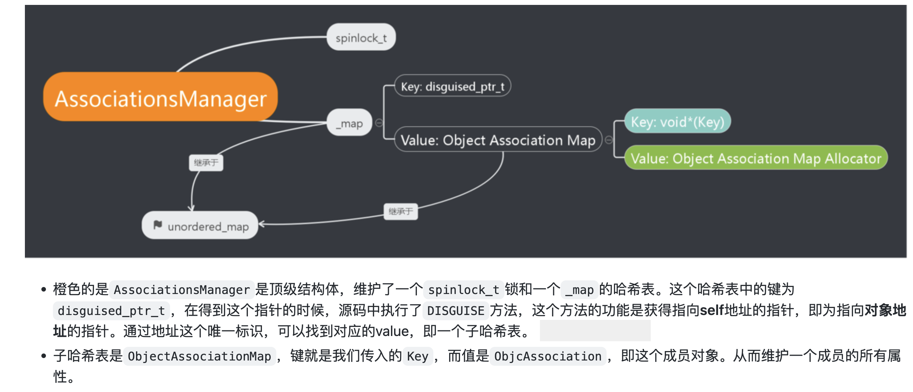
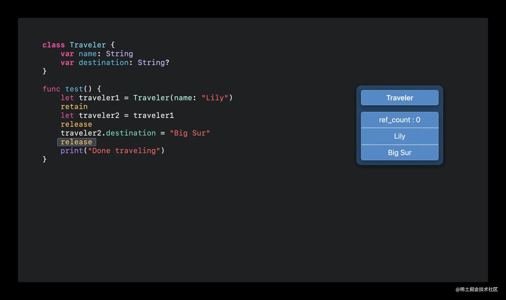

> [!TLDR]
>
> <table class="associated-summary"><thead><tr><th scope="col">函数名</th><th scope="col">函数<strong>单独</strong>的线程安全性</th><th scope="col">总体使用的线程安全性</th><th scope="col">(non)atomic 之间性能差距</th></tr></thead><tbody>
> <tr><th scope="row">setProperty</th><td>根据 policy 决定</td><td rowspan="2">根据标识符决定</td><td rowspan="2">较大</td></tr>
> <tr><th scope="row">getProperty</th><td>根据 policy 决定</td></tr>
> <tr><th scope="row">setAssociateObject</th><td>始终线程安全</td><td rowspan="2">根据标识符决定</td><td rowspan="2">较小<br></td></tr>
> <tr><th scope="row">getAssociateObject</th><td>根据 policy 决定</td></tr>
> </tbody></table>

## 起因

示例项目最近在做业务的 Model 治理，业务的 Model 总会有大量的属性是通过在 Category 中添加 AssocitedObject 来实现的。对于多个复杂场景同时使用的 Model 同步框架，就需要同时对性能与稳定性都有所考量。因此进行一些分析。


本文的分析推荐对线程安全只知其名不知其实现，或者只是抄过别人如何实现加锁解锁相关代码却不知具体原因的同学观看。网上对于 AssociatedObject 这个老八股也有很多解析，但其实没有与 Property 对应做出对比，也没有对其中到底是如何设计线程安全作出论述，理清思路还是花了很久，探寻思路供大家参考。

## Set函数

### AssociationsManager 结构



图来源于一位技术作者，图中勘误由另一位技术作者提供。


unordered\_map 是STL 函数，不自带线程安全，因此 \_map 也并不自带线程安全。

`AssociationsManager` 是靠 spinlock 实现的。也就是说 `AssociationsManager` 通过一个[自旋锁](https://en.wikipedia.org/wiki/Spinlock) `spinlock_t` 保证对 `AssociationsHashMap` 的操作是线程安全的，即**每次只会有一个线程对 AssociationsHashMap 进行操作**。这里注意，说的是 `AssociationsManager` 是线程安全的，不是说 `AssociateObject` 是线程安全的。

```cpp
class AssociationsManager {
    static spinlock_t _lock; // static，全局共用一个
    static AssociationsHashMap *_map;               // associative references:  object pointer -> PtrPtrHashMap.
public:
    AssociationsManager()   { _lock.lock(); } // 初始化函数，创建对象时调用
    ~AssociationsManager()  { _lock.unlock(); } // 析构函数，释放对象时调用
    
    AssociationsHashMap &associations() { // 必须通过实例方法去获取到 _map
        if (_map == NULL)
            _map = new AssociationsHashMap();
        return *_map;
    }
};
```

我们可以看到在创建 `AssociationsManager` 的时候就会持有锁，释放 `AssociationsManager` 的时候就会释放锁。而如果你要拿到 AssociationsHashMap 就必须要创建 `AssociationsManager` 对象。

这里给不熟悉 C\+\+ 的同学解释下，C\+\+ 可以在 Stack 上创建对象，而不用通过 `new/malloc` 的方式分配到 Heap 上。


### **RAII \&\& 锁的使用**

光这么描述可能还有些迷茫，我们接下来看 runtime 是怎么使用这把锁的。

```cpp
void _object_set_associative_reference(id object, void *key, id value, uintptr_t policy) {
    {
        // 创建AssociationsManager对象，隐含lock()，并非new的方式创建
        // 在stack上
        AssociationsManager manager;
        
        // 在manager取_map成员，其实是一个map类型的映射
        AssociationsHashMap &associations(manager.associations());
        
        // 实际set，先省略，后面会详细介绍
        
    }// C++，离开Scope就释放AssociationsManager，隐含unlock()
    
    // release the old value (outside of the lock).
    if (old_association.hasValue()) ReleaseValue()(old_association);
}
```

这个设计思路很有意思，是一种巧妙保证线程安全的方法，每个线程都要通过AssociationsManager对象去拿到实际是static的东西，通过Scope对AssociationsManager对象的释放来控制。这样就可以避免大家忘记去 unlock\(\)，或者提前 return 的时候忘记 unlock\(\) 的事情发生。


这里还有一个小细节是：并非所有操作都是在锁里完成的，可以看到对 old\_association 的释放是在锁外的。原因我们后面也会介绍到，现在只需要有个印象就行了。


这种类似的设计其实有特定的名字：**RAII**，全称**资源获取即初始化**（英语：**R**esource **A**cquisition **I**s **I**nitialization）。RAII要求，资源的有效期与持有资源的[对象的生命期](https://zh.m.wikipedia.org/w/index.php?title=%E5%AF%B9%E8%B1%A1%E7%9A%84%E7%94%9F%E5%91%BD%E6%9C%9F&action=edit&redlink=1)（英语：[Object lifetime](https://en.wikipedia.org/wiki/Object_lifetime)）严格绑定，即由对象的[构造函数](https://zh.m.wikipedia.org/wiki/%E6%9E%84%E9%80%A0%E5%87%BD%E6%95%B0)完成[资源的分配](https://zh.m.wikipedia.org/w/index.php?title=%E8%B5%84%E6%BA%90%E7%9A%84%E5%88%86%E9%85%8D&action=edit&redlink=1)（英语：[Resource allocation \(computer\)](https://en.wikipedia.org/wiki/Resource_allocation_(computer))）（获取），同时由[析构函数](https://zh.m.wikipedia.org/wiki/%E6%9E%90%E6%9E%84%E5%87%BD%E6%95%B0)完成资源的释放。在这种要求下，只要对象能正确地析构，就不会出现[资源泄露](https://zh.m.wikipedia.org/w/index.php?title=%E8%B5%84%E6%BA%90%E6%B3%84%E9%9C%B2&action=edit&redlink=1)（英语：[Resource leak](https://en.wikipedia.org/wiki/Resource_leak)）问题。


那么既然这个这么好，我们 iOS 开发能不能也整一个呢？答案是不能直接用，但可以有替代方案。


OC 是因为对象可能被加入 autoreleasepool 中，一旦被加入 pool 了，对象的释放不跟 scope 挂钩，是跟 pool 什么时候被 pop 挂钩；OC 也没有在 stack 上创建 对象的能力；OC（Swift也是） 目前使用较多的 ARC 是 基于使用情况的（use\-based），也有本质的不同。


具体解释下这个

[demo\.zip](./attachments/demo.zip)

```objective-c
// 继承只为了看什么时候调用 delloc，懒得引入 RAC 用监听了...
@interface WhenToDealloc : NSObject

@end


@implementation WhenToDealloc

- (void)dealloc {
    NSLog(@"dealloc");
}

@end

@interface ViewController ()

@end

@implementation ViewController

- (void)viewDidLoad {
    [super viewDidLoad];
    
    {
        __autoreleasing WhenToDealloc *whenToDealloc = [[WhenToDealloc alloc] init];
    }
    // dealloc when leave scope?
    
}
// dealloc when leave viewDidLoad?


- (void)viewWillAppear:(BOOL)animated {
    [super viewWillAppear:animated];
    
}
// dealloc when leave viewWillAppear?

- (void)viewDidAppear:(BOOL)animated {
    [super viewDidAppear:animated];
    
}
// dealloc when leave viewDidAppear?


@end
```


答案：离开 viewWillAppear 之后释放，viewDidLoad \&\& viewWillAppear 在一个 pool 中。


Swift 变量也不是离开 scope 才释放的，是**最后一次使用之后就不再保证存在的**，虽然实际中可能会延后释放的事件，但依赖现在的不确定延后时机去写代码是不安全的，容易随着后续的编译器优化而产生极难排查的问题。具体可以看：[【老司机精选】Swift 中的 ARC 机制: 从基础到进阶](https://juejin.cn/post/7094799538455576584/)。




当然 OC 中也有 `@onExit{}` ， Swift 中也有 `defer` 可以达到在退出 Scope 时进行一些资源释放。这个就不在这里论述了，大家很可能都使用过。

### 分析 setAssociateObject 的主路径

具体代码有删减，我们主要分析有 old\_association ，并替换新的 new\_value 的这条链路。

删减之后如下。一些边缘Case就隐藏了，有兴趣的同学可以自己去研究关于 DISGUISE 、替换/创建 AssociateObject 相关逻辑。

```cpp
void _object_set_associative_reference(id object, void *key, id value, uintptr_t policy) {
    // retain the new value (if any) outside the lock.
    ObjcAssociation old_association(0, nil);
    id new_value = value ? acquireValue(value, policy) : nil;
    {
        AssociationsManager manager;
        AssociationsHashMap &associations(manager.associations());
        disguised_ptr_t disguised_object = DISGUISE(object);
        if (new_value) {
            // 遍历链表去拿到j，j 就是一个遍历器，j->second 就是实际的对象
            ObjectAssociationMap::iterator j = findJ();
            
            // 重要逻辑
            old_association = j->second;
            j->second = ObjcAssociation(policy, new_value);
        }
        // other code
        // 包括 新建节点、删除节点等
    }
    // release the old value (outside of the lock).
    if (old_association.hasValue()) ReleaseValue()(old_association);
}
```

最重要的就是在锁内，有一个把 `old_associate` 取出，把新的 `ObjcAssociation` 赋值的步骤。这个步骤在锁内，于是保证了线程安全。

最后离开锁的区域，并释放 `old_associate` 。

那这个没有对比，我们虽然有感觉 `setAssociateObject` 中锁内的操作跟是否 `NONATOMIC` 的 policy 没有关系，但这个还不是实锤。那么我们找一个别的参考。

### 参考 setProperty 

类比下`reallySetProperty`函数，发现`reallySetProperty`还是区分 `atomic` 的操作的。但原子性的操作都是一致的，甚至包括在锁外释放old对象。

```objective-c
static inline void reallySetProperty(id self, SEL _cmd, id newValue, ptrdiff_t offset, bool atomic, bool copy, bool mutableCopy)
{
    if (offset == 0) {
        object_setClass(self, newValue);
        return;
    }

    id oldValue;
    id *slot = (id*) ((char*)self + offset);

    if (copy) {
        newValue = [newValue copyWithZone:nil];
    } else if (mutableCopy) {
        newValue = [newValue mutableCopyWithZone:nil];
    } else {
        if (*slot == newValue) return;
        newValue = objc_retain(newValue);
    }

    if (!atomic) {
        // 非原子，危险
        
        // 第一步
        oldValue = *slot;
        
        // 第二步
        *slot = newValue;
    } else {
        // 原子，安全
        spinlock_t& slotlock = PropertyLocks[slot];
        slotlock.lock();
        oldValue = *slot;
        *slot = newValue;        
        slotlock.unlock();
    }
    
    // release 对象也在锁外
    objc_release(oldValue);
}
```

我们来看下绿色跟黄色的代码，其实都是一致的，区别只是绿色的部分在锁内，黄色的没有加锁。那我们就来造一种黄色会崩溃的场景。


这里我们设计的场景是多线程对一个属性同时设置。

设想一下多线程对一个属性同时设置的情况，我们首先在线程A处获取到了执行第一步代码后的`oldValue`，然后此时线程切换到了B，B也获得了第一步后的 `oldValue`，所以此时就有两处持有`oldValue`。然后无论是 线程A 或者 线程B 执行到最后都会执行 `objc_release(oldValue)`，对同一块内存区域释放两次，就会发生崩溃。


但如果加锁了就没有这个问题了。后面拿到的 `oldValue` 已经是前面一次 `set` 设置的对象了。不存在一个对象 `release` 多次。

也就是说，`oldValue` 的设置是必须只有一个线程能同时进入的，即需要通过在锁内保证线程安全。


分析之后我们发现，对 oldValue 的 release 并不涉及竞争，那么根据锁最小原则，为了尽可能得优化性能，我们就把 oldValue 的释放放在 Block 外。


同理，`setAssociateObject` 也是一样，并且我们发现，`setAssociateObject` 只有对应 `setProperty` 中 `atomic` 的分支。那我觉得可以说明 `setAssociateObject` 方法一定是线程安全的了，我们用 demo 实际验证一下。

### 验证

这里可以做一个对比，如果你是多线程 setProperty ，是会崩的。同时崩溃的原因也与我们的分析一致，是某个对象被过度释放。

```objective-c annotated
@property(nonatomic, strong) NSMutableData *data;

for (int i = 0; i < 100000; i++) {
    dispatch_async(dispatch_get_global_queue(DISPATCH_QUEUE_PRIORITY_DEFAULT, 0), ^{
        self.data = [[NSMutableData alloc] init];
    });
}


// **error for object: pointer being freed was not allocated**。
```

但如果你是多线程 setAssocited，是不会崩的。也就验证了源码分析。

```objective-c
for (NSInteger i = 0; i < 1000000; i++) {
    dispatch_async(dispatch_get_global_queue(DISPATCH_QUEUE_PRIORITY_DEFAULT, 0), ^{
      [self setAssocitedObject:[NSObject new]];
    });
}
  
- (void)setAssocitedObject:(NSObject *)object {
  objc_setAssociatedObject(self, @selector(associtedObject), object, OBJC_ASSOCIATION_RETAIN_NONATOMIC);
}

// fine, no crash
```

这里也是一个 `setAssociateObject` 与 `setProperty` 在表现上不同。


最后我们再类比下我们正常会自己写的线程安全的 set 方法，objc\_release 方法是 ARC 帮我们自动加上的，但也是在 lock 外面的。所以我们正常的写法也是暗含这个优化逻辑在里面的。

```objective-c
- (void)setSomeString:(NSString *)aString
{
    NSString *old = nil
    @synchronized(self)
    {
        if (someString != aString)
        {
            old = someString;
            someString = [aString copy];
        }
    }
    [old release]; // 编译器会帮我们自动加上的
}
```

当然 `@synchronized` 这把锁不建议大家使用，会有很多问题，可以用别的锁。这里只是偷懒了举个例子。

## Get函数

经过上面的分析，我觉得我又行了，那分析一半我觉得是不行的，肯定也得把 get 的部分给分析了。~~于是我就翻车了，可以顺着思路一起来看我为什么会翻车。~~


首先这里我们需要看看我们熟悉的 5 个枚举在 runtime 内部是如何使用的。我们可以看到实际上会拆成 SETTTER 跟 GETTER 的结合。

```objective-c
// runtime.h
enum { 
    OBJC_ASSOCIATION_ASSIGN = 0, /**< Specifies a weak reference to the associated object. */ 
    OBJC_ASSOCIATION_RETAIN_NONATOMIC = 1, /**< Specifies a strong reference to the associated object. * The association is not made atomically. */ 
    OBJC_ASSOCIATION_COPY_NONATOMIC = 3, /**< Specifies that the associated object is copied. * The association is not made atomically. */ 
    OBJC_ASSOCIATION_RETAIN = 01401 = 0x0301, /**< Specifies a strong reference to the associated object. * The association is made atomically. */ 
    OBJC_ASSOCIATION_COPY = 01403 = 0x0303 /**< Specifies that the associated object is copied. * The association is made atomically. */ 
};

// objc-references.mm
enum { 
    OBJC_ASSOCIATION_SETTER_ASSIGN = 0, 
    OBJC_ASSOCIATION_SETTER_RETAIN = 1, 
    OBJC_ASSOCIATION_SETTER_COPY = 3, // NOTE: both bits are set, so we can simply test 1 bit in releaseValue below. 
    OBJC_ASSOCIATION_GETTER_READ = (0 << 8), 
    OBJC_ASSOCIATION_GETTER_RETAIN = (1 << 8), 
    OBJC_ASSOCIATION_GETTER_AUTORELEASE = (2 << 8) 
}; 
```

因此我们可以从枚举处得到：

`OBJC_ASSOCIATION_RETAIN_NONATOMIC` == `OBJC_ASSOCIATION_SETTER_RETAIN`

`OBJC_ASSOCIATION_RETAIN` == `OBJC_ASSOCIATION_SETTER_RETAIN` \| `OBJC_ASSOCIATION_GETTER_RETAIN` \| `OBJC_ASSOCIATION_GETTER_AUTORELEASE`。

也就是说 `OBJC_ASSOCIATION_RETAIN` 相比  `OBJC_ASSOCIATION_RETAIN_NONATOMIC` 多了 `GETTER_RETAIN` 与 `GETTER_AUTORELEASE`。

这里可以发现在枚举的语义中。是否 `NONATOMIC`，在 `SETTER` 没有任何差别，只是在 `GETTER` 中有所差别。这个也符合我们前面的分析。


然后我们再看get的代码：

```cpp
id _object_get_associative_reference(id object, void *key) {
    id value = nil;
    uintptr_t policy = OBJC_ASSOCIATION_ASSIGN;
    {
        // lock()
        AssociationsManager manager;
        AssociationsHashMap &associations(manager.associations());
        disguised_ptr_t disguised_object = DISGUISE(object);
        AssociationsHashMap::iterator i = associations.find(disguised_object);
        if (i != associations.end()) {
            ObjectAssociationMap *refs = i->second;
            ObjectAssociationMap::iterator j = refs->find(key);
            if (j != refs->end()) {
                ObjcAssociation &entry = j->second;
                value = entry.value();
                policy = entry.policy();
                if (policy & OBJC_ASSOCIATION_GETTER_RETAIN) ((id(*)(id, SEL))objc_msgSend)(value, SEL_retain); // retain 一次，锁内
            }
        }
        // unlock()
    }
    if (value && (policy & OBJC_ASSOCIATION_GETTER_AUTORELEASE)) {
        ((id(*)(id, SEL))objc_msgSend)(value, SEL_autorelease); // autorelease 一次，锁外
    }
    return value;
}
```

### 错误结论的得出

上面我标黄了 `ATOMATIC` 会额外运行的两行代码，一次锁内的 `retain`，一次锁外的 `autorelease` 。

整体从 AssociationsManager 中获取具体值的操作也都在锁内，感觉没啥不安全的。

同时由于分析 Set 函数的时候，我们考虑了 **多个线程同时 Set** 的情况，这里我也设想了 **多个线程同时 Get** 的情况，分析后觉得没什么 Bad Case。~~不要笑，当时我确实绕进去了，这里实际应该考虑的是 ~~**~~多个线程同时Set Get~~**~~ 的场景~~。


但是很明显，我们写一段代码同时有 Set ，有 Get 就会发现情况不对，实际上是会崩溃的。因此我们从结论倒推，来分析下原因。

### 更正错误

我们来简化一下 getAssociateObject 的代码。

atomic 的 的标识符会多走：一次retain，一次autorelease。

这里会有几个问题

1. 拿到 value 是在锁内，那为啥不是线程安全的？一般我们的 get 函数不都是拿到 value，再return？~~这锁难道不保熟？~~

2. 从结果倒推，加了 retain 跟 autorelease 就能保证线程安全，这是为什么？

3. 为什么 autorelease 可以放在锁外不用放在锁内？


#### 参考 getProperty

要理解这个问题，我们需要先回到正常get属性的时候，看看getProperty的实现

```objective-c
id objc_getProperty_non_gc(id self, SEL _cmd, ptrdiff_t offset, BOOL atomic) {
    if (offset == 0) {
        return object_getClass(self);
    }

    // Retain release world
    id *slot = (id*) ((char*)self + offset);
    // nonatomic，直接return
    if (!atomic) return *slot;
    
    // Atomic retain release world
    spinlock_t& slotlock = PropertyLocks[slot];
    slotlock.lock();
    id value = objc_retain(*slot);
    slotlock.unlock();
    
    // for performance, we (safely) issue the autorelease OUTSIDE of the spinlock.
    return objc_autoreleaseReturnValue(value);
}
```

我们可以看到，get在 `nonatomic` 时候，是不加锁的，直接拿到就返回。~~这句`Retain release world`的注释我至今没读懂是什么意思。~~


但是在 `atomic` 的时候，先加锁，再 retain ，解锁，再 autorelease 。是不是跟\_object\_get\_associative\_reference 有点像啊？


set 的时候，我们分析 bad case 的时候是用 同时有 多个set 的，但分析 get 的时候，不能分析有多个 get ，因为没有修改，本来就没问题。所以我们应该是思考 set 跟 get 混用的情况。


因此我们先分析 get\_property 的时候，为什么要 retain \(锁内\) \+ autorelease \(锁外\)。如果我只是加锁，不retain \+ autorelease 会发生什么？

```objective-c annotated
// wrong 实现
id objc_getProperty_non_gc(id self, SEL _cmd, ptrdiff_t offset, BOOL atomic) {
    // Retain release world
    id *slot = (id*) ((char*)self + offset);
    
    // Atomic retain release world
    spinlock_t& slotlock = PropertyLocks[slot];
    slotlock.lock();
    ~~id value = objc_retain(*slot);~~
    id value = *slot; // instead
    slotlock.unlock();
    
    ~~// for performance, we (safely) issue the autorelease OUTSIDE of the spinlock.~~
    ~~return objc_autoreleaseReturnValue(value);~~
    
    return value; // instead
}
```

我们由此可以发现，**getter 需要在锁内进行提前的 retain，防止 setter 提前对 oldValue 调用 objc\_release\(\) 。**因此解答了为什么单单加锁，不能保证线程安全。


### 得到结论

我们再回到 get\_assciate 的方法，不管是不是atomic的，都加锁了。但加锁还不能保证安全。**因此单看 get\_assciate 方法会有错觉，感觉是 retain \+ autorelease 方法保证了线程安全，其实不是的。两个因素加起来才能保证。**


因此这就可以回答上面三个问题了。

1. 为什么要在get的时候 retain \+ autorelease，因为不这样会崩，release可能会走到 retain 前面。

2. 那为什么 retain 必须在锁内，autorelease 可以在锁外？因为 get 拿到value之后，必须在 set 方法 objc\_release 之前调用 retain，不然还是崩。**同时这里就算是 nonatomic 也需要加锁是为了防止多线程操作写坏 AssociationsHashMap 。**

3. for performance，锁最小原则。


~~所以 property 的 get 更暴力一些，演都不演了直接 return了。~~正因如此，property的 nonatomic/atomic 之间性能差距较大，而 AssociateObject 的就差距不这么大，正常使用也不会有太多性能问题。


分析完毕。~~因此一开始我就在思考为什么 retain \+ autorelease 方法能保证线程安全属实是把我自己绕进去了。~~通过分析 property 的 get/set 有助于我们更好的理解 AssociateObject 的 get/set。


## 研究线程安全的通用方法

研究 set 方法时，需要考虑同时多个线程 set，也可以 set 的同时 有 get。

研究 get 方法时，则一定不能考虑多个线程同时 get，因为这个是没有实际操作意义的，应该考虑 get 的同时也有 set 操作。

## 结论

> 只set，不get，是正常的，不会崩。~~但这个不符合实际，~~不get你存他干什么。
> 
> 不set，疯狂get，是正常的。~~但这个其实也是不符合实际，~~不加锁也是能保证的。
> 
> 又set，又get，由于get不是线程安全的（如果你的标识符号是 NONATOMIC ），会崩；又set，又get，get是线程安全的（如果你的标识符号是 ATOMIC ），不会崩。
> 
> 


不论你的标识符是 `OBJC_ASSOCIATION_XXX_NONATOMIC` 还是 `OBJC_ASSOCIATION_XXX` ，`objc_setAssociatedObject` 函数都是 线程安全 的；但是 `objc_getAssociatedObject` 函数则是根据你的标识符来决定是否是 线程安全 的。

使用 AssocitedObject 时根据业务场景决定是否使用对应标识符，毕竟使用时又有 set 又有 get 才是常态，单独看 set 或者 get 不具有实际意义。


Property的 \(non\)atomic 之间性能差距较大，而 AssociateObject 的 \(non\)atomic 之间就差距不大，正常使用也不会有太多性能问题。


最后关于 AssociatedObject/Property 相关的源码其实还有很多知识，例如 StripeMap  等等，其实都很有意思，搞清楚这些更多是带来自己探索问题的思路，一个个相对独立的知识点的学习其实只是知识的积累，还是要掌握自己学习探索的方式，如果单纯看一个函数想不通原因，可以寻找别的类似机制的函数做参考，往往能够获得突破。


## 参考资料

[浅谈Associated Objects](https://github.com/Desgard/iOS-Source-Probe/blob/master/Objective-C/Runtime/%E6%B5%85%E8%B0%88Associated%20Objects.md)

[关联对象 AssociatedObject 完全解析](https://draveness.me/ao/)

https://opensource.apple.com/source/objc4/objc4-532/runtime/objc-references.mm.auto.html

https://stackoverflow.com/questions/29934289/objc-setassociatedobject-retain-atomic-or-nonatomic

[【老司机精选】Swift 中的 ARC 机制: 从基础到进阶](https://juejin.cn/post/7094799538455576584/)

https://en.wikipedia.org/wiki/Spinlock

