> [!TLDR]
>
> 1. 记录了一次疑难杂症的分析，走了不少弯路，排查疑似系统行为\(dyld\)的 bug 时，还是需要通过有问题的 OS 进行 Trace 分析，避免不同 OS 行为导致的错误排查方向。最后由一位同事提供了通用的解决方案。
>
> 2. 新安装/更新 App 时的首次打开线上监测较少，尤其本次 Case 还未走到任何业务代码故而从 App 自监控角度极难发现，最后还是依赖苹果的跨进程监控确定影响范围。对于这类情况我们将补齐线下的持续性能防劣化。对于用户体验来说，任意情况的 App 打开失败都是完全不可接受的。
>
> 3. 可以想见当包大小持续增长时，会面临低端机始终无法在 20s 内完成 Build Closure 的严重问题，因此包大小的治理还是有必要的。

## 背景

某次版本更新后，示例 App A iOS 站外 **打不开App** 类反馈激增 ，一段时间后量级有所回落，但整体量级  仍高于正常水平。


通过分析站外反馈评论内容，比较明显的聚合特征为：

- 地区：部分地区

- 机型：低端机 \( iPhone 6、iPhone 6s、iPhone 7、 iPad mini 4、iPad Air 2、iPad 3 \)

- 系统：15\.7\.x、15\.8\.x

结合用户数据来看，反馈较多的地区低端机占比较高，然后iPhone6、iPhone7这些低端设备能升级到的最高系统就是15\.8\.x，可以总结为：**某次版本更新后，低端机型 \( iPhone6、iPhone 6s、iPhone7等 \) 打不开App的概率变高**。


## 初步排查

因为站外反馈除了App Store评论内容拿不到任何其他信息，所以一位同事只能通过旁路手段尝试锁定根因：

1. \( 正常崩溃/卡死的情况 \) 从Monitor后台查看 启动阶段/非启动阶段 \+ 特定机型/特定区域 \+ 崩溃/卡死/OOM/MetricKit 数据 是否有上涨

2. \( 连续崩溃/卡死 触发容灾框架的情况 \) 从Monitor后台查看 安全模式 上报数据 是否上涨

3. \( 过早连续崩溃/卡死 容灾框架感知不到的情况 \) 从分析平台查看 特定版本 \+ 特定机型/特定区域 用户数据 是否有下跌

4. QA 使用 特定机型 \+ 特定版本 尝试复现


通过各种数据平台分析后，均无明显异常；最后在 QA 通过一台 iPhone 6s 的设备 安装 示例 App A 某个版本 AppStore 包后 复现：首次启动时 直接卡死，第二次启动正常。


通过导出该设备 Apple ips 分析：[启动堆栈 01（脱敏诊断摘录）](./attachments/attachment-01.json)[启动堆栈 02（脱敏诊断摘录）](./attachments/attachment-02.json)。

```text
Termination Reason: FRONTBOARD 2343432205 
<RBSTerminateContext| domain:10 code:0x8BADF00D explanation:process-launch watchdog transgression: application<com.example.comparison>:652 exhausted real (wall clock) time allowance of 20.00 seconds

WatchdogCPUStatistics: (
"Elapsed total CPU time (seconds): 24.920 (user 24.920, system 0.000), 60% CPU",
"Elapsed application CPU time (seconds): 18.756, 45% CPU"
) 


Triggered by Thread:  0

Kernel Triage:
VM - Fault hit memory shortage
VM - Fault hit memory shortage
VM - Fault hit memory shortage
VM - Fault hit memory shortage
VM - Fault hit memory shortage


Thread 0 name:   Dispatch queue: com.apple.main-thread
Thread 0 Crashed:
0   libobjc.A.dylib                              0x19828f998 prepareMethodLists(objc_class*, method_list_t**, int, bool, bool, char const*) + 156
1   libobjc.A.dylib                              0x198297228 realizeClassWithoutSwift(objc_class*, objc_class*) + 1504
2   libobjc.A.dylib                              0x198297228 realizeClassWithoutSwift(objc_class*, objc_class*) + 1504
3   libobjc.A.dylib                              0x198296e14 realizeClassWithoutSwift(objc_class*, objc_class*) + 460
4   libobjc.A.dylib                              0x198293ffc map_images_nolock + 5012
5   libobjc.A.dylib                              0x198294700 map_images + 120
6   dyld                                         0x10461a494 invocation function for block in dyld4::RuntimeState::setObjCNotifiers(void (*)(unsigned int, char const* const*, mach_header const* const*), void (*)(char const*, mach_header const*), void (*)(char const*, mach_header const*)) + 252
7   dyld                                         0x1046182e4 dyld4::RuntimeState::withLoadersReadLock(void () block_pointer) + 60
8   dyld                                         0x1046285b8 dyld4::RuntimeState::setObjCNotifiers(void (*)(unsigned int, char const* const*, mach_header const* const*), void (*)(char const*, mach_header const*), void (*)(char const*, mach_header const*)) + 76
9   dyld                                         0x10461de4c dyld4::APIs::_dyld_objc_notify_register(void (*)(unsigned int, char const* const*, mach_header const* const*), void (*)(char const*, mach_header const*), void (*)(char const*, mach_header const*)) + 92
10  libobjc.A.dylib                              0x198291844 _objc_init + 1544
11  libdispatch.dylib                            0x18073744c _os_object_init + 20
12  libdispatch.dylib                            0x1806e529c libdispatch_init$VARIANT$mp + 336
13  libSystem.B.dylib                            0x1be5867b8 libSystem_initializer + 204
14  dyld                                         0x10461c124 invocation function for block in dyld4::Loader::findAndRunAllInitializers(dyld4::RuntimeState&) const + 152
15  dyld                                         0x10464c020 invocation function for block in dyld3::MachOAnalyzer::forEachInitializer(Diagnostics&, dyld3::MachOAnalyzer::VMAddrConverter const&, void (unsigned int) block_pointer, void const*) const + 332
16  dyld                                         0x104619eec invocation function for block in dyld3::MachOFile::forEachSection(void (dyld3::MachOFile::SectionInfo const&, bool, bool&) block_pointer) const + 520
17  dyld                                         0x104619210 dyld3::MachOFile::forEachLoadCommand(Diagnostics&, void (load_command const*, bool&) block_pointer) const + 160
18  dyld                                         0x104618570 dyld3::MachOFile::forEachSection(void (dyld3::MachOFile::SectionInfo const&, bool, bool&) block_pointer) const + 164
19  dyld                                         0x1046250e4 dyld3::MachOAnalyzer::forEachInitializer(Diagnostics&, dyld3::MachOAnalyzer::VMAddrConverter const&, void (unsigned int) block_pointer, void const*) const + 376
20  dyld                                         0x104621e10 dyld4::Loader::findAndRunAllInitializers(dyld4::RuntimeState&) const + 144
21  dyld                                         0x104619c00 dyld4::PrebuiltLoader::runInitializers(dyld4::RuntimeState&) const + 40
22  dyld                                         0x104640884 dyld4::APIs::runAllInitializersForMain() + 44
23  dyld                                         0x10462dc5c dyld4::prepare(dyld4::APIs&, dyld3::MachOAnalyzer const*) + 2620
24  dyld                                         0x10462c4b0 start + 412

```

有几个明确的线索：

1. 被杀原因很明确是因为超过了 20s 的上限

2. CPU 未打满，并非死循环发生的接近 100%

3. 出现多次 VM \- Fault hit memory shortage 警告，缺虚拟内存了

4. 崩溃时堆栈正在 dyld 启动闭包


因此两位同事初步判断是 VM 内存不够，叠加新安装包首次启动时，所有 TEXT/DATA Page 全都是 Cold Page ，需要大量 Page In 和 Page Purge，导致频繁出现 IO 交换，导致低端机超过了 20s 的阈值。而且其中，最主要的因素应该就是 AppCore 太大了（当时已经到了较大的体积）。

但这又遇到一个无法解释的问题是，示例 App B的  ComparisonAppCore 已经到达了 更大的体积 ，但是经过测试，示例 App B并未出现同样的现象。也就是仅仅以二进制过大不足以解释问题。还有更直接的原因。


## Dyld 的一些前置知识

dyld closure 构建一般发生在 App 更新后。在构建完成后，后续的启动是直接使用构建完成的 closure 进行启动，因此体感就会变快很多。

而我们一般测试的冷启动数据指的就是在 closure 完成构建之后的数据。有一个很简单的判断本次启动是否使用了 closure 的方式就是看 dyld 的堆栈。


Build Closure 的核心堆栈如下，搜索 `dyld4::PrebuiltLoaderSet::makeLaunchSet` 即可辅助判断。

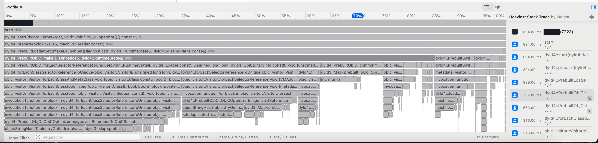

Fixup 分两种，主要看是哪个方法的 applyFixups 就行。

|读预先算好的结果（已有 Closure）|运行时现算（未有 Closure）|
|---|---|
|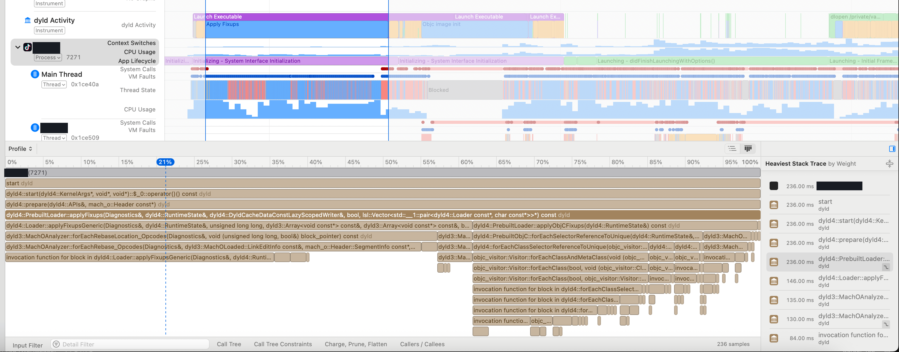<br>|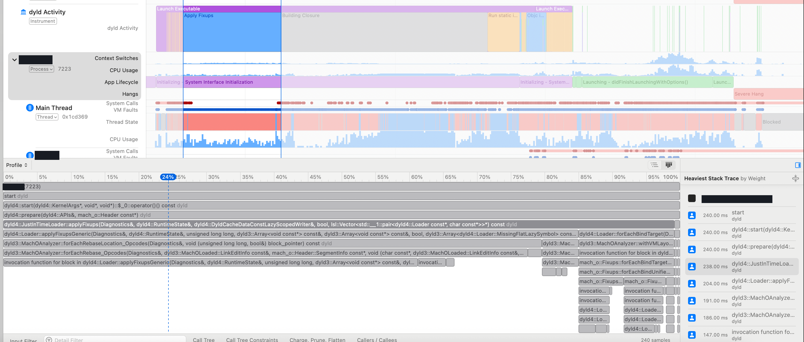<br>|
|<code>dyld4::<strong>PrebuiltLoader</strong>::applyFixups</code>|<code>dyld4::<strong>JustInTimeLoader</strong>::applyFixups</code>|


## 详细排查开始

由于示例 App B能够正常启动，因此怀疑是否是 示例 App A 在启动时有特别的耗时逻辑。


### 直观对比启动性能

使用手边的一台 iPhone 13 Pro Max\(iOS 18\) 进行测试。可以看到不论是首次启动还是第二次启动，示例 App A 的耗时数据与 PageIn 数据都优于示例 App B。难以从性能的角度解释为什么只有 示例 App A 会有这个问题。

|示例 App B|首次启动 Build|第二次启动 （已经 build 完成）|
|---|---|---|
|dyld|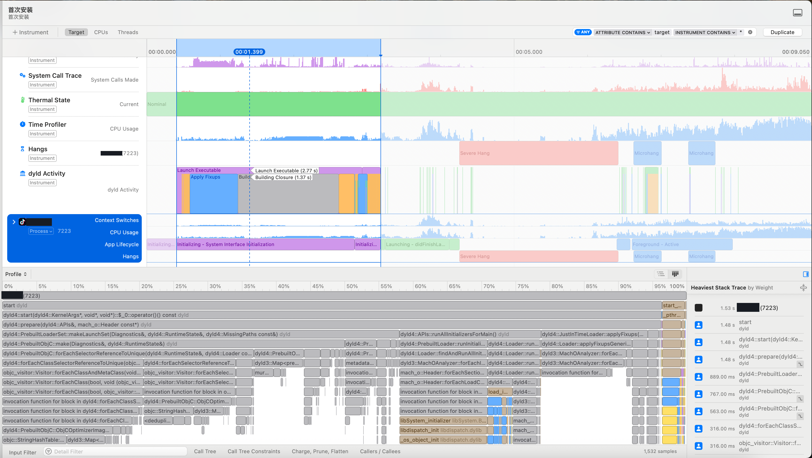<br>Dyld 有 build closure 。<br>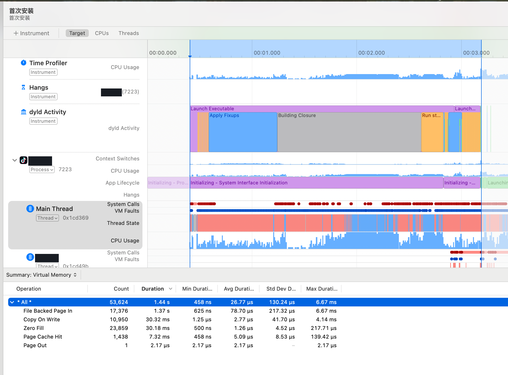<br>|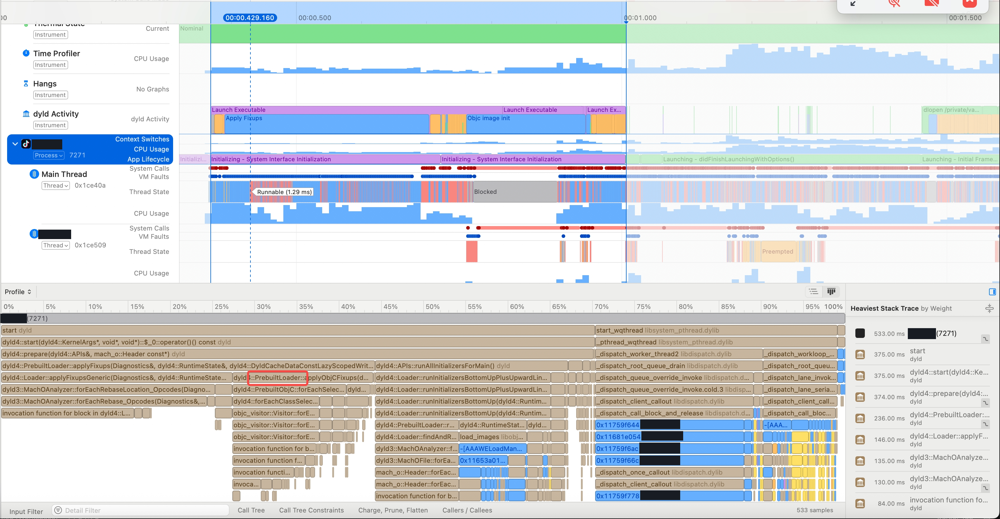<br>已经完成 closure 。<br>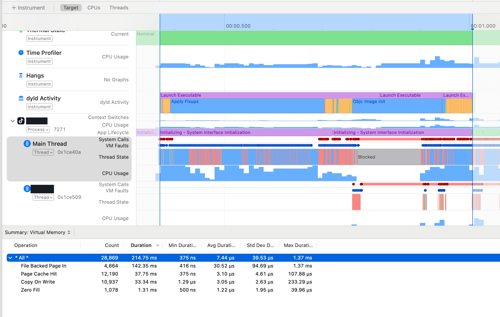<br>|
|总 Page 次数|较高|较低|


|示例 App A|首次启动 Build|第二次启动 build 已完成|
|---|---|---|
|<br>|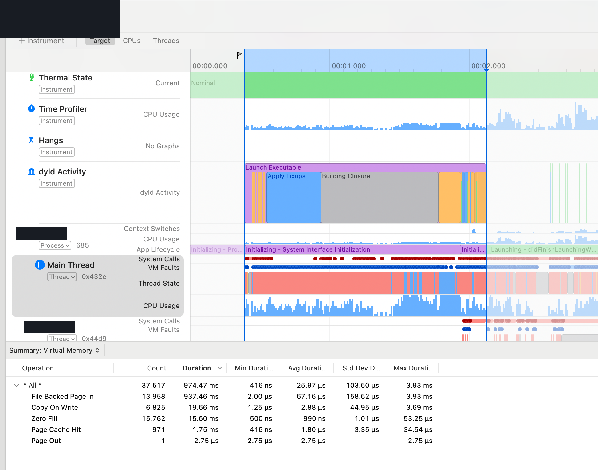<br>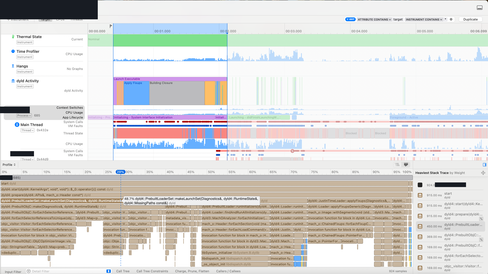<br>|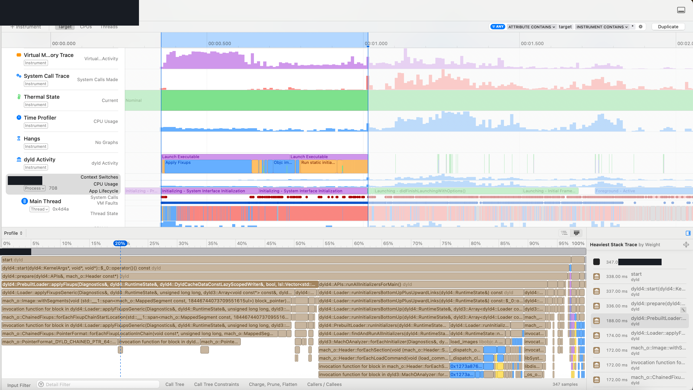<br>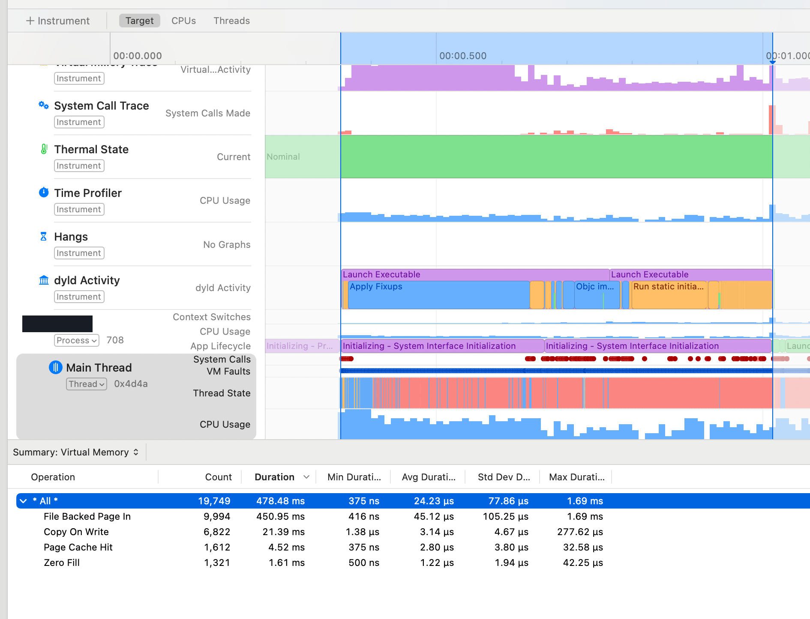<br>|
|总 Page 次数|较高|较低|


无奈之下只得进行类似二分的排除探索。

### 是否跟 chained fixup / relative method 有关系？

示例 App B未开，示例 App A 开了。

> 一位同事提示：示例 App B的method list都是常驻内存的


把 示例 App A 的也降回去。

直接降 min OS 无法走通，会有 Compile Error 😭。

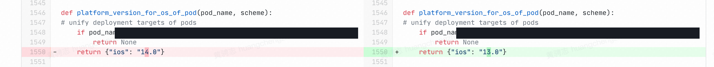

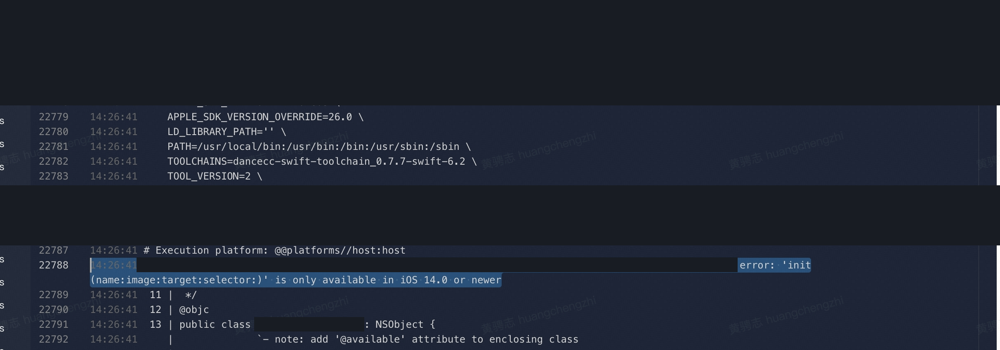

只能更换 ld 参数，额外增加参数强制关闭

```bash
-Wl,-no_objc_relative_method_lists
-Wl,-no_fixup_chains
```

需要注意，这个跟回到 iOS 13 还是有一些（小）区别的，因为不能阻止 Compiler 生成 relative 。


测试后依旧还会崩溃，无关。


[启动堆栈 03（脱敏诊断摘录）](./attachments/attachment-03.json)

[启动堆栈 04（脱敏诊断摘录）](./attachments/attachment-04.json)

[启动堆栈 05（脱敏诊断摘录）](./attachments/attachment-05.json)

[启动堆栈 06（脱敏诊断摘录）](./attachments/attachment-06.json)


### 是否与 TEXT 段超过阈值有关？

直接从 \_\_objc\_methlist 迁移到 \_\_DATA\_CONST 中。

添加 Linker 参数：\-Wl,\-rename\_section,\_\_TEXT,\_\_objc\_methlist,\_\_DATA\_CONST,\_\_objc\_methlist

无法规避，依旧还会崩溃。

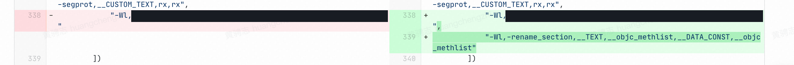


[启动堆栈 07（脱敏诊断摘录）](./attachments/attachment-07.json)


### 线上包二分排查范围

较早版本：无问题

某次更新后的版本：有问题


因此问题出现在 相邻两个版本之间，对比 示例 App B 包，唯一较大的是 swift metadata 。但这应该也不足以出现这么大的变化。


因此可以看到线上从 较早的版本即有此问题，但是线上反馈激增是从后续版本开始。一位同事 补充线上反馈之所以 后续版本激增可能原因是 后续版本的发布节奏不同，因此反馈激增。


[段与节的差异分析（脱敏过程记录）](./attachments/attachment-08.md)

### 更换 iOS 15 设备重新录制 Trace

无奈之下，请教了 一位同事，给出了关键的线索：dyld 在老 OS 的实现有缺陷，iOS 18 修复了对应的问题，因此老 OS 的表现可能不同，不能使用 iOS 18 的表现推测老 OS 的表现。

> TL;DR: The slowness was Bob Jenkins' 1996 trial\-and\-error perfect\.c generator running single\-threaded at closure\-build time — up to 2048 full re\-hashes of every selector string per table\-size attempt, **with a near\-100% load factor and a deliberately crippled augmenting\-path search causing whole\-table restarts**\. **It's gone as of dyld\-1231\.3 \(iOS 18\.0 / macOS 15\.0\)**, which dropped perfect hashing from the launch path entirely in favor of a serialized ordinary hash map\.


> 4. Game the load factor \(the binary\-tweak option\)

> Capacity is smax = 1 \<\< ceil\(log2\(n\)\) \(common/PerfectHash\.cpp:756\), so load factor swings 50–100% depending on where your unique\-not\-in\-cache selector count n falls\. Just below a power of two is the pathological zone: at \~100% load the depth\-1\-only augment \(common/PerfectHash\.cpp:506\) fails constantly, burning RETRY\_PERFECT\-then\-double\-blen cycles and potentially a full findhash failure — after which make\_perfect doubles smax anyway \(common/PerfectHash\.cpp:759\) and finally converges at \~50% load\.


> So: compute n offline \(unique \_\_objc\_methname strings across launch images, minus the target OS shared cache's selector set — dumpable with dyld\_shared\_cache\_util or ipsw dyld objc\)\. If n sits within a few percent below a 2^k boundary, add dummy unique selectors to cross it — a padding category with generated method names is enough\. That pre\-doubles smax, skipping the thrash phase entirely\. Conversely, if a selector\-stripping pass would land you just below a boundary, don't stop there\. Same logic applies \(with smaller stakes\) to the class\-name table\.


> credit: 辅助分析工具


重新找到合适的设备录制 Trace 。

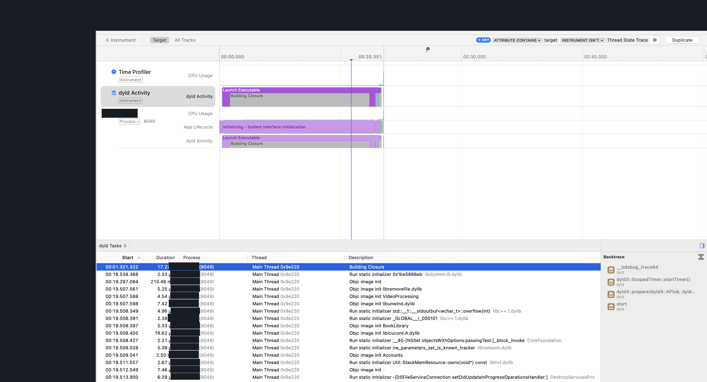

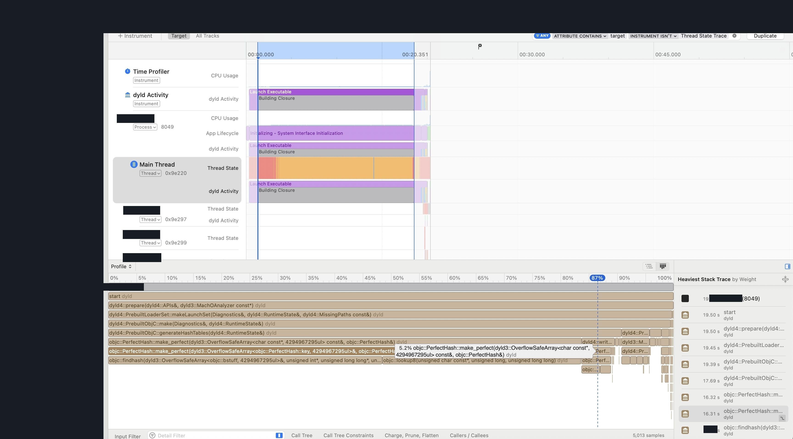

明确耗时是 Build Closure 阶段。已经非常极限接近 20s 的界限了，如果超过 20s 的界限，则无法 Build Closure 成功，也就彻底无法启动了。所幸本次并未发生，不然就是更严重的线上事件了。


至此，病因明确，AppCore 的 selector 数量叠加系统 dyld cache 中的 selector 数量接近 Hash 表的极限，就导致性能出现明确劣化，具体来说就是首次的 Hash 结果会被抛弃，并重新构建，约等于构建了两次，并且第一次的性能非常差。

而示例 App B的数量已经越过了 2^k ，即只创建了一次，因此没有对应问题。


## 实锤修复

既然问题已经明确，那么方案也就明确了，只需要我们手动塞入虚假的 Fake SEL ，让 dyld 从 2^k 开始构建 Hash 表即可。

这里还有一次失误，AI 一开始告诉我们目标是需要凑到 0\.8 的负载系数是最优的，因此我们需要额外塞入 较多 个 SEL 。

为了防止拖慢 Compile 速度影响 CI/本地 出包速度，选择直接上汇编，并且为了规避单文件过大，因此进行拆分文件。

```bash
python3 gen_fake_sel_asm.py 10000
```

[gen\_fake\_sel\_asm\.py](./attachments/attachment-09.py)

应用修复方案后。包大小劣化 一定体积 ，但 Build Closure 耗时显著缩短。

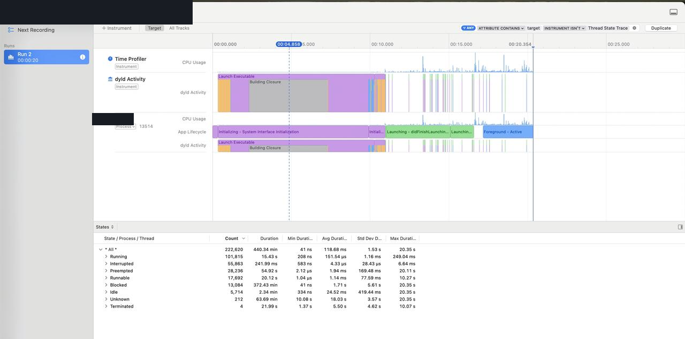


因此完成总结，本质上是用包大小去置换这部分低端机用户的首次启动性能，但由于首次启动 crash 也是完全不可接受的极差体验，因此我们认为这部分损失是完全可接受的。


### 追求极致

需要说明的是，之前这是基于 make\_perfect 单一函数的最优性能，并非全局的最优性能。并且增加的 Fake SEL 数量越多，即使在后续已经完成 Build Closure 后，也依旧会在 applyFixup 时有微弱的性能影响，因此一位同事提出对 Fake SEL 的数量进行进一步测试，找到最适合的 sweet point 。


同时还发现正确的目标不应该是凑到 0\.8 ，同时也不是凑到 0\.6 ，正确的目标是在最小代价下把 make\_perfect 次数降到尽可能小，满足各个 OS 的条件。

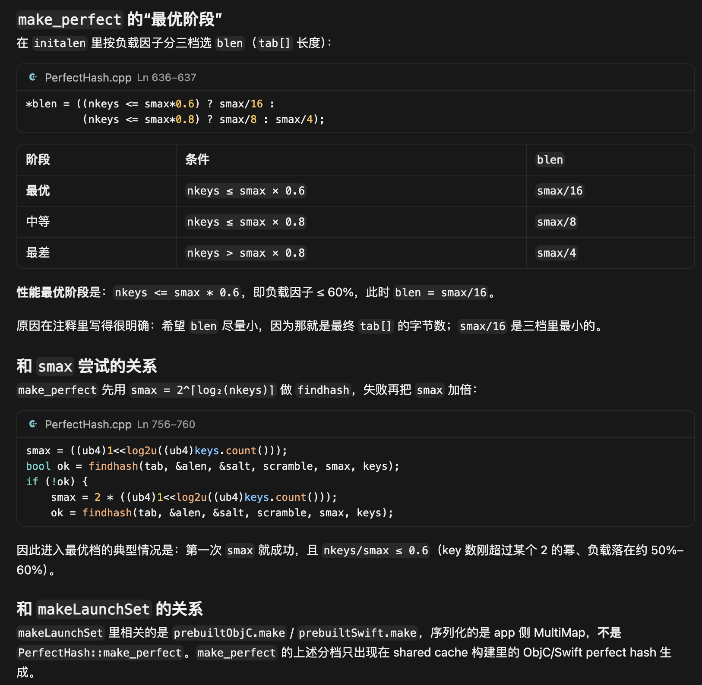


经过最后测试得到结果，注入 较少 SEL 后，首次安装效果最优，同时对于后续冷启动也最优。

一位同事和 一位同事测试，对于新用户首次安装效果明显。最后选取 修复方案。


> 


后续，一位同事额外提供了长期的解决方案，通过提供单独的二进制，并自动根据 iOS \[14, 17\] 的 dyld cache 计算雨露均沾所有 OS 的 Fake SEL 数量，并自动每个版本生成对应数量的二进制集成，彻底解决这一类问题，至此问题得到完满解决。
