> [!TLDR]
>
> 1. 提供了快速且无侵入的 dispatch\_async 到 Main Queue 的能力
>
> 2. 提供了线上获取 Main Queue Pending Blocks 监控的能力
>
> 3. 提供了一个能够本地 Preprocess 展开宏，方便探究 GCD 里的更多细节，欢迎大家与我们交流！

## 背景

在历史的数次实验中，我们发现在某些特殊的阶段（资源紧张）中，从资源发起调度到最终执行，期间会有一定的延时，这是一个有优化空间的点。


举个具体的例子来说，在冷启动时，会有大量的任务 dispatch\_block\_t（后续简称为 Block） 被 dispatch\_async 到 main queue 中，由于 main queue 是一根 serial queue ，并且会按先添加先执行的顺序执行。也就是说，没有一个按优先级取出执行的逻辑，而 GCD 又是一个过于基础的通用框架，任何业务方都可能有自己的诉求执行一次 dispatch\_async 到 main queue 中的任务提交，定位有问题的 Block 并进行更改的 ROI 过低。


下面是一个示意图，我们假设 Block 3 就是接到请求后，希望 dispatch\_async 到 main queue 的重要 Block ，但是由于前置有别的业务在各处提交一些零散的耗时，实际执行 Block 3 时已经距离提交时过去了不少时间。某些特殊情况下，这样的等待会影响用户的体验，甚至吃掉一些优化的效果。

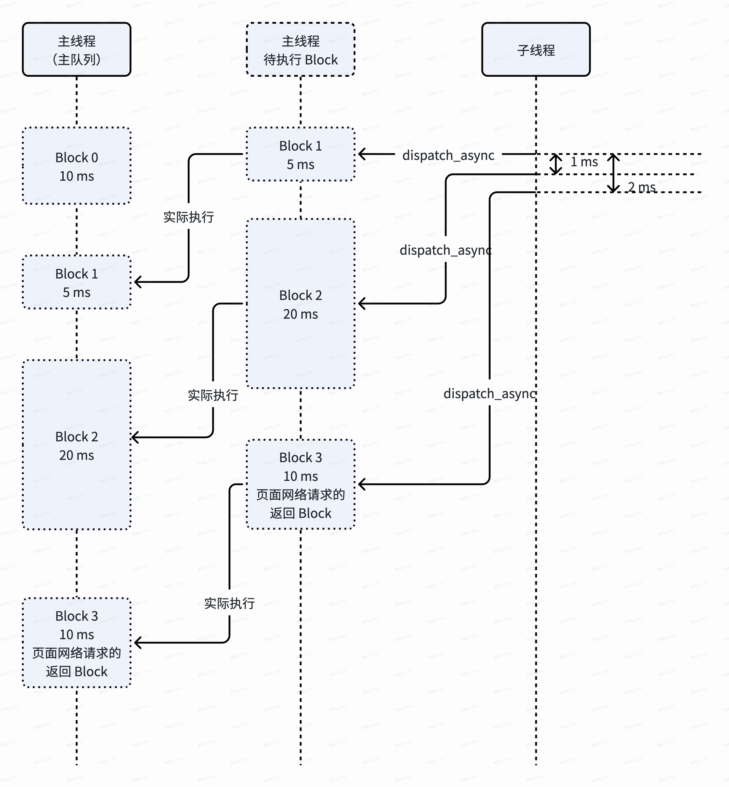

上面的示意图可能不甚直观，我们来一个具体的场景。例如冷启动阶段，有大量在 main queue 中排队执行的 Block，有的跟首屏 Feed 业务有关，有的则完全无关。当首屏数据请求接口返回后，从子线程重新提交至主线程刷新页面时，就有可能排队等待较长时间。在此前的实验中，我们发现虽然网络接口返回本身有一定的速度提升，但体现在业务 main queue 中的埋点却完全没有收益——分析后发现，这部分网络侧省下来的时间全被繁忙的主线程排队吃掉了。


因此我们可以得到一个初步结论，在主线程繁忙的阶段，资源的阻塞点不仅在网络带宽，还在主线程的繁忙中。只有让特定 Block 更快得被响应，才能让网络带宽的收益真正落地。

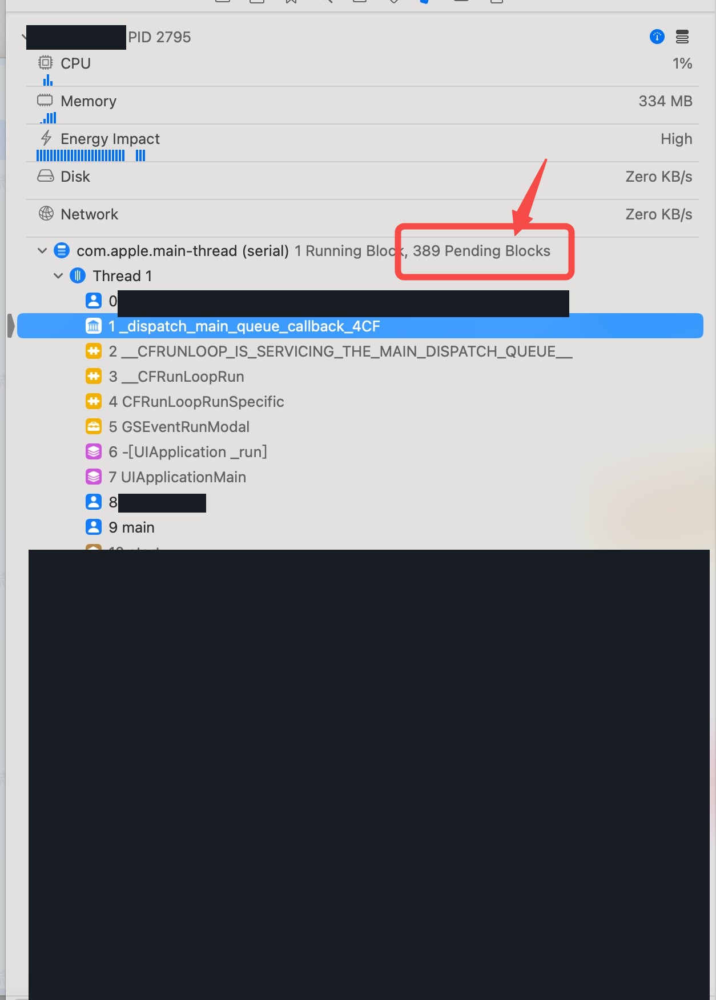

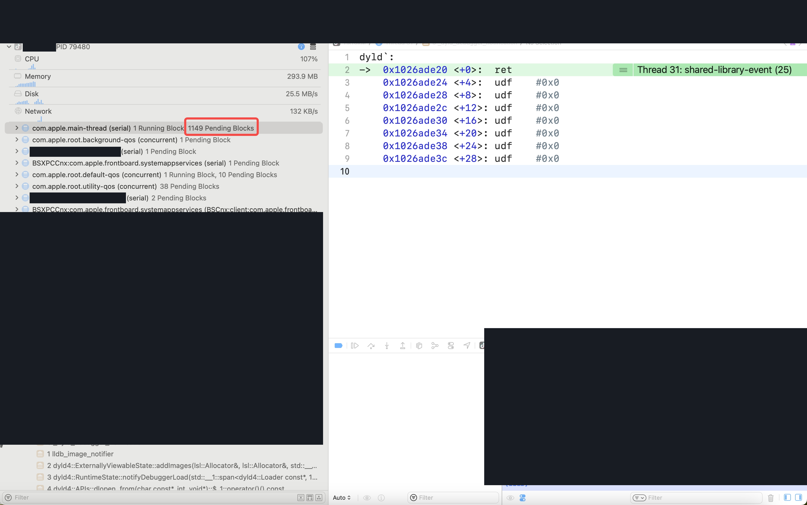


后续了解到兄弟团队也有解决类似排队问题的方案，但需要业务方侵入式修改调用代码。

## 实现方案

由于 GCD 的管理比较封闭，并且有较多核心逻辑是没有 export Extern 函数的，这意味着我们很难通过 Hook 对其进行行为的变更，并且这本身也是一个相对危险的行为。因此如果一个 Block 已经被提交给 GCD 后，我们就很难再对其进行处理。


我们翻看 GCD 源码时发现，GCD 对 root queue 有 observer\_hooks 的设计，在执行被提交到 root queue 的 Block 前后，会从 TLS 中取出 observer\_hooks ，然后发出回调。目前 main queue 的回调并未被注册，因此我们可以注册，然后在回调中执行一些类似插队的策略。

```objective-c
// static const unsigned long dispatch_pthread_root_queue_observer_hooks_key =
        __PTK_LIBDISPATCH_KEY4;
// https://github.com/rweichler/substrate/blob/master/include/pthread_machdep.h#L93C1-L93C35
// #define __PTK_LIBDISPATCH_KEY4                24

DISPATCH_ALWAYS_INLINE_NDEBUG
static inline void
_dispatch_continuation_pop_inline(dispatch_object_t dou,
        dispatch_invoke_context_t dic, dispatch_invoke_flags_t flags,
        dispatch_queue_class_t dqu)
{
    dispatch_pthread_root_queue_observer_hooks_t observer_hooks =
            _dispatch_get_pthread_root_queue_observer_hooks(); // 从 TLS 中获取注册的 hooks
    if (observer_hooks) observer_hooks->queue_will_execute(dqu._dq); // 调用 will
    flags &= _DISPATCH_INVOKE_PROPAGATE_MASK;
    if (_dispatch_object_has_vtable(dou)) {
        if (dx_type(dou._do) == DISPATCH_SWIFT_JOB_TYPE) {
            dx_invoke(dou._dsjc, NULL,
                    _dispatch_invoke_flags_to_swift_invoke_flags(flags));
        } else {
            dx_invoke(dou._dq, dic, flags);
        }
    } else {
        _dispatch_continuation_invoke_inline(dou, flags, dqu);
    }
    if (observer_hooks) observer_hooks->queue_did_execute(dqu._dq); // 调用 did
}

typedef struct dispatch_pthread_root_queue_observer_hooks_s {
    void (*queue_will_execute)(dispatch_queue_t queue);
    void (*queue_did_execute)(dispatch_queue_t queue);
} dispatch_pthread_root_queue_observer_hooks_s;
typedef dispatch_pthread_root_queue_observer_hooks_s
        *dispatch_pthread_root_queue_observer_hooks_t;
```

效果简单示意如下，可以看到 Block 3 在进行了插队操作后，挪到了 main queue 当前正在执行的 Block 1 的后面执行，成功进行了插队。达到了我们的目标。

如果当前主线程还未执行 Block 1 的话，插在 Block 0 后也是符合预期的，这个就看具体线上调度了。

|正常执行|对 Block 3 进行插队处理|
|---|---|
||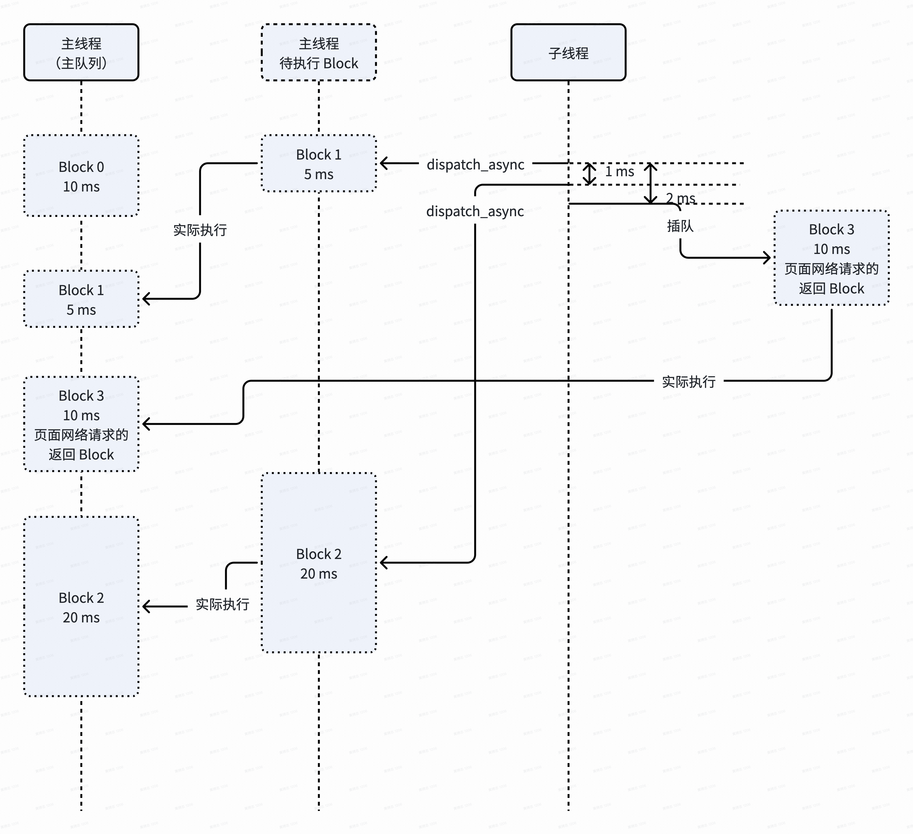|

接口设计，可以在任意线程中调用

1. 如果在主队列中调用，直接同步执行，行为与 dispatch_async_on_main_queue 保持一致。

2. 如果在非主队列中调用，进行插队，在主队列当前正在执行的 block 完成执行后的 did\_execute 回调插入 block 。

```cpp
BOOL AddUrgentMainQueueTasks(dispatch_block_t block);
```


### 一些实现细节

1. Observer 的参数在 ARC 编译环境下需要声明为 \_\_unsafe\_unretained 规避 ARC 插入 retain 。至于为什么 queue 会为 nil 不在此讨论了。

|不声明为 \_\_unsafe\_unretained ❌|声明为 \_\_unsafe\_unretained ✅|
|---|---|
|可以看到 ARC 会自动为作为 params 的 queue 进行了 retain ，在 queue 实际为 source 的时候，queue 为空，会引起崩溃。|ARC 没有插入，直接 stack push/pop 后结束。<br>|
|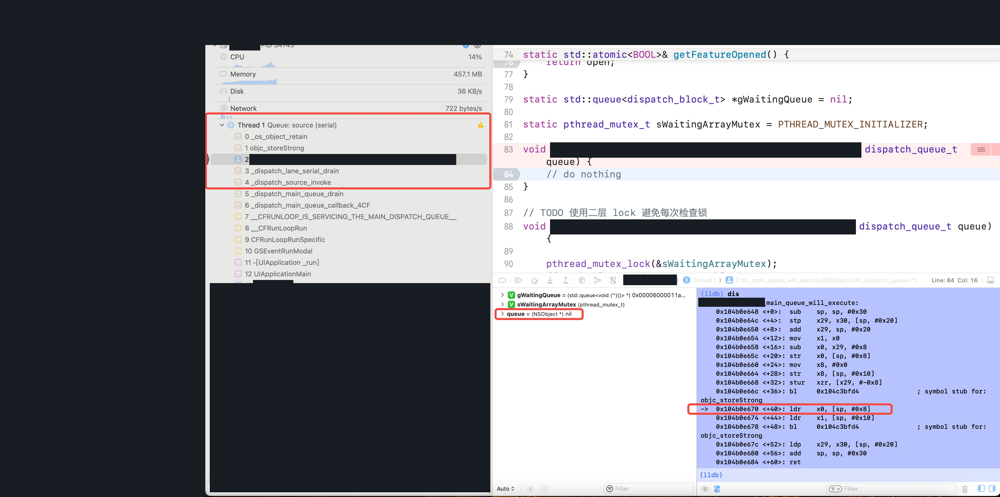<br>|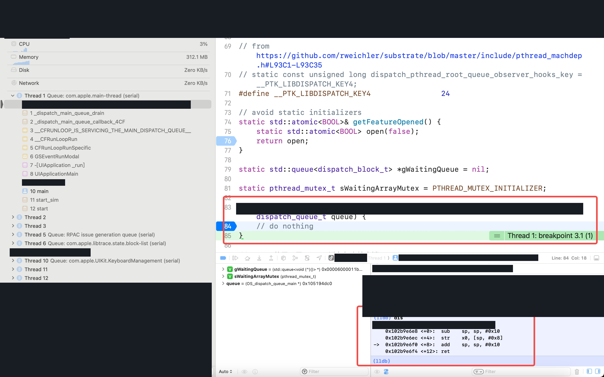<br>|


2. 模拟器与真机在 TLS 上的实现区别。模拟器是直接使用 pthread\_getspecific/pthread\_setspecific 进行 TLS 读写的，而真机有进一步的优化，直接使用汇编指令读取。

```cpp annotated
__attribute__((always_inline, pure))
static __inline__ void**
_os_tsd_get_base(void)
{
~~#if defined(__arm__)~~
~~        uintptr_t tsd;~~
~~        __asm__("mrc p15, 0, %0, c13, c0, 3\n"~~
~~                "bic %0, %0, #0x3\n" : "=r" (tsd));~~
~~        /* lower 2-bits contain CPU number */~~
~~#el~~if defined(__arm64__)
        uint64_t tsd;
        __asm__("mrs %0, TPIDRRO_EL0\n"
                "bic %0, %0, #0x7\n" : "=r" (tsd));
        /* lower 3-bits contain CPU number */
#endif

        return (void**)(uintptr_t)tsd;
}
```


### 后续性能优化策略

线上数据发现 DropXCount/CPU 有少量上涨，怀疑是每次读取锁有些耗时，因此进一步优化，目标是进一步缩小两个指标的涨幅。


1. 使用 \_\_builtin\_expect 优化分支执行，绝大部分情况是没有任务需要插队的状态。

2. 使用二级控制的方式，如果 std::queue 的内容有任意变化（push/pop），都通过 Copy constructor 重新 new 一个内容相同的 queue 。如果内存地址有变化，再加锁，进行内容更新。这样就将性能损失调整到最低。

3. 局部静态变量 `gLastWaitingQueue` 只在 main queue 中访问，因此也不需要加锁。

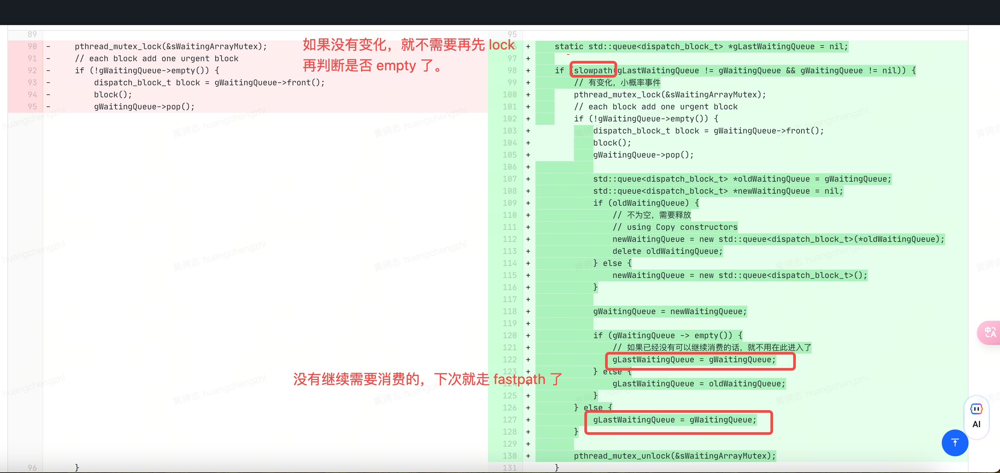

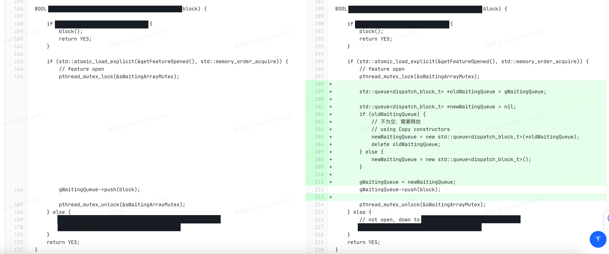


同时由于首屏请求回调是由底层网络库（`NetworkLayer`）内部直接 `dispatch_async` 到 main queue 的，因此要对这类请求做插队还需要网络库侧开放配合，在网络库同学的支持下我们也顺利注入了对应的能力。


## 线上实验

首屏请求回调接入插队方案后，线上实验在不改动网络传输层的前提下，仅靠客户端主线程调度加速就取得了明显的耗时与 QoS 收益。随着方案稳定，后续也陆续推广到了更多高优业务场景：

- **直播进房场景**：与直播业务同学合作，对直播进房等关键接口回调进行插队，在看播侧高端机上取得了正向体验（QoE）收益。
- **跨业务冷启首页场景**：另一款音频内容类 App 的同学也接入了这套能力，在冷启首页接口上线：
  > 针对冷启\-未命中首页缓存的场景下的首页接口，使其 `NetworkLayer` 的 response 在主队列返回给 `ResponseService` 时进行插队。
- **流媒体首帧上屏场景**：再次与直播团队合作，看播侧流媒体首帧使用插队快速上屏，同样取得体验收益。需要额外提醒的是，插队会提早原本回调的触发时机，可能引起业务层意料之外的时序表现（例如该次实验中观察到的小幅内存涨幅仍在定位根因中）。


## 线上监控

我们在线下明确了调度的这一类问题，那是否可以在生产环境中也进行监控，了解有哪些页面会有 Main Queue 繁忙的问题呢？答案是肯定的，既然 Xcode 的面板中能够获取到这些信息，那我们也可以。


### 宏展开

由于 GCD 中的宏展开过于复杂，在初步尝试手动展开宏之后放弃。

本次使用的 GCD 版本为：[\[Github\]swift\-corelibs\-libdispatch](https://github.com/swiftlang/swift-corelibs-libdispatch/tree/swift-5.9-DEVELOPMENT-SNAPSHOT-2023-03-31-a) 中 swift\-5\.9 的分支。

理论上可以直接通过 Swift 的 Compile 查看完整的产物，但由于较为耗时因此未选择这条路。同时疑似仓库并未开源 `autogen.sh` 。如果有正面跑通的同学请务必带带弟弟！

```objective-c
// https://github.com/swiftlang/swift-corelibs-libdispatch/blob/swift-5.9-DEVELOPMENT-SNAPSHOT-2023-03-31-a/INSTALL.md

./swift/utils/build-script --libdispatch -- --install-libdispatch
```

```python
// https://github.com/swiftlang/swift/blob/main/utils/build-script#L344C1-L350C1

    # Foundation has a dependency on libdispatch.
    # On OS X, libdispatch is provided by the OS.
    # On Linux, we must ensure that it is built manually.
    if (args.build_foundation and
            platform.system() != "Darwin"):
        args.build_libdispatch = True

```


#### 操作步骤（不重要）

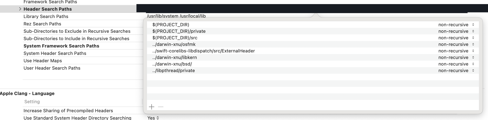

本地需要 clone 以下仓库并添加对应路径至 header search path。


darwin\-xnu 还需要将 `osfmk/mach/mach_interface.h` 中的 `lock_set` 注释掉。

```text
仓库
https://github.com/apple/darwin-xnu/tree/xnu-7195.121.3

search path
darwin-xnu/osfmk
darwin-xnu/libkern
darwin-xnu/bsd/

仓库
https://github.com/apple-oss-distributions/libpthread/tree/libpthread-536

search path
libpthread/private
```

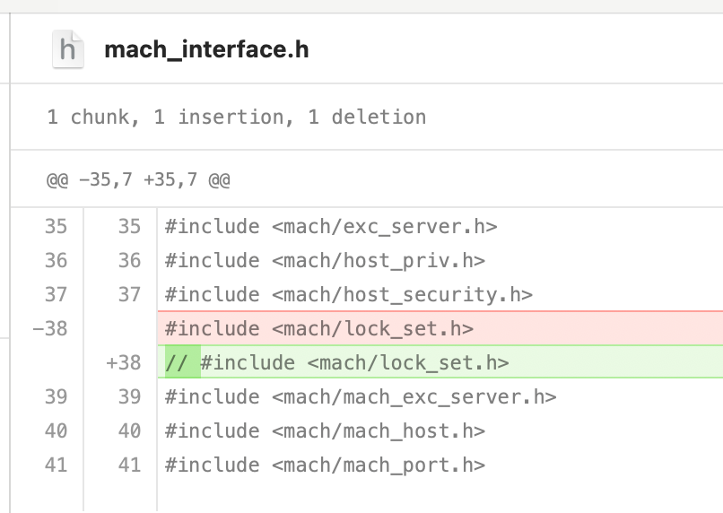


[ExternalHeader\.zip](./attachments/attachment-01.zip)

除了这些能在苹果仓库找到的部分，还有一部份较为难找，~~省去搜索过程~~，将这部分文件解压放到 [swift\-corelibs\-libdispatch](https://github.com/swiftlang/swift-corelibs-libdispatch/tree/swift-5.9-DEVELOPMENT-SNAPSHOT-2023-03-31-a) 的任意目录并添加 search path 即可。


#### 产物

当然你也可以直接用我打包完成的这一份工程。

[DryRunGCD\.zip](./attachments/attachment-02.zip)


### 分析结构

我们直接查看最终的结果

[queue\_preprocess\.c](./attachments/attachment-03.c)

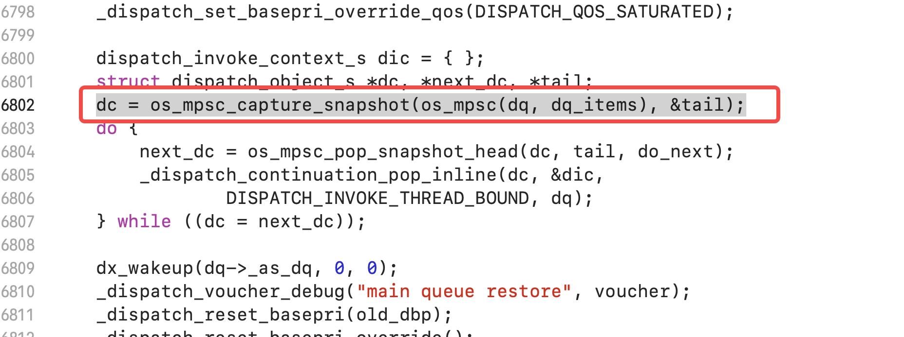

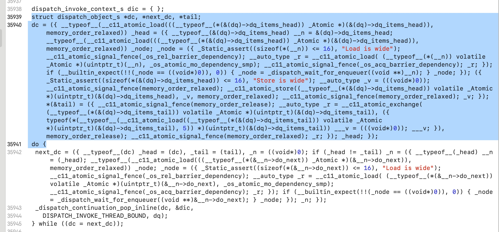

```cpp
// source code

dispatch_invoke_context_s dic = { };
struct dispatch_object_s *dc, *next_dc, *tail;
dc = os_mpsc_capture_snapshot(os_mpsc(dq, dq_items), &tail);
do {
    next_dc = os_mpsc_pop_snapshot_head(dc, tail, do_next);
    _dispatch_continuation_pop_inline(dc, &dic,
                                DISPATCH_INVOKE_THREAD_BOUND, dq);
} while ((dc = next_dc));
```

```cpp
// after pre-process

dispatch_invoke_context_s dic = { };
 struct dispatch_object_s *dc, *next_dc, *tail;
 dc = ({ __typeof__(__c11_atomic_load(((__typeof__(*(&(dq)->dq_items_head)) _Atomic *)(&(dq)->dq_items_head)), memory_order_relaxed)) _head = ({ __typeof__(&(dq)->dq_items_head) __n = &(dq)->dq_items_head; __typeof__(__c11_atomic_load(((__typeof__(*(&(dq)->dq_items_head)) _Atomic *)(&(dq)->dq_items_head)), memory_order_relaxed)) _node; _node = ({ _Static_assert((sizeof(*(__n)) <= 16), "Load is wide"); __c11_atomic_signal_fence(_os_rel_barrier_dependency); __auto_type _r = __c11_atomic_load( (__typeof__(*(__n)) volatile _Atomic *)(uintptr_t)(__n), _os_atomic_mo_dependency_smp); __c11_atomic_signal_fence(_os_acq_barrier_dependency); _r; }); if (__builtin_expect(!!(_node == ((void*)0)), 0)) { _node = _dispatch_wait_for_enqueuer((void **)__n); } _node; }); ({ _Static_assert((sizeof(*(&(dq)->dq_items_head)) <= 16), "Store is wide"); __auto_type _v = (((void*)0)); __c11_atomic_signal_fence(memory_order_relaxed); __c11_atomic_store((__typeof__(*(&(dq)->dq_items_head)) volatile _Atomic *)(uintptr_t)(&(dq)->dq_items_head), _v, memory_order_relaxed); __c11_atomic_signal_fence(memory_order_relaxed); _v; }); *(&tail) = ({ __c11_atomic_signal_fence(memory_order_release); __auto_type _r = __c11_atomic_exchange( (__typeof__(*(&(dq)->dq_items_tail)) volatile _Atomic *)(uintptr_t)(&(dq)->dq_items_tail), ({ typeof(*(__typeof__(__c11_atomic_load((__typeof__(*(&(dq)->dq_items_tail)) volatile _Atomic *)(uintptr_t)(&(dq)->dq_items_tail), 5)) *)(uintptr_t)(&(dq)->dq_items_tail)) ___v = (((void*)0)); ___v; }), memory_order_release); __c11_atomic_signal_fence(memory_order_relaxed); _r; }); _head; });
 do {
  next_dc = ({ __typeof__(dc) _head = (dc), _tail = (tail), _n = ((void*)0); if (_head != _tail) _n = ({ __typeof__(_head) __n = (_head); __typeof__(__c11_atomic_load(((__typeof__(*(&__n->do_next)) _Atomic *)(&__n->do_next)), memory_order_relaxed)) _node; _node = ({ _Static_assert((sizeof(*(&__n->do_next)) <= 16), "Load is wide"); __c11_atomic_signal_fence(_os_rel_barrier_dependency); __auto_type _r = __c11_atomic_load( (__typeof__(*(&__n->do_next)) volatile _Atomic *)(uintptr_t)(&__n->do_next), _os_atomic_mo_dependency_smp); __c11_atomic_signal_fence(_os_acq_barrier_dependency); _r; }); if (__builtin_expect(!!(_node == ((void*)0)), 0)) { _node = _dispatch_wait_for_enqueuer((void **)&__n->do_next); } _node; }); _n; });
  _dispatch_continuation_pop_inline(dc, &dic,
    DISPATCH_INVOKE_THREAD_BOUND, dq);
 } while ((dc = next_dc));
```

用了大量 C\+\+ 的 \_\_typeof\_\_ ，由 Compiler 生成类型（导致读起来很长\.\.\.）

\_\_c11\_atomic\_load ，就直接理解为 \_\_atomic\_load\_n ，把 `_c11_` 前缀直接去掉来理解就行。

\_\_builtin\_expect 就是一个告诉编译器分支预测的推荐值。

[std::atomic\_signal\_fence](https://en.cppreference.com/w/cpp/atomic/atomic_signal_fence) 只有编译器对指令的重新排序才会被抑制为 `order` instructs，意思就是告诉 Compiler 不要优化指令\(重新排序\)超出范围。

\_dispatch\_wait\_for\_enqueuer 暂时就先认为是个轮训等待？（需要 double check） 。

```cpp
// after format

    dispatch_invoke_context_s dic = { };
    struct dispatch_object_s *dc, *next_dc, *tail;
    dc = ({
        __typeof__(__c11_atomic_load(((__typeof__(*(&(dq)->dq_items_head)) _Atomic *)(&(dq)->dq_items_head)), memory_order_relaxed)) _head = ({ __typeof__(&(dq)->dq_items_head) __n = &(dq)->dq_items_head;
            __typeof__(__c11_atomic_load(((__typeof__(*(&(dq)->dq_items_head)) _Atomic *)(&(dq)->dq_items_head)), memory_order_relaxed)) _node;
            _node = ({ 
                _Static_assert((sizeof(*(__n)) <= 16), "Load is wide");
                __c11_atomic_signal_fence(_os_rel_barrier_dependency);
                __auto_type _r = __c11_atomic_load( (__typeof__(*(__n)) volatile _Atomic *)(uintptr_t)(__n), _os_atomic_mo_dependency_smp);
                __c11_atomic_signal_fence(_os_acq_barrier_dependency);
                _r;
            });
            if (__builtin_expect(!!(_node == ((void*)0)), 0)) {
                _node = _dispatch_wait_for_enqueuer((void **)__n);
            } 
            _node;
        });
        ({ 
            _Static_assert((sizeof(*(&(dq)->dq_items_head)) <= 16), "Store is wide");
            __auto_type _v = (((void*)0));
            __c11_atomic_signal_fence(memory_order_relaxed);
            __c11_atomic_store((__typeof__(*(&(dq)->dq_items_head)) volatile _Atomic *)(uintptr_t)(&(dq)->dq_items_head), _v, memory_order_relaxed);
            __c11_atomic_signal_fence(memory_order_relaxed);
            _v;
        });
        *(&tail) = ({
            __c11_atomic_signal_fence(memory_order_release);
            __auto_type _r = __c11_atomic_exchange( (__typeof__(*(&(dq)->dq_items_tail)) volatile _Atomic *)(uintptr_t)(&(dq)->dq_items_tail), ({ typeof(*(__typeof__(__c11_atomic_load((__typeof__(*(&(dq)->dq_items_tail)) volatile _Atomic *)(uintptr_t)(&(dq)->dq_items_tail), 5)) *)(uintptr_t)(&(dq)->dq_items_tail)) ___v = (((void*)0));
                ___v;
            }), memory_order_release);
            __c11_atomic_signal_fence(memory_order_relaxed);
            _r;
        });
        _head;
    });
    do {
        next_dc = ({ __typeof__(dc) _head = (dc), _tail = (tail), _n = ((void*)0);
            if (_head != _tail)
                _n = ({ __typeof__(_head) __n = (_head);
                    __typeof__(__c11_atomic_load(((__typeof__(*(&__n->do_next)) _Atomic *)(&__n->do_next)), memory_order_relaxed)) _node;
                    _node = ({
                        _Static_assert((sizeof(*(&__n->do_next)) <= 16), "Load is wide");
                        __c11_atomic_signal_fence(_os_rel_barrier_dependency);
                        __auto_type _r = __c11_atomic_load( (__typeof__(*(&__n->do_next)) volatile _Atomic *)(uintptr_t)(&__n->do_next), _os_atomic_mo_dependency_smp);
                        __c11_atomic_signal_fence(_os_acq_barrier_dependency);
                        _r;
                    });
                    if (__builtin_expect(!!(_node == ((void*)0)), 0)) {
                        _node = _dispatch_wait_for_enqueuer((void **)&__n->do_next);
                    }
                    _node;
                });
            _n;
        });
        _dispatch_continuation_pop_inline(dc, &dic,
                                          DISPATCH_INVOKE_THREAD_BOUND, dq);
    } while ((dc = next_dc));
```

极致简化后，可以看到逻辑大致为

1. 从 dq\(这里是 main queue\)中取出 dq\_items\_head \(dispatch\_object\_s\) 和 dq\_items\_tail \(dispatch\_object\_s\) 

2. 通过 dq\_items\_head 每次取 do\_next ，然后塞给 \_dispatch\_continuation\_pop\_inline 去执行，持续循环

3. 直到取到 dq\_items\_tail 了，结束

```objective-c
struct dispatch_object_s {
 struct _os_object_s _as_os_obj[0]; const struct dispatch_object_vtable_s *do_vtable; int volatile do_ref_cnt; int volatile do_xref_cnt; struct dispatch_object_s *volatile do_next; struct dispatch_queue_s *do_targetq; void *do_ctxt; void *do_finalizer;
};

struct dispatch_queue_static_s {
 struct dispatch_lane_s _as_dl[0]; struct dispatch_queue_s _as_dq[0]; struct dispatch_object_s _as_do[0]; struct _os_object_s _as_os_obj[0]; const struct dispatch_lane_vtable_s *do_vtable; int volatile do_ref_cnt; int volatile do_xref_cnt; struct dispatch_lane_s *volatile do_next; struct dispatch_queue_s *do_targetq; void *do_ctxt; void *do_finalizer; struct dispatch_object_s *volatile dq_items_tail; union { uint64_t volatile dq_state; struct { dispatch_lock dq_state_lock; uint32_t dq_state_bits; }; }; unsigned long dq_serialnum; const char *dq_label; union { uint32_t volatile dq_atomic_flags; struct { const uint16_t dq_width; const uint16_t __dq_opaque2; }; }; dispatch_priority_t dq_priority; union { struct dispatch_queue_specific_head_s *dq_specific_head; struct dispatch_source_refs_s *ds_refs; struct dispatch_timer_source_refs_s *ds_timer_refs; struct dispatch_mach_recv_refs_s *dm_recv_refs; }; int volatile dq_sref_cnt; dispatch_unfair_lock_s dq_sidelock; struct dispatch_object_s *volatile dq_items_head; uint32_t dq_side_suspend_cnt;

} __attribute__((__aligned__(64u)));
```

```objective-c
dispatch_invoke_context_s dic = { };
    struct dispatch_object_s *dc, *next_dc, *tail;
    // dc 实际就是 dq_items_head
    dc = ({
        // 从 dq 里读 dq_items_head，然后赋值给 _header
        var _head = ({
            var __n = &(dq)->dq_items_head;
            var _node;
            _node = ({
                __c11_atomic_signal_fence(_os_rel_barrier_dependency);
                __auto_type _r = __c11_atomic_load((volatile _Atomic *)(uintptr_t)(__n), _os_atomic_mo_dependency_smp);
                __c11_atomic_signal_fence(_os_acq_barrier_dependency);
                _r;
            });
            if (__builtin_expect(!!(_node == ((void*)0)), 0)) { // 如果 _node == 0 (小概率事件），再进行一次赋值
                _node = _dispatch_wait_for_enqueuer((void **)__n);
            } 
            _node;
        });
        // 把 dq_items_head 置 0
        ({
            __auto_type _v = (((void*)0));
            __c11_atomic_signal_fence(memory_order_relaxed);
            __c11_atomic_store((volatile _Atomic *)(uintptr_t)(&(dq)->dq_items_head), _v, memory_order_relaxed);
            __c11_atomic_signal_fence(memory_order_relaxed);
            _v;
        });
        // 把 dq_items_tail 赋值给 tail，把 dq_items_tail 置 0
        *(&tail) = ({
            __c11_atomic_signal_fence(memory_order_release);
            __auto_type _r = __c11_atomic_exchange((volatile _Atomic *)(uintptr_t)(&(dq)->dq_items_tail), ({
                ___v = (((void*)0));
                ___v;
            }), memory_order_release);
            __c11_atomic_signal_fence(memory_order_relaxed);
            _r;
        });
        _head;
    });
    do {
        // 每次循环都把 dc 丢去 pop 执行，然后提前获取到 next_dc
        
        // next_dc = _head -> do_next
        next_dc = ({
            __typeof__(dc) _head = (dc), _tail = (tail), _n = ((void*)0);
            // 头不等于尾
            if (_head != _tail) {
                // _n = _head -> do_next
                _n = ({ __typeof__(_head) __n = (_head);
                    var _node;
                    // _node = _head -> do_next
                    _node = ({
                        __c11_atomic_signal_fence(_os_rel_barrier_dependency);
                        __auto_type _r = __c11_atomic_load( (volatile _Atomic *)(uintptr_t)(&__n->do_next), _os_atomic_mo_dependency_smp);
                        __c11_atomic_signal_fence(_os_acq_barrier_dependency);
                        _r;
                    });
                    // 如果 _node == 0 (小概率事件），再进行一次赋值
                    if (__builtin_expect(!!(_node == ((void*)0)), 0)) {
                        _node = _dispatch_wait_for_enqueuer((void **)&__n->do_next);
                    }
                    _node;
                });
            }
            _n;
        });
        _dispatch_continuation_pop_inline(dc, &dic,
                                          DISPATCH_INVOKE_THREAD_BOUND, dq);
    } while ((dc = next_dc));
```


因此我们获取 main queue 的 block 方案就很简单了！

但实测下来，在某些时候，我们计算出的值会比 Xcode 展示的要少一些。main queue 的计算应该没有问题，不然不会按顺序找到头和尾。那问题出在哪里呢？

```objective-c

    dispatch_queue_static_s *mainqueue = (__bridge dispatch_queue_static_s *)dispatch_get_main_queue();
    
    dispatch_object_s *head = mainqueue->dq_items_head;
    dispatch_object_s *tail = mainqueue->dq_items_tail;
    
    int pendingQueueCount = 0;
    
    dispatch_object_s *temp = head;
    while (temp != tail) {
        pendingQueueCount++;
        
        temp = temp -> do_next;
    }
    
    NSLog(@"pending block is %@", @(pendingQueueCount));
```

同时在遍历 Block 时发现，部分 block 的 do\_targetq 为 null ，可以通过 do\_finalizer 大致看看这些 block 是什么。

```objective-c
Printing description of temp->do_finalizer:
<__NSGlobalBlock__: 0x1e08d8148>
 signature: "v8@?0"
 invoke   : 0x1856b0030 (/Library/Developer/CoreSimulator/Volumes/Example/Library/Developer/CoreSimulator/Profiles/Runtimes/iOS 18.1.simruntime/Contents/Resources/RuntimeRoot/System/Library/PrivateFrameworks/UIKitCore.framework/UIKitCore`__22+[UIScreen initialize]_block_invoke)
 
 Printing description of temp->do_finalizer:
<__NSMallocBlock__: 0x600000c24810>
 signature: "v8@?0"
 invoke   : 0x18fa6c318 (/Library/Developer/CoreSimulator/Volumes/Example/Library/Developer/CoreSimulator/Profiles/Runtimes/iOS 18.1.simruntime/Contents/Resources/RuntimeRoot/usr/lib/libAccessibility.dylib`__ObservePreferenceLocal_block_invoke)
 
 Printing description of temp->do_finalizer:
<__NSMallocBlock__: 0x600000c281e0>
 signature: "v8@?0"
 invoke   : 0x1cb3273c4 (/Library/Developer/CoreSimulator/Volumes/Example/Library/Developer/CoreSimulator/Profiles/Runtimes/iOS 18.1.simruntime/Contents/Resources/RuntimeRoot/System/Library/AccessibilityBundles/AccessibilitySettingsLoader.bundle/AccessibilitySettingsLoader`__35-[AccessibilitySettingsLoader init]_block_invoke)
```

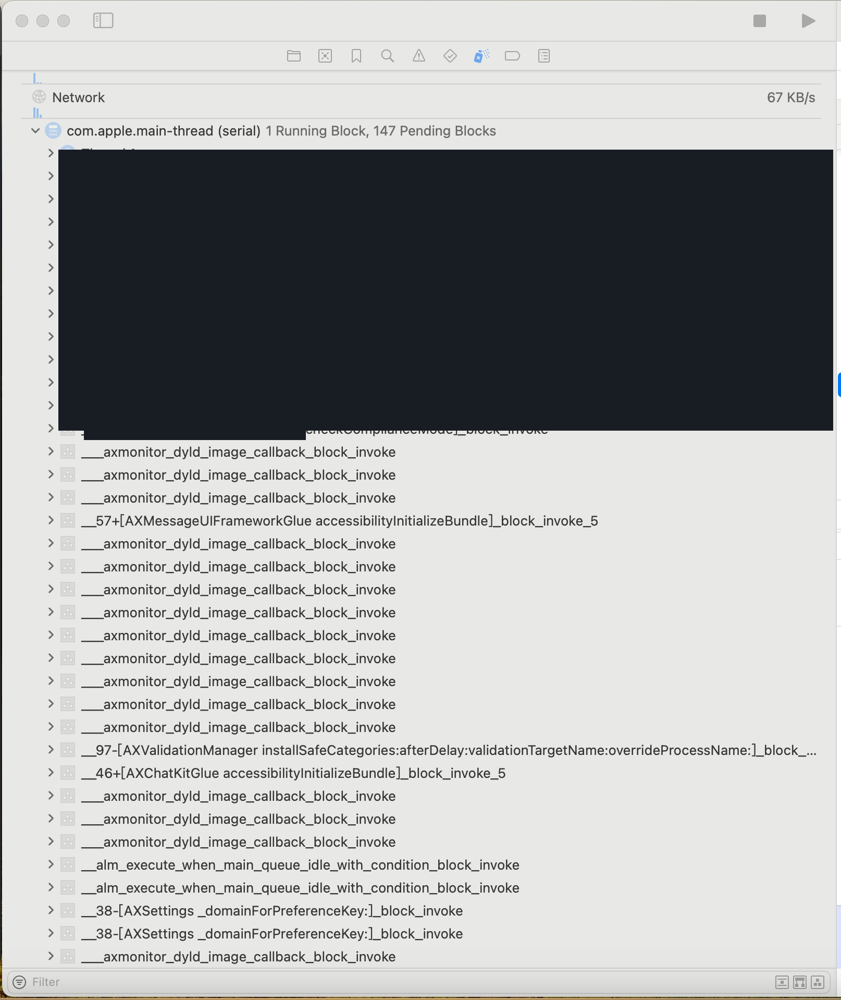

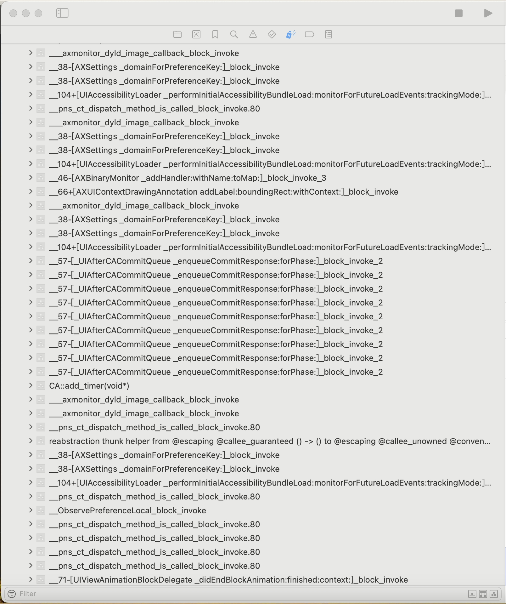

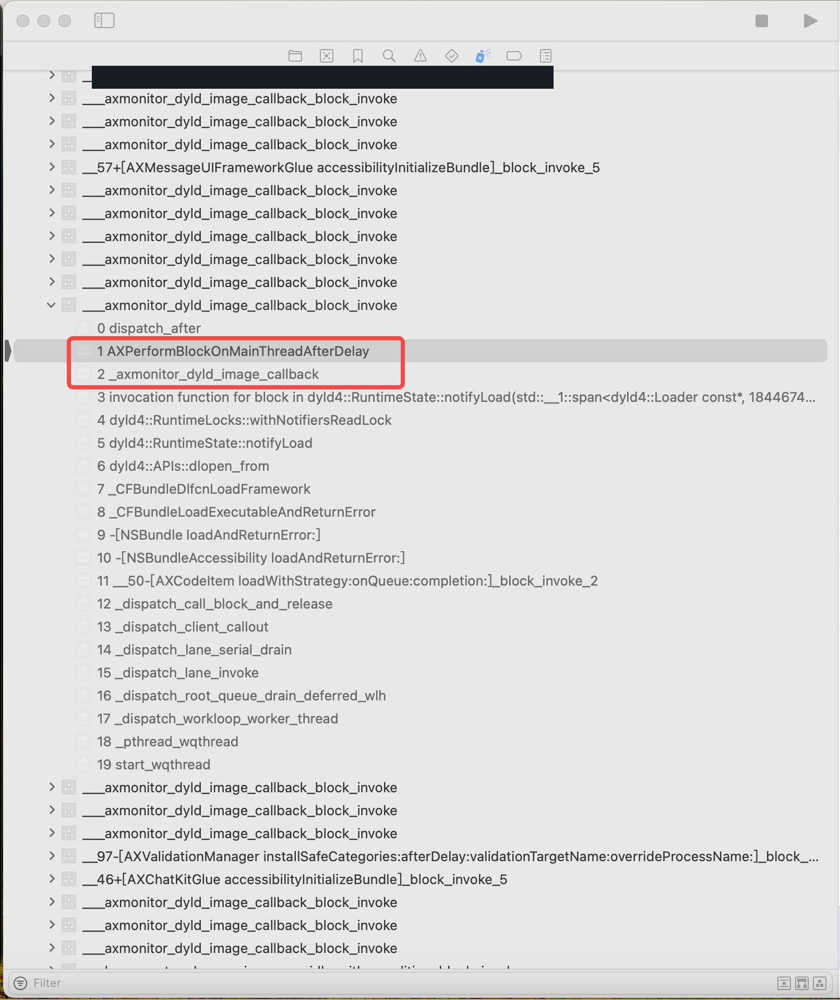

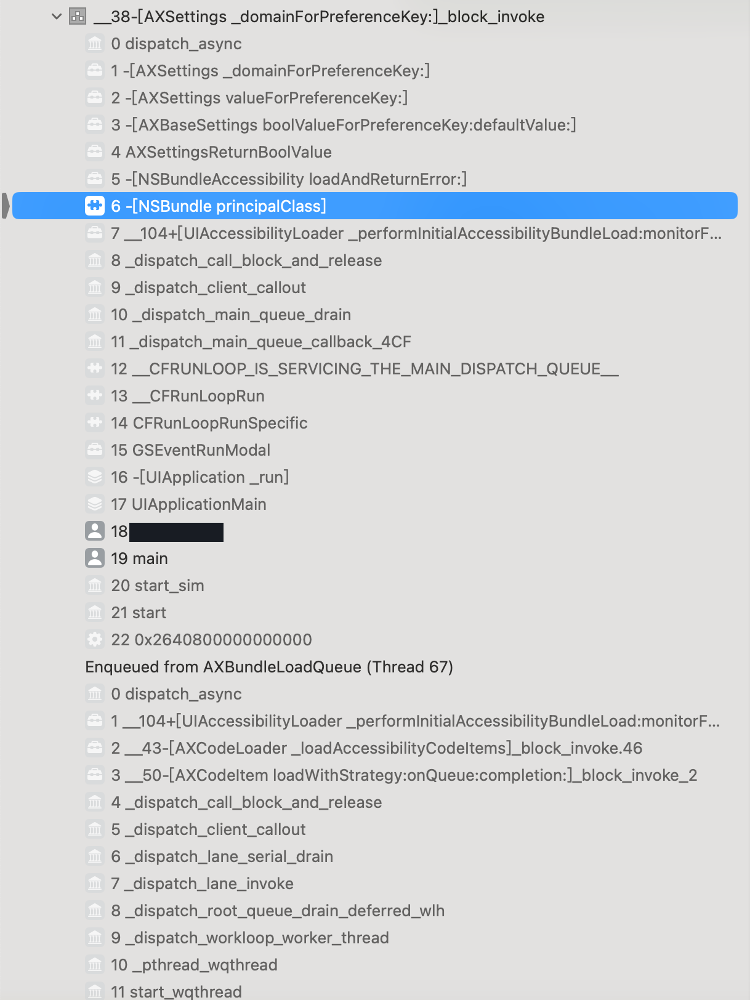


发现有非常大量的 UIAccessibility（无障碍）/AXCoreUtilities 相关的 Block 被提交，不知道是否可以直接干掉\.\.\.


调试时发现有时候 `mainqueue->dq_items_tail` 依旧还有 tail 的存在，是否还有更进一步的 tail ？确实是存在的。加上后能对齐。

```objective-c
// expr extern void printMainQueuePendingBlock(void); printMainQueuePendingBlock()
void printMainQueuePendingBlock() {
    dispatch_queue_static_s *mainqueue = (__bridge dispatch_queue_static_s *)dispatch_get_main_queue();
    
    dispatch_queue_static_s *currentqueue = (__bridge dispatch_queue_static_s *)dispatch_get_current_queue();
    
    dispatch_object_s *head = mainqueue->dq_items_head;
    dispatch_object_s *tail = mainqueue->dq_items_tail;
    
    int pendingQueueCount = 0;
    
    dispatch_object_s *temp = head;
    while (temp != tail) {
        pendingQueueCount++;
        
        NSLog(@"temp's target queue is %ld", (temp -> do_targetq));
        
        temp = temp -> do_next;
    }
    
    // tail 如果还有 do_next 呢？
    NSLog(@"after tail");
    while  (temp != 0) {
        pendingQueueCount++;
        
        NSLog(@"temp's target queue is %ld", (temp -> do_targetq));
        
        temp = temp -> do_next;
    }
    
    NSLog(@"pending block is %@", @(pendingQueueCount));
}
```

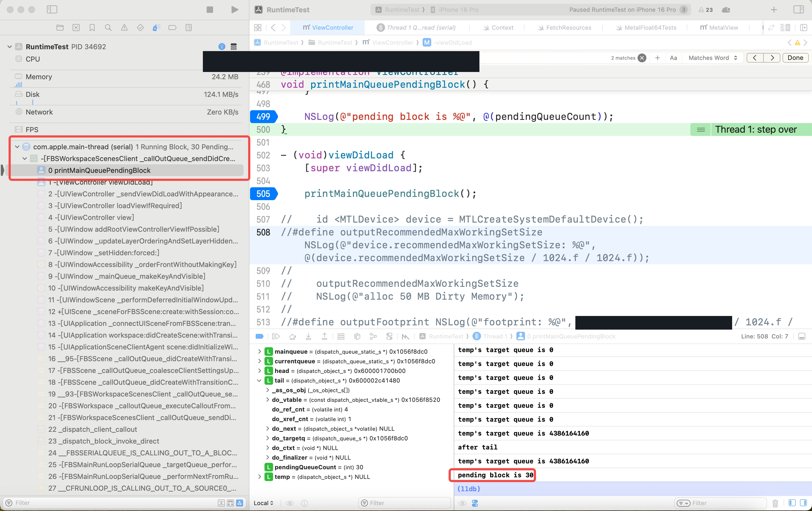

因此 Xcode 里的展示逻辑应该是 `当前正在执行的这一次的循环（head -> tail）` \+ `下一次循环到全部的(head -> null)`  。


至此我们知道了 Queue 中的 Pending Block 原理，将此监控做上线也就不困难了。


### 线上打点

在页面的 ViewDidAppear 阶段，可以看到直播与搜索相关的页面 Pending Block 的数量较高，因此对这些页面的首刷请求做插队可能也会有业务上的 QoS 收益。


