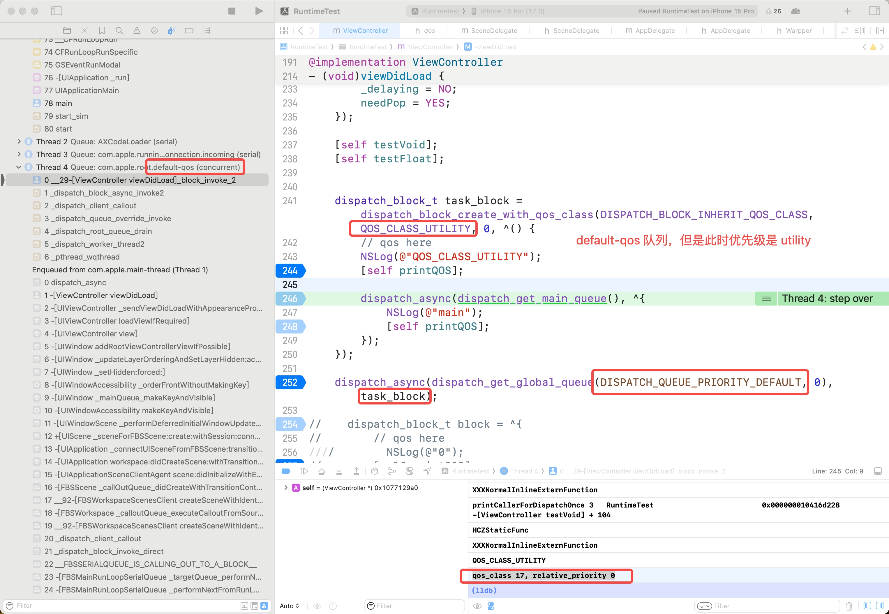
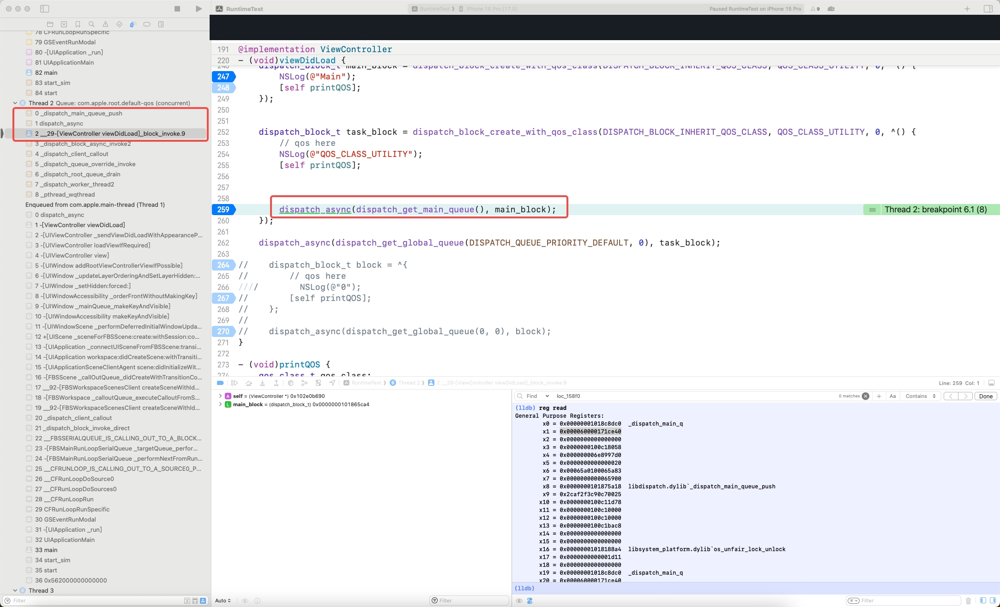
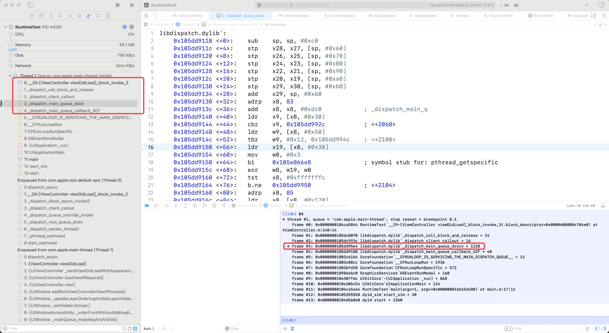
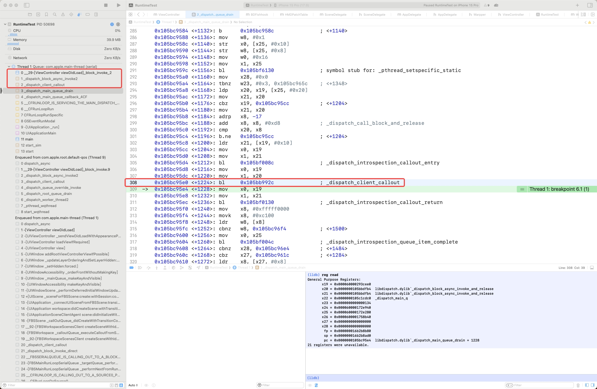
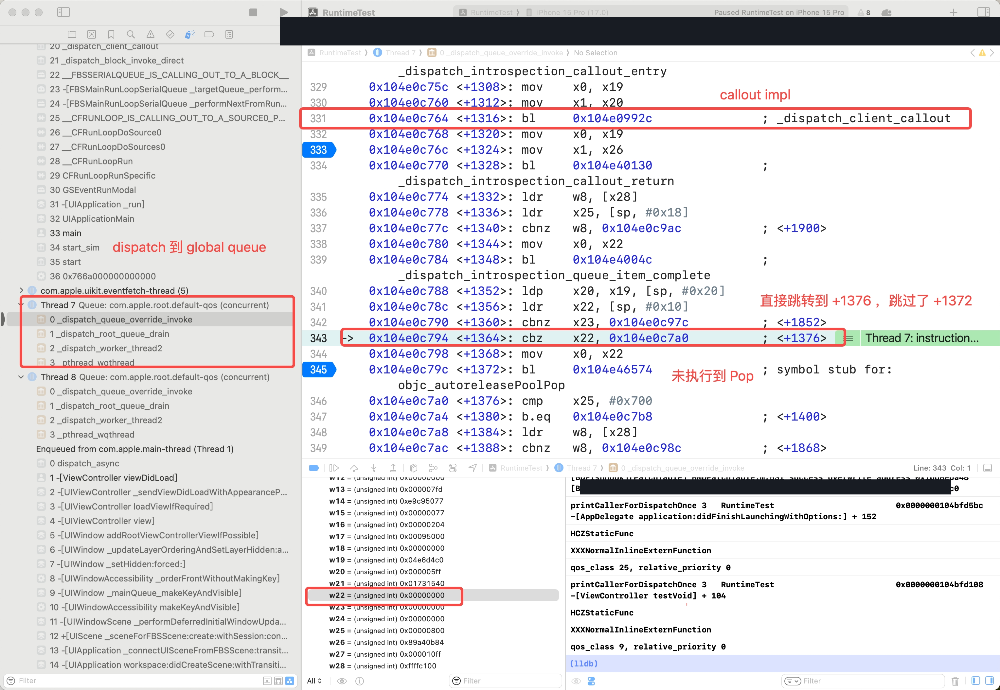
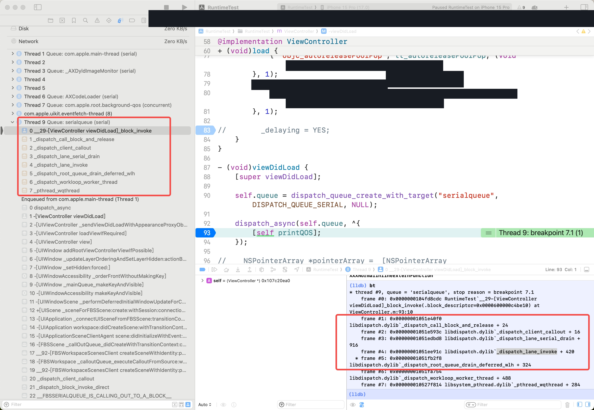
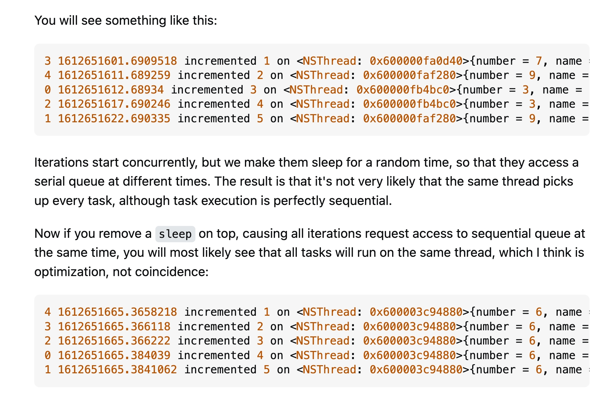

> [!TLDR]
>
> 1. GCD 为了保证优先级的传递\(QoS Propagate\)，会在 dispatch\_async 的时候记录下一些信息，包括当前队列的优先级；在 block 执行前，再拿出这些信息（`dispatch_continuation_s`），综合判断是否需要改变当前 queue 的 qos （线程的 base pri），如果需要改变该执行的 线程 的 base pri 的话，再执行对应的 dispatch\_block ，执行完毕再恢复当前 线程 原本的  base pri 。
>
> 2. 对于 main queue 是有特殊处理的，因为要保证 main queue 的优先级始终是相对最高。同时作为 GCD ，认为从 main queue 中 dispatch 出去的默认任务优先级是相对较高的，因此也会对 dispatch 到 default queue 中的任务进行抬升。
>
>     1. 而对于一部分任务，其实是不需要这么高的优先级的，但是业务大部分情况下没有感知，可能任务既然已经声明 `DISPATCH_QUEUE_PRIORITY_DEFAULT` 了，那自然应该是 default 的执行。这里存在可以优化的点。
>
> 3. 验证了为什么 GCD 的 global queue 与 自定义 queue\(serial/cocurrent\) 会存在 Autorelease 对象堆积的情况。

## 问题出现

一位同事 在线下发现如果从 main queue 中 `dispatch_async` 到 QoS 为 `QOS_CLASS_DEFAULT` 的  global queue 中，global queue 在执行 block 时，qos 会被提升为 `QOS_CLASS_USER_INITIATED` 。而 main queue 的优先级其实是 `QOS_CLASS_USER_INTERACTIVE` 。同时，再从 global queue 执行 `dispatch_async` 到 main queue 中，main queue 的 qos 是不会受到影响的。


因此一定是 GCD 有进行处理，因此我们需要研究一下 GCD 的相关实现。我们验证 QoS 的代码如下：

```cpp
- (void)printQOS {
    qos_class_t qos_class;
    int relative_priority;
    
    pthread_get_qos_class_np(pthread_self(), &qos_class, &relative_priority);
    
    NSLog(@"qos_class %@, relative_priority %@", @(qos_class), @(relative_priority));
}
```


有几个前置的概念需要大家了解：

1. QoS 可以粗略的理解为任务被调度的优先级，类似的概念还有 pthread 的 pth\_priority ，可以进行转化。Queue 是对于 Thread 的抽象，能让我们不用手动管理 Thread ，对于一些并发队列时能显著减少管理线程的成本。只不过 GCD 的抽象概念是 Queue，因此 QoS 是 Queue 的优先级，而 pth\_priority 是  Thread 的优先级。

    1. Thread 的 priority 有两个概念，pth\_priority\(base，理论最大值\) 与 pth\_curpri\(current，实时变化，受 XNU 调度\) ，base \>= current 。与 QoS 直接对应的是 base pri 。

    2. 由于 Thread 与 Queue 并非一一对应，并且单个 Block 的 QoS 可以被设置，因此能在代码里可以看到，在执行 Block 前对 Thread\(pthread\) 进行优先级\(base pri\)的设置，接着在执行完 Block 后恢复。

    3. 即使是 serial queue，背后也有可能有多根线程执行任务，只不过 GCD 会保证处理完一个任务再执行下一个。而在执行特定任务时，GCD 会给对应正在执行任务的线程打上临时的 queue name，结束执行后再去掉。详见：[Does DispatchQueue run in its own thread?](https://stackoverflow.com/questions/66081842/does-dispatchqueue-run-in-its-own-thread) 

    4. GCD 的 QoS 有 6 个分类，以枚举定义，并非连续整数。主队列对应最高的 INTERACTIVE 。

    5. QoS 是一个动态的概念，可以随时进行调整；同时可以出现 default qos 队列的实际优先级是 Utility （也就是临时的降低 ，当然也可以提升）。

2. 需要区分 GCD 的 QoS 与 pthread 的 sched\_param，这是两种调度的方式，是不能兼容的，只能二选一，而本文只讨论 QoS 的情况；对于 Swift 通过 Bridge 调用 GCD ，路径大同小异，只是会在部分 callout 时走 `DISPATCH_SWIFT_JOB_TYPE` 的分支，本文也就不再展开。


因此我们需要通过阅读源码，找到对应操作的实现，验证观察到的现象。


如果我们是通过正常的 block 创建 block ，则创建时 block 本身没有任何额外信息。我们先用这个路径进行分析。

```cpp
dispatch_block_t block = ^{};
```

## dispatch\_async

在 dispatch\_async 中，可以看到通过对 dc 的初始化，获取到了 qos 。

```cpp
// https://github.com/apple/swift-corelibs-libdispatch/blob/542b7f32311680b11b6fc8fcb2576955460ba7da/src/queue.c#L887

#ifdef __BLOCKS__
void
dispatch_async(dispatch_queue_t dq, dispatch_block_t work)
{
    dispatch_continuation_t dc = _dispatch_continuation_alloc();
    uintptr_t dc_flags = DC_FLAG_CONSUME;
    dispatch_qos_t qos;

    qos = _dispatch_continuation_init(dc, dq, work, 0, dc_flags);
    _dispatch_continuation_async(dq, dc, qos, dc->dc_flags);
}
#endif
```

传入 `_dispatch_continuation_init` 的参数中，可以看到 `dispatch_block_flags_t flags` 这个参数始终是 0 。

先简单看下定义，先只知道不是任意一个枚举就行。也就是后续用 flags 做任意的位运算，得到的都是 False\(0\)。

```cpp
DISPATCH_OPTIONS(dispatch_block_flags, unsigned long,
    DISPATCH_BLOCK_BARRIER
            DISPATCH_ENUM_API_AVAILABLE(macos(10.10), ios(8.0)) = 0x1,
    DISPATCH_BLOCK_DETACHED
            DISPATCH_ENUM_API_AVAILABLE(macos(10.10), ios(8.0)) = 0x2,
    DISPATCH_BLOCK_ASSIGN_CURRENT
            DISPATCH_ENUM_API_AVAILABLE(macos(10.10), ios(8.0)) = 0x4,
    DISPATCH_BLOCK_NO_QOS_CLASS
            DISPATCH_ENUM_API_AVAILABLE(macos(10.10), ios(8.0)) = 0x8,
    DISPATCH_BLOCK_INHERIT_QOS_CLASS
            DISPATCH_ENUM_API_AVAILABLE(macos(10.10), ios(8.0)) = 0x10,
    DISPATCH_BLOCK_ENFORCE_QOS_CLASS
            DISPATCH_ENUM_API_AVAILABLE(macos(10.10), ios(8.0)) = 0x20,
);
```


### \_dispatch\_continuation\_init

在正常 Block 执行时， `_dispatch_block_has_private_data` 的返回是 NO ，因此最终会执行到 `_dispatch_continuation_init_f`。在 dispatch\_qos\_t 也是这个函数返回的。

```cpp
DISPATCH_ALWAYS_INLINE
static inline dispatch_qos_t
_dispatch_continuation_init(dispatch_continuation_t dc,
        dispatch_queue_class_t dqu, dispatch_block_t work,
        dispatch_block_flags_t flags, uintptr_t dc_flags)
{
    void *ctxt = _dispatch_Block_copy(work);

    dc_flags |= DC_FLAG_BLOCK | DC_FLAG_ALLOCATED;
    if (unlikely(_dispatch_block_has_private_data(work))) { // ^(){} 时返回是 NO 
        dc->dc_flags = dc_flags;
        dc->dc_ctxt = ctxt;
        // will initialize all fields but requires dc_flags & dc_ctxt to be set
        return _dispatch_continuation_init_slow(dc, dqu, flags);
    }

    dispatch_function_t func = _dispatch_Block_invoke(work); // 获取实际执行的 
    if (dc_flags & DC_FLAG_CONSUME) {
        func = _dispatch_call_block_and_release; // 执行
    }
    return _dispatch_continuation_init_f(dc, dqu, ctxt, func, flags, dc_flags);
}
```

我们简化一下最后调用的实际值

```cpp
_dispatch_continuation_init_f(dc /*要被初始化的 dc 对象*/, dqu/*你指定的那条 queue */ , ctxt/*你传入的 block ，但是经过 Block_copy 了*/, _dispatch_call_block_and_release, 0, DC_FLAG_CONSUME | DC_FLAG_BLOCK | DC_FLAG_ALLOCATED);
```

#### \_dispatch\_block\_has\_private\_data

我们可以顺便看下 `_dispatch_block_has_private_data` 的实现，其实就是判断 block 的 invoke 函数有没有被更改过。如果是通过 `dispatch_block_create_with_qos_class` 创建的话，那么 invoke 函数会被替换，并存到 `dispatch_block_private_data_s dbpds` 中去了。

```cpp
#define _dispatch_Block_invoke(bb) \
        ((dispatch_function_t)((struct Block_layout *)bb)->invoke)


DISPATCH_ALWAYS_INLINE
static inline bool
_dispatch_block_has_private_data(const dispatch_block_t block)
{
    return (_dispatch_Block_invoke(block) == _dispatch_block_special_invoke);
}
```

因此我们可以通过 \_dispatch\_block\_has\_private\_data 来判断（CrashMonitor 已经实现了一份 `dispatch_block_has_metadata`，可以直接用），某个 block 是否是通过 `dispatch_block_create_with_qos_class` 创建，如果是的话，我们可以认为这个业务方是很明确使用的目的的（本地测试时大部分都是系统的调用）。


#### dispatch\_block\_private\_data\_t

我们看到由于是透明的属性，所以是把数据结构存放在原本 Block 的 imported variables 的位置；同时通过 involve 函数作为隐含的计数位来实现。

同时为了安全起见，还会检查一个 magic 值，防止出现 dispatch\_block 对象被错误写坏。

```cpp
struct Block_layout {
    void *isa;
    volatile int32_t flags; // contains ref count
    int32_t reserved; 
    void (*invoke)(void *, ...);
    struct Block_descriptor_1 *descriptor;
    // here is dispatch_block_private_data_t，usually is imported variables
};

DISPATCH_ALWAYS_INLINE
static inline dispatch_block_private_data_t
_dispatch_block_get_data(const dispatch_block_t db)
{
    if (!_dispatch_block_has_private_data(db)) {
        return NULL;
    }
    // Keep in sync with _dispatch_block_create implementation
    uint8_t *x = (uint8_t *)db;
    // x points to base of struct Block_layout
    x += sizeof(struct Block_layout);
    // x points to base of captured dispatch_block_private_data_s object
    dispatch_block_private_data_t dbpd = (dispatch_block_private_data_t)x;
    if (dbpd->dbpd_magic != DISPATCH_BLOCK_PRIVATE_DATA_MAGIC) {
        DISPATCH_CLIENT_CRASH(dbpd->dbpd_magic,
                "Corruption of dispatch block object");
    }
    return dbpd;
}
```

提供一个示意图对比一下：

对正常 Block 结构感兴趣的同学可以跳转： 。


同时我们还能知道，如果创建了一个 dispatch\_block ，但是不经过 dispatch\_async / dispatch\_sync 或者其他 API 进行分发，直接调用也是完全 OK 的。只不过 Block 的 impl 变成了 `_dispatch_block_invoke_direct` 而已，也会读取对应的 dispatch\_block\_private\_data\_t 中的参数进行处理。例如：

```cpp
dispatch_block_t direct_block = dispatch_block_create_with_qos_class(DISPATCH_BLOCK_ENFORCE_QOS_CLASS, QOS_CLASS_USER_INITIATED, 0, ^() {
    [self printQOS]; // qos_class 25, relative_priority 0
});
    
    
dispatch_block_t task_block = dispatch_block_create_with_qos_class(DISPATCH_BLOCK_ENFORCE_QOS_CLASS, QOS_CLASS_BACKGROUND, 0, ^() {
    [self printQOS]; // qos_class 9, relative_priority 0
    direct_block();
});
    
dispatch_async(dispatch_get_global_queue(DISPATCH_QUEUE_PRIORITY_DEFAULT, 0), task_block);
```

可以看到在执行 direct\_block 时，尽管仍在 com\.apple\.root\.default\-qos \(concurrent\) 中，但是 QoS 被成功得修改了。

注释中的 `invoked directly` 指的就是这种情况。

### \_dispatch\_continuation\_init\_f

由于 *flags* 是 0 ，所以 pp 是会通过 \_dispatch\_priority\_propagate 执行的。同时从 pp 就可以看到主要控制优先级的就是这个参数了。

```cpp
DISPATCH_ALWAYS_INLINE
static inline dispatch_qos_t
_dispatch_continuation_init_f(dispatch_continuation_t dc,
        dispatch_queue_class_t dqu, void *ctxt, dispatch_function_t f,
        dispatch_block_flags_t flags, uintptr_t dc_flags)
{
    pthread_priority_t pp = 0;
    dc->dc_flags = dc_flags | DC_FLAG_ALLOCATED;
    dc->dc_func = f;
    dc->dc_ctxt = ctxt;
    // in this context DISPATCH_BLOCK_HAS_PRIORITY means that the priority
    // should not be propagated, only taken from the handler if it has one
    if (!(flags & DISPATCH_BLOCK_HAS_PRIORITY)) {
        pp = _dispatch_priority_propagate(); // 关键函数，传递优先级，所有未指定优先级的 block 都会走到这里
    }
    _dispatch_continuation_voucher_set(dc, flags);
    return _dispatch_continuation_priority_set(dc, dqu, pp, flags);
}
```

至于 voucher ，是系统任务用于传递和记录信息的凭证，用户无法设置，因此可以不用关心。而最后，pp 的信息会被存放在 dispatych\_async 中创建的 `dispatch_continuation_t dc`中了。

#### \_dispatch\_priority\_propagate（QoS Propagate）

```cpp
DISPATCH_ALWAYS_INLINE
static inline pthread_priority_t
_dispatch_priority_propagate(void)
{
    return _dispatch_priority_compute_propagated(0,
            DISPATCH_PRIORITY_PROPAGATE_CURRENT);
}

DISPATCH_ALWAYS_INLINE
static inline pthread_priority_t
_dispatch_priority_compute_propagated(pthread_priority_t pp,
        unsigned int flags)
{
    if (flags & DISPATCH_PRIORITY_PROPAGATE_CURRENT) {
        pp = _dispatch_get_priority(); // 通过 _dispatch_thread_getspecific 获取当前queue对应的线程的(区别于目标 queue) pthread_priority_t
    }
    pp = _pthread_priority_strip_all_flags(pp);
    if (!(flags & DISPATCH_PRIORITY_PROPAGATE_FOR_SYNC_IPC) &&
            pp > _dispatch_qos_to_pp(DISPATCH_QOS_USER_INITIATED)) {
        // Cap QOS for propagation at user-initiated <rdar://16681262&16998036>
        return _dispatch_qos_to_pp(DISPATCH_QOS_USER_INITIATED);
    }
    return pp;
}
```

可以看到 GCD 直接从当前线程获取了 pp ，如果此时 pp 大于 `DISPATCH_QOS_USER_INITIATED` ，那就会强制降级为 `DISPATCH_QOS_USER_INITIATED` （不考虑 IPC 唤醒）。

我们知道，比 `DISPATCH_QOS_USER_INITIATED` 还高的也就只有 `QOS_CLASS_USER_INTERACTIVE` 了，也就是 main queue 正常的 QOS 。

因此当从 main queue dispatch 了一个正常的 block ，会记录下。然后在 default global queue 中执行时， QOS 会变成 `DISPATCH_QOS_USER_INITIATED` 。


#### \_dispatch\_continuation\_priority\_set

我们假设外部的调用如下，是从指定了优先级为 QOS\_CLASS\_UTILITY 的队列中，dispatch 到 main queue 。

```cpp
dispatch_block_t task_block = dispatch_block_create_with_qos_class(DISPATCH_BLOCK_INHERIT_QOS_CLASS, QOS_CLASS_UTILITY, 0, ^() {
        // QoS is QOS_CLASS_UTILITY here 
        dispatch_async(dispatch_get_main_queue(), ^{
            // what's qos here?
        });
    });
    
    dispatch_async(dispatch_get_global_queue(DISPATCH_QUEUE_PRIORITY_DEFAULT, 0), task_block);
```

此时 pp 是 非零的；flags 为 0 。

因此 enforce 为 NO 。最终会返回 qos 为 DISPATCH\_QOS\_UNSPECIFIED ，设置 dc\-\>dc\_priority 为 0 。

```cpp
DISPATCH_ALWAYS_INLINE
static inline dispatch_qos_t
_dispatch_continuation_priority_set(dispatch_continuation_t dc,
        dispatch_queue_class_t dqu,
        pthread_priority_t pp, dispatch_block_flags_t flags)
{
    dispatch_qos_t qos = DISPATCH_QOS_UNSPECIFIED;
    dispatch_queue_t dq = dqu._dq;

    if (likely(pp)) {
        bool enforce = (flags & DISPATCH_BLOCK_ENFORCE_QOS_CLASS); // 这个路径是 NO，除非创建 dispatch_block 的时候指定了
        bool is_floor = (dq->dq_priority & DISPATCH_PRIORITY_FLAG_FLOOR);
        bool dq_has_qos = (dq->dq_priority & DISPATCH_PRIORITY_REQUESTED_MASK);
        if (enforce) {
            // 只有创建 dispatch_block 时使用了 DISPATCH_BLOCK_ENFORCE_QOS_CLASS 才会走这个分支
            pp |= _PTHREAD_PRIORITY_ENFORCE_FLAG; 
            qos = _dispatch_qos_from_pp_unsafe(pp);
        } else if (!is_floor && dq_has_qos) {
            pp = 0;
        } else {
            qos = _dispatch_qos_from_pp_unsafe(pp);
        }
    }
    dc->dc_priority = pp; // dc->dc_priority = 0; 
    return qos;
}
```

### \_dispatch\_continuation\_init\_slow

对于通过 `dispatch_block_create` / `dispatch_block_create_with_qos_class` 等 API 创建的 block ，最后都会调用到 `_dispatch_block_create_with_voucher_and_priority` 。

在 `_dispatch_block_create_with_voucher_and_priority` 中会进行设置 invoke 函数。最终在 dispatch\_async 中就会走入 \_dispatch\_continuation\_init\_slow 。

```cpp
DISPATCH_NOINLINE
dispatch_qos_t
_dispatch_continuation_init_slow(dispatch_continuation_t dc,
        dispatch_queue_t dq, dispatch_block_flags_t flags)
{
    dispatch_block_private_data_t dbpd = _dispatch_block_get_data(dc->dc_ctxt);
    dispatch_block_flags_t block_flags = dbpd->dbpd_flags;
    uintptr_t dc_flags = dc->dc_flags;
    pthread_priority_t pp = 0;

    _dispatch_block_remember_async_queue(dbpd, dq);

    if (dc_flags & DC_FLAG_CONSUME) {
        dc->dc_func = _dispatch_block_async_invoke_and_release;
    } else {
        dc->dc_func = _dispatch_block_async_invoke;
    }

    flags |= block_flags;
    if (block_flags & DISPATCH_BLOCK_HAS_PRIORITY) {
        pp = _pthread_priority_strip_all_flags(dbpd->dbpd_priority);
    } else if (flags & DISPATCH_BLOCK_HAS_PRIORITY) {
        // _dispatch_source_handler_alloc is calling is and doesn't want us
        // to propagate priorities
        pp = 0;
    } else {
        pp = _dispatch_priority_propagate();
    }
    _dispatch_continuation_priority_set(dc, dq, pp, flags);
    if (block_flags & DISPATCH_BLOCK_BARRIER) {
        dc_flags |= DC_FLAG_BARRIER;
    }
    if (block_flags & DISPATCH_BLOCK_HAS_VOUCHER) {
        voucher_t v = dbpd->dbpd_voucher;
        dc->dc_voucher = (v && v != DISPATCH_NO_VOUCHER) ? _voucher_retain(v)
                : v;
        _dispatch_voucher_debug("continuation[%p] set", dc->dc_voucher, dc);
        _dispatch_voucher_ktrace_dc_push(dc);
    } else {
        _dispatch_continuation_voucher_set(dc, flags);
    }
    dc_flags |= DC_FLAG_BLOCK_WITH_PRIVATE_DATA;
    dc->dc_flags = dc_flags;
    return _dispatch_qos_from_pp(dc->dc_priority);
}
```

最终如果 dispatch 到 default\-qos 的 global queue 中，就会以传入的为准。

```cpp
dispatch_block_t task_block = dispatch_block_create_with_qos_class(DISPATCH_BLOCK_INHERIT_QOS_CLASS, QOS_CLASS_UTILITY, 0, ^() {
        // qos here
        NSLog(@"QOS_CLASS_UTILITY");
        [self printQOS];
    });
    
    dispatch_async(dispatch_get_global_queue(DISPATCH_QUEUE_PRIORITY_DEFAULT, 0), task_block);
```



### \_dispatch\_continuation\_async

做的事情很简单，就是把需要的信息都塞入 libdispatch 中的一个数据接口存下来。参数中的 qos 是 \_dispatch\_continuation\_init 返回的。

```cpp
DISPATCH_ALWAYS_INLINE
static inline void
_dispatch_continuation_async(dispatch_queue_class_t dqu,
        dispatch_continuation_t dc, dispatch_qos_t qos, uintptr_t dc_flags)
{
#if DISPATCH_INTROSPECTION
    if (!(dc_flags & DC_FLAG_NO_INTROSPECTION)) {
        _dispatch_trace_item_push(dqu, dc);
    }
#else
    (void)dc_flags;
#endif
    return dx_push(dqu._dq, dc, qos);
}


#define dx_vtable(x) (&(x)->do_vtable->_os_obj_vtable)
#define dx_push(x, y, z) dx_vtable(x)->dq_push(x, y, z)
```

对于不同的 queue ，dx\_push 执行的方法会有区别，例如 main queue 最后会执行到 \_dispatch\_main\_queue\_push 。

```cpp
DISPATCH_VTABLE_SUBCLASS_INSTANCE(queue_main, lane,
    .do_type        = DISPATCH_QUEUE_MAIN_TYPE,
    .do_dispose     = _dispatch_lane_dispose,
    .do_debug       = _dispatch_queue_debug,
    .do_invoke      = _dispatch_lane_invoke,

    .dq_activate    = _dispatch_queue_no_activate,
    .dq_wakeup      = _dispatch_main_queue_wakeup,
    .dq_push        = _dispatch_main_queue_push,
);
```



我们可以看到在将 dou 推入链表之后，就会触发唤醒队列。别的队列的 push 函数各有不同，但都会在 push 后调用对应的 dx\_wakeup 进行唤醒。

```cpp
DISPATCH_NOINLINE
void
_dispatch_main_queue_push(dispatch_queue_main_t dq, dispatch_object_t dou,
        dispatch_qos_t qos)
{
    // Same as _dispatch_lane_push() but without the refcounting due to being
    // a global object
    if (_dispatch_queue_push_item(dq, dou)) {
        return dx_wakeup(dq, qos, DISPATCH_WAKEUP_MAKE_DIRTY);
    }

    qos = _dispatch_queue_push_qos(dq, qos);
    if (_dispatch_queue_need_override(dq, qos)) {
        return dx_wakeup(dq, qos, 0);
    }
}
```


存储 dou 的结构我们知道是链表 \+ FIFO \(先进先出），新添加的 dispatch\_block 会添加在队列的尾部。在此就不进行分析了，感兴趣的同学可以自行研究。

### 小结

以上部分我们讨论了 dispatch\_async 中对于 QoS 的处理。

QoS 的相关信息会被直接传递到后续函数中，dc\-\>dc\_priority 会被存放在 dispatch\_continuation\_s 中一起入栈。

## 线程具体执行 Block 

现在我们已经添加 Block 到对应 queue 中，并且由 wakeup 进行了唤醒。

那接下来就应该研究 GCD 是如何将任务从对应 queue 的队列中取出，并执行的了。还记得我们一开始抛出的问题吗？

> 如果从 non main queue 再 dispatch\_async 到 main queue，由于 QoS Propagate 的存在，会记录 non main queue 的 QoS，难道 main queue 会读取到这个 QoS ，并将 main queue 的 qos 降低吗？


会降低的话，肯定是不合理的，毕竟我们是需要确保 main queue 的 QoS 一直保持在较高的值的。

### \_dispatch\_main\_queue\_drain（main queue）

先以主线程为例，验证的代码如下：

```cpp
dispatch_block_t main_block = dispatch_block_create_with_qos_class(DISPATCH_BLOCK_INHERIT_QOS_CLASS, QOS_CLASS_UTILITY, 0, ^() {
        NSLog(@"Main");
        [self printQOS]; // qos_class 33, relative_priority 0
    });
    
    
    dispatch_block_t task_block = dispatch_block_create_with_qos_class(DISPATCH_BLOCK_INHERIT_QOS_CLASS, QOS_CLASS_UTILITY, 0, ^() {
        // qos here
        NSLog(@"QOS_CLASS_UTILITY");
        [self printQOS]; // qos_class 17, relative_priority 0
        
        
        
        dispatch_async(dispatch_get_main_queue(), main_block);
    });
    
    dispatch_async(dispatch_get_global_queue(DISPATCH_QUEUE_PRIORITY_DEFAULT, 0), task_block);
```

我们在创建 main\_block 的时候，设置了 qos 为 UTILITY ，并且 type 为 INHERIT 。对于 async 的 dispatch\_block ，这个 type 是默认的，表示执行时更应该选择对应的 queue 原有的 qos ，如果对应的 queue 没有 qos ，那就使用这里传递的。

对于 main queue 来说是有 qos 的，因此会优先使用 main queue 的 qos；如果传递 type 为 DISPATCH\_BLOCK\_ENFORCE\_QOS\_CLASS ，且目标 queue 不是 main queue 时，就能看到优先级的变化，但是对 main queue 是无效的。无法通过 GCD 的接口来直接修改 main queue 的 QoS ，这个权限只有 XNU 才有。


我们研究从 QOS\_CLASS\_UTILITY 的 queue 中，抛出 DISPATCH\_BLOCK\_INHERIT\_QOS\_CLASS \+ QOS\_CLASS\_UTILITY 到 main queue 到情况。

具体来说，我们看的是从执行 `dispatch_async(dispatch_get_main_queue(), main_block);` \~ 执行 `main_block` 之前的部分。

```cpp
(lldb) bt
* thread #1, queue = 'com.apple.main-thread', stop reason = breakpoint 8.1
    frame #0: 0x0000000102feceb0 RuntimeTest`__29-[ViewController viewDidLoad]_block_invoke_2(.block_descriptor=0x0000600000c6aa90) at ViewController.m:120:10
    frame #1: 0x0000000103f16038 libdispatch.dylib`_dispatch_block_async_invoke2 + 104
    frame #2: 0x0000000103f0593c libdispatch.dylib`_dispatch_client_callout + 16
    frame #3: 0x0000000103f155e4 libdispatch.dylib`_dispatch_main_queue_drain + 1228
    frame #4: 0x0000000103f15108 libdispatch.dylib`_dispatch_main_queue_callback_4CF + 40
  * frame #5: 0x00000001803c61b4 CoreFoundation`__CFRUNLOOP_IS_SERVICING_THE_MAIN_DISPATCH_QUEUE__ + 12
    frame #6: 0x00000001803c08cc CoreFoundation`__CFRunLoopRun + 1936
```

我们直接断点到对应执行 Block 的地方看调用栈。可以看到是 Runloop 的回调触发了 `_dispatch_main_queue_callback_4CF`，接着再调用 `_dispatch_main_queue_drain` 。那如果有优先级变更，那就大概率在这里了。



我们可以只关注核心的代码。我们直接从现象来推断，可能相关的代码是 `_dispatch_main_queue_update_priority_from_thread`，恰巧这个函数是非 inline 的，因此我们直接通过是否命中符号断点来判断是否走入此逻辑。


直接说结果，在当前的 Case 下，`_dispatch_main_queue_update_priority_from_thread` 这个函数并不会被调用到。原因是主队列的优先级并没有被调整。


其中大量计数位是存在 TLS \(真机上 [\_pthread\_has\_direct\_tsd 为 1 ，模拟器为 0](https://opensource.apple.com/source/libpthread/libpthread-137.1.1/private/tsd_private.h) \) 中的。


而 pthread\_priority\_t / dispatch\_priority\_t  / dispatch\_qos\_t 是可以进行转换的，因此可以认为 QoS 是对 pthread\_priority\_t 的封装。区别只是 QoS 是队列纬度，而 pthread\_priority\_t 是线程纬度。


同时通过代码我们可以发现，在 \_dispatch\_main\_queue\_drain 中，并没有用到传递过来的 qos ，只是从 main  thread 的 pthread\_priority\_t 中直接获取了 QoS 。因此我们可以得到结论，不论如何传递，主线程的 QoS 都无法直接通过设置参数进行修改。


但是需要注意，主线程的 QoS 其实是可以被 XNU 控制降低的，只不过没法直接通过公开参数直接设置。

因此我们可以看到 main queue 执行任务前，会先获取主线程当前的 current priority，并设置给 base pri ，执行结束后恢复 base pri。

```cpp
static void
_dispatch_main_queue_drain(dispatch_queue_main_t dq)
{
    dispatch_thread_frame_s dtf;

    if (!dq->dq_items_tail) {
        return;
    }

    _dispatch_perfmon_start_notrace();
    if (unlikely(!_dispatch_queue_is_thread_bound(dq))) {
        DISPATCH_CLIENT_CRASH(0, "_dispatch_main_queue_callback_4CF called"
                " after dispatch_main()");
    }
    uint64_t dq_state = os_atomic_load2o(dq, dq_state, relaxed);
    if (unlikely(!_dq_state_drain_locked_by_self(dq_state))) {
        DISPATCH_CLIENT_CRASH((uintptr_t)dq_state,
                "_dispatch_main_queue_callback_4CF called"
                " from the wrong thread");
    }

    dispatch_once_f(&_dispatch_main_q_handle_pred, dq,
            _dispatch_runloop_queue_handle_init);

    // <rdar://problem/23256682> hide the frame chaining when CFRunLoop
    // drains the main runloop, as this should not be observable that way
    _dispatch_adopt_wlh_anon();
    _dispatch_thread_frame_push_and_rebase(&dtf, dq, NULL);

    pthread_priority_t pp = _dispatch_get_priority(); // 此时拿到的是 主线程的 current priority ，并非用 block 里指定的属性
    dispatch_priority_t pri = _dispatch_priority_from_pp(pp); 
    dispatch_qos_t qos = _dispatch_priority_qos(pri); // qos 是 DISPATCH_QOS_USER_INTERACTIVE
    voucher_t voucher = _voucher_copy();
    
    if (unlikely(qos != _dispatch_priority_qos(dq->dq_priority))) { // 当不需要改变 qos 时，就不会调用 _dispatch_main_queue_update_priority_from_thread() ，这个 Case 不会走进，但如果主线程 qos 被更改了，会走进去
        _dispatch_main_queue_update_priority_from_thread();
    }
    dispatch_priority_t old_dbp = _dispatch_set_basepri(pri); // 内部会调用 _dispatch_thread_setspecific 提升/降低 优先级，并把之前的优先级返回，方便后面完成任务后恢复，这里使用 current pri 去覆盖 basepri 
    _dispatch_set_basepri_override_qos(DISPATCH_QOS_SATURATED); // SATURATED 饱和的，值为 15，0B01111

    dispatch_invoke_context_s dic = { };
    struct dispatch_object_s *dc, *next_dc, *tail;
    dc = os_mpsc_capture_snapshot(os_mpsc(dq, dq_items), &tail);
    do {
        next_dc = os_mpsc_pop_snapshot_head(dc, tail, do_next);
        _dispatch_continuation_pop_inline(dc, &dic,
                DISPATCH_INVOKE_THREAD_BOUND, dq); // 执行被 dispatch 过来的 block 
    } while ((dc = next_dc));

    dx_wakeup(dq->_as_dq, 0, 0);
    _dispatch_voucher_debug("main queue restore", voucher);
    _dispatch_reset_basepri(old_dbp); // 还原 base pri
    _dispatch_reset_basepri_override();
    _dispatch_reset_priority_and_voucher(pp, voucher);
    _dispatch_thread_frame_pop(&dtf);
    _dispatch_reset_wlh();
    _dispatch_force_cache_cleanup();
    _dispatch_perfmon_end_notrace();
}
```


#### \_dispatch\_continuation\_pop\_inline

前面提到过，这是一个 FIFO 的队列（链表）结构，执行被 dispatch 到特定线程的 block 就需要 pop 出来去执行。

```cpp
static inline void
_dispatch_continuation_pop_inline(dispatch_object_t dou,
        dispatch_invoke_context_t dic, dispatch_invoke_flags_t flags,
        dispatch_queue_class_t dqu)
{
    dispatch_pthread_root_queue_observer_hooks_t observer_hooks =
            _dispatch_get_pthread_root_queue_observer_hooks();
    if (observer_hooks) observer_hooks->queue_will_execute(dqu._dq);
    flags &= _DISPATCH_INVOKE_PROPAGATE_MASK;
    if (_dispatch_object_has_vtable(dou)) {
        if (dx_type(dou._do) == DISPATCH_SWIFT_JOB_TYPE) {
            dx_invoke(dou._dsjc, NULL,
                    _dispatch_invoke_flags_to_swift_invoke_flags(flags));
        } else {
            dx_invoke(dou._dq, dic, flags);
        }
    } else {
        _dispatch_continuation_invoke_inline(dou, flags, dqu);
    }
    if (observer_hooks) observer_hooks->queue_did_execute(dqu._dq);
}


static inline void
_dispatch_continuation_invoke_inline(dispatch_object_t dou,
        dispatch_invoke_flags_t flags, dispatch_queue_class_t dqu)
{
    dispatch_continuation_t dc = dou._dc, dc1;
    dispatch_invoke_with_autoreleasepool(flags, { // 这里不会实际调用 push/pop ,因为  flag 不满足条件
        uintptr_t dc_flags = dc->dc_flags;
        // Add the item back to the cache before calling the function. This
        // allows the 'hot' continuation to be used for a quick callback.
        //
        // The ccache version is per-thread.
        // Therefore, the object has not been reused yet.
        // This generates better assembly.
        _dispatch_continuation_voucher_adopt(dc, dc_flags);
        if (!(dc_flags & DC_FLAG_NO_INTROSPECTION)) {
            _dispatch_trace_item_pop(dqu, dou);
        }
        if (dc_flags & DC_FLAG_CONSUME) {
            dc1 = _dispatch_continuation_free_cacheonly(dc);
        } else {
            dc1 = NULL;
        }
        if (unlikely(dc_flags & DC_FLAG_GROUP_ASYNC)) {
            _dispatch_continuation_with_group_invoke(dc); // 如果有 group ，走这里
        } else {
            _dispatch_client_callout(dc->dc_ctxt, dc->dc_func); // 正常执行 block
            _dispatch_trace_item_complete(dc);
        }
        if (unlikely(dc1)) {
            _dispatch_continuation_free_to_cache_limit(dc1);
        }
    });
    _dispatch_perfmon_workitem_inc();
}
```



Base Priority 信息存放在 TLS 中，对应的 key 为 25 ；Current Priority 也存放在 TLS 中，对应 key 为 4。需要作出区分。

```cpp
#ifndef __TSD_THREAD_QOS_CLASS
#define __TSD_THREAD_QOS_CLASS 4
#endif

/* Keys 20-29 for libdispatch usage */
#define __PTK_LIBDISPATCH_KEY0                20
#define __PTK_LIBDISPATCH_KEY1                21
#define __PTK_LIBDISPATCH_KEY2                22
#define __PTK_LIBDISPATCH_KEY3                23
#define __PTK_LIBDISPATCH_KEY4                24
#define __PTK_LIBDISPATCH_KEY5                25
#define __PTK_LIBDISPATCH_KEY6                26
#define __PTK_LIBDISPATCH_KEY7                27
#define __PTK_LIBDISPATCH_KEY8                28
#define __PTK_LIBDISPATCH_KEY9                29

// dispatch_queue_key & dispatch_frame_key need to be contiguous
// in that order, and queue_key to be an even number
static const unsigned long dispatch_queue_key       = __PTK_LIBDISPATCH_KEY0;
static const unsigned long dispatch_frame_key       = __PTK_LIBDISPATCH_KEY1;
static const unsigned long dispatch_cache_key       = __PTK_LIBDISPATCH_KEY2;
static const unsigned long dispatch_context_key     = __PTK_LIBDISPATCH_KEY3;
static const unsigned long dispatch_pthread_root_queue_observer_hooks_key =
        __PTK_LIBDISPATCH_KEY4;
static const unsigned long dispatch_basepri_key     = __PTK_LIBDISPATCH_KEY5;


static const unsigned long dispatch_priority_key    = __TSD_THREAD_QOS_CLASS;

DISPATCH_ALWAYS_INLINE
static inline dispatch_priority_t
_dispatch_get_basepri(void)
{
#if HAVE_PTHREAD_WORKQUEUE_QOS
    return (dispatch_priority_t)(uintptr_t)_dispatch_thread_getspecific(
            dispatch_basepri_key);
#else
    return 0;
#endif
}


DISPATCH_ALWAYS_INLINE
static inline pthread_priority_t
_dispatch_get_priority(void)
{
#if HAVE_PTHREAD_WORKQUEUE_QOS
    pthread_priority_t pp = (uintptr_t)
            _dispatch_thread_getspecific(dispatch_priority_key);
    return pp;
#else
    return 0;
#endif
}
```

#### dispatch\_invoke\_with\_autoreleasepool

在满足 DISPATCH\_INVOKE\_AUTORELEASE\_ALWAYS 时，每次调用 Block 前后都会 push/pop 成对。

```cpp
#define dispatch_invoke_with_autoreleasepool(flags, ...)  ({ \
        void *pool = NULL; \
        if ((flags) & DISPATCH_INVOKE_AUTORELEASE_ALWAYS) { \
            pool = _dispatch_autorelease_pool_push(); \
            DISPATCH_COMPILER_CAN_ASSUME(pool); \
        }; \
        __VA_ARGS__; \
        if (pool) _dispatch_autorelease_pool_pop(pool); \
    })
```

主队列是不满足这个条件的，因此不会执行这里的 push 和 pop 。当然主线程其实不用太过担心因为每次 callout 导致的堆积。


### \_dispatch\_root\_queue\_drain （global queue）

接着我们再来看 global queue 的情况。我们忽略从 XNU\(work queue\) 触发回 pthread 的部分，专注于 GCD 的部分。

```cpp annotated
(lldb) bt
* thread #7, queue = 'com.apple.root.default-qos', stop reason = breakpoint 2.1
    frame #0: 0x0000000100784f70 RuntimeTest`__29-[ViewController viewDidLoad]_block_invoke_2(.block_descriptor=0x0000600000c931b0) at ViewController.m:244:10
  * frame #1: 0x00000001009a2038 libdispatch.dylib`_dispatch_block_async_invoke2 + 104
    frame #2: 0x000000010099193c libdispatch.dylib`_dispatch_client_callout + 16
    frame #3: 0x0000000100994768 libdispatch.dylib`_dispatch_queue_override_invoke + 1320
    frame #4: 0x00000001009a54bc libdispatch.dylib`**_dispatch_root_queue_drain** + 372
    frame #5: 0x00000001009a6068 libdispatch.dylib`**_dispatch_worker_thread2** + 256
    frame #6: 0x0000000100a2b7d8 libsystem_pthread.dylib`_pthread_wqthread + 224
```

可以看到内部有一个 for 循环，把所有堆积的任务全部执行完。

在每次执行 Block 前后，都会重新设置优先级；但在进入 for 循环 前后，只会集中处理一次 AutoreleasePool 的 Push 和 Pop 。

```cpp
DISPATCH_NOT_TAIL_CALLED // prevent tailcall (for Instrument DTrace probe)
static void
_dispatch_root_queue_drain(dispatch_queue_global_t dq,
        dispatch_priority_t pri, dispatch_invoke_flags_t flags)
{
#if DISPATCH_DEBUG
    dispatch_queue_t cq;
    if (unlikely(cq = _dispatch_queue_get_current())) {
        DISPATCH_INTERNAL_CRASH(cq, "Premature thread recycling");
    }
#endif
    _dispatch_queue_set_current(dq);
    _dispatch_init_basepri(pri); // 传进来的 pri 其实就是 dq->dq_priority，也就是 queue 自身的 pri ，这里由于我们指定是 dispatch_get_global_queue(DISPATCH_QUEUE_PRIORITY_DEFAULT, 0)，因此会返回给我们 com.apple.root.default-qos (concurrent) -> pri
    // 由于一个 cocurrent queue 不止对应一根 Thread ，因此这里的设置是有必要的
    // 同时，即使是 serial queue，也可能出现 多根 serial queue 对应多根线程的情况
    
    
    _dispatch_adopt_wlh_anon();

    struct dispatch_object_s *item;
    bool reset = false;
    dispatch_invoke_context_s dic = { };
#if DISPATCH_COCOA_COMPAT
    _dispatch_last_resort_autorelease_pool_push(&dic);// push 一个 token
#endif // DISPATCH_COCOA_COMPAT
    _dispatch_queue_drain_init_narrowing_check_deadline(&dic, pri);
    _dispatch_perfmon_start();
    while (likely(item = _dispatch_root_queue_drain_one(dq))) { // 一直执行，直到任务处理完
        if (reset) _dispatch_wqthread_override_reset(); // Drop all QoS overrides on the current workqueue thread.
        _dispatch_continuation_pop_inline(item, &dic, flags, dq); // call dx_invoke ，and then call _dispatch_queue_override_invoke
        reset = _dispatch_reset_basepri_override(); // 重新设置 base priority
        if (unlikely(_dispatch_queue_drain_should_narrow(&dic))) {
            // We can just shortcircuit and don't need to worry about checking for
            // more work because _dispatch_root_queue_drain_one should have requested
            // for more threads if there was more work
            break;
        }

#if DISPATCH_USE_COOPERATIVE_WORKQUEUE
        /* There is no need to check to see if we need to shuffle since by
         * virtue of the fact that we're here, we're timesharing between the
         * work items anyways - just eat the quantum expiry action.
         *
         * In the future, we'd expand this to include more checks for various
         * other quantum expiry actions */
        _dispatch_ack_quantum_expiry_action();
#endif
    }

    // overcommit or not. worker thread
    if (pri & DISPATCH_PRIORITY_FLAG_OVERCOMMIT) {
        _dispatch_perfmon_end(perfmon_thread_worker_oc);
    } else {
        _dispatch_perfmon_end(perfmon_thread_worker_non_oc);
    }

#if DISPATCH_COCOA_COMPAT
    _dispatch_last_resort_autorelease_pool_pop(&dic); // 执行到这里才会 pop ，也就是如果 dispatch 到 gloabl queue 里的任务太多，确实是会导致来不及排空自动释放池。
#endif // DISPATCH_COCOA_COMPAT
    _dispatch_reset_wlh();
    _dispatch_clear_basepri();
    _dispatch_queue_set_current(NULL);
}

```

#### \_dispatch\_queue\_override\_invoke

```cpp
static void
_dispatch_queue_override_invoke(dispatch_continuation_t dc,
        dispatch_invoke_context_t dic, dispatch_invoke_flags_t flags)
{
    dispatch_queue_t old_rq = _dispatch_queue_get_current();
    dispatch_queue_global_t assumed_rq = dc->dc_other;
    dispatch_priority_t old_dp;
    dispatch_object_t dou;
    uintptr_t dc_flags = DC_FLAG_CONSUME;

    dou._do = dc->dc_data;
    old_dp = _dispatch_root_queue_identity_assume(assumed_rq); // 从 dc(block 创建的 context 里拿到 dc->dc_other -> dq_priority ，并设置
    if (dc_type(dc) == DISPATCH_CONTINUATION_TYPE(OVERRIDE_S分析平台LING)) {
        flags |= DISPATCH_INVOKE_S分析平台LING;
        dc_flags |= DC_FLAG_NO_INTROSPECTION;
    }
    _dispatch_continuation_pop_forwarded(dc, dc_flags, assumed_rq, {
        if (_dispatch_object_has_vtable(dou._do)) {
            if (dx_type(dou._do) == DISPATCH_SWIFT_JOB_TYPE) {
                dx_invoke(dou._dsjc, NULL,
                        _dispatch_invoke_flags_to_swift_invoke_flags(flags));
            } else {
                dx_invoke(dou._dq, dic, flags);
            }
        } else {
            _dispatch_continuation_invoke_inline(dou, flags, assumed_rq); // call _dispatch_client_callout (执行 block )
        }
    });
    _dispatch_reset_basepri(old_dp); // 重置
    _dispatch_queue_set_current(old_rq);
}
```

#### \_dispatch\_continuation\_invoke\_inline

```cpp
DISPATCH_ALWAYS_INLINE
static inline void
_dispatch_continuation_invoke_inline(dispatch_object_t dou,
        dispatch_invoke_flags_t flags, dispatch_queue_class_t dqu)
{
    dispatch_continuation_t dc = dou._dc, dc1;
    dispatch_invoke_with_autoreleasepool(flags, {
        uintptr_t dc_flags = dc->dc_flags;
        // Add the item back to the cache before calling the function. This
        // allows the 'hot' continuation to be used for a quick callback.
        //
        // The ccache version is per-thread.
        // Therefore, the object has not been reused yet.
        // This generates better assembly.
        _dispatch_continuation_voucher_adopt(dc, dc_flags);
        if (!(dc_flags & DC_FLAG_NO_INTROSPECTION)) {
            _dispatch_trace_item_pop(dqu, dou);
        }
        if (dc_flags & DC_FLAG_CONSUME) {
            dc1 = _dispatch_continuation_free_cacheonly(dc);
        } else {
            dc1 = NULL;
        }
        if (unlikely(dc_flags & DC_FLAG_GROUP_ASYNC)) {
            _dispatch_continuation_with_group_invoke(dc);
        } else {
            _dispatch_client_callout(dc->dc_ctxt, dc->dc_func);
            _dispatch_trace_item_complete(dc);
        }
        if (unlikely(dc1)) {
            _dispatch_continuation_free_to_cache_limit(dc1);
        }
    });
    _dispatch_perfmon_workitem_inc();
}

```

需要注意的是，虽然 \_dispatch\_continuation\_invoke\_inline 会调用到 `dispatch_invoke_with_autoreleasepool` 中，但是 global queue 的 flag 是不满足 DISPATCH\_INVOKE\_AUTORELEASE\_ALWAYS 的，因此不会执行 callout 前执行 push 和 pop 。


我们可以进行断点验证。



顺便这部分的代码还解释了为什么 global queue 如果一直不空闲，会无法排空自动释放池。


这也符合苹果对于 dispatch\_queue\_attr\_make\_with\_autorelease\_frequency 中的注释：

```cpp
* @discussion
 * When a queue uses the per-workitem autorelease frequency (either directly
 * or inherited from its target queue), any block submitted asynchronously to
 * this queue (via dispatch_async(), dispatch_barrier_async(),
 * dispatch_group_notify(), etc...) is executed as if surrounded by a individual
 * Objective-C <code>@autoreleasepool</code> scope.

 * The global concurrent queues have the DISPATCH_AUTORELEASE_FREQUENCY_NEVER
 * behavior. Manually created dispatch queues use
 * DISPATCH_AUTORELEASE_FREQUENCY_INHERIT by default.
```

如果是自己创建的 serial queue ，如果不设置 `DISPATCH_AUTORELEASE_FREQUENCY_WORK_ITEM`，也会有同样的问题。可以看下文 `_dispatch_lane_invoke （自定义 queue）` 部分的分析。


#### 正确创建 Default QoS 的任务到 Default Queue

```cpp
dispatch_block_t defaultQoSBlock = dispatch_block_create_with_qos_class(DISPATCH_BLOCK_INHERIT_QOS_CLASS, QOS_CLASS_DEFAULT, 0, ^() {
    // do something
});
dispatch_async(dispatch_get_global_queue(0, 0), block);
```

### \_dispatch\_lane\_invoke （自定义 queue）

自定义创建的 queue ，触发 Block 回调的情况如下：



```cpp
frame #1: 0x00000001051e40f0 libdispatch.dylib`_dispatch_call_block_and_release + 24
    frame #2: 0x00000001051e593c libdispatch.dylib`_dispatch_client_callout + 16
    frame #3: 0x00000001051edbd8 libdispatch.dylib`_dispatch_lane_serial_drain + 916
    frame #4: 0x00000001051ee91c libdispatch.dylib`_dispatch_lane_invoke + 420
  * frame #5: 0x00000001051fb2f8 libdispatch.dylib`_dispatch_root_queue_drain_deferred_wlh + 324
    frame #6: 0x00000001051fa754 libdispatch.dylib`_dispatch_workloop_worker_thread + 488
    frame #7: 0x000000010527f814 libsystem_pthread.dylib`_pthread_wqthread + 284
```

额外提一句，如果是像上图那样为传递 NULL 作为参数初始化 queue ，则这跟 queue 的 QoS 为 `DISPATCH_QOS_UNSPECIFIED` 。


根据初始化，可以得知 do\_invoke 函数为 `_dispatch_lane_invoke` 。

```cpp
DISPATCH_VTABLE_SUBCLASS_INSTANCE(queue_serial, lane,
    .do_type        = DISPATCH_QUEUE_SERIAL_TYPE,
    .do_dispose     = _dispatch_lane_dispose,
    .do_debug       = _dispatch_queue_debug,
    .do_invoke      = _dispatch_lane_invoke,

    .dq_activate    = _dispatch_lane_activate,
    .dq_wakeup      = _dispatch_lane_wakeup,
    .dq_push        = _dispatch_lane_push,
);
```

#### \_dispatch\_root\_queue\_drain\_deferred\_wlh

如果在执行 Block 后，有新的 Block 被塞入，就会跳到 retry 的 label 上，进行下一个 Block 的调用。

对应就是 queue 中的 block 没有被排空的情况，并且还没没有设置 DISPATCH\_INVOKE\_AUTORELEASE\_ALWAYS ，就会导致堆积。对于一些异常频繁的任务提交来说，这是非常危险的。

```cpp
#if DISPATCH_USE_KEVENT_WORKQUEUE
static void
_dispatch_root_queue_drain_deferred_wlh(dispatch_deferred_items_t ddi
        DISPATCH_PERF_MON_ARGS_PROTO)
{
    dispatch_queue_global_t rq = ddi->ddi_stashed_rq;
    dispatch_queue_t dq = ddi->ddi_stashed_dou._dq;
    _dispatch_queue_set_current(rq);

    dispatch_invoke_context_s dic = { };
    dispatch_invoke_flags_t flags = DISPATCH_INVOKE_WORKER_DRAIN |
            DISPATCH_INVOKE_REDIRECTING_DRAIN | DISPATCH_INVOKE_WLH;
    _dispatch_queue_drain_init_narrowing_check_deadline(&dic, rq->dq_priority);
    uint64_t dq_state;

    _dispatch_init_basepri_wlh(rq->dq_priority);
    ddi->ddi_wlh_servicing = true;
retry:
    dispatch_assert(ddi->ddi_wlh_needs_delete);
    _dispatch_trace_item_pop(rq, dq);

    if (_dispatch_queue_drain_try_lock_wlh(dq, &dq_state)) {
        dx_invoke(dq, &dic, flags); // 设置参数为 DISPATCH_INVOKE_WORKER_DRAIN，调用 _dispatch_lane_invoke
        //
        // dx_invoke() will always return `dq` unlocked or locked by another
        // thread, and either have consumed the +2 or transferred it to the
        // other thread.
        //
        if (!ddi->ddi_wlh_needs_delete) {
            //
            // The fate of the workloop thread request has already been dealt
            // with, which can happen for 4 reasons, for which we just want
            // to go park and skip trying to unregister the thread request:
            // - the workloop target has been changed
            // - the workloop has been re-enqueued because of narrowing
            // - the workloop has been re-enqueued on the manager queue
            // - the workloop ownership has been handed off to a sync owner
            //
            goto park;
        }
        //
        // The workloop has been drained to completion or suspended.
        // dx_invoke() has cleared the enqueued bit before it returned.
        //
        // Since a dispatch_set_target_queue() could occur between the unlock
        // and our reload of `dq_state` (rdar://32671286) we need to re-assess
        // the workloop-ness of the queue. If it's not a workloop anymore,
        // _dispatch_event_loop_leave_immediate() will have handled the kevent
        // deletion already.
        //
        // Then, we check one last time that the queue is still not enqueued,
        // in which case we attempt to quiesce it.
        //
        // If we find it enqueued again, it means someone else has been
        // enqueuing concurrently and has made a thread request that coalesced
        // with ours, but since dx_invoke() cleared the enqueued bit,
        // the other thread didn't realize that and added a +1 ref count.
        // Take over that +1, and add our own to make the +2 this loop expects,
        // and drain again.
        //
        dq_state = os_atomic_load2o(dq, dq_state, relaxed);
        if (unlikely(!_dq_state_is_base_wlh(dq_state))) { // rdar://32671286
            goto park;
        }
        if (unlikely(_dq_state_is_enqueued_on_target(dq_state))) {
            _dispatch_retain(dq);
            _dispatch_trace_item_push(dq->do_targetq, dq);
            goto retry;
        }
    }
    
    // 省略大部分代码
park:
    // event thread that could steal
    _dispatch_perfmon_end(perfmon_thread_event_steal);
    _dispatch_clear_basepri();
    _dispatch_queue_set_current(NULL);

    _dispatch_voucher_debug("root queue clear", NULL);
    _dispatch_reset_voucher(NULL, DISPATCH_THREAD_PARK);
}
```

#### \_dispatch\_lane\_invoke

如果设置了 frquency ，则在每次 callout 之前都会调用  push/pop 。

```cpp
DISPATCH_NOINLINE
void
_dispatch_lane_invoke(dispatch_lane_t dq, dispatch_invoke_context_t dic,
        dispatch_invoke_flags_t flags)
{
    _dispatch_queue_class_invoke(dq, dic, flags, 0, _dispatch_lane_invoke2);
}

DISPATCH_ALWAYS_INLINE
static inline void
_dispatch_queue_class_invoke(dispatch_queue_class_t dqu,
        dispatch_invoke_context_t dic, dispatch_invoke_flags_t flags,
        dispatch_invoke_flags_t const_restrict_flags,
        _dispatch_queue_class_invoke_handler_t invoke)
{
    // 省略部分代码
    dispatch_priority_t old_dbp;
    if (!(flags & DISPATCH_INVOKE_MANAGER_DRAIN)) {
        old_dbp = _dispatch_set_basepri(dq->dq_priority);
    } else {
        old_dbp = 0;
    }
    if (flags & DISPATCH_INVOKE_WORKLOOP_DRAIN) {
        if (unlikely(_dispatch_queue_atomic_flags(dqu) & DQF_MUTABLE)) {
            _dispatch_queue_atomic_flags_clear(dqu, DQF_MUTABLE);
        }
    }
    
    flags = _dispatch_queue_merge_autorelease_frequency(dq, flags);
    
#if DISPATCH_COCOA_COMPAT
        if ((flags & DISPATCH_INVOKE_WLH) &&
                !(flags & DISPATCH_INVOKE_AUTORELEASE_ALWAYS)) {
            _dispatch_last_resort_autorelease_pool_push(dic); // 如果设置了 frquency ，就会在这里执行 push pool
        }
#endif // DISPATCH_COCOA_COMPAT
        tq = invoke(dq, dic, flags, &owned); // callout _dispatch_lane_invoke2(_dispatch_lane_serial_drain or _dispatch_lane_concurrent_drain)
#if DISPATCH_COCOA_COMPAT
        if ((flags & DISPATCH_INVOKE_WLH) &&
                !(flags & DISPATCH_INVOKE_AUTORELEASE_ALWAYS)) {
            dispatch_thread_frame_s dtf;
            _dispatch_thread_frame_push(&dtf, dq);
            _dispatch_last_resort_autorelease_pool_pop(dic); // 如果设置了 frquency ，就会在这里执行 pop pool
            _dispatch_thread_frame_pop(&dtf);
        }
#endif // DISPATCH_COCOA_COMPAT
    
    // 省略部分代码
    if (!(flags & DISPATCH_INVOKE_MANAGER_DRAIN)) {
        _dispatch_reset_basepri(old_dbp);
    }
}

DISPATCH_ALWAYS_INLINE
static inline dispatch_queue_wakeup_target_t
_dispatch_lane_invoke2(dispatch_lane_t dq, dispatch_invoke_context_t dic,
        dispatch_invoke_flags_t flags, uint64_t *owned)
{
    dispatch_queue_t otq = dq->do_targetq;
    dispatch_queue_t cq = _dispatch_queue_get_current();

    if (unlikely(cq != otq)) {
        return otq;
    }
    if (dq->dq_width == 1) {
        return _dispatch_lane_serial_drain(dq, dic, flags, owned); // serial queue
    }
    return _dispatch_lane_concurrent_drain(dq, dic, flags, owned); // cocurrent queue
}
```

#### \_dispatch\_lane\_serial\_drain

取出 dc 后进行一次调用。serial 和 cocurent 最后都会调用到 \_dispatch\_lane\_drain，区别只是 `bool serial_drain` 的参数分别为 YES 与 NO 。

```cpp
DISPATCH_NOINLINE
dispatch_queue_wakeup_target_t
_dispatch_lane_serial_drain(dispatch_lane_class_t dqu,
        dispatch_invoke_context_t dic, dispatch_invoke_flags_t flags,
        uint64_t *owned)
{
    flags &= ~(dispatch_invoke_flags_t)DISPATCH_INVOKE_REDIRECTING_DRAIN;
    return _dispatch_lane_drain(dqu._dl, dic, flags, owned, true);
}


DISPATCH_ALWAYS_INLINE
static dispatch_queue_wakeup_target_t
_dispatch_lane_drain(dispatch_lane_t dq, dispatch_invoke_context_t dic,
        dispatch_invoke_flags_t flags, uint64_t *owned_ptr, bool serial_drain) 
{
    // 省略大段代码
    _dispatch_continuation_pop_inline(dc, dic, flags, dq); // 回到 main queue 中的分析
    // 省略大段代码
}
```

因此我们可以看到自定义队列，如果不配置 `DISPATCH_INVOKE_AUTORELEASE_ALWAYS` ，也会出现堆积的情况。


同时也能验证我们的观察，如果频繁得往一根 serial queue 里塞任务，在这个阶段由于始终在一次 \_dispatch\_root\_queue\_drain\_deferred\_wlh 的循环内，因此这个阶段内始终是同一根 Thread ；但如果过了一段时间再对同一根 queue 里塞任务，可能就会分配到另一根 Thread 执行任务了，但是这个区别我们不应该有感知，毕竟 GCD 就是为了屏蔽 Thread 才会创造出 Queue 的概念的。

> 现象见：[Does DispatchQueue run in its own thread?](https://stackoverflow.com/questions/66081842/does-dispatchqueue-run-in-its-own-thread) 

> ```cpp
> let serialQueue = DispatchQueue(label: "my.serialqueue")
> var incr: Int = 0DispatchQueue.concurrentPerform(iterations: 5) { iteration in// Rundomize time of access to serial queue
>     sleep(UInt32.random(in: 1...30))

>     // Schedule execution on serial queue
>     serialQueue.async {
>         incr += 1print("\(iteration) \(Date().timeIntervalSince1970) incremented \(incr) on \(Thread.current)")
>     }
> }
> ```

> 


### 小结

所有改动逻辑都是如果需要变更，则进行变更后再进行恢复，其余没有太多差异。可以看到 GCD 内部有多个不同队列的实例，每个实例都会有不同的实现（大同小异）。


在此，我们可以给出 QoS Propagate 的含义：记录了执行 dispatch\_async 时 queue\(thread\) 的优先级，作为一个参考值传递下去。而并非一定会按照当前 queue\(thread\) 的优先级去执行后面的任务。


同时源码的阅读验证了 global queue 与 自定义的  queue\(serial/cocurrent\) 都会存在堆积的情况。因此还是推荐大家默认使用 `DISPATCH_QUEUE_SERIAL_WITH_AUTORELEASE_POOL` / `DISPATCH_QUEUE_CONCURRENT_WITH_AUTORELEASE_POOL` 创建自定义队列；同时对于 dispatch 到 global queue 中的任务也使用 一位同事封装的 `dispatch_async_with_autoreleasepool` 。

## INHERIT VS ENFORCE VS 直接创建

讲了这么多，但其实绝大部分同学都用不到这么深入，大部分同学只需要确保最后执行 Block 时的 QoS 满足预期即可。因此最后我给出一些常见的组合的结果，给大家一个直观的。


需要注意，尽管有设置了希望执行的 QoS，但是并非一定会按照外部设置的来。例如，不论你给 main queue 设置多高/低的，都不会生效。


### INHERIT（主要以 queue 为准）

这一小节的测试都是从 main thread 中抛出。

纵坐标是 dispatch\_block\_create\_with\_qos\_class 创建时使用的 QoS ；横坐标是对应 QoS 的 global queue 。

|Block QOS / Global Queue Priority|main queue|HIGH|DEFAULT|LOW|BACKGROUND|
|---|---|---|---|---|---|
|未使用带 qos 创建 block `^{}`|INTERACTIVE|INITIATED|INITIATED|UTILITY|BACKGROUND|
|QOS\_CLASS\_USER\_INTERACTIVE|||INTERACTIVE|||
|QOS\_CLASS\_USER\_INITIATED|||INITIATED|||
|QOS\_CLASS\_DEFAULT\(特殊类型\)|||DEFAULT|||
|QOS\_CLASS\_UTILITY|||UTILITY|||
|QOS\_CLASS\_BACKGROUND|||BACKGROUND|||
|QOS\_CLASS\_UNSPECIFIED\(特殊类型\)|||DEFAULT|||

我们看到对于 `LOW` / `BACKGROUND` / `HIGH` 的 global queue ，不论传递什么，都无法改变执行 Block 时的 qos 。

`QOS_CLASS_DEFAULT` 的 global queue 上下限都很大，基本可以认为你传什么就是什么（可以理解为 default 就是没有队列的默认 qos ，但是又要区别于 UNSPECIFIED），甚至可以跃升到最高的 INTERACTIVE 。


一个主要的盲区就在于从 main thread 中 dispatch 到 DEFAULT queue 中的 block ，执行的时候优先级会被默认抬高到 INITIATED 。

### ENFORCE（主要以 block 上的 qos 为准）

这一小节的测试都是从 main thread 中抛出。

纵坐标是 dispatch\_block 创建时使用的 QoS ；横坐标是 target queue 的枚举。

|Block QOS / Global Queue Priority|main queue|HIGH|DEFAULT|LOW|BACKGROUND|
|---|---|---|---|---|---|
|QOS\_CLASS\_USER\_INTERACTIVE|INTERACTIVE|INTERACTIVE||||
|QOS\_CLASS\_USER\_INITIATED||INITIATED||||
|QOS\_CLASS\_DEFAULT\(特殊类型\)||INITIATED|DEFAULT|||
|QOS\_CLASS\_UTILITY||INITIATED|UTILITY|||
|QOS\_CLASS\_BACKGROUND||INITIATED|BACKGROUND|UTILITY|BACKGROUND|
|QOS\_CLASS\_UNSPECIFIED\(特殊类型\)||INITIATED|DEFAULT|UTILITY|BACKGROUND|

可以看到尽管 Enforce 有设置，只要 dispatch 到 main  queue 里，执行时依旧保持最高 QoS ，这与我们前面的分析能够 match ；对于 High 的 gloabl queue ，也保持了较高的 QoS。


一位同事在开启了线上实验后分析了 QoS 区别对于任务调度的影响，省流：高 QoS 对比 低 QoS 主要体现在调度耗时上。

> 


### 未指定 QoS 的自定义 Queue

由于未指定 QoS ，因此 Queue 自身为 QOS\_CLASS\_UNSPECIFIED 。

```cpp
self.queue = dispatch_queue_create_with_target("serialqueue", DISPATCH_QUEUE_SERIAL, NULL);

dispatch_block_t task_block = dispatch_block_create_with_qos_class(DISPATCH_BLOCK_ENFORCE_QOS_CLASS, /* target queue*/, 0, ^() {

        dispatch_async(self.queue, ^{
            [self printQOS]; // We want to see QoS here
        });
    });

dispatch_async(dispatch_get_global_queue(DISPATCH_QUEUE_PRIORITY_DEFAULT, 0), direct_block_2);


// from main queue
dispatch_async(self.queue, ^{
    [self printQOS]; // qos_class 25, relative_priority 0 ，结果同 from INTERACTIVE 队列
});
```

|From queue QoS|INTERACTIVE|INITIATED|DEFAULT|UTILITY|BACKGROUND|
|---|---|---|---|---|---|
|Excute QoS|INITIATED|INITIATED|DEFAULT|UTILITY|BACKGROUND|

我们发现在这种情况下，实际执行的 QoS 是参照 QoS Propagate ，从来源的 queue 中传递优先级。但无法传递 `INTERACTIVE` ，表现与 直接从 main queue 中 dispatch\_async 到 global queue 中一样。


同时如果是从 main queue 中  dispatch async 到自定义 queue ，我们潜意识会认为因为没有指定 QoS ，因此应该是 DEFAULT ，但其实被抬高为了 INITIATED 。

### QoS propagate 会影响最后执行的 QoS 吗？

由于 WWDC 的文档有提到，GCD 会自动从 calling thread 传递 QoS ，因此我们需要确认 calling thread 的 QoS 是否会影响别的实际执行时的 QoS 。使用的是 dispatch\_async 。

|From/TO|HIGH|DEFAULT\(特殊类型\)|LOW|BACKGROUND|
|---|---|---|---|---|
|HIGH|INITIATED<br>|DEFAULT|UTILITY|BACKGROUND|
|DEFAULT\(特殊类型\)||DEFAULT|||
|LOW||UTILITY|||
|BACKGROUND||BACKGROUND|||

```cpp
dispatch_block_t __block direct_block_2 = ^{
        [self printQOS]; // We want to see QOS here
    };
    
    dispatch_block_t direct_block = ^{        
        dispatch_async(dispatch_get_global_queue(DISPATCH_QUEUE_PRIORITY_HIGH, 0), direct_block_2);
    };
    
    dispatch_async(dispatch_get_global_queue(DISPATCH_QUEUE_PRIORITY_LOW, 0), direct_block);
```

我们看到，除了 TO queue 为 DEFAULT 时，其余情况都以 TO queue 的 QoS 为准，与 From Queue 无关，与 INHERIT 的效果大致相同；而 TO queue 为 DEFAULT 时，情况会有一些复杂。

因此 QoS propagate 应该被理解为：GCD 记录了原本 From Queue 的 QoS ，只不过在执行时是否使用 From Queue 的 QoS，是则要看使用的策略是 dispatch\_async\(INHERIT\) 还是 dispatch\_sync\(ENFORCE\)  。


总结一下，使用 INHERIT 时，效果大多可以被预估；但是使用 ENFORCE 时，结果会较难记忆，其实也不用记就是了。毕竟正常大家也是用 dispatch\_async 用得多，dispatch\_async 默认就是 INHERIT 模式。

因此对于 dispatch\_async 来说，从主线程抛出的 block \(正常创建\)，基本都能在对应的 queue 上以正确的 qos 执行。只有 default 的时候会被自动提升。


## 一些目前在尝试的事

易于以上的研究，一位同事已经在 示例 App A 做了一个尝试，在判断业务可能错误使用了高 QoS 时，降级为 Default 的 QoS，以避免对 CPU 资源的抢占；同时发现 NetworkLayer 的部分线程是 unspec ，可以进行设置。


同时我们也在线上收集了所有线程的 QoS 与 relative\_priority，在此期间我们也遇到了一些稳定性问题。由于 QoS 信息，在某个子线程对所有线程的 QoS 信息进行收集时，会遇到部分线程的内存地址已经不可读。因此我们使用 vm\_read\_overwrite 对这个问题进行了处理，经过线上验证，崩溃的问题已经解决，，示例代码如下。

```cpp
// 

#import <sys/_pthread/_pthread_types.h> // to get __PTHREAD_SIZE__ and _opaque_pthread_t

static bool read_memory(void *_Nonnull from, void *_Nonnull to, vm_size_t size) {
    if (from == NULL || to == NULL) {
        NSCAssert(NO, @"from / to can not be null");
        return false;
    }
    // safe memory access
    vm_size_t storage_size = size;
    if (vm_read_overwrite(mach_task_self(), (vm_address_t)from, size, (vm_address_t)to, &storage_size) == KERN_SUCCESS) {
        return true;
    } else {
        return false;
    }
}


/*
    struct pthread_s {
    long sig;
    struct __darwin_pthread_handler_rec *__cleanup_stack;

    ...
    }
*/
// pthread_s is always changing due to the comments
// from: Thread Specific Data slots
// so instead , we use _opaque_pthread_t to copy
        
struct _opaque_pthread_t copiedPthread = {};

// this is to justify if the Thread's vm has been deallocated
if (!read_memory(pthread, &copiedPthread, sizeof(struct _opaque_pthread_t))) {
    continue;
}

qos_class_t qos_class;
int relative_priority;
pthread_get_qos_class_np(&copiedPthread, &qos_class, &relative_priority);
```


本文只起到抛砖引玉的作用，GCD 还有很多值得挖掘与学习的设计。


## 总结

1. GCD 为了保证优先级的传递\(QoS Propagate\)，会在 dispatch\_async 的时候记录下一些信息，包括当前队列的优先级；在 block 执行前，再拿出这些信息（`dispatch_continuation_s`），综合判断是否需要改变当前 queue 的 qos （线程的 base pri），如果需要改变该执行的 线程 的 base pri 的话，再执行对应的 dispatch\_block ，执行完毕再恢复当前 线程 原本的  base pri 。

2. dispatch\_block 对外其实就是正常的 `void (^dispatch_block_t)(void)` ，即使是通过 `dispatch_block_create_with_qos_class` 等 API 创建，也是返回一个对外透明的对象，信息存在了这个对象\(block\)的私有属性中。

3. 对于 main queue 是有特殊处理的，因为要保证 main queue 的优先级始终是相对最高（等锁时等特殊情况除外）。同时作为 GCD ，认为从 main queue 中 dispatch 出去的默认任务优先级是相对较高的，因此也会对 dispatch 到 default queue 中的任务进行抬升。

    1. 而对于一部分任务，其实是不需要这么高的优先级的，但是业务大部分情况下没有感知，可能任务既然已经声明 `DISPATCH_QUEUE_PRIORITY_DEFAULT` 了，那自然应该是 default 的执行。这里存在可以优化的点。

4. 对于常见的一些使用场景，枚举了实际执行时的 QoS 。

5. 验证了为什么 GCD 的 global queue 与 自定义 queue\(serial/cocurrent\) 会存在 Autorelease 对象堆积的情况。


~~又臭又长写了一大坨，希望能给大家理解 GCD 作为一个侧面参考。~~

## 参考资料

> [Building Responsive and Efficient Apps with GCD \(718\)](https://github.com/danielrhammond/WWDC15/blob/master/718%20-%20GCD.md)

> `dispatch_async()` automatically propagates\(传递\) the QoS from the calling thread, though it will translate User Interactive to User Initiated to avoid assigning that priority to non mainthreads\.

> Captured at time of block submission, translatse user interactive to user initiated\. Used if destination queue does not have a QoS and does not lower the QoS \(ex dispatch\_async back to the main thread\)

> [Prioritize Work with Quality of Service Classes](https://developer.apple.com/library/archive/documentation/Performance/Conceptual/EnergyGuide-iOS/PrioritizeWorkWithQoS.html)


> https://newosxbook.com/articles/GCD.html

> [GCD之线程原理向](https://devyang.space/2020/02/26/GCD%E4%B9%8B%E7%BA%BF%E7%A8%8B%E5%8E%9F%E7%90%86%E5%90%91/)

> https://stackoverflow.com/questions/66081842/does-dispatchqueue-run-in-its-own-thread

> [iOS Concurrency — Underlying Truth](https://chetan-aggarwal.medium.com/ios-concurrency-underlying-truth-1021a0bb2a98)


