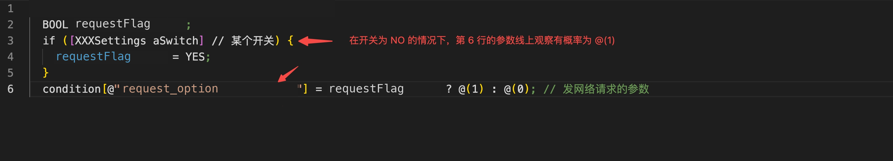
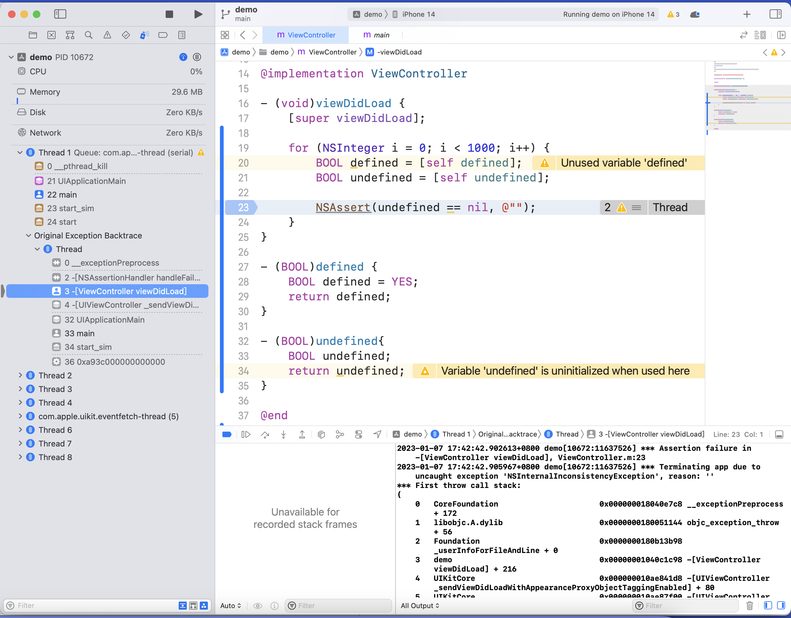
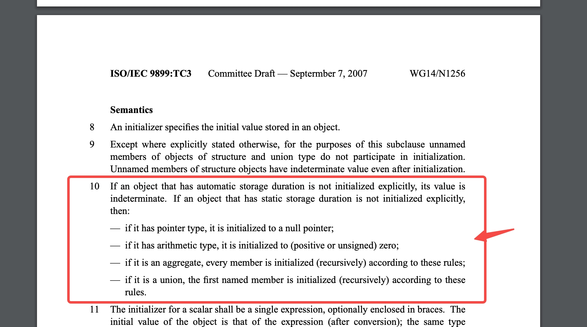
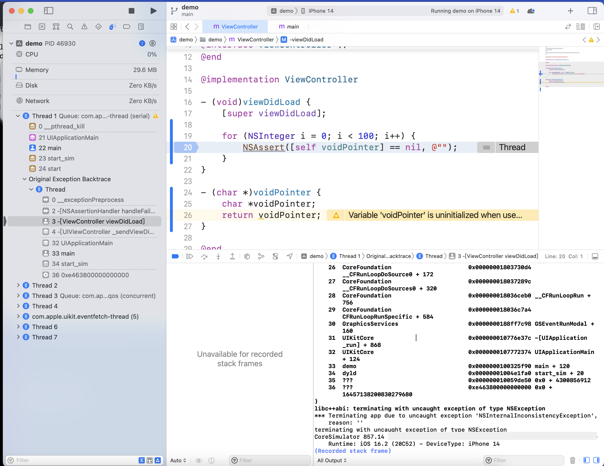
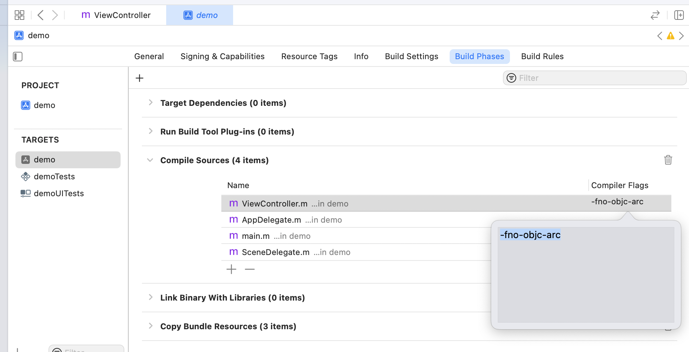
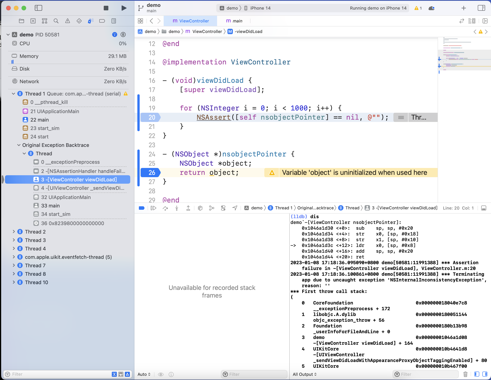
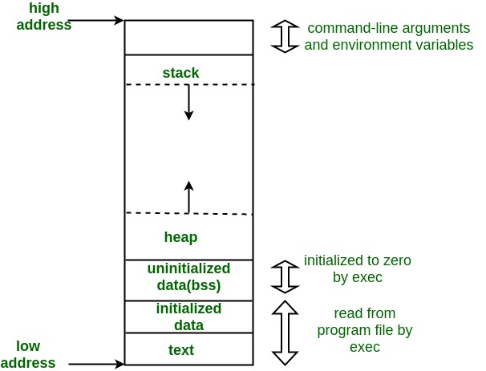
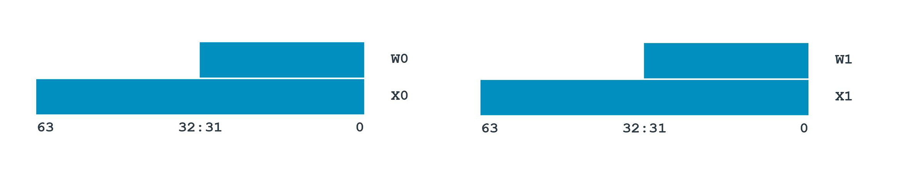

> [!TLDR]
>
> 1. 推荐大家在创建变量的时候都显式进行正确的初始化，不论是从鲁棒性还是可读性都更加优秀。Clang 有对应的 Warning，大家可以开启 `-Werror=uninitialized` \(Warn As Error\) 相关编译参数。
>
> 2. 局部的算数类型如果不初始化，值不确定，需要显示初始化。其余类型的结论可以翻看本文的[总结部分](#总结)。

## 问题提出



前几天在协助业务同学排查业务问题时，遇到了一个奇怪的问题。实际的业务代码如上，默认定义了一个局部变量 `requestFlag` ，通过另一个开关控制这个参数是否为 NO。但观察线上数据，在开关为 NO 时依旧有参数为 YES 的上报，数量虽然之前版本一直存在但量级较小，视为误差。但最新版本上线后发现这种情况量级突然变大，但是这个函数的代码没有任何改动。

排除了其他的可能性之后，问题就来到了怀疑 `requestFlag` 是否值不确定，也就是是否可能是 NO 或者 YES。


这一下子就把我问住了，我有印象应该这个在局部变量的时候是未定义的，但非局部变量的情况下我也不是很清楚。我就问了问同组的同学，发现大家对于局部的 BOOL 变量的默认值是什么也有争议，部分同学认为永远是 NO。既然有疑问，那我们就需要进行研究，~~顺便小水一篇~~。


我们进一步抽象这个问题，在 ARC 环境下，下面这段代码的各个变量的值是什么？

```objective-c
- (void)sample {
    NSObject *obj;
    BOOL boolean;
    NSInteger inter;
    char *pointer;
    static BOOL staticBoolean;
}
```

戳我点开答案：[answer\.txt](./attachments/answer.txt)，如果答案与你的认知不同，那你可以继续阅读本文啦。

关于阅读本文需要的前置知识，由于篇幅较大，为了大家的阅读体验挪到了本文的最后，如果对 [C 的内存布局](#c的内存布局) 与 [ARM64 汇编](#arm64-汇编) 不熟悉的同学可以先跳转观看。


## 通过汇编进行验证算数类型

### 分析汇编

我们可以简单写一个 Demo 验证一下 BOOL 的情况。

[demo\.zip](./attachments/demo.zip)

```objective-c
- (void)viewDidLoad {
    [super viewDidLoad];
    
    for (NSInteger i = 0; i < 1000; i++) {
        BOOL defined = [self defined];
        BOOL undefined = [self undefined];
        NSAssert(undefined == NO, @""); // 如果认为 BOOL 未经初始化一定是 NO 的话，那这个 Assert 就永远不会中 
    }
}

- (BOOL)defined {
    BOOL defined = YES;
    return defined;
}

- (BOOL)undefined{
    BOOL undefined; 
    return undefined; // Variable 'undefined' is uninitialized when used here
}
```

跑起来看看结果，Demo 因为命中 Assert 后抛出 NSException 而崩溃了。因此可以先简单确认结论了。未初始化的临时变量 BOOL 的值并非确定是 NO。



但为什么是未定义的？这就需要汇编来帮助我们了。

在 ARM64 的真机 Debug 下 **disassemble** 一下，如果用的模拟器则会出现 x86 的汇编，感兴趣的同学可以自行尝试，我们这里就以 ARM64 的汇编为例了：

```objective-c
- (BOOL)undefined {
    BOOL undefined;
->  return undefined;
}
```

```asm annotated
**(lldb) disassemble**
demo`-[ViewController undefined]:
    0x102fade68 <+0>:  sub    sp, sp, #0x20 // sp = sp - 20，push stack，本身因为调用 @selector(undefined) 新开了一个函数栈，至于为什么是 0x20 是因为 sp 要以 16(0x10) 字节对齐：除了 存 x0（8 字节） x1(8 字节) ，BOOL (1 个字节，读到寄存器再补成了 4 个字节变成了 w8) ，还有 15 个字节就是对齐的成本
    0x102fade6c <+4>:  str    x0, [sp, #0x18] // 把 x0 存到 sp + 0x18 的地址，x0 实际是 self，存储的具体位置是 sp + 0x18 到 sp + 0x20 的这 8 个字节
    0x102fade70 <+8>:  str    x1, [sp, #0x10] // 把 x1 存到 sp + 0x18 的地址，x1 实际是 selector(undefined)，存储的具体位置是 sp + 0x10 到 sp + 0x18 这个位置。
->  0x102fade74 <+12>: ldrb   w8, [sp, #0xf] // w8 直接从 sp + 0xf 的地址读取，但是 sp + 0xf 的位置是未定义的，w8 就是 undefined 这个变量
    0x102fade78 <+16>: and    w0, w8, #0x1 // 把 w8 与 0x1 取并（也就是结果要么 0x0 要么 0x1）塞给 w0（x0），返回给外部
    0x102fade7c <+20>: add    sp, sp, #0x20
    0x102fade80 <+24>: ret   
```

我们来看下内存分布，加深下对 stack 内存布局的理解，一句话理解结论就是：分给 `undefined` 的内存 sp \+ 0xf 的值是未定义的，因此导致了 `undefined` 的值也是未定义的。

```objective-c annotated
**(lldb) reg read sp**
      sp = 0x000000016d8e79a0
```

我们首先打印 **sp** 的值，值为 **0x000000016d8e79a0** 。

```objective-c annotated
**(lldb) memory read 0x000000016d8e79a0 0x000000016d8e79c0**
                                                        **sp+0xf**
                                                          **⬇️**
0x16d8e79a0: 01 00 00 00 00 00 00 00 00 d0 51 02 01 00 00 11  ..........Q.....
              x1  sp+0x10 ~ sp+0x18   x0  sp+0x18 ~ sp+0x20                   
                        ⬇️                       ⬇️                            
0x16d8e79b0: 78 4e 74 b1 01 00 00 00 f0 61 60 17 01 00 00 00  xNt......a`.....
```

接着我们查看内存中从 **0x000000016d8e79a0**\(sp\) 到 **0x000000016d8e79c0**\(sp \+ 0x20\) 的具体内容，通过 **memory read **命令，也就是 `-[ViewController undefined]` 这个函数本次分配到的栈内存。

每个参数寄存器对应写入的内存地址与范围已经标注在上方了，例如 x0 对应 sp\+0x18 \~ sp\+0x20 ，x1 对应 sp\+0x10 \~ sp\+0x18 。

```objective-c annotated
**(lldb) po self**
<ViewController: 0x1176061f0>
**(lldb) reg read x0**
      x0 = 0x00000001176061f0
```

x0 首先肯定是外部调用的 self，也就是本次的 ViewController ，我们看到由于 ARM64 是小端序，因此展示在内存里的值与我们正常阅读的顺序是反过来的，具体来说就是每个 Byte 位内部不用颠倒，但是整体阅读的时候需要反转，例如 x0 对应的内存区域：sp\+0x18 \~ sp\+0x20 ，`f0 61 60 17 01 00 00 00` \-\> `00 00 00 01 17 60 61 f0` \-\> `0x00000001176061f0` 。

```objective-c annotated
**(lldb) reg read x1**
      x1 = 0x00000001b1744e78

**(lldb) memory read 0x00000001b1744e70**
**0x1b1744e70: 63 74 56 61 6c 75 65 00 75 6e 64 65 66 69 6e 65  ctValue.undefine**
**0x1b1744e80: 64 00 54 42 2c 52 2c 4e 2c 47 69 73 55 6e 64 65  d.TB,R,N,GisUnde**
```

同理我们可以看到 x1 是调用时的 @selector ，写入了内存中  sp\+0x18 \~ sp\+0x20 的位置，一样可以看到是能对应上的，我们还可以看 x1 指向的内存区域，看看 @selector 是什么，可以看到是 **undefine\\0** 。最后的 **\\0** 是表达 Cstr 的结束。

```objective-c annotated
**(lldb) memory read 0x000000016d8e79a0 0x000000016d8e79c0**
                                                        **sp+0xf**
                                                          **⬇️**
0x16d8e79a0: 01 00 00 00 00 00 00 00 00 d0 51 02 01 00 00 11  ..........Q.....
// 下面一行略
```

接着我们再分析 w8 的诞生，w8 就是对 undefined 这个变量的操作，w8 从 sp \+ 0xf 读取这一个字节，本次运行的时候读取到的值是 0x11 ，然后 ldrb 会高位补 0 ，因此 w8 的结果就是 4 个字节的 0x11 。最后再对 w8 取 与 0x1 ，获得了最终的 BOOL 值。

这里虽然本次取到的值是 0x11 ，但这个是完全随机的，原因我们在一开始也就讲过了，Stack 的内存内容是完全随机，并且我们的程序也没有对其进行初始化。原本操作系统分给你是什么就是什么，不论是 heap 还是 stack 都一样。对于 Stack 来说，这块内存可能之前有更深的调用使用过，在 pop 的时候并不会清零。

> A common assumption made by novice programmers is that all variables are set to a known value, such as zero, when they are declared\. While this is true for many languages, it is not true for all of them, and so the potential for error is there\. Languages such as [C](https://en.wikipedia.org/wiki/C_(programming_language)) use [stack](https://en.wikipedia.org/wiki/Stack_(data_structure)) space for variables, and the collection of variables allocated for a subroutine is known as a [stack frame](https://en.wikipedia.org/wiki/Stack_frame). While the computer will set aside the appropriate amount of space for the stack frame, it usually does so simply by adjusting the value of the stack [pointer](https://en.wikipedia.org/wiki/Pointer_(computer_programming)), and does not set the [memory](https://en.wikipedia.org/wiki/Computer_storage) itself to any new state \(typically out of efficiency concerns\)\. Therefore, whatever contents of that memory at the time will appear as initial values of the variables which occupy those addresses\.
> 
> https://en.wikipedia.org/wiki/Uninitialized_variable
> 
> 


我们再对比下有默认值的汇编，看看有什么区别：

```objective-c
- (BOOL)undefined {
    BOOL defined = YES;
->  return defined;
}
```

```asm annotated
**(lldb) dis**
demo`-[ViewController undefined]:
    0x100b29e60 <+0>:  sub    sp, sp, #0x20
    0x100b29e64 <+4>:  str    x0, [sp, #0x18]
    0x100b29e68 <+8>:  str    x1, [sp, #0x10]
    0x100b29e6c <+12>: mov    w8, #0x1 // 先把 w8 设置成 YES
    0x100b29e70 <+16>: strb   w8, [sp, #0xf] // 把 w8 存到 sp + 0xf 的位置
->  0x100b29e74 <+20>: ldrb   w8, [sp, #0xf]
    0x100b29e78 <+24>: and    w0, w8, #0x1
    0x100b29e7c <+28>: add    sp, sp, #0x20
    0x100b29e80 <+32>: ret    
```

可以看到主要区别在于 w8 有初始化赋值，其余都没有区别。于此，对于算数类型的初始化验证完毕。

### 网络上寻找相关资料

我们看最权威的资料：ISO/IEC 9899:TC3（2007-09-07） 中 Section 6\.7\.8 关于 Initialization  的论述。我们在 stack 上分配的变量是 automatic storage，并且是没有经过初始化的，这种值是未定义的。



同时后半句还提到，如果是 static storage 并且未初始化：

1. 指针类型就是空指针；

2. 算术类型 \(int / float 等\) 就是 0 ；

3. 复合类型 \(struct / class\) 的每个成员变量以前面的规则初始化；

4. 对于 union ，只有第一个命名的成员以前面的规则初始化，其余的都是未定义，可以看：[Static storage union and named members initialization in C language](https://stackoverflow.com/questions/54307858/static-storage-union-and-named-members-initialization-in-c-language)。

### 结论得出

至此我们就可以解答同学提出的疑问了，对于局部变量且是算数类型时，这个值是不确定的。这个结论也符合现象，之前版本也一直存在这种上报，但是最新版本可能由于任意调用链路上的 stack 调用改动，导致 BOOL 值变成 YES 的概率变大。同理，如果是 NSInteger 或者 CGFloat 或者 别的类型也是一样的结果。


同时我们发现这么写代码，Xcode 也有对应的警告，可以看下 Clang 相关的静态检查

> - [**core\.uninitialized\.ArraySubscript \(C\)**](https://clang.llvm.org/docs/analyzer/checkers.html#core-uninitialized-arraysubscript-c)
> 
> - [**core\.uninitialized\.Assign \(C\)**](https://clang.llvm.org/docs/analyzer/checkers.html#core-uninitialized-assign-c)
> 
> - [**core\.uninitialized\.Branch \(C\)**](https://clang.llvm.org/docs/analyzer/checkers.html#core-uninitialized-branch-c)
> 
> - [**core\.uninitialized\.CapturedBlockVariable \(C\)**](https://clang.llvm.org/docs/analyzer/checkers.html#core-uninitialized-capturedblockvariable-c)
> 
> - [**core\.uninitialized\.UndefReturn \(C\)**](https://clang.llvm.org/docs/analyzer/checkers.html#core-uninitialized-undefreturn-c)
> 
> - [**core\.uninitialized\.NewArraySize \(C\+\+\)**](https://clang.llvm.org/docs/analyzer/checkers.html#core-uninitialized-newarraysize-c)
> 
> https://clang.llvm.org/docs/analyzer/checkers.html#core-uninitialized-assign
> 
> 

大家可以考虑在项目的 CI 中开启对应的检查。如果觉得静态检查过于后置，也可以在本地打开对应规则的 Warn As Error ，更前置得报出问题。

具体参数是：`-Werror=uninitialized`，可以查看：https://clang.llvm.org/docs/DiagnosticsReference.html#wuninitialized


## 再进一步拓展到普通指针与 NSObject \(OC 对象\)指针

### 普通指针

其实根据刚才上面的分析，我们已经可以大致猜到普通指针的结果，由于分配的区域是 stack ，而 stack 又未经初始化，因此大概率普通的指针默认值也不是 nil 。

```objective-c
- (void)viewDidLoad {
    for (NSInteger i = 0; i < 100; i++) {
        NSAssert([self voidPointer] == nil, @"");
    }
}

- (char *)voidPointer {
    char *voidPointer;
->  return voidPointer;
}
```

```objective-c annotated
**(lldb) dis**
demo`-[ViewController voidPointer]:
    0x104c1dcb0 <+0>:  sub    sp, sp, #0x20
    0x104c1dcb4 <+4>:  str    x0, [sp, #0x18]
    0x104c1dcb8 <+8>:  str    x1, [sp, #0x10]
->  0x104c1dcbc <+12>: ldr    x0, [sp, #0x8]
    0x104c1dcc0 <+16>: add    sp, sp, #0x20
    0x104c1dcc4 <+20>: ret    
```

与之前的分析基本一样，只是由于 char \* 本身是一个指针，只是偏移量有所改变，这次 `voidPointer` 取的是  `sp + 0x8` 到 `sp + 0x10` 而已。因此值也是不确定的。与我们设想的一致。



### NSObject 指针

#### ARC

到了这时候大家可能会觉得，NSObject 指针有啥不一样的，不也是在 stack 上分配内存吗，那肯定值是不确定的。

理解到这里我只能说确实是理解了我前文的内容，但是对于 OC 的理解还有欠缺（手动狗头）。

```objective-c
- (void)viewDidLoad {
    [super viewDidLoad];
    
    for (NSInteger i = 0; i < 1000; i++) {
        NSAssert([self nsobjectPointer] == nil, @"");
    }
}

- (NSObject *)nsobjectPointer {
    NSObject *object;
    return object;
}
```

我们跑起来看下，竟然没有命中 Assert ，看起来 `NSObject *` 不初始化也能是 null ？那这是为什么呢？\(~~其实标题已经剧透了~~）


首先我们对这个文件的编译参数是 ARC ，因此对于所有的指针类型默认属性都是 `__strong` 。

其实就隐藏在 ARC 帮我们自动插入的代码中，我们也一样来看看汇编。  为了简化代码，我们把函数返回值取消（不然你会看到诸如 `objc_autoreleaseReturnValue` 的调用，增加复杂度）。

```objective-c
- (void)nsobjectPointer {
    NSObject *object;
->  
}
```

```objective-c annotated
**(lldb) dis**
demo`-[ViewController nsobjectPointer]:
    0x102f05db8 <+0>:  sub    sp, sp, #0x30
    0x102f05dbc <+4>:  stp    x29, x30, [sp, #0x20]
    0x102f05dc0 <+8>:  add    x29, sp, #0x20
    0x102f05dc4 <+12>: stur   x0, [x29, #-0x8]
    0x102f05dc8 <+16>: str    x1, [sp, #0x10]
    0x102f05dcc <+20>: add    x0, sp, #0x8 // x0 = sp + 0x8
    0x102f05dd0 <+24>: mov    x1, #0x0 // x1 = 0x0
    0x102f05dd4 <+28>: str    xzr, [sp, #0x8] // *(sp + 0x8) = 0 也就是刚写入的 xzr(8 个字节的 0)
->  0x102f05dd8 <+32>: bl     0x102f06374               ; symbol stub for: objc_storeStrong // 接受两个参数，x1 如果是 null 的话就是对 x0 置空
    0x102f05ddc <+36>: ldp    x29, x30, [sp, #0x20]
    0x102f05de0 <+40>: add    sp, sp, #0x30
    0x102f05de4 <+44>: ret    
```

哦豁，代码量一下子就提高了很多。但没关系我们只需要关注一个点即可，那就是虽然没有任何值赋给 `__strong object`，但其实 ARC 依旧帮我们调用了 `objc_storeStrong` ，并且调用的还是 `objc_storeStrong(sp + 0x8, 0x0)`。这个调用的意思就是对 `sp + 0x8` 这块内存置空。

```objective-c
// objc4-706
void
objc_storeStrong(id *location, id obj)
{
    id prev = *location;
    if (obj == prev) {
        return;
    }
    objc_retain(obj);
    *location = obj;
    objc_release(prev);
}
```

我们可以对比下手动置 nil 的汇编代码，没有任何区别。

```objective-c
- (void)nsobjectPointer {
    NSObject *object = nil;
->  
}
```

```objective-c annotated
**(lldb) dis**
demo`-[ViewController nsobjectPointer]:
    0x102e3ddb8 <+0>:  sub    sp, sp, #0x30
    0x102e3ddbc <+4>:  stp    x29, x30, [sp, #0x20]
    0x102e3ddc0 <+8>:  add    x29, sp, #0x20
    0x102e3ddc4 <+12>: stur   x0, [x29, #-0x8]
    0x102e3ddc8 <+16>: str    x1, [sp, #0x10]
    0x102e3ddcc <+20>: add    x0, sp, #0x8
    0x102e3ddd0 <+24>: mov    x1, #0x0
    0x102e3ddd4 <+28>: str    xzr, [sp, #0x8]
->  0x102e3ddd8 <+32>: bl     0x102e3e374               ; symbol stub for: objc_storeStrong
    0x102e3dddc <+36>: ldp    x29, x30, [sp, #0x20]
    0x102e3dde0 <+40>: add    sp, sp, #0x30
    0x102e3dde4 <+44>: ret    
```

我们最后再看下对于 `__weak` 变量，结果是如何的。

```objective-c
- (void)nsobjectPointer {
    __weak NSObject *object = nil;
->  
}
```

```objective-c annotated
**(lldb) dis**
demo`-[ViewController nsobjectPointer]:
    0x104c75db0 <+0>:  sub    sp, sp, #0x30
    0x104c75db4 <+4>:  stp    x29, x30, [sp, #0x20]
    0x104c75db8 <+8>:  add    x29, sp, #0x20
    0x104c75dbc <+12>: stur   x0, [x29, #-0x8]
    0x104c75dc0 <+16>: str    x1, [sp, #0x10]
    0x104c75dc4 <+20>: add    x0, sp, #0x8 // x0 = sp + 0x8
    0x104c75dc8 <+24>: str    xzr, [sp, #0x8] // *(sp + 0x8) = 0x0，这时候 x0 就是 __weak 的 object，也就是置空
->  0x104c75dcc <+28>: bl     0x104c76338               ; symbol stub for: objc_destroyWeak // 只接收了一个参数，x0，也就是把 sp + 0x8 这个地址传入，这个地址的值是 0 
    0x104c75dd0 <+32>: ldp    x29, x30, [sp, #0x20]
    0x104c75dd4 <+36>: add    sp, sp, #0x30
    0x104c75dd8 <+40>: ret    
```

因此我们知道了在 ARC 下，把 `__strong`/ `__weak` 变量初始化为 nil 是编译器特性，由于编译器会帮我们插入 objc\_storeStrong/objc\_retain 等函数来进行控制，在这个时候就会把 NSObject 类型的指针初始化为 0 啦。

具体可以查看：[Clang \- AutomaticReferenceCounting\.html](https://releases.llvm.org/11.1.0/tools/clang/docs/AutomaticReferenceCounting.html) 

> It is undefined behavior if the storage of a `__strong` or `__weak` object is not properly initialized before the first managed operation is performed on the object, or if the storage of such an object is freed or reused before the object has been properly deinitialized\. Storage for a `__strong` or `__weak` object may be properly initialized by filling it with the representation of a null pointer, e\.g\. by acquiring the memory with `calloc` or using `bzero` to zero it out\. A `__strong` or `__weak` object may be properly deinitialized by assigning a null pointer into it\. A `__strong` object may also be properly initialized by copying into it \(e\.g\. with `memcpy`\) the representation of a different `__strong` object whose storage has been properly initialized; doing this properly deinitializes the source object and causes its storage to no longer be properly initialized\. A `__weak` object may not be representation\-copied in this way\.
> 
> 

这句话的理解是：类对象的所有 Property 默认值都是 nil，因为类对象是 calloc 出来 或者 通过 bzero 置零了。

```objective-c
// objc4-706

// Call [cls alloc] or [cls allocWithZone:nil], with appropriate 
// shortcutting optimizations.
static ALWAYS_INLINE id
callAlloc(Class cls, bool checkNil, bool allocWithZone=false)
{
    if (slowpath(checkNil && !cls)) return nil;

#if __OBJC2__
    if (fastpath(!cls->ISA()->hasCustomAWZ())) {
        // No alloc/allocWithZone implementation. Go straight to the allocator.
        // fixme store hasCustomAWZ in the non-meta class and 
        // add it to canAllocFast's summary
        if (fastpath(cls->canAllocFast())) {
            // No ctors, raw isa, etc. Go straight to the metal.
            bool dtor = cls->hasCxxDtor();
            id obj = (id)calloc(1, cls->bits.fastInstanceSize());
            if (slowpath(!obj)) return callBadAllocHandler(cls);
            obj->initInstanceIsa(cls, dtor);
            return obj;
        }
        else {
            // Has ctor or raw isa or something. Use the slower path.
            id obj = class_createInstance(cls, 0);
            if (slowpath(!obj)) return callBadAllocHandler(cls);
            return obj;
        }
    }
#endif

    // No shortcuts available.
    if (allocWithZone) return [cls allocWithZone:nil];
    return [cls alloc];
}
```


最后，我们把复杂带返回值的这大段汇编的具体理解，就当留一个课后作业给大家，感兴趣的同学可以自行分析。

```objective-c
- (NSObject *)nsobjectPointer {
    NSObject *object;
->  return object;
}
```

```objective-c annotated
(lldb) dis
demo`-[ViewController nsobjectPointer]:
    0x100df9ce8 <+0>:  sub    sp, sp, #0x40
    0x100df9cec <+4>:  stp    x29, x30, [sp, #0x30]
    0x100df9cf0 <+8>:  add    x29, sp, #0x30
    0x100df9cf4 <+12>: stur   x0, [x29, #-0x8]
    0x100df9cf8 <+16>: stur   x1, [x29, #-0x10]
    0x100df9cfc <+20>: add    x8, sp, #0x18 // x8 = sp + 0x18
    0x100df9d00 <+24>: str    x8, [sp, #0x8] // *(sp + 0x8) = x8
    0x100df9d04 <+28>: mov    x8, #0x0 // 清空 x8，这时候 x8 其实就是 object 了
    0x100df9d08 <+32>: str    x8, [sp] // *(sp) = x8 = 0 
    0x100df9d0c <+36>: str    xzr, [sp, #0x18] // *(sp + 0x18) = 0x0 (8 个字节的 0)
->  0x100df9d10 <+40>: ldr    x0, [sp, #0x18] // x0 = *(sp + 0x18) ，也就是刚写入的 xzr(8 个字节的 0)
    0x100df9d14 <+44>: bl     0x100dfa2bc               ; symbol stub for: objc_retain // objc_retain 只有一个参数，就是 x0，而上一步 x0 = *(sp + 0x18) ，也就是把 0 传入（啥都没干）
    0x100df9d18 <+48>: ldr    x1, [sp] // 之前 *sp 的位置是被写入了 0x0 的 0x100df9d08 <+32>
    0x100df9d1c <+52>: mov    x2, x0
    0x100df9d20 <+56>: ldr    x0, [sp, #0x8]
    0x100df9d24 <+60>: str    x2, [sp, #0x10]
    0x100df9d28 <+64>: bl     0x100dfa2d4               ; symbol stub for: objc_storeStrong // 接受两个参数，x1 如果是 null 的话就是对 x0 置空
    0x100df9d2c <+68>: ldr    x0, [sp, #0x10]
    0x100df9d30 <+72>: ldp    x29, x30, [sp, #0x30]
    0x100df9d34 <+76>: add    sp, sp, #0x40
    0x100df9d38 <+80>: b      0x100dfa28c               ; symbol stub for: objc_autoreleaseReturnValue
```

#### MRC

如果我们用 MRC 编译文件，来看下对应的汇编代码，与之前的普通指针完全一致，因此在 MRC 情况下，结论与普通指针一致。

```objective-c
- (NSObject *)nsobjectPointer {
    NSObject *object;
    return object;
}
```

```objective-c annotated
**(lldb) dis**
demo`-[ViewController nsobjectPointer]:
    0x1046a1d30 <+0>:  sub    sp, sp, #0x20
    0x1046a1d34 <+4>:  str    x0, [sp, #0x18]
    0x1046a1d38 <+8>:  str    x1, [sp, #0x10]
->  0x1046a1d3c <+12>: ldr    x0, [sp, #0x8]
    0x1046a1d40 <+16>: add    sp, sp, #0x20
    0x1046a1d44 <+20>: ret    
```

因此也就会发生崩溃。





## 总结

```objective-c
// ARC 环境
- (void)sampleARC {
    NSObject *obj; // nil，值确定
    BOOL boolean; // 未定义，值不确定
    NSInteger inter; // 未定义，值不确定
    char *pointer; // 未定义，值不确定
    static BOOL staticBoolean; // false / 0，值确定
}

// MRC 环境
- (void)sampleMRC {
    NSObject *obj; // 未定义，值不确定
}
```

本文通过理解 ARM64 汇编的方式验证了下面的这些情况：

1. 对于 C 的基础类型，如果未初始化：

    1. 局部变量：值不确定，需要初始化。

    2. 全局变量或者静态变量：值确定为 NULL 或者 0，原因是这部分储存在 \_\_bss/\_\_common 段内存会被初始化为 0。

2. 指针如果未初始化：

    1. ARC 情况下，OC 对象指针：由于编译器生成代码协助，值确定为 nil 。

    2. MRC 情况下，OC 对象指针：值不确定，需要初始化。

    3. 非 OC 对象指针：值不确定，需要初始化。


## 前置知识

### C的内存布局



#### 堆内存 \(stack\) 与栈内存 \(heap\)

```objective-c
- (void)memberFunction {
    BOOL memberArithmetic = NO; // 栈
    NSObject *pointer = [[NSObject alloc] init]; // pointer 本身是在栈上，但 *pointer （也就是分配的 NSObject）在堆上
}
```

对于 OC 来说由于机制的原因，如果是 new 或者 alloc 出来的对象都是 堆 \(heap\) 内存，而一些结构体或者基础类型，就是 栈 \(stack\) 内存。如果是 C\+\+ 的话，就比较复杂了，对象可以创建在堆上，也可以创建在栈上，看创建方法。

如果不熟练的话，可以通过运行时的命令进行 check，对比地址与 fp 与 sp。

```objective-c annotated
**(lldb)p $fp >= &(memberArithmetic) && &(memberArithmetic) >= $sp // memberArithmetic 在栈上**
(bool) $0 = true
**(lldb) p $fp >= &(pointer) && &(pointer) >= $sp // pointer 本身是在栈上**
**(bool) $1 = true**
**(lldb) p $fp >= (pointer) && (pointer) >= $sp // pointer （也就是分配的 NSObject）在堆上**
**(bool) $2 = false**
```

分配在栈上的变量的地址一定是处于 fp\(frame pointer / x29 / w29\) 与 sp\(stack pointer\) 之间的。里面的变量可以自己进行替换。


而 栈/堆内存是由系统分配的虚拟内存（Virtual Memory），实际最终会映射到物理内存，物理内存可能是之前别的进程使用过，也可能是当前进程使用过的，总之拿到这块内存的时候，里面的值不一定都是经过初始化为 0 的。甚至有些 malloc\(\) 的实现会特意在 debug 状态下赋值为非零以充分暴露问题。

> The operating system does not guarantee a zero'ed out memory, just that you own it\. It will probably give you pages of memory that were used before \(or never used before, but non\-zero\)\. If an application stores potentially\-sensitive data, it is expected to zero it before free\(\)'ing\.
> 
> https://stackoverflow.com/questions/5266260/how-is-the-stack-initialized
> 
> 
> 
> When the OS has to apportion a new page to your process \(whether that's for its stack or for the arena used by `malloc()`\), it guarantees that it won't expose data from other processes; the usual way to ensure that is to fill it with zeros \(but it's equally valid to overwrite with anything else, including even a page worth of `/dev/urandom`\- in fact some debugging `malloc()` implementations write non\-zero patterns, to catch mistaken assumptions such as yours\)\.
> 
> https://unix.stackexchange.com/questions/509232/if-the-heap-is-zero-initialized-for-security-then-why-is-the-stack-merely-unin
> 
> 


#### BSS 段

**BSS** \(**B**lock **S**tarting by **S**ymbol \)，存放未初始化的 statically allocated objects。statically allocated objects 同时指代：

特别注意：具体是否分配在 BSS 段是取决于 编译器以及具体的参数的，例如 llvm 中就还有 `__common` 段（紧跟着`__bss`段），部分情况也有所不同。这里的解释主要以 wikipedia 为主，wiki 中较多还是以 GCC 角度解释。实际变量存在哪个段中还需要实际查看编译产物。

1. 未初始化的 全局变量/常量 。（这一条 GCC 与 LLVM 不一致）

> all uninitialized objects \(both variables and [constants](https://en.wikipedia.org/wiki/Constant_(computer_programming))\) declared at file scope \(i\.e\., outside any function\)
> 
> A **global variable** is a variable that is defined outside all functions and available to all functions\.
> 
> 

```objective-c
BOOL unintializedGlobalVariable;
const BOOL unintializedGlobalConstant;

- (void)function {}
```

2. 未初始化的局部静态变量 

> uninitialized [static local variables](https://en.wikipedia.org/wiki/Static_local_variable) \([local variables](https://en.wikipedia.org/wiki/Local_variable) declared with the [`static`](https://en.wikipedia.org/wiki/Static_(keyword)) [keyword](https://en.wikipedia.org/wiki/Keyword_(computer_programming))\);
> 
> 

```objective-c
- (void)function {
    static BOOL unintializedLocalStaticVariables;
}
```

但最后，还有一类变量也可能是在 BSS 端中：初始化为 0 的 全局变量或静态变量。当然这个是看编译器支持的，不是一贯而论的。例如 GCC 的 \-fzero\-initialized\-in\-bss 与 \-fno\-zero\-initialized\-in\-bss 就能控制这个特性。

> statically\-allocated variables and constants initialized with a value consisting solely of zero\-valued bits
> 
> 

```objective-c
int intializedGlobalVariable = 0;

- (void)function {}
```

BSS 段的特征是当程序开始运行时，全部都是 0 （由 OS 内核保证），因此如果是 基础属性，那就是 0 ，如果是指针，那就是 空指针。实际由于未初始化，因此在 \.o 文件中不占用实际空间，只是一个占位 \(placeholder\)，也因此也可以解释为 'Better Save Space' 。

##### 通过产物查看

说了这么多可能被绕晕了，whatever ，我们可以直接在产物中 grep 查看对应结果来看到底是不是在 bss 段中。我的编译环境为 Xcode 14\.2 （LLVM）。

```objective-c
BOOL unintializedGlobalVariable;
const BOOL unintializedGlobalConstant;

int intializedGlobalVariable = 0;
const BOOL intializedGlobalConstant = YES;

- (void)viewDidLoad {
    [super viewDidLoad];
    
    static BOOL unintializedLocalStaticVariable;
    static const BOOL unintializedLocalStaticConstant;
    
    static BOOL intializedLocalStaticVariable = YES;
}
```

```objective-c annotated
**➜  arm64 objdump -t ViewController.o | grep intialized**
**0000000000001175 l     O __DATA,__bss** **_viewDidLoad.unintializedLocalStaticVariable**
**0000000000000145 l     O __TEXT,__const _viewDidLoad.unintializedLocalStaticConstant**
**00000000000001c8 l     O __DATA,__data _viewDidLoad.intializedLocalStaticVariable**
**0000000000000144 g     O __TEXT,__const _intializedGlobalConstant**
**0000000000001170 g     O __DATA,__common** **_intializedGlobalVariable**
**0000000000000146 g     O __TEXT,__const _unintializedGlobalConstant**
**0000000000001174 g     O __DATA,__common** **_unintializedGlobalVariable**
```

我们可以看到跟 wiki 上的介绍有些出入，例如 所有常量都在 `__TEXT,__const` 区；同时 LLVM 把 全局变量\(**GlobalVariable**\) 统统放到了 `DATA,__common` 区；未初始化的局部静态变量在 bss 区。

关于这个输出的具体参数可以查看：[objdump 的 \-t/\-\-syms 部分。](https://man7.org/linux/man-pages/man1/objdump.1.html)


> When your program starts running, all the contents of the bss section are zeroed bytes\.
> 
> http://web.mit.edu/rhel-doc/3/rhel-as-en-3/bss.html
> 
> Hence, the BSS segment typically includes all uninitialized objects \(both variables and [constants](https://en.wikipedia.org/wiki/Constant_(computer_programming))\) declared at file scope \(i\.e\., outside any function\) as well as uninitialized [static local variables](https://en.wikipedia.org/wiki/Static_local_variable) \([local variables](https://en.wikipedia.org/wiki/Local_variable) declared with the [`static`](https://en.wikipedia.org/wiki/Static_(keyword)) [keyword](https://en.wikipedia.org/wiki/Keyword_(computer_programming))\);
> 
> An implementation may also assign statically\-allocated variables and constants initialized with a value consisting solely of zero\-valued bits to the BSS section\.
> 
> https://en.wikipedia.org/wiki/.bss#BSS_in_C
> 
> If a global variable is explicitly initialized to zero \(`int myglobal = 0`\), where that variable will be stored?Compiler is free to put such variable into `bss` as well as into `data`\.
> 
> https://stackoverflow.com/questions/8721475/if-a-global-variable-is-initialized-to-0-will-it-go-to-bss
> 
> Data in this segment is initialized by the kernel to arithmetic 0 before the program starts executing;contains all global variables and static variables that are initialized to zero or do not have explicit initialization in source code\.
> 
> https://www.geeksforgeeks.org/memory-layout-of-c-program/
> 
> 虽然这里没有非常明显的证据，但我们还是可以认为`__common`段和`__bss`段没有太大区别；而之所以`__common`段独立于`__bss`段，是因为要考虑到 **全局变量需要暴露给外部（external）** ，涉及到“弱符号与强符号”的问题（这里不作介绍），否则与`__bss`段没区别。
> 
> https://www.polarxiong.com/archives/C-C-%E4%B8%AD%E5%B7%B2%E5%88%9D%E5%A7%8B%E5%8C%96-%E6%9C%AA%E5%88%9D%E5%A7%8B%E5%8C%96%E5%85%A8%E5%B1%80-%E9%9D%99%E6%80%81-%E5%B1%80%E9%83%A8%E5%8F%98%E9%87%8F-%E5%B8%B8%E9%87%8F%E5%9C%A8%E5%86%85%E5%AD%98%E4%B8%AD%E7%9A%84%E4%BD%8D%E7%BD%AE.html
> 
> 


关于这部分内容，详细可以查看：[Memory Layout of C Programs](https://www.geeksforgeeks.org/memory-layout-of-c-program/) 一文。当然实际对于内存的理解还有非常多的内容，例如 page in/out、触发中断、clean/dirty memory 等等，跟本文无关我们就不再展开了。

### ARM64 汇编

这是一个比较大的话题，我们在这里只讲解必要的指令帮助大家理解，其余复杂的命令大家如果工作中用得到的话再学习即可。

#### `sub` / `add`

意思就是简单的加减法，对于 CPU 来说，能直接操作的只有寄存器，不能直接操作内存，因此一般参数都是寄存器。

`sub    sp, sp, #0x20` 的意思是 sp = sp \- 0x20 。由于 stack 内存是由高地址向地址分配，因此对 sp 进行 sub 操作本质上 push stack 的行为。

`add    sp, sp, #0x20` 的意思是 sp = sp \+ 0x20 。本质上是 pop stack 的行为，一般来说同一个函数调用中，push 跟 pop 的偏移量是保持一致的。

#### `str` / `ldr(ldrb)`

这是一个对应的操作，str \(store register\)是把寄存器的值写到内存里，ldr \(load register\) 是把内存的值读到寄存器里。

`str    x0, sp`  的意思就是把 sp 的**值**写到 x0 里面。可以理解为 `x0 = sp` 。一般出现于调用 C 函数且第一个参数是指针的情况。

`str    x0, [sp, #0x18]` 的意思是把 sp \+ 0x18 这个地址的**内容**存到 x0 里面。`[]` 符号可以理解为 C 语言的 `*` 符号，可以理解为 `*(sp + 0x18) = x0`。

`ldr    x0, sp` 的意思就是把 sp 的**值**读到 x0 里面。可以理解为 x0 = sp。

`ldr    x8, [sp, #0xf]` 综上，意思就是把 sp \+ 0xf 这个地址的**内容**存到 x8 里面。可以理解为 `x8 = *(sp + 0xf)` 。

`ldrb   w1, [sp, #0xf]` ，与 ldr 大致相同，区别是多了一个 b\(byte\)，表示只读一个字节，然后用 0 填充到高位，直到满足 4 byte （也就是 w1 的大小）。w1 是访问时是寄存器的 低 32 位（4 byte），x1 访问时是寄存器 R1\(Register 1\) 的完整的 64 位（8 byte）。




## 引用


3. https://stackoverflow.com/questions/5266260/how-is-the-stack-initialized

4. https://unix.stackexchange.com/questions/509232/if-the-heap-is-zero-initialized-for-security-then-why-is-the-stack-merely-unin

5. https://man7.org/linux/man-pages/man1/objdump.1.html

6. http://web.mit.edu/rhel-doc/3/rhel-as-en-3/bss.html

7. https://en.wikipedia.org/wiki/.bss#BSS_in_C

8. https://stackoverflow.com/questions/8721475/if-a-global-variable-is-initialized-to-0-will-it-go-to-bss

9. https://www.polarxiong.com/archives/C-C-%E4%B8%AD%E5%B7%B2%E5%88%9D%E5%A7%8B%E5%8C%96-%E6%9C%AA%E5%88%9D%E5%A7%8B%E5%8C%96%E5%85%A8%E5%B1%80-%E9%9D%99%E6%80%81-%E5%B1%80%E9%83%A8%E5%8F%98%E9%87%8F-%E5%B8%B8%E9%87%8F%E5%9C%A8%E5%86%85%E5%AD%98%E4%B8%AD%E7%9A%84%E4%BD%8D%E7%BD%AE.html


13. [Static storage union and named members initialization in C language](https://stackoverflow.com/questions/54307858/static-storage-union-and-named-members-initialization-in-c-language)

14. https://en.wikipedia.org/wiki/Uninitialized_variable

15. https://clang.llvm.org/docs/analyzer/checkers.html#core-uninitialized-assign


17. https://releases.llvm.org/11.1.0/tools/clang/docs/AutomaticReferenceCounting.html


