> [!TLDR]
>
> 1. 分析了 iOS 15 前后 AutoreleasePool 与 Runloop 绑定的机制，探寻了系统的实现变迁（通过开关控制）。
>
>     1. \< iOS 15 ，系统在 `BeforeWaiting`时调用 `_objc_autoreleasePoolPop()` 和 `_objc_autoreleasePoolPush()` 释放旧的池并创建新池。
>
>     2. \>= iOS 15  ，系统在每次有 callout 的前后都会调用  `_objc_autoreleasePoolPush()` 和 `_objc_autoreleasePoolPop()` 。不再有 Runloop 的时机观测。
>
> 2. 分析了 Runloop 的一些关键对象，得到两个结论：
>
>     1. 当 order 相同时，Observer 的调用顺序会根据加入的顺序决定。后加入的，会在更后面（优先级低），先加入的会在前面（优先级高）。
>
>     2. 对于通过 CreateWithHandler 系列 API 创建的 Observer，通过 context ，从而找到实际的执行的 Block 。
>
> 3. 分析了系统 feature 开关的实现，列出了部分可供后续研究的系统库的开关。

在实践中，我发现了一些奇怪的点，在 \(, iOS 15\) 上，释放堆积的 AutoreleasePoolPop 需要在系统的 \_runLoopObserverCallout 进行，因此我们对 pop 的控制需要在 \_runLoopObserverCallout 前进行；而在 \[iOS 15\.0, \) 后，任意优先级的 callout 后，都有系统触发的 AutoreleasePoolPop，疑似系统在每次 callout 前后都进行了 AutoreleasePool 的 Push/Pop 操作。那系统是不再将 runloop 的行为绑定 AutoreleasePool 了吗？


同时，在调试时还发现 示例 App A 存在众多优先级相同的 Observer ，执行顺序又该如何？苹果的文档中并没有明确处理的顺序。因此希望对结果进行探究。


> 文中大量的 disassemble 代码同时使用 ida64 与 hopper 生成两份，各位按喜好选取即可。~~个人喜欢 ida64 。~~ 


## CF\-1153\.18 Source Code

对于我们想看到的输出，如果创建 Oberserver 的方式是通过 CFRunLoopObserverCreateWithHandler 的话，直接 **`po [NSRunLoop mainRunLoop]`** 是看不到我们想要的结果的。但既然我们看了源码，自然知道如何拿到 block 的符号。


给一个输出的实例：

```text
<CFRunLoopObserver 0x6000017b0780 [0x1da835af0]>{valid = Yes, activities = 0xa0, repeats = Yes, order = 1999000, callout = _beforeCACommitHandler (0x184d6c2bc), context = <CFRunLoopObserver context 0x1415051f0>}


<CFRunLoopObserver 0x6000001bc3c0 [0x1da835af0]>{valid = Yes, activities = 0x20, repeats = No, order = 9223372036854775807, callout = _runLoopObserverWithBlockContext (0x18034d338), context = <CFRunLoopObserver context 0x600003ed1650>}

<CFRunLoopTimer 0x6000005ac3c0 [0x1da835af0]>{valid = Yes, firing = No, interval = 0, tolerance = 0, next fire date = 737279755 (-2596.69412 @ 15026257855025), callout = (Delayed Perform) UIApplication _accessibilitySetUpQuickSpeak (0x1808118bc / 0x18413ede4) (/Library/Developer/CoreSimulator/Profiles/Runtimes/iOS 15.0.simruntime/Contents/Resources/RuntimeRoot/System/Library/PrivateFrameworks/UIKitCore.framework/UIKitCore), context = <CFRunLoopTimer context 0x6000025f2bc0>}
```

我们可以看到：

1. 第一个 Observer 可以明确看到 callout 函数为 `_beforeCACommitHandler` 。


2. 第三个 Timer 可以很明确看到 callout 函数为 `UIApplication _accessibilitySetUpQuickSpeak`。当然这其实也是因为这个 Timer 的创建没有使用 CFRunLoopTimerCreateWithHandler 的 API ，不然也看不到直接的输出。


3. 但第二个 Observer 我们只能看到 callout 是 `_runLoopObserverWithBlockContext` ，但是业务的触发在哪里，我们无从得知。需要查看源码获取对应的信息。


### 关于 \_\_CFRunLoopObserver 的结构

可以通过 copy 一份 source code，通过 `__builtin_offsetof` 直接获取偏移量，避免去理解定义或者手动展开（~~偷懒~~）。

```cpp annotated
typedef struct __CFRuntimeBase {
    uintptr_t _cfisa;
    uint8_t _cfinfo[4];
#if __LP64__
    uint32_t _rc;
#endif
} CFRuntimeBase;

struct __CFRunLoopObserver {
    CFRuntimeBase _base;
    pthread_mutex_t _lock;
    CFRunLoopRef _runLoop;
    CFIndex _rlCount;
    CFOptionFlags _activities;        /* immutable */
    CFIndex _order;            /* immutable */
    CFRunLoopObserverCallBack _callout;    /* immutable */
    CFRunLoopObserverContext _context;    /* immutable, except invalidation */
};

// 解析后

struct __CFRunLoopObserver {
    CFRuntimeBase _base;
    pthread_mutex_t _lock;
    CFRunLoopRef _runLoop;
    CFIndex _rlCount;
    CFOptionFlags _activities;        /* immutable */
    CFIndex _order;            /* immutable */
    CFRunLoopObserverCallBack _callout;    /* immutable */ // + 112 , + 0x70
    ~~CFRunLoopObserverContext _context;    /* immutable, except invalidation */ // 手动进行展开如下~~
    CFIndex    version; // + 120,  + 0x78
    void *    info; // + 128， + 0x80
    const void *(*retain)(const void *info); // + 136
    void    (*release)(const void *info); // + 144
    CFStringRef    (*copyDescription)(const void *info); // + 152, + 0x98
};


static ptrdiff_t _calloutOffset = __builtin_offsetof(struct __CFRunLoopObserver, _callout); // + 112 , + 0x70
static ptrdiff_t _contextOffset = __builtin_offsetof(struct __CFRunLoopObserver, _context); // + 120,  + 0x78
```

为了方便起见，我在上面标注了 64 位设备的偏移量，并将 `CFRunLoopObserverContext` 进行了展开。


我们再来看一下 CFRunLoopObserverCreateWithHandler 的源码：

```cpp
CFRunLoopObserverRef CFRunLoopObserverCreate(CFAllocatorRef allocator, CFOptionFlags activities, Boolean repeats, CFIndex order, CFRunLoopObserverCallBack callout, CFRunLoopObserverContext *context) {}


CFRunLoopObserverRef CFRunLoopObserverCreateWithHandler(CFAllocatorRef allocator, CFOptionFlags activities, Boolean repeats, CFIndex order,
                                                      void (^block) (CFRunLoopObserverRef observer, CFRunLoopActivity activity)) {
    CFRunLoopObserverContext blockContext;
    blockContext.version = 0;
    blockContext.info = (void *)block;
    blockContext.retain = (const void *(*)(const void *info))_Block_copy;
    blockContext.release = (void (*)(const void *info))_Block_release;
    blockContext.copyDescription = NULL;
    return CFRunLoopObserverCreate(allocator, activities, repeats, order, _runLoopObserverWithBlockContext, &blockContext);
}

static void _runLoopObserverWithBlockContext(CFRunLoopObserverRef observer, CFRunLoopActivity activity, void *opaqueBlock) {
    typedef void (^observer_block_t) (CFRunLoopObserverRef observer, CFRunLoopActivity activity);
    observer_block_t block = (observer_block_t)opaqueBlock;
    block(observer, activity);
}

```

可以看到传递给 callout 的函数是一个写死的函数：`_runLoopObserverWithBlockContext` 。


因此对于通过 CreateWithHandler 创建的 Observer ，callout 打印出来的并非业务注册监听的地址，而是某个固定的函数（或者可以理解为跳板）。所以其实应该改造一下，这样输出方便一点。~~给我自己留一个 TODO ，考虑整一个 lldb script 实现。~~


对于通过 `CFRunLoopTimerCreateWithHandler` 创建的 Timer 也是同理，这里就不再展开，感兴趣的同学可以自行研究。

```cpp
CFRunLoopTimerRef CFRunLoopTimerCreate(CFAllocatorRef allocator, CFAbsoluteTime fireDate, CFTimeInterval interval, CFOptionFlags flags, CFIndex order, CFRunLoopTimerCallBack callout, CFRunLoopTimerContext *context) {}


CFRunLoopTimerRef CFRunLoopTimerCreateWithHandler(CFAllocatorRef allocator, CFAbsoluteTime fireDate, CFTimeInterval interval, CFOptionFlags flags, CFIndex order,
                        void (^block) (CFRunLoopTimerRef timer)) {
    
    CFRunLoopTimerContext blockContext;
    blockContext.version = 0;
    blockContext.info = (void *)block;
    blockContext.retain = (const void *(*)(const void *info))_Block_copy;
    blockContext.release = (void (*)(const void *info))_Block_release;
    blockContext.copyDescription = NULL;
    return CFRunLoopTimerCreate(allocator, fireDate, interval, flags, order, _runLoopTimerWithBlockContext, &blockContext);
}

static void _runLoopTimerWithBlockContext(CFRunLoopTimerRef timer, void *opaqueBlock) {
    typedef void (^timer_block_t) (CFRunLoopTimerRef timer);
    timer_block_t block = (timer_block_t)opaqueBlock;
    block(timer);
}
```


回到一开始的话题，如果要获取到函数的具体名字并进行符号化，也就很简单了，通过 CFRunLoopObserverContext 的偏移量再获取指针即可。或者直接输出 context 即可。

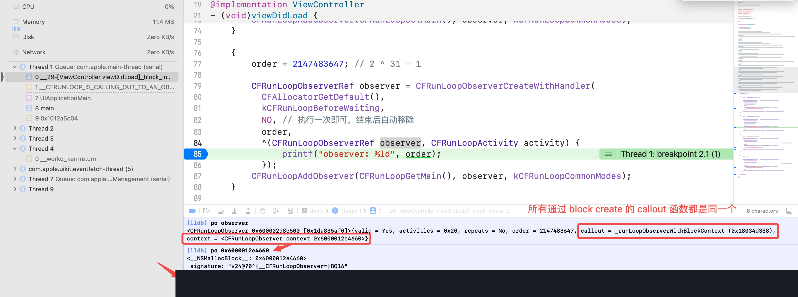


### Oberserver 的触发顺序

Order 的部分，添加与储存时，通过 po 进行查看，输出时确实是按 order 顺序来的，因此猜测储存也是如此。但还需要结合源码进行验证。

结论很简单：如果有 order 相同的情况插入，那么后加入的，会在更后面（优先级低），先加入的会在前面（优先级高）。也就是与加入的时序相关。


#### CFRunLoopAddObserver

`rlm->_observers` 是一个 CFArray ，按照 Order 从小到大 的顺序储存。

而添加新的 Observer 时，也是按倒序遍历 `rlm->_observers` ，添加到合适的位置。

如果 order 相同的话，则 后加入的，会在储存在 index 更大的位置。

```cpp
void CFRunLoopAddObserver(CFRunLoopRef rl, CFRunLoopObserverRef rlo, CFStringRef modeName) {
    // 省略部分代码异常情况兜底
    CFRunLoopModeRef rlm;
    rlm = __CFRunLoopFindMode(rl, modeName, true);
    
    // 核心循环
    if (NULL != rlm && !CFArrayContainsValue(rlm->_observers, CFRangeMake(0, CFArrayGetCount(rlm->_observers)), rlo)) {
            Boolean inserted = false;
            // 倒序插入，确实是只比较 _order 大小
            for (CFIndex idx = CFArrayGetCount(rlm->_observers); idx--; ) {
                CFRunLoopObserverRef obs = (CFRunLoopObserverRef)CFArrayGetValueAtIndex(rlm->_observers, idx);
                if (obs->_order <= rlo->_order) {
                    CFArrayInsertValueAtIndex(rlm->_observers, idx + 1, rlo);
                    inserted = true;
                    break;
                }
            }
            if (!inserted) {
            CFArrayInsertValueAtIndex(rlm->_observers, 0, rlo);
            }
        rlm->_observerMask |= rlo->_activities;
        __CFRunLoopObserverSchedule(rlo, rl, rlm);
    }
    
    // 省略部分代码
    
}
```

#### \_\_CFRunLoopDoObservers

看完了 `rlm->_observers` 的储存（Write）， 我们就要来看 实际的使用（Read），源码如下：

```c
/* rl is locked, rlm is locked on entrance and exit */
static void __CFRunLoopDoObservers() __attribute__((noinline));
static void __CFRunLoopDoObservers(CFRunLoopRef rl, CFRunLoopModeRef rlm, CFRunLoopActivity activity) { /* DOES CALLOUT */
    CHECK_FOR_FORK();

    CFIndex cnt = rlm->_observers ? CFArrayGetCount(rlm->_observers) : 0;
    if (cnt < 1) return;

    /* Fire the observers */
    STACK_BUFFER_DECL(CFRunLoopObserverRef, buffer, (cnt <= 1024) ? cnt : 1);
    CFRunLoopObserverRef *collectedObservers = (cnt <= 1024) ? buffer : (CFRunLoopObserverRef *)malloc(cnt * sizeof(CFRunLoopObserverRef));
    CFIndex obs_cnt = 0;
    for (CFIndex idx = 0; idx < cnt; idx++) {
        CFRunLoopObserverRef rlo = (CFRunLoopObserverRef)CFArrayGetValueAtIndex(rlm->_observers, idx);
        if (0 != (rlo->_activities & activity) && __CFIsValid(rlo) && !__CFRunLoopObserverIsFiring(rlo)) {
            collectedObservers[obs_cnt++] = (CFRunLoopObserverRef)CFRetain(rlo);
        }
    }
    __CFRunLoopModeUnlock(rlm);
    __CFRunLoopUnlock(rl);
    // 从 order 小的开始，逐渐往 order 大的执行
    for (CFIndex idx = 0; idx < obs_cnt; idx++) {
        CFRunLoopObserverRef rlo = collectedObservers[idx];
        __CFRunLoopObserverLock(rlo);
        if (__CFIsValid(rlo)) {
            Boolean doInvalidate = !__CFRunLoopObserverRepeats(rlo);
            __CFRunLoopObserverSetFiring(rlo);
            __CFRunLoopObserverUnlock(rlo);
            // 实际回调外部
            __CFRUNLOOP_IS_CALLING_OUT_TO_AN_OBSERVER_CALLBACK_FUNCTION__(rlo->_callout, rlo, activity, rlo->_context.info);
            if (doInvalidate) {
                CFRunLoopObserverInvalidate(rlo);
            }
            __CFRunLoopObserverUnsetFiring(rlo);
        } else {
            __CFRunLoopObserverUnlock(rlo);
        }
        CFRelease(rlo);
    }
    __CFRunLoopLock(rl);
    __CFRunLoopModeLock(rlm);

    if (collectedObservers != buffer) free(collectedObservers);
}

static void __CFRUNLOOP_IS_CALLING_OUT_TO_AN_OBSERVER_CALLBACK_FUNCTION__() __attribute__((noinline));
static void __CFRUNLOOP_IS_CALLING_OUT_TO_AN_OBSERVER_CALLBACK_FUNCTION__(CFRunLoopObserverCallBack func, CFRunLoopObserverRef observer, CFRunLoopActivity activity, void *info) {
    if (func) { // function 其实就是上面贴过的 _runLoopObserverWithBlockContext
        func(observer, activity, info);
    }
    asm __volatile__(""); // thwart tail-call optimization
}
```


#### 进一步思考

但这其实还挺不稳定的，像 示例 App A 工程中，就存在复数个同样优先级的 `kCFRunLoopBeforeWaiting` 的  observer ，其中还涉及到了 卡死监听 的，可能会导致线上出现实际卡死的上报不准确 / Hitch 上报不准确等问题。

因此需要讨论是否需要进行 runloop 的 observer 除了 order 为 0 外，不具有其他同样 order 的 observer 的管控。像 APM 的可以保持 `CFIndex.Max` ，FrameProfiler 是否需要调整为 `CFIndex.Max - 1` ？其他的呢？会导致我们监听的 “`当次 runloop 结束`” 并非真的结束，这是很危险的，除了品质的指标与真实情况相悖，还有卡死监控遗漏的风险。需要与 一位同事协商下后续的治理。

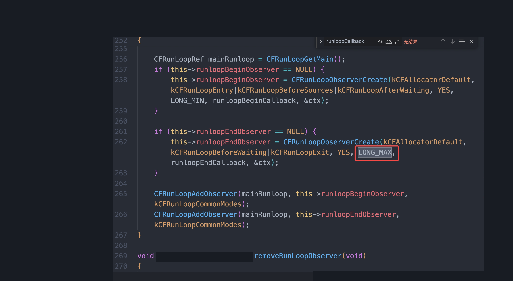

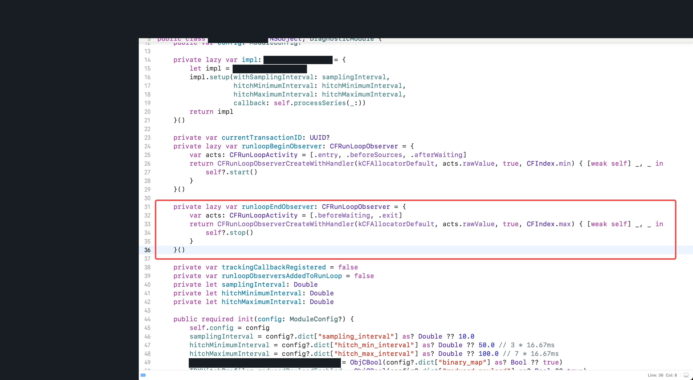

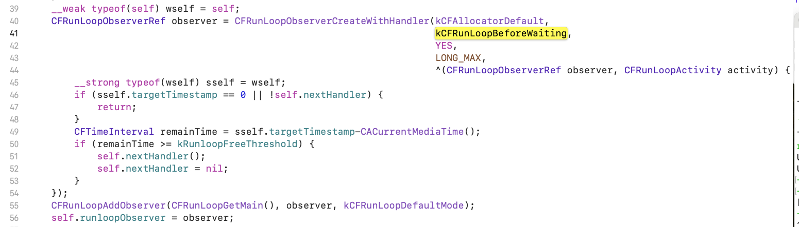

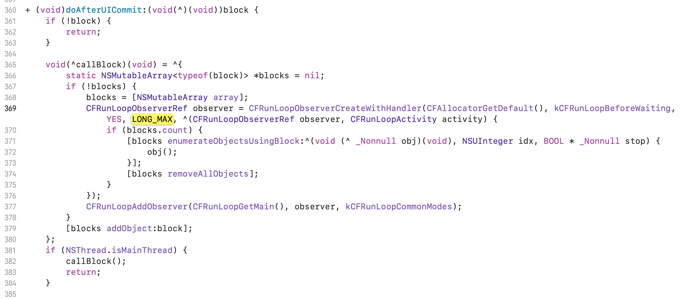

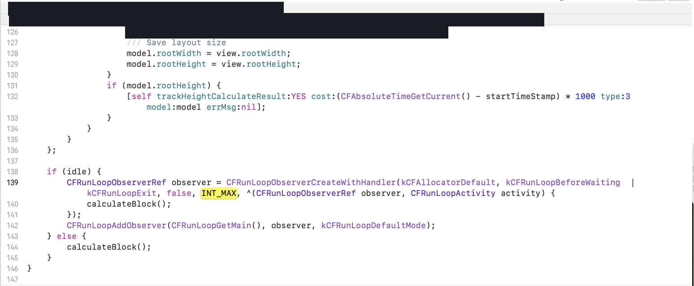

### 关于 \_\_CFRunLoop 的结构

```cpp
struct __CFRunLoop {
    CFRuntimeBase _base;
    pthread_mutex_t _lock;          /* locked for accessing mode list */
    __CFPort _wakeUpPort;           // used for CFRunLoopWakeUp , mach_port_t + 80
    Boolean _unused;
    volatile _per_run_data *_perRunData;              // reset for runs of the run loop
    pthread_t _pthread; // + 96
    uint32_t _winthread;
    CFMutableSetRef _commonModes;
    CFMutableSetRef _commonModeItems;
    CFRunLoopModeRef _currentMode; // + 128
    CFMutableSetRef _modes;
    struct _block_item *_blocks_head;
    struct _block_item *_blocks_tail;
    CFAbsoluteTime _runTime;
    CFAbsoluteTime _sleepTime;
    CFTypeRef _counterpart; // + 176
    
    // source code 里没有了
};
```

由于后续需要用到 \_\_CFRunLoop \+ 0xb9 的标记位，因此我也在这里提供 \_\_CFRunLoop 的偏移量，一样是 64 位的。

可以看到 0xb9 对应的 \+185 已经超出了最后一个数据。


### CF 对应 OS 的版本

网上找到部分的版本好对应，如果正确的话，那我们手上的源码版本大致是在 iOS 9 。

> https://iphonedev.wiki/CoreFoundation.framework  

> 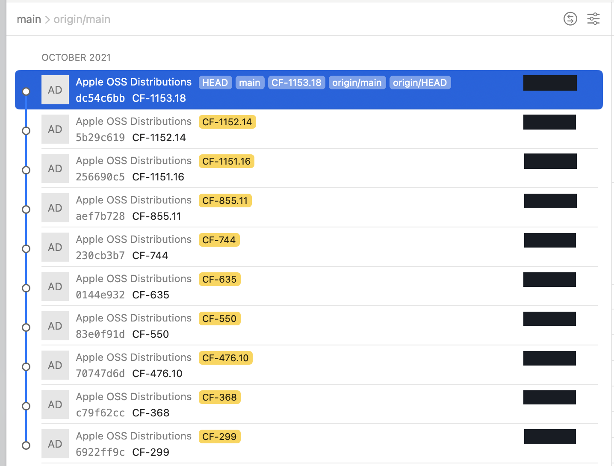

> 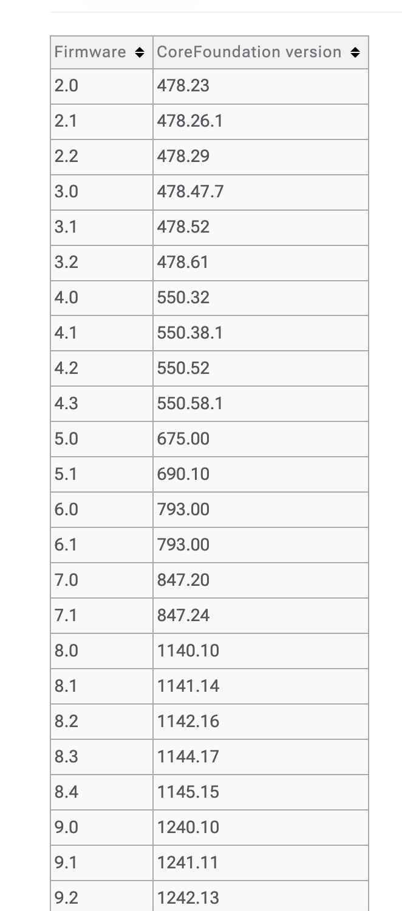

> 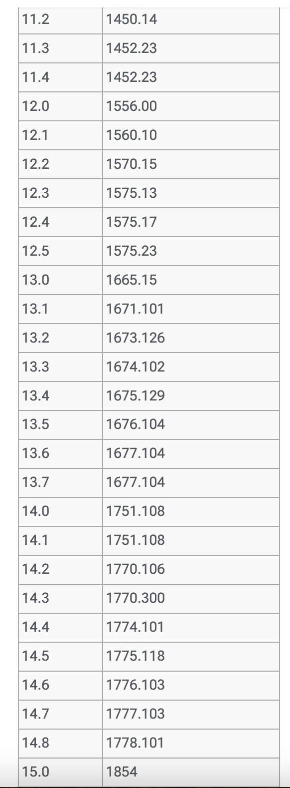


## iOS 15

我们先分析 iOS 15 的运行机制。由于我们已经事先知道，在 \[iOS 15\.0, \) 后，任意优先级的 callout 后，都有系统通过 `___CFRunLoopPerCalloutARPEnd` 触发的 AutoreleasePoolPop。因此我们直接分析 `___CFRunLoopPerCalloutARPEnd` 。

> [CoreFoundation iOS15 Simulator](./attachments/attachment-01.bin)


### \_\_\_CFRunLoopPerCalloutARPEnd

```cpp
// hooper iOS 15
int ___CFRunLoopPerCalloutARPEnd() {
    r31 = r31 - 0x60;
    var_20 = r22;
    stack[-40] = r21;
    var_10 = r20;
    stack[-24] = r19;
    saved_fp = r29;
    stack[-8] = r30;
    if (r0 != 0x0) {
            r0 = __CFAutoreleasePoolPop(r0); // 这里用的 r0 就是传入的第一个参数
    }
    if (**___stack_chk_guard != **___stack_chk_guard) {
            r0 = __stack_chk_fail();
    }
    return r0;
}

int __CFRunLoopPerCalloutAutoreleasepoolEnabled() {
    r0 = _CFRunLoopGetCurrent();
    r0 = *(int8_t *)(r0 + 0xb9); // 一个标记位，在 + 0xb9 偏移量的地址
    // 通过后续分析，我们得知其实就是这个 runloop 是否开启了 __CFRunLoopPerCalloutAutoreleasepool 
    // 由于有多个 runloop 实例（主线程，子线程各自持有自己的，因此需要区分实例，而非直接读取开关）
    return r0;
}

// call by _UIApplicationInstallAutoreleasePoolsIfNecessaryForMode
int __CFRunLoopSetPerCalloutAutoreleasepoolEnabled(int arg0) { // iOS 15 上，arg0 == 0x1
    var_10 = r20;
    stack[-24] = r19;
    r31 = r31 + 0xffffffffffffffe0;
    saved_fp = r29;
    stack[-8] = r30;
    r19 = _CFRunLoopGetCurrent();
    if (arg0 != 0x0) {
            r0 = _os_feature_enabled_impl(); // 将开关的值赋值给 mainRunloop + 0xb9 的位置，完成 mainRunloop 的初始化
    }
    else {
            r0 = 0x0;
    }
    *(int8_t *)(r19 + 0xb9) = r0;
    return r0;
}

int _CFRunLoopGetCurrent() {
    var_10 = r20;
    stack[-24] = r19;
    r31 = r31 + 0xffffffffffffffe0;
    saved_fp = r29;
    stack[-8] = r30;
    if ((*(int8_t *)0x694d42 & 0x2) == 0x0) {
            ___CF_USED();
    }
    if ((*(int8_t *)0x694d42 & 0x1) != 0x0) {
            ___THE_PROCESS_HAS_FORKED_AND_YOU_CANNOT_USE_THIS_COREFOUNDATION_FUNCTIONALITY___YOU_MUST_EXEC__();
    }
    r0 = __CFGetTSD(0xa);
    if (r0 == 0x0) {
            r0 = pthread_self();
            r0 = __CFRunLoopGet0(r0);
    }
    return r0;
}
```

Ida 64 可以很明确看到简化后的逻辑，把 `___stack_chk_guard` 等都去掉了。同时 ida 对于参数的传递等的处理会更友善一些。


```c
// ida64 iOS 15

__int64 __fastcall __CFRunLoopPerCalloutARPEnd(__int64 result)
{
  if ( result )
    result = _CFAutoreleasePoolPop();
  return result;
}

__int64 _CFRunLoopPerCalloutAutoreleasepoolEnabled()
{
  return *(unsigned __int8 *)(CFRunLoopGetCurrent() + 185);
}

__int64 CFRunLoopGetCurrent()
{
  __int64 result; // x0
  pthread_t v1; // x0

  if ( !(__CF_FORK_STATE & 2) )
    __CF_USED();
  if ( __CF_FORK_STATE & 1 )
    __THE_PROCESS_HAS_FORKED_AND_YOU_CANNOT_USE_THIS_COREFOUNDATION_FUNCTIONALITY___YOU_MUST_EXEC__();
  result = _CFGetTSD(10LL);
  if ( !result )
  {
    v1 = pthread_self();
    result = _CFRunLoopGet0(v1);
  }
  return result;
}
```


同时调用 `___CFRunLoopPerCalloutARPEnd();` 的还有很多函数。可以看到确实是符合 `___CFRunLoopPerCalloutARPEnd();` 的命名的，每次 runloop 向外调用 callout 后，都会进行调用。

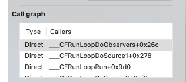

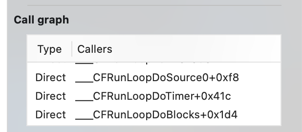

### \_\_\_CFRunLoopDoObservers 中的调用

简化一下伪代码的话，核心逻辑如下。可以看到确实在 callout 的前后，都有增加成对的 push/pop 。

```cpp
for (CFIndex idx = 0; idx < obs_cnt; idx++) {
    
    if (mainRunloop) {
        r26 = __CFAutoreleasePoolPush();
    } else {
        r26 = 0;
    }
    
    __CFRUNLOOP_IS_CALLING_OUT_TO_AN_OBSERVER_CALLBACK_FUNCTION__(rlo->_callout, rlo, activity, rlo->_context.info);
    
    if (r26 != 0) {
        __CFAutoreleasePoolPop(r26);
    }
}
```

附上原始解析：

```cpp
// hopper
int ___CFRunLoopDoObservers(int arg0, int arg1, int arg2) {
    var_50 = r28;
    stack[-88] = r27;
    var_40 = r26;
    stack[-72] = r25;
    var_30 = r24;
    stack[-56] = r23;
    r29 = &saved_fp;
    r31 = r31 + 0xffffffffffffffa0 - 0x30;
    r19 = arg2;
    r20 = arg1;
    r26 = arg0;
    if (*__isCFTraceEnabled.onceToken != -0x1) {
            dispatch_once(0x693d40, 0x65d590);
    }
    if (*(int8_t *)__isCFTraceEnabled.shouldTrace != 0x0) {
            kdebug_trace();
    }
    if ((*(int8_t *)0x694d42 & 0x2) == 0x0) {
            ___CF_USED();
    }
    if ((*(int8_t *)0x694d42 & 0x1) != 0x0) {
            ___THE_PROCESS_HAS_FORKED_AND_YOU_CANNOT_USE_THIS_COREFOUNDATION_FUNCTIONALITY___YOU_MUST_EXEC__();
    }
    r0 = *(r20 + 0x70);
    if (r0 != 0x0) {
            r0 = _CFArrayGetCount(r0);
            if (r0 >= 0x1) {
                    r23 = r0;
                    r8 = &var_80;
                    var_80 = r8;
                    if (r0 < 0x401) {
                            asm { csinc      x8, x0, xzr, lt };
                    }
                    r9 = &var_80;
                    r22 = r9 - ((r8 << 0x3) + 0xf & 0xfffffffffffffff0);
                    var_68 = r22;
                    if (r0 >= 0x401) {
                            r22 = malloc(r23 << 0x3);
                    }
                    r21 = 0x0;
                    r24 = 0x0;
                    do {
                            r0 = *(r20 + 0x70);
                            r0 = _CFArrayGetValueAtIndex(r0, r24);
                            if ((*(r0 + 0x60) & r19) != 0x0) {
                                    r8 = r0 + 0x8;
                                    asm { ldar       x9, [x8] };
                                    if ((r9 & 0x8) != 0x0) {
                                            asm { ldar       x8, [x8] };
                                            if ((r8 & 0x1) == 0x0) {
                                                    *(r22 + r21 * 0x8) = _CFRetain(r0);
                                                    r21 = r21 + 0x1;
                                            }
                                    }
                            }
                            r24 = r24 + 0x1;
                    } while (r23 != r24);
                    var_70 = r20 + 0x10;
                    pthread_mutex_unlock(r20 + 0x10);
                    var_78 = r26 + 0x10;
                    pthread_mutex_unlock(r26 + 0x10);
                    if (r21 >= 0x1) {
                            r23 = 0x0;
                            var_60 = r26;
                            do {
                                    r27 = *(r22 + r23 * 0x8);
                                    r25 = r27 + 0x10;
                                    pthread_mutex_lock(r25);
                                    asm { ldar       x9, [x8] };
                                    if ((r9 & 0x8) == 0x0) {
                                            pthread_mutex_unlock(r25);
                                    }
                                    else {
                                            asm { ldar       x24, [x8] };
                                            asm { ldar       x9, [x8] };
                                            r8 = r9;
                                            do {
                                                    r10 = r9 | 0x1;
                                                    asm { casal      x8, x10, [x11] };
                                                    if (r8 == r9) {
                                                            if (CPU_FLAGS & E) {
                                                                    r10 = 0x1;
                                                            }
                                                    }
                                                    r9 = r8;
                                            } while (r10 != 0x1);
                                            pthread_mutex_unlock(r25);
                                            r25 = *(r27 + 0x70);
                                            r28 = *(r27 + 0x80);
                                            if (r26 != 0x0 && *(int8_t *)(r26 + 0xb9) == 0x0) { // 注意这里的偏移量也是 0xb9 ，很明确可以猜到是前面提到过的 __CFRunLoopPerCalloutAutoreleasepoolEnabled
                                                    r26 = 0x0;
                                            }
                                            else {
                                                    r26 = __CFAutoreleasePoolPush();
                                            }
                                            if (*__isCFTraceEnabled.onceToken != -0x1) {
                                                    dispatch_once(0x693d40, 0x65d590);
                                            }
                                            if (*(int8_t *)__isCFTraceEnabled.shouldTrace != 0x0) {
                                                    kdebug_trace();
                                            }
                                            ___CFRUNLOOP_IS_CALLING_OUT_TO_AN_OBSERVER_CALLBACK_FUNCTION__(r25, r27, r19, r28);
                                            if (*__isCFTraceEnabled.onceToken != -0x1) {
                                                    dispatch_once(0x693d40, 0x65d590);
                                            }
                                            if (*(int8_t *)__isCFTraceEnabled.shouldTrace != 0x0) {
                                                    kdebug_trace();
                                            }
                                            ___CFRunLoopPerCalloutARPEnd();
                                            if ((r24 & 0x2) == 0x0) {
                                                    _CFRunLoopObserverInvalidate(r27);
                                            }
                                            asm { ldar       x10, [x8] };
                                            r9 = r10;
                                            r26 = var_60;
                                            do {
                                                    asm { casal      x9, x11, [x8] };
                                                    COND = r9 != r10;
                                                    r10 = r9;
                                            } while (COND);
                                    }
                                    _CFRelease(r27);
                                    r23 = r23 + 0x1;
                            } while (r23 != r21);
                    }
                    pthread_mutex_lock(var_78);
                    r0 = pthread_mutex_lock(var_70);
                    if (r22 != var_68) {
                            r0 = free(r22);
                    }
                    if (*__isCFTraceEnabled.onceToken != -0x1) {
                            r0 = dispatch_once(0x693d40, 0x65d590);
                    }
                    r21 = var_80;
                    if (*(int8_t *)__isCFTraceEnabled.shouldTrace != 0x0) {
                            r0 = kdebug_trace();
                    }
            }
    }
    if (**___stack_chk_guard != **___stack_chk_guard) {
            r0 = __stack_chk_fail();
    }
    return r0;
}
```

```c
// ida64
void __fastcall __CFRunLoopDoObservers(__int64 a1, __int64 a2, __int64 a3)
{
  __int64 v3; // x19
  __int64 v4; // x20
  __int64 v5; // x26
  __int64 v6; // x0
  unsigned __int64 *v7; // x23
  signed __int64 v8; // x8
  unsigned __int64 v9; // x8
  char *v10; // x22
  signed __int64 v11; // x21
  unsigned __int64 *v12; // x24
  __int64 v13; // x0
  unsigned __int64 *v14; // x9
  unsigned __int64 *v15; // x8
  unsigned __int64 v16; // off
  unsigned __int64 v17; // off
  __int64 v18; // x23
  __int64 v19; // x27
  unsigned __int64 *v20; // x9
  unsigned __int64 v21; // off
  unsigned __int64 v22; // off
  unsigned __int64 v23; // off
  BOOL v30; // w10
  __int64 v31; // x0
  __int64 v32; // x25
  __int64 v33; // x28
  __int64 v34; // x26
  unsigned __int64 *v35; // x10
  unsigned __int64 v37; // off
  __int64 *v39; // [xsp+0h] [xbp-80h]
  pthread_mutex_t *v40; // [xsp+8h] [xbp-78h]
  pthread_mutex_t *v41; // [xsp+10h] [xbp-70h]
  char *v42; // [xsp+18h] [xbp-68h]
  __int64 v43; // [xsp+20h] [xbp-60h]

  v3 = a3;
  v4 = a2;
  v5 = a1;
  if ( _isCFTraceEnabled_onceToken != -1 )
    a1 = dispatch_once(&_isCFTraceEnabled_onceToken, &__block_literal_global_73);
  if ( _isCFTraceEnabled_shouldTrace )
    a1 = kdebug_trace(724631777LL, v5, v4, v3, 0LL);
  if ( !(__CF_FORK_STATE & 2) )
    a1 = __CF_USED(a1);
  if ( __CF_FORK_STATE & 1 )
    __THE_PROCESS_HAS_FORKED_AND_YOU_CANNOT_USE_THIS_COREFOUNDATION_FUNCTIONALITY___YOU_MUST_EXEC__(a1);
  if ( *(_QWORD *)(v4 + 112) )
  {
    v6 = CFArrayGetCount();
    if ( v6 >= 1 )
    {
      v7 = (unsigned __int64 *)v6;
      v39 = (__int64 *)&v39;
      if ( v6 >= 1025 )
        v8 = 1LL;
      else
        v8 = v6;
      v9 = (8 * v8 + 15) & 0xFFFFFFFFFFFFFFF0LL;
      v10 = (char *)&v39 - v9;
      v42 = (char *)&v39 - v9;
      if ( v6 >= 1025 )
        v10 = (char *)malloc(8 * v6);
      v11 = 0LL;
      v12 = 0LL;
      do
      {
        v13 = CFArrayGetValueAtIndex(*(_QWORD *)(v4 + 112), v12);
        if ( *(_QWORD *)(v13 + 96) & v3 )
        {
          v15 = (unsigned __int64 *)(v13 + 8);
          v16 = __ldar(v14);
          if ( (unsigned __int8)v14 & 8 )
          {
            v17 = __ldar(v15);
            if ( !((unsigned __int8)v15 & 1) )
              *(_QWORD *)&v10[8 * v11++] = CFRetain(v13);
          }
        }
        v12 = (unsigned __int64 *)((char *)v12 + 1);
      }
      while ( v7 != v12 );
      v41 = (pthread_mutex_t *)(v4 + 16);
      pthread_mutex_unlock((pthread_mutex_t *)(v4 + 16));
      v40 = (pthread_mutex_t *)(v5 + 16);
      pthread_mutex_unlock((pthread_mutex_t *)(v5 + 16));
      if ( v11 >= 1 )
      {
        v18 = 0LL;
        v43 = v5;
        do
        {
          v19 = *(_QWORD *)&v10[8 * v18];
          pthread_mutex_lock((pthread_mutex_t *)(v19 + 16));
          v21 = __ldar(v20);
          if ( (unsigned __int8)v20 & 8 )
          {
            v22 = __ldar(v12);
            v23 = __ldar(v20);
            do
            {
              _X11 = v19 + 8;
              __asm { CASAL           X8, X10, [X11] }
              v30 = _X8 == v20;
              v20 = _X8;
            }
            while ( v30 != 1 );
            v31 = pthread_mutex_unlock((pthread_mutex_t *)(v19 + 16));
            v32 = *(_QWORD *)(v19 + 112);
            v33 = *(_QWORD *)(v19 + 128);
            if ( v5 && !*(_BYTE *)(v5 + 185) )
              v34 = 0LL;
            else
              v34 = _CFAutoreleasePoolPush(v31);
            if ( _isCFTraceEnabled_onceToken != -1 )
              dispatch_once(&_isCFTraceEnabled_onceToken, &__block_literal_global_73);
            if ( _isCFTraceEnabled_shouldTrace )
              kdebug_trace(724631749LL, v32, v19, v3, v33);
            __CFRUNLOOP_IS_CALLING_OUT_TO_AN_OBSERVER_CALLBACK_FUNCTION__(v32, v19, v3, v33);
            if ( _isCFTraceEnabled_onceToken != -1 )
              dispatch_once(&_isCFTraceEnabled_onceToken, &__block_literal_global_73);
            if ( _isCFTraceEnabled_shouldTrace )
              kdebug_trace(724631750LL, v32, v19, v3, v33);
            __CFRunLoopPerCalloutARPEnd(v34);
            if ( !((unsigned __int8)v12 & 2) )
              CFRunLoopObserverInvalidate(v19);
            _X8 = v19 + 8;
            v37 = __ldar(v35);
            v5 = v43;
            do
            {
              __asm { CASAL           X9, X11, [X8] }
              _ZF = _X9 == v35;
              v35 = _X9;
            }
            while ( !_ZF );
          }
          else
          {
            pthread_mutex_unlock((pthread_mutex_t *)(v19 + 16));
          }
          CFRelease(v19);
          ++v18;
        }
        while ( v18 != v11 );
      }
      pthread_mutex_lock(v40);
      pthread_mutex_lock(v41);
      if ( v10 != v42 )
        free(v10);
      if ( _isCFTraceEnabled_onceToken != -1 )
        dispatch_once(&_isCFTraceEnabled_onceToken, &__block_literal_global_73);
      if ( _isCFTraceEnabled_shouldTrace )
        kdebug_trace(724631778LL, v5, v4, v3, 0LL);
    }
  }
}
```

### \_\_\_CFRunLoopDoSource1 中的调用

核心逻辑与 \_\_\_CFRunLoopDoObservers 大致相同，也是在 callout 的前后包装了 成对的 push/pop 。

```cpp
// hopper
int ___CFRunLoopDoSource1(int arg0, int arg1, int arg2, int arg3, int arg4, int arg5) {
    var_50 = r28;
    stack[-88] = r27;
    var_40 = r26;
    stack[-72] = r25;
    var_30 = r24;
    stack[-56] = r23;
    var_20 = r22;
    stack[-40] = r21;
    var_10 = r20;
    stack[-24] = r19;
    saved_fp = r29;
    stack[-8] = r30;
    r31 = r31 + 0xffffffffffffffa0 - 0x1040;
    r25 = arg5;
    r26 = arg4;
    r27 = arg3;
    r19 = arg2;
    r22 = arg1;
    r23 = arg0;
    if ((*(int8_t *)0x694d42 & 0x2) == 0x0) {
            ___CF_USED();
    }
    if ((*(int8_t *)0x694d42 & 0x1) != 0x0) {
            ___THE_PROCESS_HAS_FORKED_AND_YOU_CANNOT_USE_THIS_COREFOUNDATION_FUNCTIONALITY___YOU_MUST_EXEC__();
    }
    _CFRetain(r19);
    r20 = r22 + 0x10;
    pthread_mutex_unlock(r20);
    r21 = r23 + 0x10;
    pthread_mutex_unlock(r21);
    r24 = r19 + 0x10;
    pthread_mutex_lock(r24);
    r8 = r19 + 0x8;
    asm { ldar       x8, [x8] };
    if ((r8 & 0x8) == 0x0) {
            pthread_mutex_unlock(r24);
            r22 = 0x0;
    }
    else {
            asm { stlur      xzr, [x19, #0x58] };
            pthread_mutex_unlock(r24);
            if (0x0 != 0x0) {
                    r0 = *(r19 + 0xa8);
                    if (r0 != 0x507ac) {
                            r0 = dladdr(r0, &var_81);
                            if (r0 != 0x0) {
                                    snprintf(&var_61, 0x800, "%s", r3);
                                    snprintf(&arg_78F, 0x800, "%s", r3);
                            }
                    }
                    else {
                            ___CFDescribeCFMachPortPerformCallout(*(r19 + 0x70), &arg_78F, 0x800, &var_61, 0x800);
                    }
            }
            var_89 = r25;
            if (*__isCFTraceEnabled.onceToken != -0x1) {
                    dispatch_once(0x693d40, 0x65d590);
            }
            r25 = r27;
            if (*(int8_t *)__isCFTraceEnabled.shouldTrace != 0x0) {
                    kdebug_trace();
            }
            r27 = *(r19 + 0xa8);
            r28 = *(r19 + 0x70);
            if (r23 != 0x0 && *(int8_t *)(r23 + 0xb9) == 0x0) { // 注意这里的偏移量也是 0xb9 ，很明确可以猜到是前面提到过的 __CFRunLoopPerCalloutAutoreleasepoolEnabled
                    r24 = 0x0;
            }
            else {
                    r24 = __CFAutoreleasePoolPush();
            }
            if (*__isCFTraceEnabled.onceToken != -0x1) {
                    dispatch_once(0x693d40, 0x65d590);
            }
            if (*(int8_t *)__isCFTraceEnabled.shouldTrace != 0x0) {
                    kdebug_trace();
            }
            ___CFRUNLOOP_IS_CALLING_OUT_TO_A_SOURCE1_PERFORM_FUNCTION__(r27, r25, r26, var_89, r28);
            if (*__isCFTraceEnabled.onceToken != -0x1) {
                    dispatch_once(0x693d40, 0x65d590);
            }
            if (*(int8_t *)__isCFTraceEnabled.shouldTrace != 0x0) {
                    kdebug_trace();
            }
            ___CFRunLoopPerCalloutARPEnd();
            if ((*(int8_t *)0x694d42 & 0x2) == 0x0) {
                    ___CF_USED();
            }
            if ((*(int8_t *)0x694d42 & 0x1) != 0x0) {
                    ___THE_PROCESS_HAS_FORKED_AND_YOU_CANNOT_USE_THIS_COREFOUNDATION_FUNCTIONALITY___YOU_MUST_EXEC__();
            }
            r22 = 0x1;
    }
    var_60 = **___stack_chk_guard;
    _CFRelease(r19);
    pthread_mutex_lock(r21);
    pthread_mutex_lock(r20);
    if (**___stack_chk_guard == var_60) {
            r0 = r22;
    }
    else {
            r0 = __stack_chk_fail();
    }
    return r0;
}
```

```c
// ida64

signed __int64 __fastcall __CFRunLoopDoSource1(__int64 a1, __int64 a2, __int64 a3, __int64 a4, __int64 a5, __int64 a6)
{
  __int64 v6; // x25
  __int64 v7; // x26
  __int64 v8; // x27
  __int64 v9; // x19
  __int64 v10; // x22
  __int64 v11; // x23
  pthread_mutex_t *v12; // x20
  unsigned __int64 v13; // off
  signed __int64 v14; // x22
  __int64 v20; // x0
  __int64 v21; // x25
  __int64 v22; // x27
  __int64 v23; // x28
  __int64 v24; // x24
  __int64 v25; // x0
  signed __int64 result; // x0
  __int64 v27; // [xsp+8h] [xbp-1088h]
  __int64 v28; // [xsp+1030h] [xbp-60h]

  v6 = a6;
  v7 = a5;
  v8 = a4;
  v9 = a3;
  v10 = a2;
  v11 = a1;
  if ( !(__CF_FORK_STATE & 2) )
    a1 = __CF_USED(a1);
  if ( __CF_FORK_STATE & 1 )
    __THE_PROCESS_HAS_FORKED_AND_YOU_CANNOT_USE_THIS_COREFOUNDATION_FUNCTIONALITY___YOU_MUST_EXEC__(a1);
  CFRetain(v9);
  v12 = (pthread_mutex_t *)(v10 + 16);
  pthread_mutex_unlock((pthread_mutex_t *)(v10 + 16));
  pthread_mutex_unlock((pthread_mutex_t *)(v11 + 16));
  pthread_mutex_lock((pthread_mutex_t *)(v9 + 16));
  v13 = __ldar((unsigned __int64 *)(v9 + 8));
  if ( ((_DWORD)v9 + 8) & 8 )
  {
    __asm { PRFM            #0x1F, loc_8FD38 }
    pthread_mutex_unlock((pthread_mutex_t *)(v9 + 16));
    v20 = 0LL;
    v27 = v6;
    if ( _isCFTraceEnabled_onceToken != -1 )
      v20 = dispatch_once(&_isCFTraceEnabled_onceToken, &__block_literal_global_73);
    v21 = v8;
    if ( _isCFTraceEnabled_shouldTrace )
      v20 = kdebug_trace(724631692LL, v9, 0LL, 0LL, 0LL);
    v22 = *(_QWORD *)(v9 + 168);
    v23 = *(_QWORD *)(v9 + 112);
    if ( v11 && !*(_BYTE *)(v11 + 185) )
      v24 = 0LL;
    else
      v24 = _CFAutoreleasePoolPush(v20);
    if ( _isCFTraceEnabled_onceToken != -1 )
      dispatch_once(&_isCFTraceEnabled_onceToken, &__block_literal_global_73);
    if ( _isCFTraceEnabled_shouldTrace )
      kdebug_trace(724631741LL, v11, v10, v22, v23);
    __CFRUNLOOP_IS_CALLING_OUT_TO_A_SOURCE1_PERFORM_FUNCTION__(v22, v21, v7, v27, v23);
    if ( _isCFTraceEnabled_onceToken != -1 )
      dispatch_once(&_isCFTraceEnabled_onceToken, &__block_literal_global_73);
    if ( _isCFTraceEnabled_shouldTrace )
      kdebug_trace(724631742LL, v11, v10, v22, v23);
    v25 = __CFRunLoopPerCalloutARPEnd(v24);
    if ( !(__CF_FORK_STATE & 2) )
      v25 = __CF_USED(v25);
    if ( __CF_FORK_STATE & 1 )
      __THE_PROCESS_HAS_FORKED_AND_YOU_CANNOT_USE_THIS_COREFOUNDATION_FUNCTIONALITY___YOU_MUST_EXEC__(v25);
    v14 = 1LL;
  }
  else
  {
    pthread_mutex_unlock((pthread_mutex_t *)(v9 + 16));
    v14 = 0LL;
  }
  CFRelease(v9);
  pthread_mutex_lock((pthread_mutex_t *)(v11 + 16));
  result = pthread_mutex_lock(v12);
  if ( __stack_chk_guard == v28 )
    result = v14;
  return result;
}
```


### 小结

从汇编里，我们发现，iOS 15 开始，系统的方案是：

1. 每个循环向外调用 callout 前，都会调用一次 `__CFAutoreleasePoolPush();` 函数。

2. 每个循环向外调用 callout 后，都会调用一次 `___CFRunLoopPerCalloutARPEnd();` 函数。


伪代码如下：

```cpp
for (CFIndex idx = 0; idx < obs_cnt; idx++) {
    
    @autoreleasepool { // same as autoreleasePoolPush
        __CFRUNLOOP_IS_CALLING_OUT_TO_AN_OBSERVER_CALLBACK_FUNCTION__(rlo->_callout, rlo, activity, rlo->_context.info);
    }; // same as autoreleasePoolPop
    
}
```


附上 iOS 15 中干净的输出。

```c
(lldb) po [NSRunLoop mainRunLoop]
<CFRunLoop 0x600001e20400 [0x1da835af0]>{wakeup port = 0x1303, stopped = false, ignoreWakeUps = false, 
current mode = kCFRunLoopDefaultMode,
common modes = <CFBasicHash 0x600002c68180 [0x1da835af0]>{type = mutable set, count = 2,
entries =>
        0 : <CFString 0x1ce5f2110 [0x1da835af0]>{contents = "UITrackingRunLoopMode"}
        2 : <CFString 0x1daa6d778 [0x1da835af0]>{contents = "kCFRunLoopDefaultMode"}
}
,
common mode items = <CFBasicHash 0x600002c73810 [0x1da835af0]>{type = mutable set, count = 8,
entries =>
        0 : <CFRunLoopSource 0x600001734180 [0x1da835af0]>{signalled = No, valid = Yes, order = -1, context = <CFRunLoopSource context>{version = 0, info = 0x0, callout = PurpleEventSignalCallback (0x18bf0328c)}}
        1 : <CFRunLoopSource 0x600001730240 [0x1da835af0]>{signalled = No, valid = Yes, order = 0, context = <CFRunLoopSource context>{version = 0, info = 0x60000377c580, callout = FBSSerialQueueRunLoopSourceHandler (0x1861345bc)}}
        2 : <CFRunLoopObserver 0x600001338500 [0x1da835af0]>{valid = Yes, activities = 0xa0, repeats = Yes, order = 2000000, callout = _ZN2CA11Transaction17observer_callbackEP19__CFRunLoopObservermPv (0x1883cc044), context = <CFRunLoopObserver context 0x0>}
        6 : <CFRunLoopObserver 0x6000013383c0 [0x1da835af0]>{valid = Yes, activities = 0x20, repeats = Yes, order = 0, callout = _UIGestureRecognizerUpdateObserver (0x184856888), context = <CFRunLoopObserver context 0x600000934af0>}
        7 : <CFRunLoopSource 0x600001734480 [0x1da835af0]>{signalled = No, valid = Yes, order = -2, context = <CFRunLoopSource context>{version = 0, info = 0x600002c7fae0, callout = __eventFetcherSourceCallback (0x184ddfafc)}}
        8 : <CFRunLoopObserver 0x6000013340a0 [0x1da835af0]>{valid = Yes, activities = 0xa0, repeats = Yes, order = 1999000, callout = _beforeCACommitHandler (0x184d6c2bc), context = <CFRunLoopObserver context 0x129705e70>}
        10 : <CFRunLoopSource 0x600001734540 [0x1da835af0]>{signalled = No, valid = Yes, order = -1, context = <CFRunLoopSource context>{version = 0, info = 0x600001938410, callout = __eventQueueSourceCallback (0x184ddfa44)}}
        12 : <CFRunLoopObserver 0x600001334140 [0x1da835af0]>{valid = Yes, activities = 0xa0, repeats = Yes, order = 2001000, callout = _afterCACommitHandler (0x184d6c2c0), context = <CFRunLoopObserver context 0x129705e70>}
}
,
modes = <CFBasicHash 0x600002c68450 [0x1da835af0]>{type = mutable set, count = 3,
entries =>
        0 : <CFRunLoopMode 0x600001934410 [0x1da835af0]>{name = UITrackingRunLoopMode, port set = 0x4303, queue = 0x600000c34800, source = 0x600000c34900 (not fired), timer port = 0x5303, 
        sources0 = <CFBasicHash 0x600002c72d60 [0x1da835af0]>{type = mutable set, count = 4,
entries =>
        0 : <CFRunLoopSource 0x600001734180 [0x1da835af0]>{signalled = No, valid = Yes, order = -1, context = <CFRunLoopSource context>{version = 0, info = 0x0, callout = PurpleEventSignalCallback (0x18bf0328c)}}
        2 : <CFRunLoopSource 0x600001734540 [0x1da835af0]>{signalled = No, valid = Yes, order = -1, context = <CFRunLoopSource context>{version = 0, info = 0x600001938410, callout = __eventQueueSourceCallback (0x184ddfa44)}}
        3 : <CFRunLoopSource 0x600001734480 [0x1da835af0]>{signalled = No, valid = Yes, order = -2, context = <CFRunLoopSource context>{version = 0, info = 0x600002c7fae0, callout = __eventFetcherSourceCallback (0x184ddfafc)}}
        5 : <CFRunLoopSource 0x600001730240 [0x1da835af0]>{signalled = No, valid = Yes, order = 0, context = <CFRunLoopSource context>{version = 0, info = 0x60000377c580, callout = FBSSerialQueueRunLoopSourceHandler (0x1861345bc)}}
}
,
        sources1 = <CFBasicHash 0x600002c737e0 [0x1da835af0]>{type = mutable set, count = 0,
entries =>
}
,
        observers = (
    "<CFRunLoopObserver 0x6000013383c0 [0x1da835af0]>{valid = Yes, activities = 0x20, repeats = Yes, order = 0, callout = _UIGestureRecognizerUpdateObserver (0x184856888), context = <CFRunLoopObserver context 0x600000934af0>}",
    "<CFRunLoopObserver 0x6000013340a0 [0x1da835af0]>{valid = Yes, activities = 0xa0, repeats = Yes, order = 1999000, callout = _beforeCACommitHandler (0x184d6c2bc), context = <CFRunLoopObserver context 0x129705e70>}",
    "<CFRunLoopObserver 0x600001338500 [0x1da835af0]>{valid = Yes, activities = 0xa0, repeats = Yes, order = 2000000, callout = _ZN2CA11Transaction17observer_callbackEP19__CFRunLoopObservermPv (0x1883cc044), context = <CFRunLoopObserver context 0x0>}",
    "<CFRunLoopObserver 0x600001334140 [0x1da835af0]>{valid = Yes, activities = 0xa0, repeats = Yes, order = 2001000, callout = _afterCACommitHandler (0x184d6c2c0), context = <CFRunLoopObserver context 0x129705e70>}"
),
        timers = (null),
        currently 737115115 (11074989844213) / soft deadline in: 7.68613875e+11 sec (@ -1) / hard deadline in: 7.68613875e+11 sec (@ -1)
},
        1 : <CFRunLoopMode 0x600001934270 [0x1da835af0]>{name = GSEventReceiveRunLoopMode, port set = 0x5203, queue = 0x600000c34980, source = 0x600000c34a80 (not fired), timer port = 0x5003, 
        sources0 = <CFBasicHash 0x600002c73750 [0x1da835af0]>{type = mutable set, count = 1,
entries =>
        0 : <CFRunLoopSource 0x600001734180 [0x1da835af0]>{signalled = No, valid = Yes, order = -1, context = <CFRunLoopSource context>{version = 0, info = 0x0, callout = PurpleEventSignalCallback (0x18bf0328c)}}
}
,
        sources1 = <CFBasicHash 0x600002c73720 [0x1da835af0]>{type = mutable set, count = 0,
entries =>
}
,
        observers = (null),
        timers = (null),
        currently 737115115 (11074989862068) / soft deadline in: 7.68613875e+11 sec (@ -1) / hard deadline in: 7.68613875e+11 sec (@ -1)
},
        2 : <CFRunLoopMode 0x600001930270 [0x1da835af0]>{name = kCFRunLoopDefaultMode, port set = 0x3a07, queue = 0x600000c39680, source = 0x600000c39780 (not fired), timer port = 0x3803, 
        sources0 = <CFBasicHash 0x600002c737b0 [0x1da835af0]>{type = mutable set, count = 4,
entries =>
        0 : <CFRunLoopSource 0x600001734180 [0x1da835af0]>{signalled = No, valid = Yes, order = -1, context = <CFRunLoopSource context>{version = 0, info = 0x0, callout = PurpleEventSignalCallback (0x18bf0328c)}}
        2 : <CFRunLoopSource 0x600001734540 [0x1da835af0]>{signalled = No, valid = Yes, order = -1, context = <CFRunLoopSource context>{version = 0, info = 0x600001938410, callout = __eventQueueSourceCallback (0x184ddfa44)}}
        3 : <CFRunLoopSource 0x600001734480 [0x1da835af0]>{signalled = No, valid = Yes, order = -2, context = <CFRunLoopSource context>{version = 0, info = 0x600002c7fae0, callout = __eventFetcherSourceCallback (0x184ddfafc)}}
        5 : <CFRunLoopSource 0x600001730240 [0x1da835af0]>{signalled = No, valid = Yes, order = 0, context = <CFRunLoopSource context>{version = 0, info = 0x60000377c580, callout = FBSSerialQueueRunLoopSourceHandler (0x1861345bc)}}
}
,
        sources1 = <CFBasicHash 0x600002c73780 [0x1da835af0]>{type = mutable set, count = 0,
entries =>
}
,
        observers = (
    "<CFRunLoopObserver 0x6000013383c0 [0x1da835af0]>{valid = Yes, activities = 0x20, repeats = Yes, order = 0, callout = _UIGestureRecognizerUpdateObserver (0x184856888), context = <CFRunLoopObserver context 0x600000934af0>}",
    "<CFRunLoopObserver 0x6000013340a0 [0x1da835af0]>{valid = Yes, activities = 0xa0, repeats = Yes, order = 1999000, callout = _beforeCACommitHandler (0x184d6c2bc), context = <CFRunLoopObserver context 0x129705e70>}",
    "<CFRunLoopObserver 0x600001338500 [0x1da835af0]>{valid = Yes, activities = 0xa0, repeats = Yes, order = 2000000, callout = _ZN2CA11Transaction17observer_callbackEP19__CFRunLoopObservermPv (0x1883cc044), context = <CFRunLoopObserver context 0x0>}",
    "<CFRunLoopObserver 0x600001334140 [0x1da835af0]>{valid = Yes, activities = 0xa0, repeats = Yes, order = 2001000, callout = _afterCACommitHandler (0x184d6c2c0), context = <CFRunLoopObserver context 0x129705e70>}"
),
        timers = <CFArray 0x600000630360 [0x1da835af0]>{type = mutable-small, count = 1, values = (
        0 : <CFRunLoopTimer 0x6000017300c0 [0x1da835af0]>{valid = Yes, firing = No, interval = 0, tolerance = 0, next fire date = 737115056 (-58.74668 @ 11073579969765), callout = (Delayed Perform) UIApplication _accessibilitySetUpQuickSpeak (0x1808118bc / 0x18413ede4) (/Library/Developer/CoreSimulator/Profiles/Runtimes/iOS 15.0.simruntime/Contents/Resources/RuntimeRoot/System/Library/PrivateFrameworks/UIKitCore.framework/UIKitCore), context = <CFRunLoopTimer context 0x60000377cec0>}
)},
        currently 737115115 (11074989862548) / soft deadline in: 7.68614336e+11 sec (@ 11073579969765) / hard deadline in: 7.68614336e+11 sec (@ 11073579969765)
},
}
}
(lldb) 
```


## iOS 14\.2 

因为分析出了 iOS 15 \+ 的机制，因此我们直接查看在 iOS 14 中，为什么没有对应的调用。 

> [CoreFoundation iOS14\.2 Simulator](./attachments/attachment-02.bin)

> ```cpp
> /Library/Developer/CoreSimulator/Profiles/Runtimes/iOS\ 14.2.simruntime/Contents/Resources/RuntimeRoot/System/Library/Frameworks/CoreFoundation.framework/CoreFoundation
> ```


一句话总结下结论， 存在`___CFRunLoopPerCalloutARPEnd();` 的调用，但由于开关没有打开，因此虽然有调用，但没有实际效果。而 `___CFRunLoopPerCalloutARPEnd();` 的调用也在 `___CFRunLoopDoObservers` 等方法中。


### \_\_\_CFRunLoopDoObservers

`___CFRunLoopDoObservers` 函数其实与 iOS 15 并没有多少区别。只在分支选择时，会有所不同。

```cpp
// hopper
int ___CFRunLoopDoObservers(int arg0, int arg1, int arg2) {
    r1 = arg1;
    r0 = arg0;
    var_50 = r28;
    stack[-88] = r27;
    var_40 = r26;
    stack[-72] = r25;
    var_30 = r24;
    stack[-56] = r23;
    r29 = &saved_fp;
    r31 = r31 + 0xffffffffffffffa0 - 0x30;
    r19 = arg2;
    r20 = r1;
    r26 = r0;
    if (*__isCFTraceEnabled.onceToken != -0x1) {
            r1 = 0x5d36c0;
            r0 = dispatch_once(0x607bf8, r1);
    }
    if (*(int8_t *)__isCFTraceEnabled.shouldTrace != 0x0) {
            r1 = r26;
            r0 = kdebug_trace(0x2b3100e1, r1, r20, r19, 0x0);
    }
    if ((*(int8_t *)0x608bd2 & 0x2) == 0x0) {
            ___CF_USED(r0, r1);
    }
    if ((*(int8_t *)0x608bd2 & 0x1) != 0x0) {
            ___THE_PROCESS_HAS_FORKED_AND_YOU_CANNOT_USE_THIS_COREFOUNDATION_FUNCTIONALITY___YOU_MUST_EXEC__();
    }
    r0 = *(r20 + 0x70);
    if (r0 != 0x0) {
            r0 = _CFArrayGetCount(r0);
            if (r0 >= 0x1) {
                    r23 = r0;
                    r8 = &var_80;
                    var_80 = r8;
                    if (r0 < 0x401) {
                            asm { csinc      x8, x0, xzr, lt };
                    }
                    r9 = &var_80;
                    r22 = r9 - ((r8 << 0x3) + 0xf & 0xfffffffffffffff0);
                    var_68 = r22;
                    if (r0 >= 0x401) {
                            r22 = malloc(r23 << 0x3);
                    }
                    r21 = 0x0;
                    r24 = 0x0;
                    do {
                            r0 = *(r20 + 0x70);
                            r0 = _CFArrayGetValueAtIndex(r0, r24);
                            if ((*(r0 + 0x60) & r19) != 0x0) {
                                    r8 = r0 + 0x8;
                                    asm { ldar       x9, [x8] };
                                    if ((r9 & 0x8) != 0x0) {
                                            asm { ldar       x8, [x8] };
                                            if ((r8 & 0x1) == 0x0) {
                                                    *(r22 + r21 * 0x8) = _CFRetain(r0);
                                                    r21 = r21 + 0x1;
                                            }
                                    }
                            }
                            r24 = r24 + 0x1;
                    } while (r23 != r24);
                    var_70 = r20 + 0x10;
                    pthread_mutex_unlock(r20 + 0x10);
                    var_78 = r26 + 0x10;
                    pthread_mutex_unlock(r26 + 0x10);
                    if (r21 >= 0x1) {
                            r23 = 0x0;
                            var_60 = r26;
                            do {
                                    r27 = *(r22 + r23 * 0x8);
                                    r25 = r27 + 0x10;
                                    pthread_mutex_lock(r25);
                                    asm { ldar       x9, [x8] };
                                    if ((r9 & 0x8) == 0x0) {
                                            pthread_mutex_unlock(r25);
                                    }
                                    else {
                                            asm { ldar       x24, [x8] };
                                            asm { ldar       x9, [x8] };
                                            r8 = r9;
                                            do {
                                                    r10 = r9 | 0x1;
                                                    asm { casal      x8, x10, [x11] };
                                                    if (r8 == r9) {
                                                            if (CPU_FLAGS & E) {
                                                                    r10 = 0x1;
                                                            }
                                                    }
                                                    r9 = r8;
                                            } while (r10 != 0x1);
                                            pthread_mutex_unlock(r25);
                                            r25 = *(r27 + 0x70);
                                            r28 = *(r27 + 0x80);
                                            if (r26 != 0x0 && *(int8_t *)(r26 + 0xb9) == 0x0) {
                                                    r26 = 0x0;
                                            }
                                            else {
                                                    r26 = __CFAutoreleasePoolPush();
                                            }
                                            if (*__isCFTraceEnabled.onceToken != -0x1) {
                                                    dispatch_once(0x607bf8, 0x5d36c0);
                                            }
                                            if (*(int8_t *)__isCFTraceEnabled.shouldTrace != 0x0) {
                                                    kdebug_trace(0x2b3100c5, r25, r27, r19, r28);
                                            }
                                            ___CFRUNLOOP_IS_CALLING_OUT_TO_AN_OBSERVER_CALLBACK_FUNCTION__(r25, r27, r19, r28);
                                            if (*__isCFTraceEnabled.onceToken != -0x1) {
                                                    dispatch_once(0x607bf8, 0x5d36c0);
                                            }
                                            if (*(int8_t *)__isCFTraceEnabled.shouldTrace != 0x0) {
                                                    kdebug_trace(0x2b3100c6, r25, r27, r19, r28);
                                            }
                                            ___CFRunLoopPerCalloutARPEnd();
                                            if ((r24 & 0x2) == 0x0) {
                                                    _CFRunLoopObserverInvalidate(r27);
                                            }
                                            asm { ldar       x10, [x8] };
                                            r9 = r10;
                                            r26 = var_60;
                                            do {
                                                    asm { casal      x9, x11, [x8] };
                                                    COND = r9 != r10;
                                                    r10 = r9;
                                            } while (COND);
                                    }
                                    _CFRelease(r27);
                                    r23 = r23 + 0x1;
                            } while (r23 != r21);
                    }
                    pthread_mutex_lock(var_78);
                    r0 = pthread_mutex_lock(var_70);
                    if (r22 != var_68) {
                            r0 = free(r22);
                    }
                    if (*__isCFTraceEnabled.onceToken != -0x1) {
                            r0 = dispatch_once(0x607bf8, 0x5d36c0);
                    }
                    r21 = var_80;
                    if (*(int8_t *)__isCFTraceEnabled.shouldTrace != 0x0) {
                            r0 = kdebug_trace(0x2b3100e2, r26, r20, r19, 0x0);
                    }
            }
    }
    if (**___stack_chk_guard != **___stack_chk_guard) {
            r0 = __stack_chk_fail();
    }
    return r0;
}
```

确实有调用到 \_\_CFRunLoopPerCalloutARPEnd 方法。

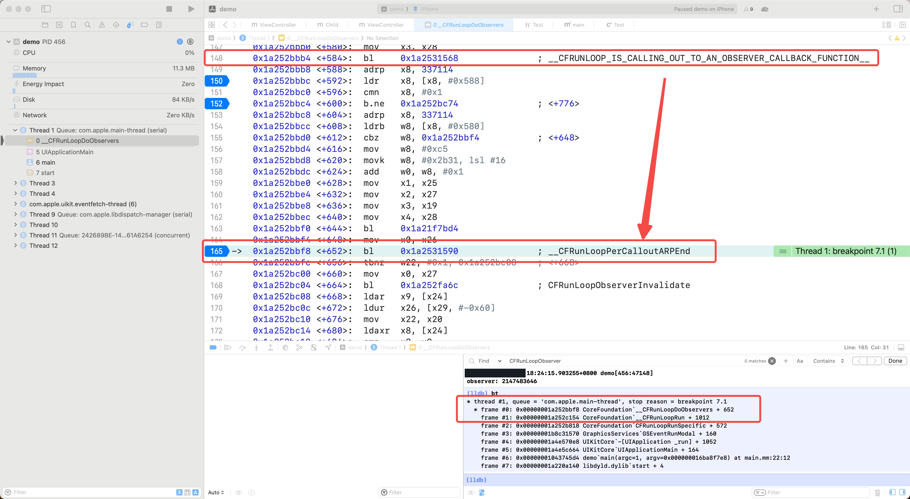

但是在 \_\_CFRunLoopPerCalloutARPEnd 内，但方法中有开关，在 iOS 14 上为 NO ，并未真正执行 pop 。

```c
int ___CFRunLoopPerCalloutARPEnd() {
    r31 = r31 - 0x60;
    stack[48] = r22;
    stack[56] = r21;
    stack[64] = r20;
    stack[72] = r19;
    stack[80] = r29;
    stack[88] = r30;
    if (r0 != 0x0) { // r0 其实就是传入的参数，也就是 mainRunloop + 0xb9 ，也就是开关
    //hooper 中不将 r0 展示在参数列表中
            r0 = __CFAutoreleasePoolPop();
    }
    if (**___stack_chk_guard != **___stack_chk_guard) {
            r0 = __stack_chk_fail();
    }
    return r0;
}
```

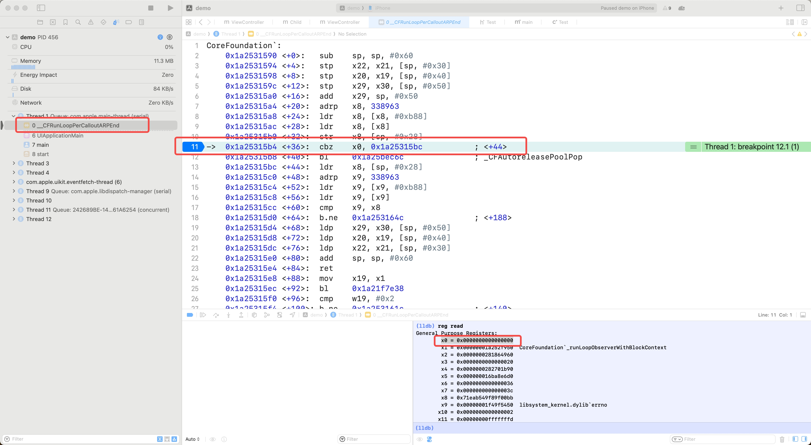


### 两个 Observer 

思路陷入停滞，我们能够验证机制的丢失，但是 iOS 14 上也应该有与 runloop 绑定的机制来确保 AutoreleasePool 的 Push/pop 。

因此我们再从 Observer 入手，无任何自己添加的监听时，输出如下：

```cpp annotated
(lldb) po [NSRunLoop mainRunLoop]
<CFRunLoop 0x282e9c100 [0x1f5146528]>{wakeup port = 0x240b, stopped = false, ignoreWakeUps = false, 
current mode = kCFRunLoopDefaultMode,
common modes = <CFBasicHash 0x281cc8030 [0x1f5146528]>{type = mutable set, count = 2,
entries =>
        0 : <CFString 0x1fc809aa8 [0x1f5146528]>{contents = "UITrackingRunLoopMode"}
        2 : <CFString 0x1f53247e0 [0x1f5146528]>{contents = "kCFRunLoopDefaultMode"}
}
,
common mode items = <CFBasicHash 0x281cc8210 [0x1f5146528]>{type = mutable set, count = 12,
entries =>
        0 : <CFRunLoopSource 0x28279c000 [0x1f5146528]>{signalled = No, valid = Yes, order = -1, context = <CFRunLoopSource context>{version = 0, info = 0x0, callout = <redacted> (0x1b8c32390)}}
        3 : <CFRunLoopSource 0x2827980c0 [0x1f5146528]>{signalled = No, valid = Yes, order = -1, context = <CFRunLoopSource context>{version = 1, info = 0x2e03, callout = <redacted> (0x1b8c32398)}}
        **4 : <CFRunLoopObserver 0x28239cbe0 [0x1f5146528]>{valid = Yes, activities = 0x1, repeats = Yes, order = -2147483647, callout = <redacted> (0x1a4980de8), context = (**
    "<_UIWeakReference: 0x281090f00>"
)}
        5 : <CFRunLoopObserver 0x28239cb40 [0x1f5146528]>{valid = Yes, activities = 0xa0, repeats = Yes, order = 2001000, callout = <redacted> (0x1a4e86fac), context = <CFRunLoopObserver context 0x1008045f0>}
        6 : <CFRunLoopSource 0x28279c3c0 [0x1f5146528]>{signalled = No, valid = Yes, order = -2, context = <CFRunLoopSource context>{version = 0, info = 0x281cca0d0, callout = <redacted> (0x1a4ef4640)}}
        **7 : <CFRunLoopObserver 0x28239cc80 [0x1f5146528]>{valid = Yes, activities = 0xa0, repeats = Yes, order = 2147483647, callout = <redacted> (0x1a4980de8), context = (**
    "<_UIWeakReference: 0x281090f00>"
)}
        8 : <CFRunLoopObserver 0x28239caa0 [0x1f5146528]>{valid = Yes, activities = 0xa0, repeats = Yes, order = 1999000, callout = <redacted> (0x1a4e86f38), context = <CFRunLoopObserver context 0x1008045f0>}
        14 : <CFRunLoopSource 0x28279c240 [0x1f5146528]>{signalled = No, valid = Yes, order = 0, context = <CFRunLoopSource context>{version = 0, info = 0x283690a20, callout = <redacted> (0x1b10a4360)}}
        17 : <CFRunLoopObserver 0x28239c3c0 [0x1f5146528]>{valid = Yes, activities = 0x20, repeats = Yes, order = 0, callout = <redacted> (0x1a49cdff0), context = <CFRunLoopObserver context 0x28399db90>}
        20 : <CFRunLoopTimer 0x282798900 [0x1f5146528]>{valid = Yes, firing = No, interval = 0, tolerance = 0, next fire date = 737099987 (-167.529369 @ 4861946970), callout = <redacted> (0x1a4e88090 / 0x1a4e88090) (/System/Library/PrivateFrameworks/UIKitCore.framework/UIKitCore), context = <CFRunLoopTimer context 0x0>}
        21 : <CFRunLoopSource 0x28279c300 [0x1f5146528]>{signalled = No, valid = Yes, order = -1, context = <CFRunLoopSource context>{version = 0, info = 0x28299c5b0, callout = <redacted> (0x1a4ef45cc)}}
        22 : <CFRunLoopObserver 0x28239cfa0 [0x1f5146528]>{valid = Yes, activities = 0xa0, repeats = Yes, order = 2000000, callout = <redacted> (0x1a57524d4), context = <CFRunLoopObserver context 0x0>}
}
,
modes = <CFBasicHash 0x281cc8060 [0x1f5146528]>{type = mutable set, count = 3,
entries =>
        0 : <CFRunLoopMode 0x28299c340 [0x1f5146528]>{name = UITrackingRunLoopMode, port set = 0x2003, queue = 0x283c9d780, source = 0x283c9d880 (not fired), timer port = 0x2a03, 
        sources0 = <CFBasicHash 0x281cc8270 [0x1f5146528]>{type = mutable set, count = 4,
entries =>
        0 : <CFRunLoopSource 0x28279c000 [0x1f5146528]>{signalled = No, valid = Yes, order = -1, context = <CFRunLoopSource context>{version = 0, info = 0x0, callout = <redacted> (0x1b8c32390)}}
        1 : <CFRunLoopSource 0x28279c240 [0x1f5146528]>{signalled = No, valid = Yes, order = 0, context = <CFRunLoopSource context>{version = 0, info = 0x283690a20, callout = <redacted> (0x1b10a4360)}}
        2 : <CFRunLoopSource 0x28279c300 [0x1f5146528]>{signalled = No, valid = Yes, order = -1, context = <CFRunLoopSource context>{version = 0, info = 0x28299c5b0, callout = <redacted> (0x1a4ef45cc)}}
        3 : <CFRunLoopSource 0x28279c3c0 [0x1f5146528]>{signalled = No, valid = Yes, order = -2, context = <CFRunLoopSource context>{version = 0, info = 0x281cca0d0, callout = <redacted> (0x1a4ef4640)}}
}
,
        sources1 = <CFBasicHash 0x281cc82a0 [0x1f5146528]>{type = mutable set, count = 1,
entries =>
        1 : <CFRunLoopSource 0x2827980c0 [0x1f5146528]>{signalled = No, valid = Yes, order = -1, context = <CFRunLoopSource context>{version = 1, info = 0x2e03, callout = <redacted> (0x1b8c32398)}}
}
,
        observers = (
    "<CFRunLoopObserver 0x28239cbe0 [0x1f5146528]>{valid = Yes, activities = 0x1, repeats = Yes, order = -2147483647, callout = <redacted> (0x1a4980de8), context = (\n    \"<_UIWeakReference: 0x281090f00>\"\n)}",
    "<CFRunLoopObserver 0x28239c3c0 [0x1f5146528]>{valid = Yes, activities = 0x20, repeats = Yes, order = 0, callout = <redacted> (0x1a49cdff0), context = <CFRunLoopObserver context 0x28399db90>}",
    "<CFRunLoopObserver 0x28239caa0 [0x1f5146528]>{valid = Yes, activities = 0xa0, repeats = Yes, order = 1999000, callout = <redacted> (0x1a4e86f38), context = <CFRunLoopObserver context 0x1008045f0>}",
    "<CFRunLoopObserver 0x28239cfa0 [0x1f5146528]>{valid = Yes, activities = 0xa0, repeats = Yes, order = 2000000, callout = <redacted> (0x1a57524d4), context = <CFRunLoopObserver context 0x0>}",
    "<CFRunLoopObserver 0x28239cb40 [0x1f5146528]>{valid = Yes, activities = 0xa0, repeats = Yes, order = 2001000, callout = <redacted> (0x1a4e86fac), context = <CFRunLoopObserver context 0x1008045f0>}",
    "<CFRunLoopObserver 0x28239cc80 [0x1f5146528]>{valid = Yes, activities = 0xa0, repeats = Yes, order = 2147483647, callout = <redacted> (0x1a4980de8), context = (\n    \"<_UIWeakReference: 0x281090f00>\"\n)}"
),
        timers = <CFArray 0x28369b9c0 [0x1f5146528]>{type = mutable-small, count = 1, values = (
        0 : <CFRunLoopTimer 0x282798900 [0x1f5146528]>{valid = Yes, firing = No, interval = 0, tolerance = 0, next fire date = 737099987 (-167.536935 @ 4861946970), callout = <redacted> (0x1a4e88090 / 0x1a4e88090) (/System/Library/PrivateFrameworks/UIKitCore.framework/UIKitCore), context = <CFRunLoopTimer context 0x0>}
)},
        currently 737100155 (8882721009) / soft deadline in: 7.68614336e+11 sec (@ 4861946970) / hard deadline in: 7.68614336e+11 sec (@ 4861946970)
},
        1 : <CFRunLoopMode 0x28299c410 [0x1f5146528]>{name = GSEventReceiveRunLoopMode, port set = 0x5403, queue = 0x283c9d900, source = 0x283c9da00 (not fired), timer port = 0x2b03, 
        sources0 = <CFBasicHash 0x281cc8330 [0x1f5146528]>{type = mutable set, count = 1,
entries =>
        0 : <CFRunLoopSource 0x28279c000 [0x1f5146528]>{signalled = No, valid = Yes, order = -1, context = <CFRunLoopSource context>{version = 0, info = 0x0, callout = <redacted> (0x1b8c32390)}}
}
,
        sources1 = <CFBasicHash 0x281cc8360 [0x1f5146528]>{type = mutable set, count = 1,
entries =>
        1 : <CFRunLoopSource 0x2827983c0 [0x1f5146528]>{signalled = No, valid = Yes, order = -1, context = <CFRunLoopSource context>{version = 1, info = 0x2e03, callout = <redacted> (0x1b8c32398)}}
}
,
        observers = (null),
        timers = (null),
        currently 737100155 (8882852998) / soft deadline in: 7.68614336e+11 sec (@ -1) / hard deadline in: 7.68614336e+11 sec (@ -1)
},
        2 : <CFRunLoopMode 0x28299c270 [0x1f5146528]>{name = kCFRunLoopDefaultMode, port set = 0x1d03, queue = 0x283c9d580, source = 0x283c9d680 (not fired), timer port = 0x2203, 
        sources0 = <CFBasicHash 0x281cc82d0 [0x1f5146528]>{type = mutable set, count = 4,
entries =>
        0 : <CFRunLoopSource 0x28279c000 [0x1f5146528]>{signalled = No, valid = Yes, order = -1, context = <CFRunLoopSource context>{version = 0, info = 0x0, callout = <redacted> (0x1b8c32390)}}
        1 : <CFRunLoopSource 0x28279c240 [0x1f5146528]>{signalled = No, valid = Yes, order = 0, context = <CFRunLoopSource context>{version = 0, info = 0x283690a20, callout = <redacted> (0x1b10a4360)}}
        2 : <CFRunLoopSource 0x28279c300 [0x1f5146528]>{signalled = No, valid = Yes, order = -1, context = <CFRunLoopSource context>{version = 0, info = 0x28299c5b0, callout = <redacted> (0x1a4ef45cc)}}
        3 : <CFRunLoopSource 0x28279c3c0 [0x1f5146528]>{signalled = No, valid = Yes, order = -2, context = <CFRunLoopSource context>{version = 0, info = 0x281cca0d0, callout = <redacted> (0x1a4ef4640)}}
}
,
        sources1 = <CFBasicHash 0x281cc8300 [0x1f5146528]>{type = mutable set, count = 1,
entries =>
        1 : <CFRunLoopSource 0x2827980c0 [0x1f5146528]>{signalled = No, valid = Yes, order = -1, context = <CFRunLoopSource context>{version = 1, info = 0x2e03, callout = <redacted> (0x1b8c32398)}}
}
,
        observers = (
    **"<CFRunLoopObserver 0x28239cbe0 [0x1f5146528]>{valid = Yes, activities = 0x1, repeats = Yes, order = -2147483647, callout = <redacted> (0x1a4980de8), context = (\n    \"<_UIWeakReference: 0x281090f00>\"\n)}",**
    "<CFRunLoopObserver 0x28239c3c0 [0x1f5146528]>{valid = Yes, activities = 0x20, repeats = Yes, order = 0, callout = <redacted> (0x1a49cdff0), context = <CFRunLoopObserver context 0x28399db90>}",
    "<CFRunLoopObserver 0x28239caa0 [0x1f5146528]>{valid = Yes, activities = 0xa0, repeats = Yes, order = 1999000, callout = <redacted> (0x1a4e86f38), context = <CFRunLoopObserver context 0x1008045f0>}",
    "<CFRunLoopObserver 0x28239cfa0 [0x1f5146528]>{valid = Yes, activities = 0xa0, repeats = Yes, order = 2000000, callout = <redacted> (0x1a57524d4), context = <CFRunLoopObserver context 0x0>}",
    "<CFRunLoopObserver 0x28239cb40 [0x1f5146528]>{valid = Yes, activities = 0xa0, repeats = Yes, order = 2001000, callout = <redacted> (0x1a4e86fac), context = <CFRunLoopObserver context 0x1008045f0>}",
    **"<CFRunLoopObserver 0x28239cc80 [0x1f5146528]>{valid = Yes, activities = 0xa0, repeats = Yes, order = 2147483647, callout = <redacted> (0x1a4980de8), context = (\n    \"<_UIWeakReference: 0x281090f00>\"\n)}"**
),
        timers = <CFArray 0x28369b4e0 [0x1f5146528]>{type = mutable-small, count = 2, values = (
        0 : <CFRunLoopTimer 0x282798240 [0x1f5146528]>{valid = Yes, firing = No, interval = 0, tolerance = 0, next fire date = 737099954 (-201.105656 @ 4056450875), callout = (Delayed Perform) UIApplication _accessibilitySetUpQuickSpeak (0x1a38caf90 / 0x1a432fcb4) (/System/Library/PrivateFrameworks/UIKitCore.framework/UIKitCore), context = <CFRunLoopTimer context 0x2807a31c0>}
        1 : <CFRunLoopTimer 0x282798900 [0x1f5146528]>{valid = Yes, firing = No, interval = 0, tolerance = 0, next fire date = 737099987 (-167.544101 @ 4861946970), callout = <redacted> (0x1a4e88090 / 0x1a4e88090) (/System/Library/PrivateFrameworks/UIKitCore.framework/UIKitCore), context = <CFRunLoopTimer context 0x0>}
)},
        currently 737100155 (8882856969) / soft deadline in: 7.68614336e+11 sec (@ 4056450875) / hard deadline in: 7.68614336e+11 sec (@ 4056450875)
},
}
}
```


其中我们先研究这个优先级为 **2147483647** 的 oberserver。优先级为 \-**2147483647** 就留给读者自行分析。

```cpp annotated
"<CFRunLoopObserver 0x28239cc80 [0x1f5146528]>{valid = Yes, activities = 0xa0, repeats = Yes, order = 2147483647, callout = <redacted> (0x1a4980de8), **context = (\n    \"<_UIWeakReference: 0x281090f00>\"\n)}"**
```

0xa0 = 1  \<\< 7 \+ 1 \<\< 5 。对应 `kCFRunLoopBeforeWaiting` \+ `kCFRunLoopExit` 。


### \_UIWeakReference

通过前人已经完成解析 header ，我们直接查看定义。是一个包装了函数指针的弱引用。

```cpp
// 由于 po 的时候，context 已经被 po 打印了，看不出原本的地址了，因此需要额外分析下
(lldb) po (_UIWeakReference *)0x281090f00
<_UIWeakReference: 0x281090f00>
```

```cpp
// https://github.com/SparkDev97/iOS14-Runtime-Headers/blob/f1f1b547ae5f6c98a4eb490258276a67aa3d0226/PrivateFrameworks/UIKitCore.framework/_UIWeakReference.h#L12

@interface _UIWeakReference : NSObject <NSCopying> {

        id _object;

}

@property (assign,nonatomic,__weak) id object;              //@synthesize object=_object - In the implementation block
+(id)weakReferenceWrappingObject:(id)arg1 ;
-(id)copyWithZone:(NSZone*)arg1 ;
-(void)setObject:(id)arg1 ;
-(id)initWithObject:(id)arg1 ;
-(id)object;
@end
```

输出包装后的对象，是一个 \_UIBoxedAutoreleasePoolMark，也就是一个包装了 Token 的对象而已， 没有更多研究的价值。

```cpp
(lldb) po [(_UIWeakReference *)0x281090f00 object]
<_UIBoxedAutoreleasePoolMark: 0x281090f10>
```

```objective-c
// https://github.com/SparkDev97/iOS14-Runtime-Headers/blob/f1f1b547ae5f6c98a4eb490258276a67aa3d0226/PrivateFrameworks/UIKitCore.framework/_UIBoxedAutoreleasePoolMark.h#L10

@interface _UIBoxedAutoreleasePoolMark : NSObject {

        void* _mark;

}

@property (assign,nonatomic) void* mark;              //@synthesize mark=_mark - In the implementation block
-(void*)mark;
-(void)setMark:(void*)arg1 ;
-(id)initWithAutoreleasePoolMark:(void*)arg1 ;
@end
```


我们再回到 context  的输出，很明显，context 的信息肯定是一个 OC 对象，并且这个对象还实现了 `-(void)description;` ，而我们需要看原始类型。~~（此时其实我并没有意识到这是一个 Array 的输出😭）。~~

```asm annotated
// 0x28239cc80 是 CFRunLoopObserver
(lldb) memory read 0x28239cc80 (0x28239cc80+0xa0)
0x28239cc80: e9 f5 9f f4 a1 21 00 00 8a 2d 00 00 04 00 00 00  .....!...-......
0x28239cc90: 58 54 55 4d 00 00 00 00 00 00 00 00 a8 20 00 00  XTUM......... ..
0x28239cca0: 00 00 00 00 58 54 55 4d 00 00 00 00 00 00 00 00  ....XTUM........
0x28239ccb0: 00 00 00 00 00 00 00 00 ff ff ff ff ff ff ff ff  ................
0x28239ccc0: 6f 33 c6 7d fd ff ff ff 58 54 55 4d 58 54 55 4d  o3.}....XTUMXTUM
0x28239ccd0: 00 c1 e9 82 02 00 00 00 02 00 00 00 00 00 00 00  ................
0x28239cce0: a0 00 00 00 00 00 00 00 ff ff ff 7f 00 00 00 00  ................
                  callout ⬇️           context.version ⬇️   
0x28239cd00: e8 0d 98 a4 01 00 00 00 **00 00 00 00 00 00 00 00**  ................
                 context.info ⬇️       context.retain ⬇️   
0x28239cd10: **d0 8e 78 80 02 00 00 00** 9c 9e 49 a2 01 00 00 00  ..x.......I.....
0x2838ecf20: 30 9a 49 a2 01 00 00 00 dc 51 53 a2 01 00 00 00  0.I......QS.....


```

通过直接输出偏移量，获得对象字段的值。

`d0 8e 78 80 02 00 00 00` \-\> `0x0280788ed0` 。输出一下，竟然是一个 NSArray \.\.\. 唯一的元素是我们一开始就看到的 **\_UIWeakReference**。

```bash
(lldb) po 0x0280788ed0
<__NSArrayM 0x280788ed0>(
<_UIWeakReference: 0x280becbb0>
)
```

以防万一再输出下 retain ，`9c 9e 49 a2 01 00 00 00` \-\> `0x01a2499e9c` 。

```cpp
(lldb) dis -a 0x01a2499e9c
CoreFoundation`CFRetain:
    0x1a2499e9c <+0>:   stp    x29, x30, [sp, #-0x10]!
    0x1a2499ea0 <+4>:   mov    x29, sp
    0x1a2499ea4 <+8>:   cbz    x0, 0x1a2499f24           ; <+136>
    0x1a2499ea8 <+12>:  tbz    x0, #0x3f, 0x1a2499eb4    ; <+24>
    0x1a2499eac <+16>:  ldp    x29, x30, [sp], #0x10
    0x1a2499eb0 <+20>:  ret    
    0x1a2499eb4 <+24>:  add    x8, x0, #0x8
    0x1a2499eb8 <+28>:  ldar   x9, [x8]
    0x1a2499ebc <+32>:  ldr    x8, [x0]
    0x1a2499ec0 <+36>:  cbz    x8, 0x1a2499ef4           ; <+88>
    0x1a2499ec4 <+40>:  ubfx   x9, x9, #8, #10
    0x1a2499ec8 <+44>:  adrp   x10, 337260
    0x1a2499ecc <+48>:  ldr    x10, [x10, #0xdd0]
    0x1a2499ed0 <+52>:  cmp    x9, #0x7
    0x1a2499ed4 <+56>:  ccmp   x8, x10, #0x0, eq
    0x1a2499ed8 <+60>:  b.eq   0x1a2499ef4               ; <+88>
    0x1a2499edc <+64>:  adrp   x10, 337255
    0x1a2499ee0 <+68>:  add    x10, x10, #0x560          ; __CFRuntimeClassTable
    0x1a2499ee4 <+72>:  add    x9, x10, x9, lsl #3
    0x1a2499ee8 <+76>:  ldr    x9, [x9, #0x2000]
    0x1a2499eec <+80>:  cmp    x8, x9
    0x1a2499ef0 <+84>:  b.ne   0x1a2499f00               ; <+100>
    0x1a2499ef4 <+88>:  mov    w1, #0x0
    0x1a2499ef8 <+92>:  ldp    x29, x30, [sp], #0x10
    0x1a2499efc <+96>:  b      0x1a2533ea0               ; _CFRetain
    0x1a2499f00 <+100>: tbz    w8, #0x0, 0x1a2499f1c     ; <+128>
    0x1a2499f04 <+104>: adrp   x10, 339115
    0x1a2499f08 <+108>: ldr    x10, [x10, #0xca8]
    0x1a2499f0c <+112>: ldr    x10, [x10]
    0x1a2499f10 <+116>: and    x8, x10, x8
    0x1a2499f14 <+120>: cmp    x8, x9
    0x1a2499f18 <+124>: b.eq   0x1a2499ef4               ; <+88>
    0x1a2499f1c <+128>: ldp    x29, x30, [sp], #0x10
    0x1a2499f20 <+132>: b      0x1a21f7e98
    0x1a2499f24 <+136>: bl     0x1a261fd08               ; CFRetain.cold.1
```

既然是 CFRetain ，那我们就知道了，这个 observer 肯定是通过 `CFRunLoopObserverCreate` 方法直接创建的。再不济我们可以对 `CFRunLoopObserverCreate` 进行符号断点，找到创建的地方。


但我们还没这么山穷水尽，我们先通过输出 callout 可得（非同一次执行，地址会与上面对不上），发现函数不在 CoreFoundation 中了。

```bash annotated
(lldb) dis -a **0x1a4980de8**
UIKitCore`:
    0x1a4980de8 <+0>:  stp    x20, x19, [sp, #-0x20]!
    0x1a4980dec <+4>:  stp    x29, x30, [sp, #0x10]
    0x1a4980df0 <+8>:  add    x29, sp, #0x10
    0x1a4980df4 <+12>: mov    x19, x2
    0x1a4980df8 <+16>: cmp    x1, #0x80
    0x1a4980dfc <+20>: b.eq   0x1a4980e1c               ; <+52>
    0x1a4980e00 <+24>: cmp    x1, #0x20
    0x1a4980e04 <+28>: b.eq   0x1a4980e2c               ; <+68>
    0x1a4980e08 <+32>: cmp    x1, #0x1
    0x1a4980e0c <+36>: b.eq   0x1a4980e34               ; <+76>
    0x1a4980e10 <+40>: ldp    x29, x30, [sp, #0x10]
    0x1a4980e14 <+44>: ldp    x20, x19, [sp], #0x20
    0x1a4980e18 <+48>: ret    
    0x1a4980e1c <+52>: mov    x0, x19
    0x1a4980e20 <+56>: ldp    x29, x30, [sp, #0x10]
    0x1a4980e24 <+60>: ldp    x20, x19, [sp], #0x20
    0x1a4980e28 <+64>: b      0x1a4980f70               ; _popAutoreleasePool
    0x1a4980e2c <+68>: mov    x0, x19
    0x1a4980e30 <+72>: bl     0x1a4980f70               ; _popAutoreleasePool
    0x1a4980e34 <+76>: mov    x0, x19
    0x1a4980e38 <+80>: ldp    x29, x30, [sp, #0x10]
    0x1a4980e3c <+84>: ldp    x20, x19, [sp], #0x20
    0x1a4980e40 <+88>: b      0x1a4981034               ; _pushAutoreleasePool
```

### \_\_runLoopObserverCallout

通过 imagelist 偏移与地址相减得到 0x659DE8 。通过偏移量，得到基于 UIKitCore 开始的地址偏移，得到函数 `__runLoopObserverCallout:` 。这一结果与调试时调用栈结果相符，可进行验证。

```bash annotated
[ 74] 186F3A78-108A-3057-A67E-800A88EBFF00 **0x00000001a4327000** /Users/example/Library/Developer/Xcode/iOS DeviceSupport/iPhone9,1 14.6 (18F72)/Symbols/System/Library/PrivateFrameworks/UIKitCore.framework/UIKitCore 


0x1a4980de8 - 0x00000001a4327000 = 0x659DE8
```

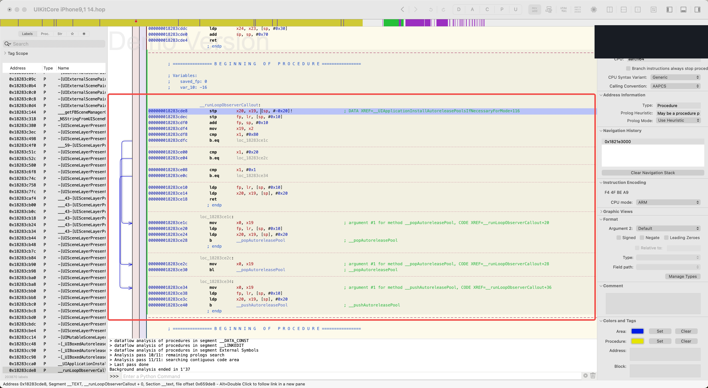

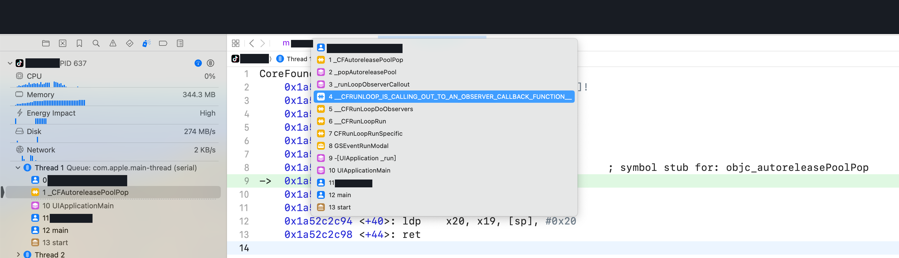

> [UIKitCore iPhone9,1 14\.6](./attachments/attachment-03.bin)


查看反汇编，解析如下：

```c
// hooper

static void __CFRUNLOOP_IS_CALLING_OUT_TO_AN_OBSERVER_CALLBACK_FUNCTION__(CFRunLoopObserverCallBack func, CFRunLoopObserverRef observer, CFRunLoopActivity activity, void *info) {
    if (func) {
        func(observer, activity, info);
    }
    asm __volatile__(""); // thwart tail-call optimization
}

// __runLoopObserverCallout 也就对应上面的 func(observer, activity, info);
// 可以用以对照
/*
arg0 -> observer
arg1 -> activity
arg2 -> info
*/
void __runLoopObserverCallout(int arg0, int arg1, int arg2) {
    r1 = arg1;
    var_10 = r20;
    stack[-24] = r19;
    r31 = r31 + 0xffffffffffffffe0;
    saved_fp = r29;
    stack[-8] = r30;
    r19 = arg2;
    if (r1 != 0x80) {
            if (r1 != 0x20) {
                    if (r1 == 0x1) { // 0x1 ，也就是 kCFRunLoopEntry
                            __pushAutoreleasePool(r19);
                    }
            }
            else {
                    // 正常在 runloop 结束时，走这个分支
                    // arg 1 是 0x20 (kCFRunLoopBeforeWaiting) , arg2 是 
                    /*
<__NSArrayM 0x280ebd8f0>(
<_UIWeakReference: 0x2802ec660>
)
                    */
                    __popAutoreleasePool(r19);
                    __pushAutoreleasePool(r19);
            }
    }
    else {
            // arg 1 是 0x80 （kCFRunLoopExit），也就是 主 runloop 退出，走这里
            __popAutoreleasePool(r19);
    }
    return;
}
```

因此我们明白了 `__runLoopObserverCallout` 的作用。


### iOS 14 \_\_UIApplicationInstallAutoreleasePoolsIfNecessaryForMode in

通过 Hooper 的 caller 功能找到了调用 `__runLoopObserverCallout` 的函数：`__UIApplicationInstallAutoreleasePoolsIfNecessaryForMode`。通过运行时的符号断点研究。

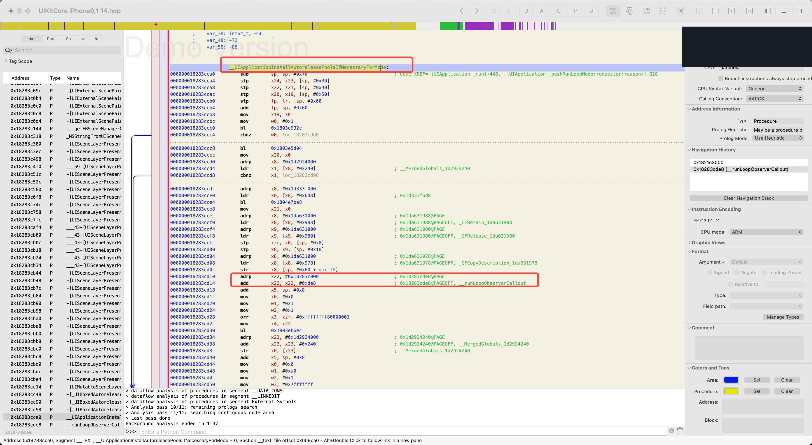

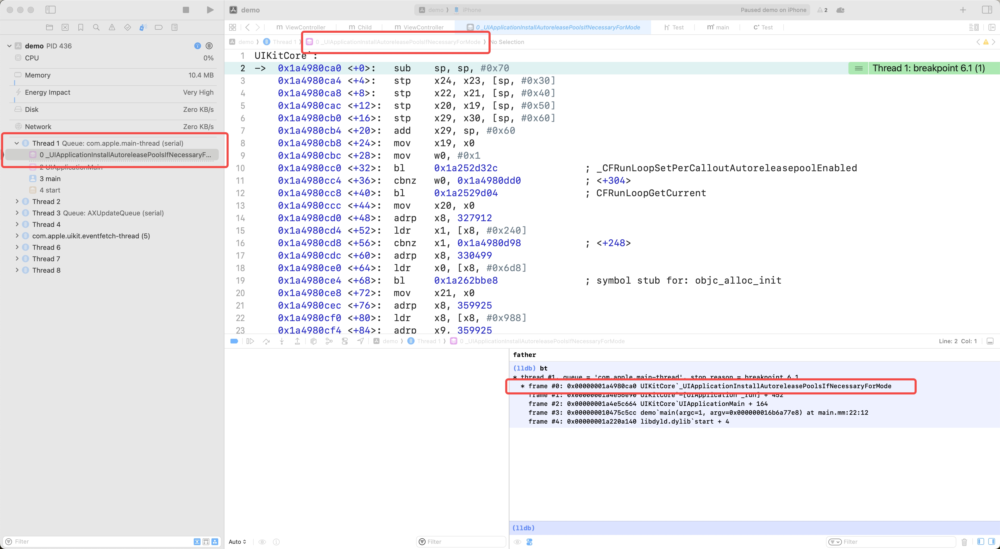

还可以看到函数 `_CFRunLoopSetPerCalloutAutoreleasepoolEnabled` 。在 iOS 14 上，为 0 。


所以就明白了，iOS 15 \+ 以上 `_CFRunLoopSetPerCalloutAutoreleasepoolEnabled` 的返回值是 YES 。苹果这个开关等于很早就留着了，但是一直到 iOS 15 才开。

等于就是如果 `_CFRunLoopSetPerCalloutAutoreleasepoolEnabled` 不开，那就 runloop BeforeWaiting\(结束\)的时候先 Pop 一次，再 Push 一次；如果开关开了，那就每次 callout 前后都调用一下。

```c annotated
function _CFRunLoopSetPerCalloutAutoreleasepoolEnabled {
    r0 = __CFRunLoopSetPerCalloutAutoreleasepoolEnabled_ptr();
    return r0;
}

                     __CFRunLoopSetPerCalloutAutoreleasepoolEnabled_ptr:
00000001da634f28         **dq**         0x00000201803e932c                          ; DATA XREF=imp___stubs___CFRunLoopSetPerCalloutAutoreleasepoolEnabled+4
```

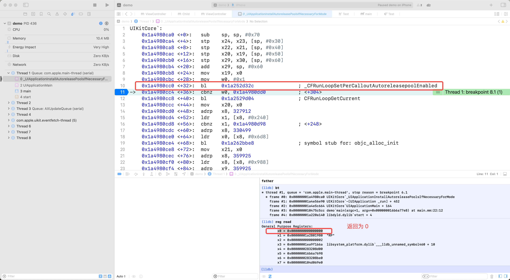

```c
UIKitCore`:
    0x1a4980ca0 <+0>:   sub    sp, sp, #0x70
    0x1a4980ca4 <+4>:   stp    x24, x23, [sp, #0x30]
    0x1a4980ca8 <+8>:   stp    x22, x21, [sp, #0x40]
    0x1a4980cac <+12>:  stp    x20, x19, [sp, #0x50]
    0x1a4980cb0 <+16>:  stp    x29, x30, [sp, #0x60]
    0x1a4980cb4 <+20>:  add    x29, sp, #0x60
    0x1a4980cb8 <+24>:  mov    x19, x0
    0x1a4980cbc <+28>:  mov    w0, #0x1
    0x1a4980cc0 <+32>:  bl     0x1a252d32c               ; _CFRunLoopSetPerCalloutAutoreleasepoolEnabled
->  0x1a4980cc4 <+36>:  cbnz   w0, 0x1a4980dd0           ; <+304>
    0x1a4980cc8 <+40>:  bl     0x1a2529d04               ; CFRunLoopGetCurrent
    0x1a4980ccc <+44>:  mov    x20, x0
    0x1a4980cd0 <+48>:  adrp   x8, 327912
    0x1a4980cd4 <+52>:  ldr    x1, [x8, #0x240]
    0x1a4980cd8 <+56>:  cbnz   x1, 0x1a4980d98           ; <+248>
    0x1a4980cdc <+60>:  adrp   x8, 330499
    0x1a4980ce0 <+64>:  ldr    x0, [x8, #0x6d8]
    0x1a4980ce4 <+68>:  bl     0x1a262bbe8               ; symbol stub for: objc_alloc_init
    0x1a4980ce8 <+72>:  mov    x21, x0
    0x1a4980cec <+76>:  adrp   x8, 359925
    0x1a4980cf0 <+80>:  ldr    x8, [x8, #0x988]
    0x1a4980cf4 <+84>:  adrp   x9, 359925
    0x1a4980cf8 <+88>:  ldr    x9, [x9, #0x980]
    0x1a4980cfc <+92>:  stp    xzr, x0, [sp, #0x8]
    0x1a4980d00 <+96>:  stp    x8, x9, [sp, #0x18]
    0x1a4980d04 <+100>: adrp   x8, 359925
    0x1a4980d08 <+104>: ldr    x8, [x8, #0x978]
    0x1a4980d0c <+108>: str    x8, [sp, #0x28]
    0x1a4980d10 <+112>: adrp   x22, 0
    0x1a4980d14 <+116>: add    x22, x22, #0xde8          ; _runLoopObserverCallout // callback
    0x1a4980d18 <+120>: add    x5, sp, #0x8
    0x1a4980d1c <+124>: mov    x0, #0x0
    0x1a4980d20 <+128>: mov    w1, #0x1
    0x1a4980d24 <+132>: mov    w2, #0x1
    0x1a4980d28 <+136>: mov    x3, #-0x7fffffff
    0x1a4980d2c <+140>: mov    x4, x22
    0x1a4980d30 <+144>: bl     0x1a252f6e4               ; CFRunLoopObserverCreate // 创建 observer 了
    0x1a4980d34 <+148>: adrp   x23, 327912
    0x1a4980d38 <+152>: add    x23, x23, #0x240          ; _MergedGlobals
    0x1a4980d3c <+156>: str    x0, [x23]
    0x1a4980d40 <+160>: add    x5, sp, #0x8
    0x1a4980d44 <+164>: mov    x0, #0x0
    0x1a4980d48 <+168>: mov    w1, #0xa0
    0x1a4980d4c <+172>: mov    w2, #0x1
    0x1a4980d50 <+176>: mov    w3, #0x7fffffff
    0x1a4980d54 <+180>: mov    x4, x22
    0x1a4980d58 <+184>: bl     0x1a252f6e4               ; CFRunLoopObserverCreate
    0x1a4980d5c <+188>: str    x0, [x23, #0x8]
    0x1a4980d60 <+192>: ldr    x1, [x23]
    0x1a4980d64 <+196>: adrp   x8, 359926
    0x1a4980d68 <+200>: ldr    x8, [x8, #0xda0]
    0x1a4980d6c <+204>: ldr    x22, [x8]
    0x1a4980d70 <+208>: mov    x0, x20
    0x1a4980d74 <+212>: mov    x2, x22
    0x1a4980d78 <+216>: bl     0x1a252dde4               ; CFRunLoopAddObserver
    0x1a4980d7c <+220>: ldr    x1, [x23, #0x8]
    0x1a4980d80 <+224>: mov    x0, x20
    0x1a4980d84 <+228>: mov    x2, x22
    0x1a4980d88 <+232>: bl     0x1a252dde4               ; CFRunLoopAddObserver
    0x1a4980d8c <+236>: mov    x0, x21
    0x1a4980d90 <+240>: bl     0x1a21f7e8c
    0x1a4980d94 <+244>: ldr    x1, [x23]
    0x1a4980d98 <+248>: mov    x0, x20
    0x1a4980d9c <+252>: mov    x2, x19
    0x1a4980da0 <+256>: bl     0x1a252dcd0               ; CFRunLoopContainsObserver
    0x1a4980da4 <+260>: cbnz   w0, 0x1a4980dd0           ; <+304>
    0x1a4980da8 <+264>: adrp   x21, 327912
    0x1a4980dac <+268>: add    x21, x21, #0x240          ; _MergedGlobals
    0x1a4980db0 <+272>: ldr    x1, [x21]
    0x1a4980db4 <+276>: mov    x0, x20
    0x1a4980db8 <+280>: mov    x2, x19
    0x1a4980dbc <+284>: bl     0x1a252dde4               ; CFRunLoopAddObserver
    0x1a4980dc0 <+288>: ldr    x1, [x21, #0x8]
    0x1a4980dc4 <+292>: mov    x0, x20
    0x1a4980dc8 <+296>: mov    x2, x19
    0x1a4980dcc <+300>: bl     0x1a252dde4               ; CFRunLoopAddObserver
    0x1a4980dd0 <+304>: ldp    x29, x30, [sp, #0x60]
    0x1a4980dd4 <+308>: ldp    x20, x19, [sp, #0x50]
    0x1a4980dd8 <+312>: ldp    x22, x21, [sp, #0x40]
    0x1a4980ddc <+316>: ldp    x24, x23, [sp, #0x30]
    0x1a4980de0 <+320>: add    sp, sp, #0x70
    0x1a4980de4 <+324>: ret    
```

同时我们分析这个函数，发现创建 Obberser 的代码也在其中：

```c
int __UIApplicationInstallAutoreleasePoolsIfNecessaryForMode(int arg0) {
    r31 = r31 - 0x70;
    var_30 = r24;
    stack[-56] = r23;
    var_20 = r22;
    stack[-40] = r21;
    var_10 = r20;
    stack[-24] = r19;
    saved_fp = r29;
    stack[-8] = r30;
    r19 = arg0;
    r0 = loc_1803e932c(0x1); // 这个调用就是 _CFRunLoopSetPerCalloutAutoreleasepoolEnabled
    if (r0 == 0x0) {
            r20 = loc_1803e5d04(); // CFRunLoopGetCurrent 
            if (*0x1d2924240 == 0x0) { // 
                    // 走进核心逻辑
                    loc_1804e7be8(*0x1d333f6d8); 
                    // 0xffffffff80000001 是 order ，也就是 -2147483647
                    // 简单的测试方法就是看输出即可
                    // CFIndex testOrder = 0xffffffff80000001; 
                    r0 = loc_1803eb6e4(0x0, 0x1, 0x1, 0xffffffff80000001, 0x18283cde8, &var_58); // 就是 CFRunLoopObserverCreate
                    *0x1d2924240 = r0;
                    // 0x7fffffff 是 order，也就是熟悉的 2147483647
                    r0 = loc_1803eb6e4(0x0, 0xa0, 0x1, 0x7fffffff, 0x18283cde8, &var_58); // // 就是 CFRunLoopObserverCreate
                    *0x1d2924248 = r0;
                    loc_1803e9de4(r20, *0x1d2924240, **_kCFRunLoopCommonModes); // 就是 CFRunLoopAddObserver
                    loc_1803e9de4(r20, *0x1d2924248, r22); // 就是 CFRunLoopAddObserver
                    loc_1800b3e8c(r21);
            }
            r0 = loc_1803e9cd0(r20);
            if (r0 == 0x0) {
                    loc_1803e9de4(r20, *0x1d2924240, r19);
                    r0 = loc_1803e9de4(r20, *0x1d2924248, r19);
            }
    }
    return r0;
}
```

在这里一共创建了两个 observer 。优先级不同。

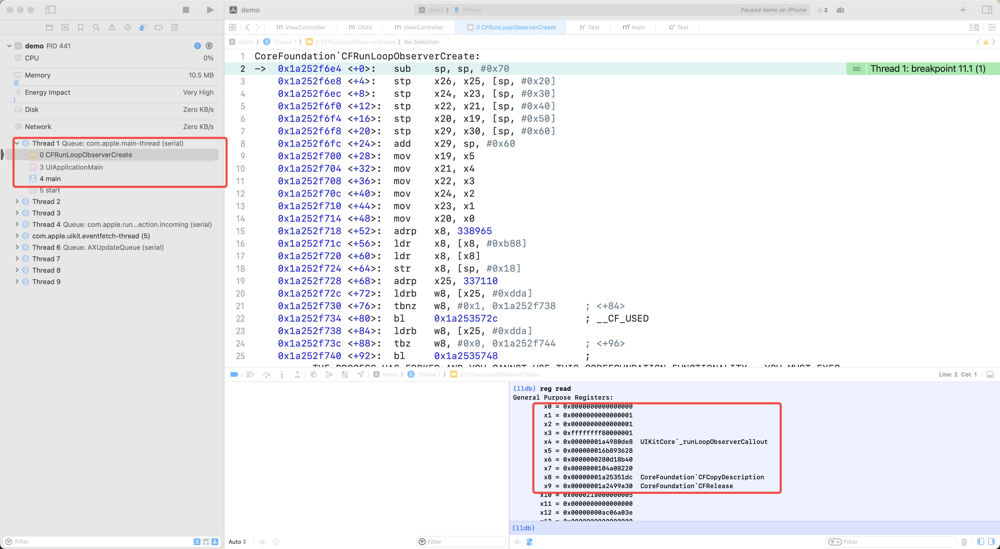

```c
(lldb) reg read
General Purpose Registers:
        x0 = 0x0000000000000000
        x1 = 0x0000000000000001
        x2 = 0x0000000000000001
        x3 = 0xffffffff80000001
        x4 = 0x00000001a4980de8  UIKitCore`_runLoopObserverCallout
        x5 = 0x000000016b893628
...
        lr = 0x00000001a4980d34  UIKitCore`_UIApplicationInstallAutoreleasePoolsIfNecessaryForMode + 148
        sp = 0x000000016b893620
        pc = 0x00000001a252f6e4  CoreFoundation`CFRunLoopObserverCreate
      cpsr = 0x40000000
```

### iOS 15\+ \_UIApplicationInstallAutoreleasePoolsIfNecessaryForMode

既然我们知道了 iOS 14 的机制，自然也要回过头来再次确认下 iOS 15 中此函数执行的分支情况。


直接先看结果：在 iOS 15 上 \_CFRunLoopSetPerCalloutAutoreleasepoolEnabled 返回 1 ，跳过两个 oberserver 的注册。

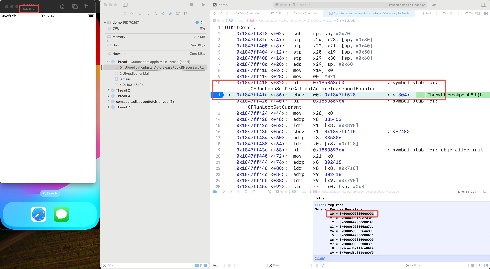

```cpp
0x1847ff410 <+24>:  mov    x19, x0
    0x1847ff414 <+28>:  mov    w0, #0x1 // 写死传入 0x1
    0x1847ff418 <+32>:  bl     0x185368cb0               ; symbol stub for: _CFRunLoopSetPerCalloutAutoreleasepoolEnabled
->  0x1847ff41c <+36>:  cbnz   w0, 0x1847ff528           ; <+304>
```

可以看到实现里就是通过 \_CFRunLoopSetPerCalloutAutoreleasepoolEnabled 传入的参数 a1 决定是否读取开关，再将打开，并将对应的 BOOL 设置到 CFRunLoopGetCurrent\(\) \+ 185\(0xb9\) 的位置，后续 CF 就能内部闭环获取，不用再读取开关了。

而在 iOS 15 上，传入的参数写死 1 ，同时开关读取到后，mainRunloop 也就打开了。

```c
// ida 64

__int64 __fastcall _CFRunLoopSetPerCalloutAutoreleasepoolEnabled(int a1) // iOS 15 传入为 0x1
{
  int v1; // w20
  __int64 v2; // x19
  __int64 result; // x0

  v1 = a1;
  v2 = CFRunLoopGetCurrent(); // 注意这里调用到的时候一定是 mainRunloop ，因此这个功能只会对 mainRunloop 开启
  if ( v1 )
    result = _os_feature_enabled_impl("CoreFoundation", "CFRunLoopEnablePerCalloutARP");
  else
    result = 0LL;
  *(_BYTE *)(v2 + 185) = result;
  return result;
}
```

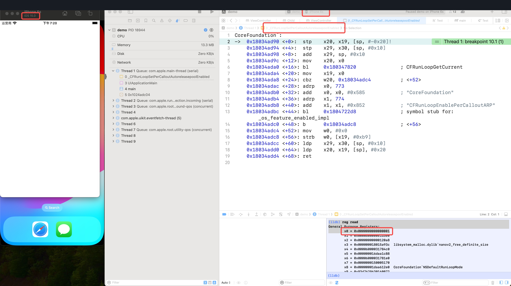


对于汇编的研究这里就不再赘述，感兴趣的同学自行研究即可。

> UIKitCore iOS 16\.2


### 小结

我们回头对比一下 iOS 15 前后，苹果的实现方案对比，我们可以发现，从设计的角度上来说，iOS 15 \+ 的方案更加合理，也减少了由于业务方实现导致堆积的风险。


## 关于 \_os\_feature\_enabled\_impl 

```c
// https://github.com/WebKit/WebKit/blob/5e8c37fdde35faf069d784d63f2def9f9c9f551e/Source/WebCore/PAL/pal/spi/cocoa/FeatureFlagsSPI.h#L37

#define os_feature_enabled(d, f) _os_feature_enabled_impl(#d, #f)
extern "C" bool _os_feature_enabled_impl(const char *domain, const char *feature);
```

实现在 `libsystem_featureflags.dylib` 中。

```c
/Library/Developer/CoreSimulator/Profiles/Runtimes/iOS 15.0.simruntime/Contents/Resources/RuntimeRoot/usr/lib/system/libsystem_featureflags.dylib
```

通过在网上搜索对应文件计数，我们可以找到这一段片段，可以大致猜到 os\_feature\_enabled 是读取的文件中的配置。

> 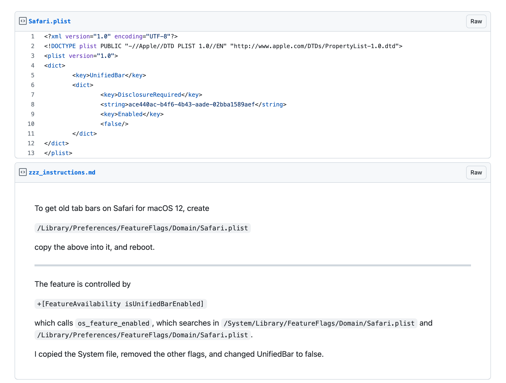

> https://gist.github.com/zhuowei/8ad1dd478df0efeb67baf2088e5cd85e


那模拟器中对应的  System 文件夹就可以通过上面的 image list 的命令中猜出，实际运行起来的前缀就是到 **RuntimeRoot** 中的部分。

```text
/Library/Developer/CoreSimulator/Profiles/Runtimes/iOS 15.0.simruntime/Contents/Resources/RuntimeRoot/
```

因此再在后面拼上对应的路径即可。

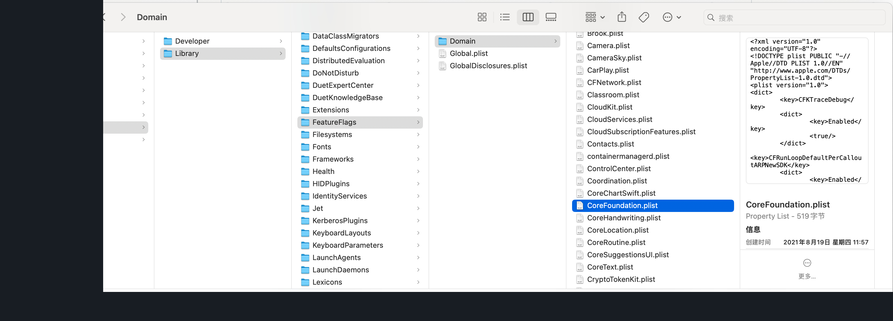

```text
/Library/Developer/CoreSimulator/Profiles/Runtimes/iOS\ 15.0.simruntime/Contents/Resources/RuntimeRoot/System/Library/FeatureFlags/Domain/CoreFoundation.plist
```

### iOS 15\.0

[CoreFoundation 15\.0\.plist](./attachments/attachment-05.plist)

确实能看到对应的 `CFRunLoopEnablePerCalloutARP` 是 true ，验证完毕。同时这也说明我们可以在低版本的系统上，通过 hook 对应的 \_os\_feature\_enabled\_impl 函数，来实现对我们进程的行为的更改。（但这也是有风险的，可以线下玩玩）。


后续还可以在 FeatureFlags 中深挖下别的，看看是否还有什么苹果留下的后门可以研究研究。随便抛几个有可能的后续深挖的。

|||
|---|---|
|AVKit \-\> SecondGenPlayer|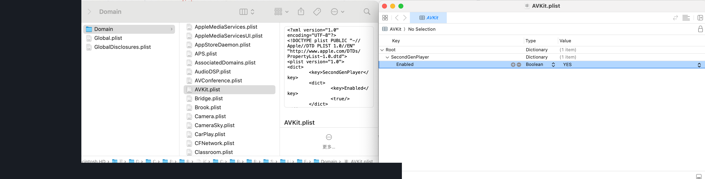<br>|
|libmalloc \-\> ProbGuard|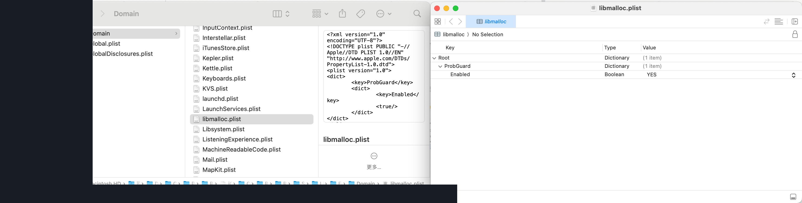<br>|
|objc4 \-\> preoptmizedCaches|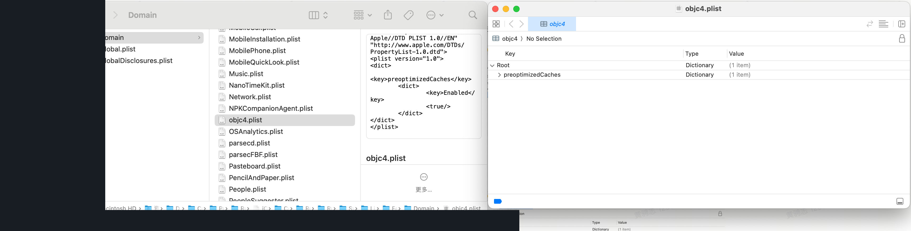<br>|
|privacy\_transparency \-\> tracker\_monitor|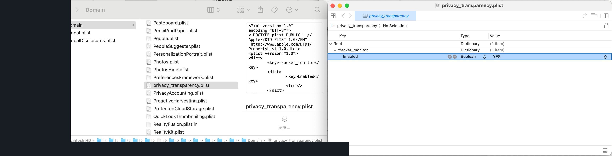<br>|
|UIKit \-\> \.\.\.\(众多 key）|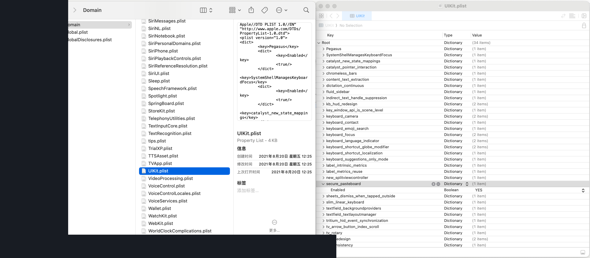<br>|


### iOS 14

通过在 iOS 15 上关于 \_os\_feature\_enabled\_impl 的研究，我们也探寻下 iOS 14 的 Feature Flag 文件夹。

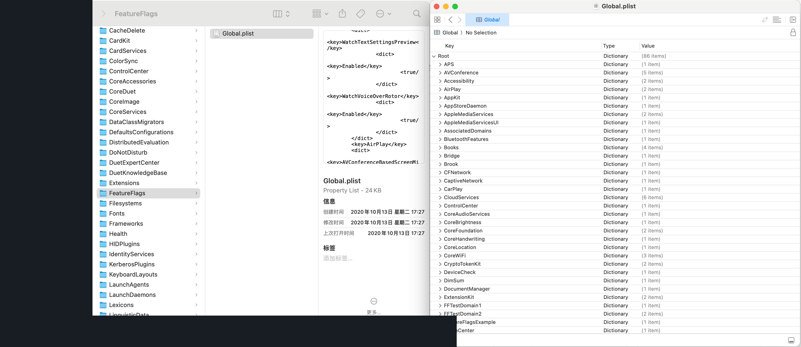

[Global iOS 14\.plist](./attachments/attachment-06.plist)

可以看到 iOS 14 上，对 plist 没有进行分类，Domain 只是作为一级 key 存在，~~🍎的程序员还是在持续优化 plist 大文件读写的是吧。~~

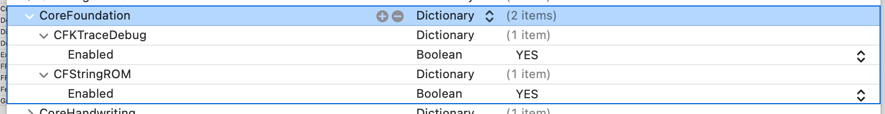

而 CoreFoundation 中确实没有 `CFRunLoopEnablePerCalloutARP` 的记录，默认为 NO 。验证完成。


~~同时还可以看到，🍎还是挺保守的，如果是 NO 就不明文写出，不被大家提前知道所有还未打开的开关，也合理。~~ 并且在开源的 CoreFoundation 源码中也删除了所有的开关。


### SwiftUI 

From 一位同事

> 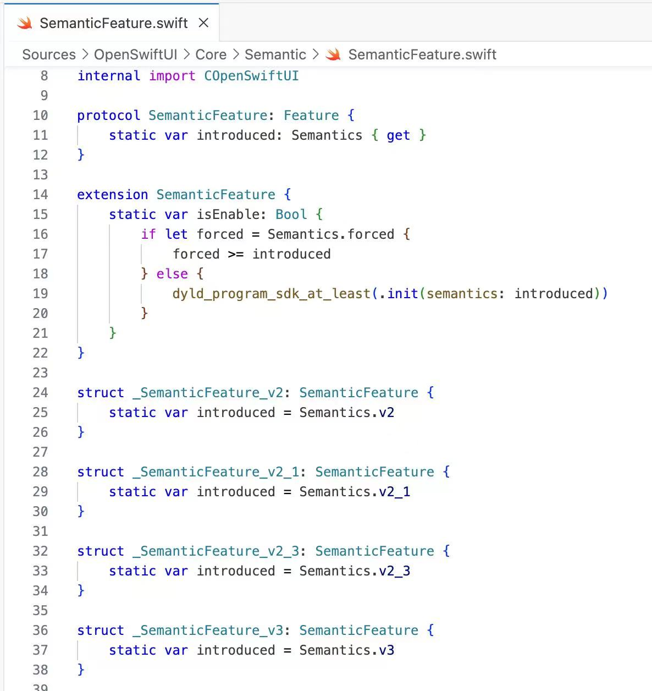

> 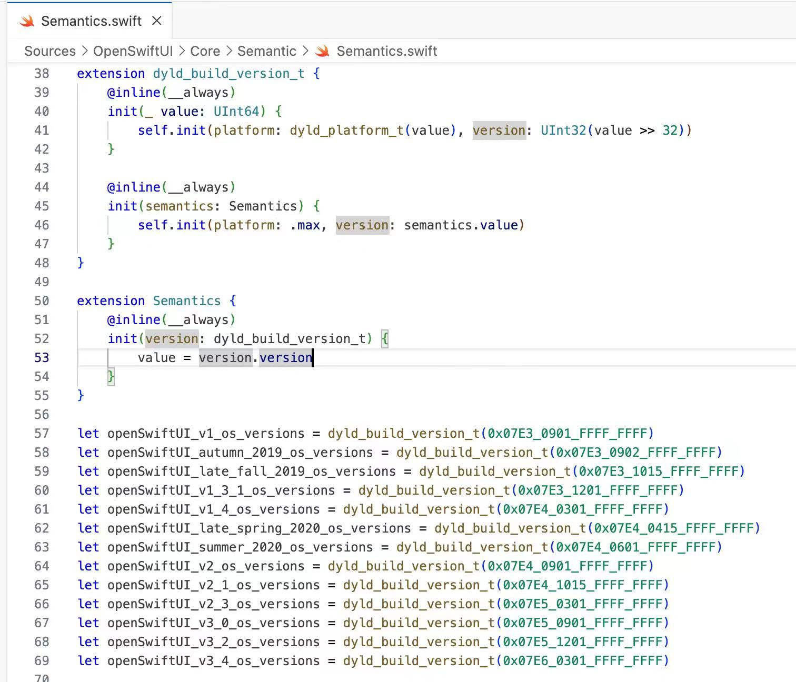

> SwiftUI里也有类似的版本控制，不过没走 plist ，是依赖的 dyld\_program\_sdk\_at\_least 函数来判断的。同样可以hook这个函数改变SwiftUI行为，~~也是一样的危险。~~


## 总结

一路跋涉，终于是完成了所有的排查，历经大量的过程，好在最后我们对问题有了完整的认知。


我们来理一下思路：

1. 最早我们通过前人的研究知道了系统管控的 AutoreleasePool 的生命周期与 Runloop 强绑定，但在实践下发现有所出入。

2. 通过 CoreFoundation 的 source code ，分析一些关键对象的结构与实现。

    1. 分析了 当 order 相同时，Observer 会按照加入的顺序决定。后加入的，会在更后面（优先级低），先加入的会在前面（优先级高）。

    2. 对于通过 CreateWithHandler 系列 API 创建的 Observer，通过打印 context ，从而找到实际的执行的 Block 。

    3. 发现 示例 App A 中存在的相同 Order 的 Observer 存在的风险，治理风险将后续独立展开。

3. 分析 \[iOS 15, \) 中的 AutoreleasePool 的 Push/Pop 时机，得到结论：系统在 callout 的前后，都有增加成对的 push/pop 。

4. 分析 \(, iOS 15\) 中的 AutoreleasePool 的 Push/Pop 时机，找到了系统控制注册的 Observer 。并发现这是由一个开关控制的。

5. 回到 \[iOS 15, \) 中，确认开关在 iOS 15 是打开的，在之前版本是关闭的。


至此得到完整的证明。最后简单研究了一下系统 os\_feature\_enabled 的实现，并附上了一些系统的开关配置。
