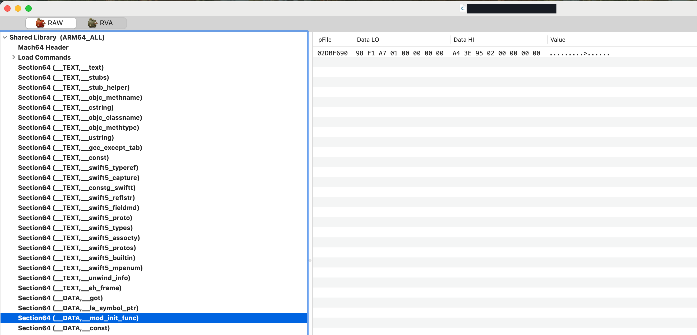
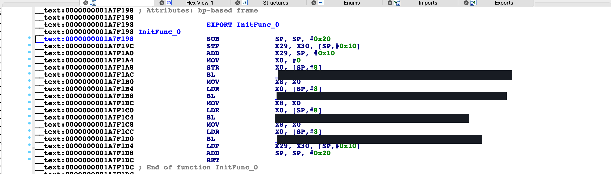
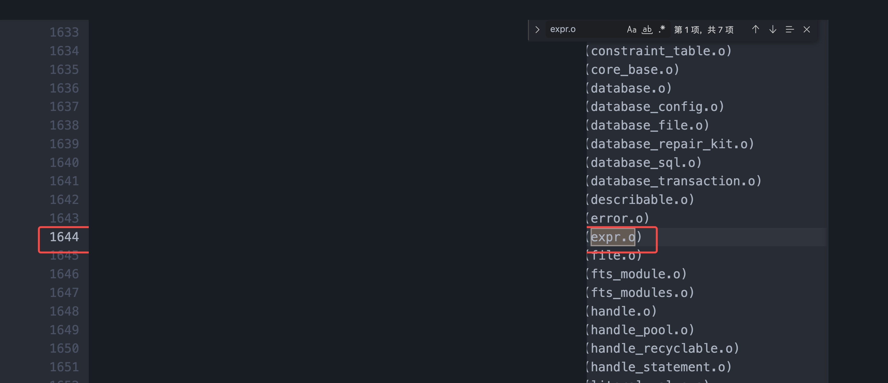
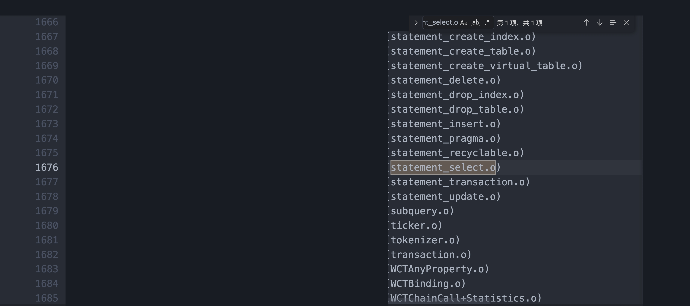
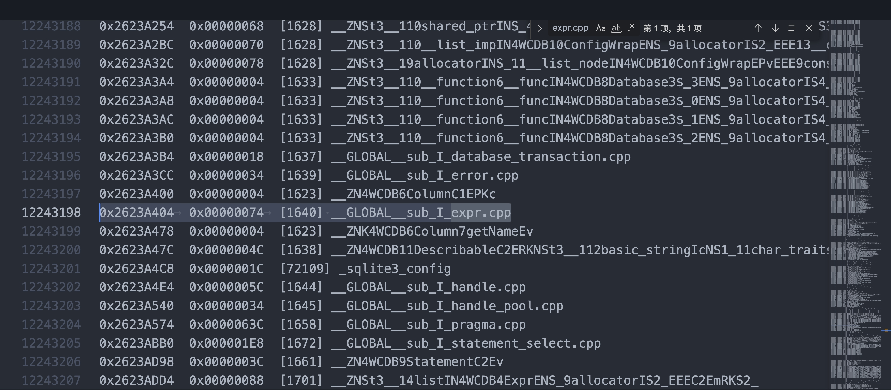
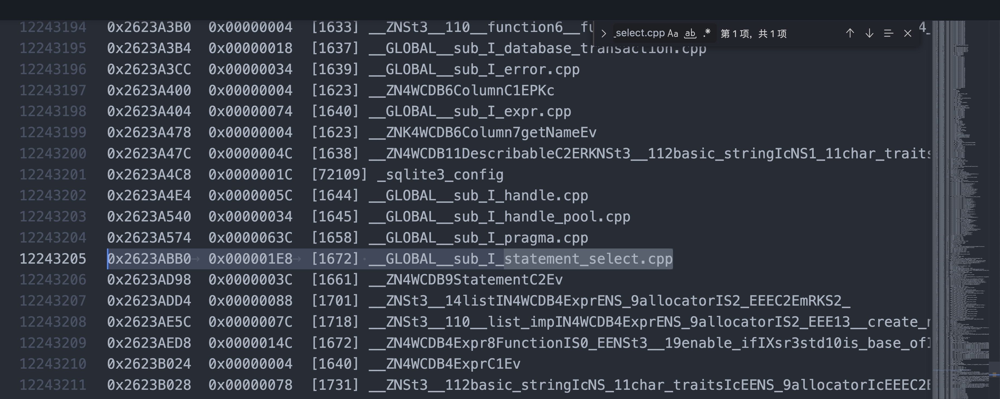
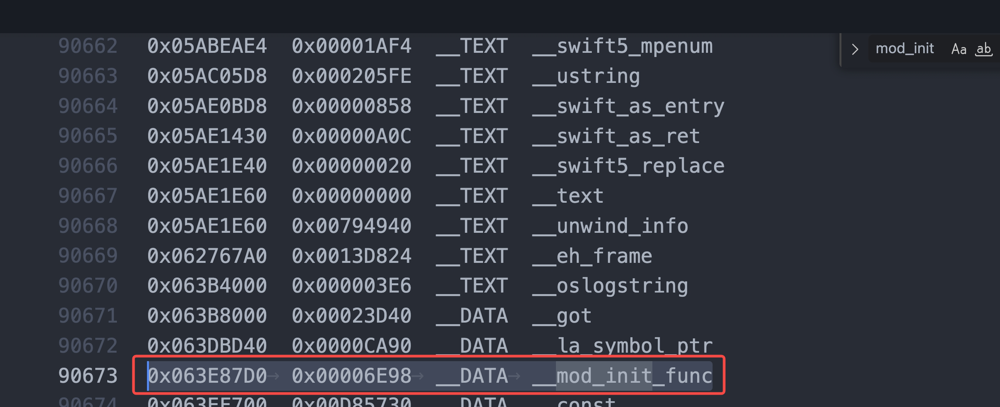
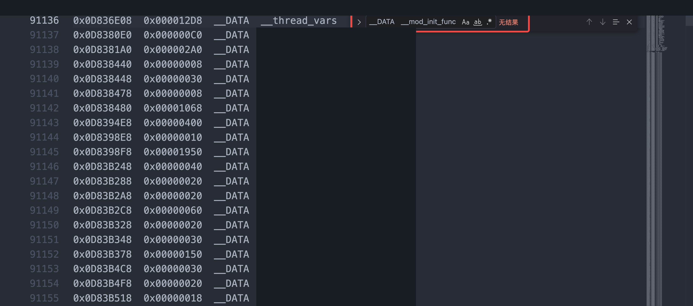
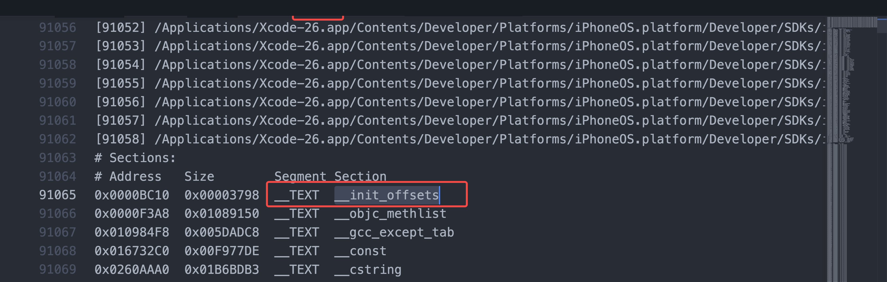

> [!TLDR]
>
> min OS version to iOS 14 之后，`__mod_init_func` 消失（实际最小生效版本为 iOS 13\.4），static initializer 的顺序将不再遵守之前的输入顺序，需要警惕隐式依赖。
>
>
> 对于仍在使用 DatabaseLibrary 较旧版本 且 使用 fts 相关功能的宿主建议提前修复消除对应隐患。

## 问题出现


业务同学反馈怀疑 WCDB 中两个不同 Compile Unit 中的 static initializer 顺序从 某次更新 版本起发生变动，导致业务表现错误。

```cpp
// expr.cpp
const Expr Expr::BindParameter = Expr(Column("?"));

// statement_select.cpp  (depends on BindParameter above)
StatementSelect StatementSelect::Fts3Tokenizer = StatementSelect().select(
    {Expr::Function("fts3_tokenizer", ExprList(2, WCDB::Expr::BindParameter))});
```

业务表现上正确的顺序是先执行 `expr.cpp` 的初始化，再执行 `statement_select.cpp` 的初始化。旧版本 表现正确；而 新版本 初始化顺序错误，在对 `Fts3Tokenizer` 进行初始化时，`BindParameter` 为空，导致业务逻辑错误。


## 排查细节

按照以往的经验，我们知道 static initializer 的顺序是由传递给 Linker 的 \.o 顺序决定的，再由 Linker\(ld64\)  在  `__DATA , __mod_init_func` 按序写入每一个函数的地址；App 进程启动后由 dyld 找到对应 Section 后执行 。





因此首先的排查是检查 Linkmap 中对应 \.o 的顺序。









命名为 `__GLOBAL_sub_I_xxx.cpp` 的函数就是对应 xxx\.cpp 文件中 static initilizer 的函数名字。`I` 意味着 `Initialization`，如果是析构函数的话，会是 `D` \(Destruction\)。

因此可以看到顺序是正确的。似乎能排除 Linker 的问题了。但另一点奇怪的是，在 新版本的 Linkmap 中，我们无法找到 `__mod_init_func` 了，而 旧版本是能够找到的。





难道还有什么别的变量导致了 Linker 的行为变更？我们 CD 使用的 Linker 是 定制工具链 提供的基于 ld64 的修改版本，因此咨询一位同事是否了解更多的上下文。


某次更新 同版本没有对应 WCDB 与依赖库的直接代码改动。唯一的大改动就在于将 min OS version 从 12 提升到了 14。得知在 min OS version 提升到 iOS 14 后，确实有 Linker 的行为变更（from 开源 ld64 的逻辑），将原本的 `__DATA, __mod_init_funcs` 更改为了 `__TEXT,__init_offsets` ，并开启了对应的优化。



```text
// <rdar://problem/29241917> transform __DATA, __mod_init_funcs to __TEXT offsets
        // enable init-offsets by default only for userspace programs
        // firmware can opt-in explicitly using -init_offsets option
        if ( dyldLoadsOutput() && fMakeChainedFixups )
                fMakeInitializersIntoOffsets = true;
```

fMakeChainedFixups 只有当 min OS \>= 13\.4 才会生效。本次满足条件。

```cpp
// <rdar://problem/49851380> adopt chained fixups for all architectures
    // <rdar://problem/85572905> (Backdeploy chained fixups to 13.4)
    else if ( platforms().minOS(ld::supportsChainedFixups) ) {

        // By default, enable everywhere.
        fMakeChainedFixups = true;


// simulator does not support chained fixups until iOS 15, watchOS 8, and tvOS 14
static const VersionSet supportsChainedFixups   ({mac12_0, iOS_sim_15_0, iOS_13_4, watchOS_sim_8_0, watchOS_7_0, tvOS_sim_15_0, tvOS_14_0, bridgeOS_Future});

```


其中核心的逻辑位于 `ld::passes::inits` 中。

```cpp
namespace ld {
namespace passes {
namespace inits {

// called by linker to transform __mod_init_funs to __init_offsets
extern void doPass(Options& opts, ld::Internal& internal);

} // namespace huge
} // namespace passes 
} // namespace ld 

#endif // __INITS_H__
```

处理完 inits 这个 Pass 后，走到了新的排序逻辑中，虽然按照注释依旧存在按输入顺序排序，但细看之后发现在 inits Pass 处理后，对应的 `file()` 、 `objectAddress()` 等函数都未返回有实际意义的值。

```cpp
// sort by .o order
        const ld::File* leftFile = left->file(); // NULL;
        const ld::File* rightFile = right->file(); // NULL;
        // <rdar://problem/10830126> properly sort if on file is NULL and the other is not
        ld::File::Ordinal leftFileOrdinal = (leftFile != NULL) ? leftFile->ordinal() : ld::File::Ordinal::NullOrdinal();
        ld::File::Ordinal rightFileOrdinal = (rightFile != NULL) ? rightFile->ordinal() : ld::File::Ordinal::NullOrdinal();
        if ( leftFileOrdinal != rightFileOrdinal )
                return leftFileOrdinal< rightFileOrdinal;

        // tentative definitions have no address in .o file, they are traditionally laid out by name
        if ( leftIsTent && rightIsTent )
                return left->getUserVisibleName() < right->getUserVisibleName();

        // lastly sort by atom address
        int64_t addrDiff = left->objectAddress() - right->objectAddress(); // 0;
        if ( addrDiff == 0 ) {
                // both at same address, sort by name
                return left->getUserVisibleName() < right->getUserVisibleName();
        }
        return (addrDiff < 0);
```

```cpp
class InitOffsetAtom : public ld::Atom {
public:
                                            InitOffsetAtom(const ld::Atom* atom)
                                            : ld::Atom(_s_section, ld::Atom::definitionRegular, ld::Atom::combineNever,
                                                        ld::Atom::scopeTranslationUnit, ld::Atom::typeUnclassified,
                                                        symbolTableNotIn, false, false, false, ld::Atom::Alignment(2)),
                                             _fixup1(0, ld::Fixup::k1of2, ld::Fixup::kindSetTargetImageOffset, atom),
                                             _fixup2(0, ld::Fixup::k2of2, ld::Fixup::kindStoreLittleEndian32)
                                            { }

    virtual const ld::File*                 file() const                    { return NULL; }
    virtual const char*                     name() const                    { return "init-offset"; }
    virtual uint64_t                        size() const                    { return 4; }
    virtual uint64_t                        objectAddress() const           { return 0; }
    virtual void                            copyRawContent(uint8_t buffer[]) const { }
    virtual ld::Fixup::iterator             fixupsBegin() const             { return &_fixup1; }
    virtual ld::Fixup::iterator             fixupsEnd() const               { return &((ld::Fixup*)&_fixup2)[1]; }

protected:
    mutable ld::Fixup                       _fixup1;
    ld::Fixup                               _fixup2;

    static ld::Section                      _s_section;
};

```

因此实际变成了随机的排序。而问题也因此暴露。


## 处理方案

由于原本 C\+\+ 的规范就不保证跨 CU 的执行顺序，在 旧版本 业务表现正确的行为只是巧合（Bazel 输入是默认根据字母序进行排序），后续无法保证问题不会再次出现，因此建议业务使用访问创建的方案（即目前业务的止损方式）进行修复。

> 在最新的主干 [WCDB](https://github.com/Tencent/wcdb) 中已没有类似问题，只是 示例 App A 的 WCDB 版本落后主干较多，因此这个问题才暴露。


~~同时，建议对所有工程中隐藏的 static initializer 方法进行摸排（由 Linkmap 扫描出），由业务确认是否存在对初始化顺序的隐式依赖，再进行治理。~~

> 后续与 一位同事 讨论，曾经 Reliability 的同学尝试管控过，但是由于依赖链过长，经常出现某个相距非常远的头文件改动，最终影响到单个 CU ，因此除非能有工具快捷定位到生成的具体原因，否则极难消费。后续就关闭了这一项管控。

> [find\_initializers\.py](./attachments/attachment-01.py)


## 一些其他的疑问

1. 为什么 CI / 渠道为 test 的包未出现此问题？

因为用的 Linker 以及对应的优化都不一样（使用的 ld\-prime），确实建议同步打包配置，但会造成每次出包时间有所增加 。

目前回归测试使用的包，已经将打包配置完全对齐 CD ，包括但不限于：Linker 的正确选择以及其优化项，Compiler 的正确选择以及其优化项。


2. 为什么说是完全随机，但是表现大部分 TF/App Store 包都能出现？

Static Initialier 的变动相对还是低频的，在 相邻版本之间 可能并未有新增的对应的关于 static initialier  的改动。


3. 既然已经是自定义 LD64 了，我们是否能自行兼容这个问题（模拟 iOS 12 的行为）？

可以但不建议，因为原本的用法就是错误的。应该由对应仓库维护者进行处理。
