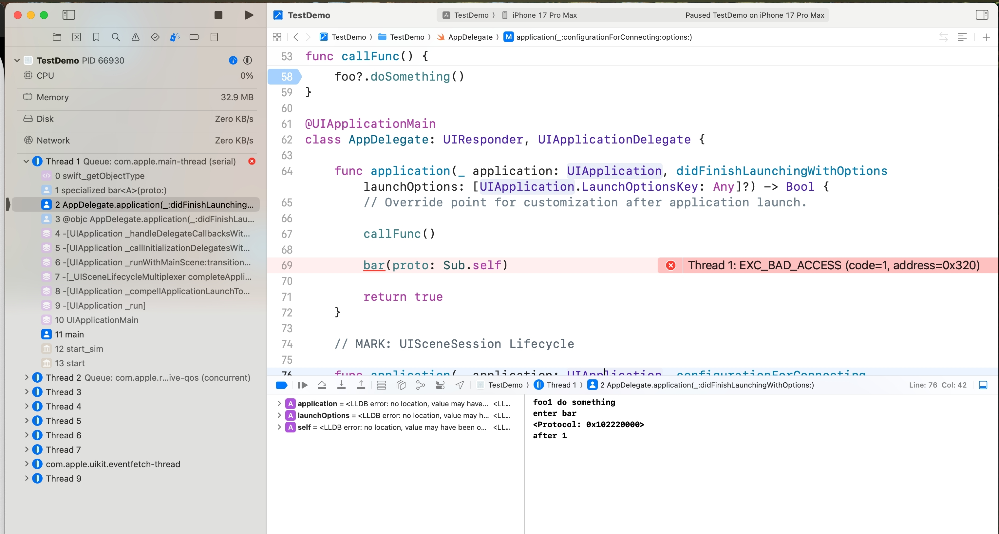
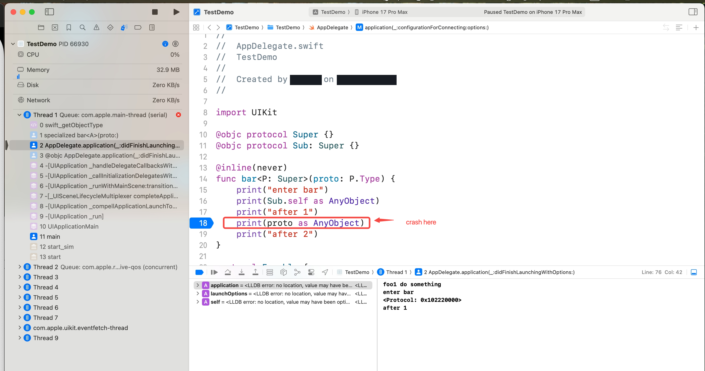
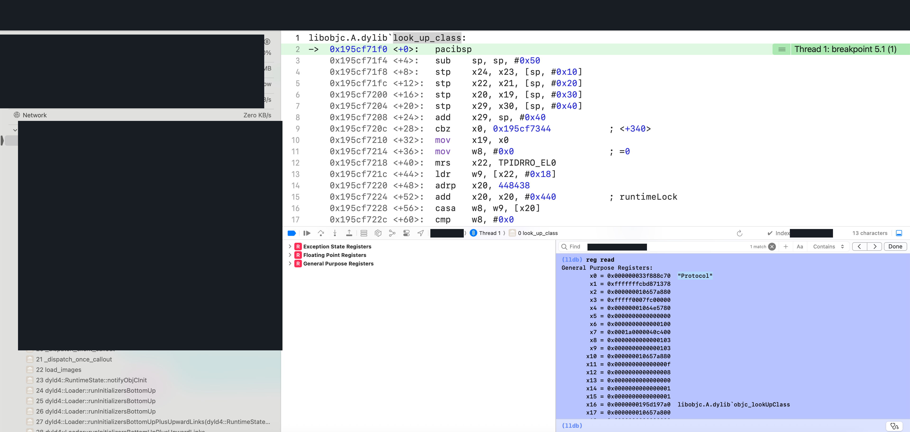

> [!TLDR]
>
> 类型体操对 Runtime 性能也有影响，如果没有必要可以不做 或者 桥接到 C 语言实现对应逻辑
>
> 1. as Any 等于 调用 `swift_getMetatypeMetadata`，获取该协议元类型的 Metadata 。
>
> 2. as AnyObject 等于 调用 `_bridgeAnythingToObjectiveC` ，将 Swift 的任意类型（这里是协议的 Metatype）桥接成 Objective\-C 的对象指针。
>
> 3. as Protocol 等于 调用  `swift_dynamicCastObjCClass` ，`targetType` 为 `objc_lookUpClass("Protocol")` 。此判断较为 heavy ，需要避免非必要的调用。

我们来看一段实际业务中出现的类型体操，需要将一个满足 `NSObjectProtocol` 的由 Swift 定义的 `protocol` 通过一系列类型转换，变为编译器 \& Runtime 能判断通过的 OC 的 `Protocol` 。

```swift
/// Get service object conforming to `protocol`.
    /// - Parameter protocol: The service object's conforming protocol.
    /// - Returns: A service object conforming to `protocol` or nil.
    /// - Note: If possible, use `Service.get(_:)` instead.
    public static func getServiceProtocol<T: NSObjectProtocol>(_ protocol: T.Type) -> T? {
        guard let `protocol` = `protocol` as Any as AnyObject as? Protocol else {
            return nil
        }
        return get_service_protocol(`protocol`) as? T
    }
    
FOUNDATION_EXTERN id _Nullable get_service_protocol(Protocol * _Nullable prot);
```

我们就不解释为什么需要先 `as Any` （编译器认为一定成功），再 `as AnyObject` （编译器认为一定成功） ，再 `as? Protocol` （编译器认为有可能失败）了。

一定要通过 `as Any` 先转一次，去掉泛型绑定的类型信息——熟悉编译器的同事介绍这是 Swift Compiler 的历史遗留问题，同时我们也顺手测试了直到 Swift 6\.2 Release \(Xcode 26\.0\)，问题依旧存在。

> https://stackoverflow.com/questions/51052531/workaround-to-bridge-a-generic-protocol-to-objective-c/51071722#51071722

> https://github.com/swiftlang/swift/issues/50661

> 

> 


## 问题发现

在线下录制 Trace 时，我们看到实验配置模块（`ExperimentConfig`）在启动阶段密集触发了 `Service.getServiceProtocol<A>(_:)`，进而频繁落入 `look_up_class`（OC Runtime 方法，内部持有全局的 `runtimeLock`；下图上层业务栈帧已做脱敏遮挡，调用链底部集中落在 `look_up_class` 等锁上）。我们需要理解这里发生了什么，进而判断这次 `look_up_class` 的调用是否可以优化掉？


### look\_up\_class 为什么要减少调用？

我们来看一下 look\_up\_class 的实现，会获取 `runtimeLock` （全局锁，一把 mutex ），然后判断对应的 Class 是否 `isRealized`，如果没有的话执行 `realizeClass`，并释放 `runtimeLock` 。

```cpp
Class
look_up_class(const char *name,
              bool includeUnconnected __attribute__((unused)),
              bool includeClassHandler __attribute__((unused)))
{
    if (!name) return nil;

    Class result;
    bool unrealized;
    {
        runtimeLock.lock();
        result = getClassExceptSomeSwift(name); // 有缓存
        unrealized = result  &&  !result->isRealized();
        if (unrealized) {
            result = realizeClassMaybeSwiftAndUnlock(result, runtimeLock);
            // runtimeLock is now unlocked
        } else {
            runtimeLock.unlock();
        }
    }

    if (!result) {
        // dealing with Swift types. 
    }

    return result;
}
```

`getClassExceptSomeSwift` 内部其实存在缓存，有一个 HashTable 的设计，当第二次对同一个 Class 访问时，对应的查找耗时是相对低的。


因此这里的问题在于频繁得获取了全局锁，即使锁内的时间耗时相对低，但持有锁或者等待锁依旧会对复杂 App 在极端情况下的性能造成影响。

这里具体分为两种情况，在一次冷启动中，如果 name 是不同的，那是必要的调用；如果 name 是相同的，那是非必要的调用，可以业务在外部缓存结果即可。


### 为何调用了 look\_up\_class ？

因此我们来看对应函数的具体实现（就是本文开头的部分）。

```swift
/// Get service object conforming to `protocol`.
    /// - Parameter protocol: The service object's conforming protocol.
    /// - Returns: A service object conforming to `protocol` or nil.
    /// - Note: If possible, use `Service.get(_:)` instead.
    public static func getServiceProtocol<T: NSObjectProtocol>(_ protocol: T.Type) -> T? {
        guard let `protocol` = `protocol` as Any as AnyObject as? Protocol else {
            return nil
        }
        return get_service_protocol(`protocol`) as? T
    }
```

从代码中并未找到直接对于 `look_up_class` 的调用。因此我们选择直接从汇编中寻找答案。

```python
(lldb) dis
AppCoreDebug`static Service.getServiceProtocol<ExperimentProtocol & AnyObject>(_:):
    0x330e2c8ec <+0>:   sub    sp, sp, #0x130
    0x330e2c8f0 <+4>:   stp    x28, x27, [sp, #0x110]
    0x330e2c8f4 <+8>:   stp    x29, x30, [sp, #0x120]
    0x330e2c8f8 <+12>:  add    x29, sp, #0x120
    0x330e2c8fc <+16>:  mov    x8, x0
    0x330e2c900 <+20>:  mov    x0, x1
    0x330e2c904 <+24>:  str    x0, [sp, #0x68]
    0x330e2c908 <+28>:  stur   xzr, [x29, #-0x20]
    0x330e2c90c <+32>:  stur   xzr, [x29, #-0x30]
    0x330e2c910 <+36>:  mov    x1, x0
    0x330e2c914 <+40>:  stur   x1, [x29, #-0x18]
    0x330e2c918 <+44>:  mov    x9, x8
    0x330e2c91c <+48>:  stur   x9, [x29, #-0x20]
    0x330e2c920 <+52>:  sub    x9, x29, #0x28
    0x330e2c924 <+56>:  str    x9, [sp, #0x70]
->  0x330e2c928 <+60>:  stur   x8, [x29, #-0x28]
    0x330e2c92c <+64>:  bl     0x337494c3c               ; swift_getMetatypeMetadata.island
    0x330e2c930 <+68>:  mov    x1, x0
    0x330e2c934 <+72>:  ldr    x0, [sp, #0x70]
    0x330e2c938 <+76>:  bl     0x3374901d4               ; Swift._bridgeAnythingToObjectiveC<τ_0_0>(τ_0_0) -> Swift.AnyObject with unmangled suffix ".island"
    0x330e2c93c <+80>:  str    x0, [sp, #0x78]
    0x330e2c940 <+84>:  adrp   x0, 59996
    0x330e2c944 <+88>:  add    x0, x0, #0xc70            ; "Protocol"
    0x330e2c948 <+92>:  bl     0x337490088               ; objc_lookUpClass.island
    0x330e2c94c <+96>:  mov    x1, x0
    0x330e2c950 <+100>: ldr    x0, [sp, #0x78]
    0x330e2c954 <+104>: bl     0x3374908c8               ; swift_dynamicCastObjCClass.island
    0x330e2c958 <+108>: mov    x8, x0
    0x330e2c95c <+112>: str    x8, [sp, #0x80]
    0x330e2c960 <+116>: cbz    x0, 0x330e2c974           ; <+136> at Service.swift
    0x330e2c964 <+120>: b      0x330e2c968               ; <+124> at Service.swift
    0x330e2c968 <+124>: ldr    x8, [sp, #0x80]
    0x330e2c96c <+128>: str    x8, [sp, #0x60]
    0x330e2c970 <+132>: b      0x330e2c988               ; <+156> at Service.swift
    0x330e2c974 <+136>: ldr    x0, [sp, #0x78]
    0x330e2c978 <+140>: bl     0x337490010               ; swift_unknownObjectRelease.island
    0x330e2c97c <+144>: mov    x8, #0x0                  ; =0 
    0x330e2c980 <+148>: str    x8, [sp, #0x60]
    0x330e2c984 <+152>: b      0x330e2c988               ; <+156> at Service.swift
    0x330e2c988 <+156>: ldr    x8, [sp, #0x60]
    0x330e2c98c <+160>: str    x8, [sp, #0x58]
    0x330e2c990 <+164>: cbz    x8, 0x330e2cae0           ; <+500> at Service.swift
    0x330e2c994 <+168>: b      0x330e2c998               ; <+172> at Service.swift
    0x330e2c998 <+172>: ldr    x8, [sp, #0x58]
    0x330e2c99c <+176>: str    x8, [sp, #0x50]
    0x330e2c9a0 <+180>: b      0x330e2c9a4               ; <+184> at Service.swift
    0x330e2c9a4 <+184>: ldr    x0, [sp, #0x50]
    0x330e2c9a8 <+188>: str    x0, [sp, #0x40]
    0x330e2c9ac <+192>: stur   x0, [x29, #-0x30]
    0x330e2c9b0 <+196>: adrp   x8, 69347
    0x330e2c9b4 <+200>: ldr    x8, [x8, #0xd60]
    0x330e2c9b8 <+204>: blr    x8
    0x330e2c9bc <+208>: ldr    x0, [sp, #0x40]
    0x330e2c9c0 <+212>: bl     0x330e22f54               ; get_service_protocol at ServiceRegistry.mm:27
    0x330e2c9c4 <+216>: mov    x29, x29
    0x330e2c9c8 <+220>: bl     0x33748ffdc               ; objc_retainAutoreleasedReturnValue.island
    0x330e2c9cc <+224>: mov    x8, x0
    0x330e2c9d0 <+228>: ldr    x0, [sp, #0x40]
    0x330e2c9d4 <+232>: str    x8, [sp, #0x48]
    0x330e2c9d8 <+236>: adrp   x8, 69347
    0x330e2c9dc <+240>: ldr    x8, [x8, #0xd58]
    0x330e2c9e0 <+244>: blr    x8
    0x330e2c9e4 <+248>: ldr    x0, [sp, #0x48]
    0x330e2c9e8 <+252>: cbz    x0, 0x330e2ca28           ; <+316> at Service.swift:36:16
    0x330e2c9ec <+256>: b      0x330e2c9f0               ; <+260> at Service.swift
    0x330e2c9f0 <+260>: ldr    x8, [sp, #0x48]
    0x330e2c9f4 <+264>: str    x8, [sp, #0x38]
    0x330e2c9f8 <+268>: b      0x330e2c9fc               ; <+272> at Service.swift
    0x330e2c9fc <+272>: ldr    x0, [sp, #0x38]
    0x330e2ca00 <+276>: str    x0, [sp, #0x30]
    0x330e2ca04 <+280>: add    x8, sp, #0x88
    0x330e2ca08 <+284>: str    x8, [sp, #0x28]
    0x330e2ca0c <+288>: bl     0x337490068               ; Swift._bridgeAnyObjectToAny(Swift.Optional<Swift.AnyObject>) -> Any with unmangled suffix ".island"
    0x330e2ca10 <+292>: ldr    x0, [sp, #0x28]
    0x330e2ca14 <+296>: sub    x1, x29, #0x70
    0x330e2ca18 <+300>: bl     0x32f895d04               ; outlined init with take of Any at <compiler-generated>
    0x330e2ca1c <+304>: ldr    x0, [sp, #0x30]
    0x330e2ca20 <+308>: bl     0x337490010               ; swift_unknownObjectRelease.island
    0x330e2ca24 <+312>: b      0x330e2ca3c               ; <+336> at Service.swift:36:16
    0x330e2ca28 <+316>: stur   xzr, [x29, #-0x70]
    0x330e2ca2c <+320>: stur   xzr, [x29, #-0x68]
    0x330e2ca30 <+324>: stur   xzr, [x29, #-0x60]
    0x330e2ca34 <+328>: stur   xzr, [x29, #-0x58]
    0x330e2ca38 <+332>: b      0x330e2ca3c               ; <+336> at Service.swift:36:16
    0x330e2ca3c <+336>: ldur   q0, [x29, #-0x70]
    0x330e2ca40 <+340>: stur   q0, [x29, #-0x50]
    0x330e2ca44 <+344>: ldur   q0, [x29, #-0x60]
    0x330e2ca48 <+348>: stur   q0, [x29, #-0x40]
    0x330e2ca4c <+352>: ldur   x8, [x29, #-0x38]
    0x330e2ca50 <+356>: cbz    x8, 0x330e2cacc           ; <+480> at Service.swift
    0x330e2ca54 <+360>: b      0x330e2ca58               ; <+364> at Service.swift
    0x330e2ca58 <+364>: ldr    x3, [sp, #0x68]
    0x330e2ca5c <+368>: sub    x0, x29, #0x78
    0x330e2ca60 <+372>: sub    x1, x29, #0x50
    0x330e2ca64 <+376>: adrp   x8, 69297
    0x330e2ca68 <+380>: ldr    x8, [x8, #0x3e0]
    0x330e2ca6c <+384>: add    x2, x8, #0x8
    0x330e2ca70 <+388>: mov    w8, #0x6                  ; =6 
    0x330e2ca74 <+392>: mov    x4, x8
    0x330e2ca78 <+396>: bl     0x337490060               ; swift_dynamicCast.island
    0x330e2ca7c <+400>: tbz    w0, #0x0, 0x330e2ca90     ; <+420> at Service.swift
    0x330e2ca80 <+404>: b      0x330e2ca84               ; <+408> at Service.swift:36:45
    0x330e2ca84 <+408>: ldur   x8, [x29, #-0x78]
    0x330e2ca88 <+412>: str    x8, [sp, #0x20]
    0x330e2ca8c <+416>: b      0x330e2ca9c               ; <+432> at Service.swift
    0x330e2ca90 <+420>: mov    x8, #0x0                  ; =0 
    0x330e2ca94 <+424>: str    x8, [sp, #0x20]
    0x330e2ca98 <+428>: b      0x330e2ca9c               ; <+432> at Service.swift
    0x330e2ca9c <+432>: ldr    x8, [sp, #0x20]
    0x330e2caa0 <+436>: str    x8, [sp, #0x18]
    0x330e2caa4 <+440>: b      0x330e2caa8               ; <+444> at Service.swift
    0x330e2caa8 <+444>: ldr    x0, [sp, #0x40]
    0x330e2caac <+448>: ldr    x8, [sp, #0x18]
    0x330e2cab0 <+452>: str    x8, [sp, #0x8]
    0x330e2cab4 <+456>: adrp   x8, 69347
    0x330e2cab8 <+460>: ldr    x8, [x8, #0xd58]
    0x330e2cabc <+464>: blr    x8
    0x330e2cac0 <+468>: ldr    x8, [sp, #0x8]
    0x330e2cac4 <+472>: str    x8, [sp, #0x10]
    0x330e2cac8 <+476>: b      0x330e2caec               ; <+512> at Service.swift
    0x330e2cacc <+480>: sub    x0, x29, #0x50
    0x330e2cad0 <+484>: bl     0x32f8b92ac               ; outlined destroy of Swift.Optional<Any> at <compiler-generated>
    0x330e2cad4 <+488>: mov    x8, #0x0                  ; =0 
    0x330e2cad8 <+492>: str    x8, [sp, #0x18]
    0x330e2cadc <+496>: b      0x330e2caa8               ; <+444> at Service.swift
    0x330e2cae0 <+500>: mov    x8, #0x0                  ; =0 
    0x330e2cae4 <+504>: str    x8, [sp, #0x10]
    0x330e2cae8 <+508>: b      0x330e2caec               ; <+512> at Service.swift
    0x330e2caec <+512>: ldr    x0, [sp, #0x10]
    0x330e2caf0 <+516>: ldp    x29, x30, [sp, #0x120]
    0x330e2caf4 <+520>: ldp    x28, x27, [sp, #0x110]
    0x330e2caf8 <+524>: add    sp, sp, #0x130
    0x330e2cafc <+528>: ret    
```

查看汇编，确实能看到对 `objc_lookUpClass.island` 的调用（对 `look_up_class` 的包装），因此 Trace 本身是没有问题。

直接使用大模型从汇编翻译为伪代码（注释是后续加上的）。

```java
// x0: protocol_metatype (传入的协议元类型)
// x1: T_metadata (泛型 T 的类型元数据)
id getServiceProtocol_pseudo_c(void* protocol_metatype, void* T_metadata) {
    // ==========================================
    // 对应 Swift: protocol as Any
    // ==========================================
    // 汇编 <+64>: 获取协议元类型的 Metadata
    void* metatype_metadata = swift_getMetatypeMetadata(protocol_metatype);
    // ==========================================
    // 对应 Swift: as AnyObject
    // ==========================================
    // 汇编 <+76>: 将协议元类型桥接为 Objective-C 的 id 对象
    // 注意：底层传入的是 protocol_metatype 的指针地址和它的 metadata
    id bridged_obj = _bridgeAnythingToObjectiveC(&protocol_metatype, metatype_metadata);
    // ==========================================
    // 对应 Swift: as? Protocol
    // ==========================================
    // 汇编 <+84> ~ <+92>: 查找 "Protocol" 类
    Class protocol_class = objc_lookUpClass("Protocol");
    // 汇编 <+104>: 尝试将桥接后的对象强转为 Protocol 类
    id protocol_obj = swift_dynamicCastObjCClass(bridged_obj, protocol_class);
    // ==========================================
    // 对应 Swift: guard let ... else { return nil }
    // ==========================================
    // 汇编 <+116>: cbz x0, 0x330e2c974 (如果转换失败，跳转到释放分支)
    if (protocol_obj == NULL) {
        // 汇编 <+140>: 释放刚才桥接产生的临时对象
        swift_unknownObjectRelease(bridged_obj);
        return NULL;
    }
    // ==========================================
    // 对应 Swift: get_service_protocol(protocol)
    // ==========================================
    // 汇编 <+212>: 调用底层的 C/OC 函数获取 Service 实例
    id service_obj = get_service_protocol(protocol_obj);
    
    /// 省略后续
}    
```

因此判断这个实际发生 look\_up\_class 的调用是在 `as? Protocol` 这一步。

```cpp
/***********************************************************************
* objc_lookUpClass.  Return the id of the named class.
*
* Formerly objc_getClassWithoutWarning ()
***********************************************************************/
Class objc_lookUpClass(const char *aClassName)
{
    if (!aClassName) return Nil;

    // NO unconnected, NO class handler
    return look_up_class(aClassName, NO, NO);
}
```

我们进行验证，符号断点触发到 look\_up\_class ，可以看到 x0 为 "Protocol" ，现象与分析互相验证正确。



## 解决方案

我们很简单就能判断出，其实每次 `getServiceProtocol` 的调用中，`objc_lookUpClass("Protocol")` 的结果是相同的，可以直接缓存解决，类似效果如下：

```cpp
id getServiceProtocol_pseudo_c(void* protocol_metatype, void* T_metadata) {
    void* metatype_metadata = swift_getMetatypeMetadata(protocol_metatype);
    id bridged_obj = _bridgeAnythingToObjectiveC(&protocol_metatype, metatype_metadata);
    static Class s_protocol_class = objc_lookUpClass("Protocol");
    id protocol_obj = swift_dynamicCastObjCClass(bridged_obj, protocol_class);
    
    // 省略
}
```

或者更彻底一些，由 swiftc 生成一个全局的 `objc_lookUpClass("Protocol")` 的缓存，彻底解决所有 `as Protocol?` 的问题，但这样成本就太高了。


但 Swift 本身的语言特性并没有开放出类似的口子给我们执行这个操作。


因此将这部分操作更换成在 C 中执行，同时由于这层转换在实际意义上就是希望成功的，如果传递了错误的对象是无法正确获取打对应的 Service 的，因此在 Debug 下，我们依旧选择爆出对应的 Assert 。而在线上，就可以跳过这个判断了。

```cpp
/*
 * skip swift type as? change
 * use id as params type, do the check in # DEBUG internally
 */
FOUNDATION_EXTERN id _Nullable get_service_protocol_typeerase(id _Nullable prot);


id get_service_protocol_typeerase(id prot) {
#if DEBUG
    
    if (!protocol_conformsToProtocol((Protocol *)prot, @protocol(NSObject))) {
        AssertFatal(NO, @"User should use the right Protocol instance here");
        return nil;
    }
    
#endif
    return get_service_protocol((Protocol *)prot);
}
```

需要额外说明的是，对照组会在 `as? Protocol` 的判断走入提前返回静默失败，造成业务逻辑的错误；而实验组由于去掉了 Swift 设计的内存安全检查，如果真的存在错误传递过来的对象，是可能在后续崩溃的。因此线上放量需要谨慎。


但综合来说，结合类似操作都是处理类型体操，传递非法对象/类型的可能性非常低，再加上有开关兜底，在开启灰度实验没有 Assert 与崩溃上报后，判断风险可控。


后续更新：工具链方向的同事帮忙在 Swift 官方论坛发帖询问了这个问题，准备先看看社区回复，再讨论是否需要在 swiftc 层面提供更彻底的解决方案：

> https://forums.swift.org/t/objc-lookupclass-protocol-emitted-for-every-use-of-protocol-metatype/86056


## 实验效果

本次实验只优化了线下 Trace 中发现调用最为频繁的 `getServiceProtocol` 函数。灰度放量后，客户端滑动丢帧率等流畅度（QoS）指标取得了明显改善，甚至还撬动了大盘停留时长的小幅正向体验收益。

从性能指标上看，对高端机的提升最为显著，这也符合预期：全局锁争用对性能的影响会随着设备多核性能提升而更加突出，因为同一时刻会有更多核心堵在等锁上。原本我认为这处改动最多只会有一些高分位的耗时改善，最后能撬动整体体验收益确实属于超出预期了。
