> [!TLDR]
>
> 1. 介绍了 VM 的相关概念与实际应用场景，并给出了 正确/错误 的使用示例
>
> 2. 定位 vm\_read\_overwrite 有非原子性问题的缺陷，将其更换为直接写内存解决线上分散在各个 issue 中的 Crash ，降低了大盘水位
>
> 3. 分析了 OC Runtime 的 Method Cache 是如何处理多线程读写的问题（并未彻底解决问题）

## 前置知识

### Virtual Memory\(VM\)

Virtual Memory\(VM\) 是 OS 提供的内存管理技术，虽然一般业务开发中很少直接与 VM 接触，但其实所有拿到的指针地址等都是存在于 VM 中的。

并且如果深入研究过系统底层，就会发现 VM 是一个绕不过去需要了解的知识，包括但不限于辅助 定位/解决 Crash/OOM 问题等。


#### VM 的一些常用信息

我们常用的主要是 vm 的起始地址，vm 的大小，以及 vm 的一些属性（当前权限，最大权限， SHRMOD 等）。

```objective-c
kern_return_t vm_region
(
        vm_map_read_t target_task,
        vm_address_t *address,
        vm_size_t *size,
        vm_region_flavor_t flavor,
        vm_region_info_t info,
        mach_msg_type_number_t *infoCnt,
        mach_port_t *object_name
);
```

我们可以遍历获取所有的虚拟内存块，这里提供一段示例代码（改编自 WriteVMMap 方法），可以本地 Debug 时进行调用，这里只打印了一些我比较关心的属性。

```objective-c
void DebugWriteVMMap() {
    const int max_vmmap = 1000000;
    kern_return_t kret;
#ifdef __LP64__
    struct vm_region_submap_info_64 info;
#else
    struct vm_region_submap_info info;
#endif
    vm_address_t addr = 0;
    vm_size_t size = 0;
    mach_msg_type_number_t count = 0;
    natural_t depth = 0;
    int region_count = 0;
    for (;;) {
        while (1) {
#ifdef __LP64__
            count = VM_REGION_SUBMAP_INFO_COUNT_64;
            kret = vm_region_recurse_64(current_task(), &addr, &size, &depth, (vm_region_recurse_info_t)&info, &count);
#else
            count = VM_REGION_SUBMAP_INFO_COUNT;
            kret = vm_region_recurse(current_task(), &addr, &size, &depth, (vm_region_recurse_info_t)&info, &count);
#endif
            if (KERN_SUCCESS != kret)
                break;
            if (addr + size > VM_MAX_ADDRESS)
                break;
            if (info.is_submap) {
                depth++;
            } else {
                break;
            }
        }
        if (KERN_SUCCESS != kret) break;
        NSLog(@"base:%lx size:%lx user_tag:%@ protection:%@ max_protection:%@ dirty_size:%x", addr, size, @(info.user_tag), @(info.protection), @(info.max_protection), info.pages_dirtied);
        addr += size;
        region_count++;
        if ((max_vmmap > 0) && (region_count >= max_vmmap)) {
            break;
        }
    }
}
```

当然如果想直接在 lldb 中进行直接调用某一个 C 函数需要前置进行声明，来自一位同事 的教导。

```objective-c
expr extern void DebugWriteVMMap(void); DebugWriteVMMap()
```

留一个简单的小问题，我们知道通过 dlopen 可以动态得 load 动态库，那么一般来说 load 一个动态库会有 1 块 VM 还是 多块 VM 呢？

提示：一个动态库中会有多段空间，包括 Mach64 Header / Load Commands 等，其中也会有不同的权限。

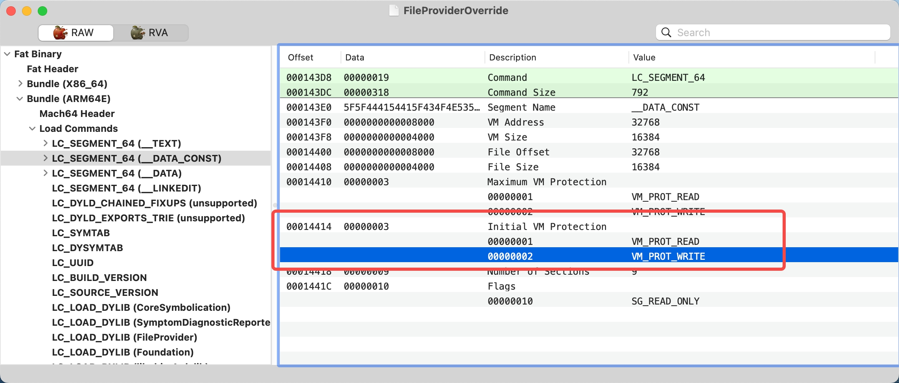

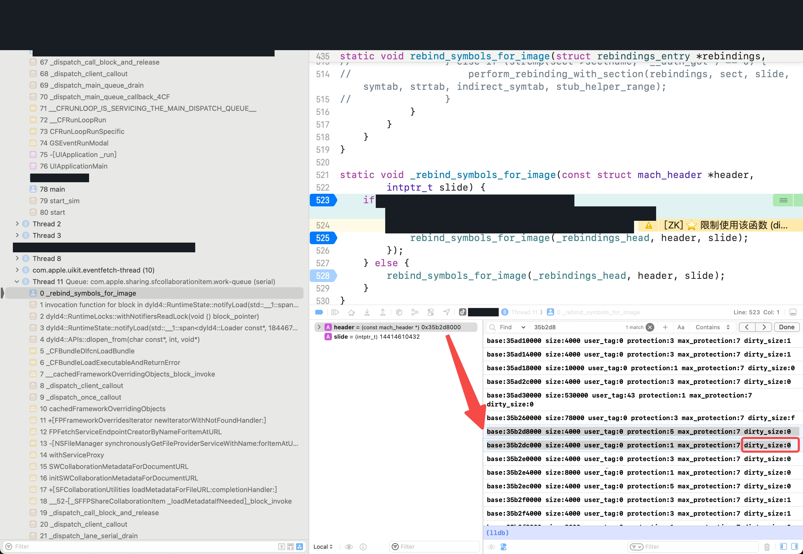


#### 操作 VM 的常见方法

主要方法定义在 [mach/vm\_map\.h](https://developer.apple.com/documentation/kernel/mach/vm) 中，一般来说我们常用的是 vm\_allocate/vm\_deallocate \(创建/释放\)，vm\_protect（修改权限），vm\_read/vm\_write/vm\_read\_overwrite\(读写修改\) 。由于 vm\_read/vm\_write 会需要页对齐，因此我们一般更倾向于使用 vm\_read\_overwrite 。


通过 VM 系列方法访问对应的 vm\_address\_t 时，如果访问了非法的内存（非法地址），或者对只读的区域进行写入（权限错误），是不会直接崩溃的，VM 系列方法会前置进行权限相关的判读，如果操作不成功会返回对应的 Code 。


因此在正确使用的情况下，VM 的方法能够帮助我们安全得读写修改一些内存区域。下面也会看到一些具体的 Case 。


需要注意的是，虽然你可以用 VM 的系列方法去修改任意地址的内容，但是不推荐通过 vm 的系列方法去访问正常能够获取的内存地址。

有同学可能会问，那对于任意的一些 **EXC\_BAD\_ACCESS KERN\_INVALID\_ADDRESS** 类型的错误，我们是否可以使用上面讲过的 vm\_read\_overwrite 方法，去先判断一些这块地址是否可读，可读之后再进行一些操作呢？

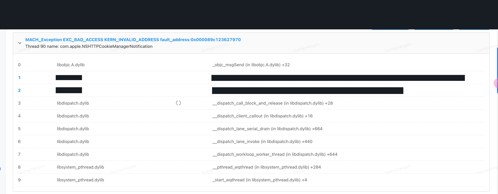

```objective-c
NSObject *someMaybeWildObject = /**/; // 某个可能野掉的对象

pointer_t memStart;
uint32_t size;
kern_return_t result = vm_read_overwrite(mach_task_self(), someMaybeWildObject, 8, &memStart, &size); // 使用 vm_read_overwrite 进行判断地址是否可读
if (result != KERN_SUCCESS) { 
    return;
}

[someMaybeWildObject doSomething]; // 可读再执行方法访问
```

答案是不行。

首先不考虑进行 vm\_read\_overwrite 的性能损失，一般的 OC 对象野指针都是由于多线程操作，最终导致 retainCount 归零触发释放。即使先通过了 vm\_read 的判断，也有可能在调用 @selector\(doSomething\) 进行转发前被释放。

因此首先这么处理并没有从根本上解决 **KERN\_INVALID\_ADDRESS** 的问题，其次也并不能降低问题发生的概率。还是需要正面解决多线程操作的问题，常规处理就是加锁。


### x16/x17 寄存器

系统库在进行函数跳转时，会使用到 x16 / x17\(PAC\) 两个寄存器。

> 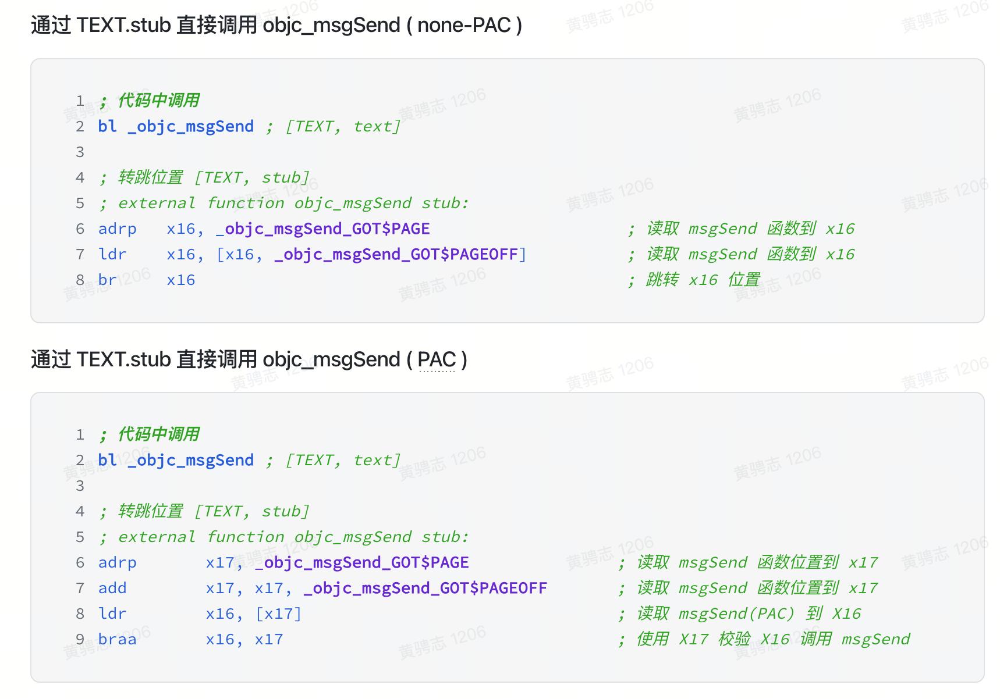


> **`x16`** and **`x17`** \- **Intra\-procedural Call Registers**\. Temporary registers for immediate values\. They are also used for indirect function calls and PLT \(Procedure Linkage Table\) stubs\.

> - **`x16`** is used as the **system call number** for the **`svc`** instruction in **macOS**\.

> https://book.hacktricks.xyz/macos-hardening/macos-security-and-privilege-escalation/macos-apps-inspecting-debugging-and-fuzzing/arm64-basic-assembly


因此我们得知，x16/x17 如果有效，就是有 indirect function calls 或者 PLT \(Procedure Linkage Table\) stubs 发生。x16 一般指向某个函数起始的位置，x17 则是用来进行校验的值。

如果 x16 出现了指向某个函数中间，那就一定是有严重问题的。虽然可能不会立即崩溃，但是由于跳过了部分汇编代码的执行，会出现不可预知的问题（大概率是在未来的某个时刻 Crash）。


CrashMonitor 会在崩溃时上报寄存器的值，可以在崩溃信息中找到，像下左图这个位于 \_autoreleasePoolPop \+ 80  偏移量的 x16 就是有问题的；下右图则是正常的。

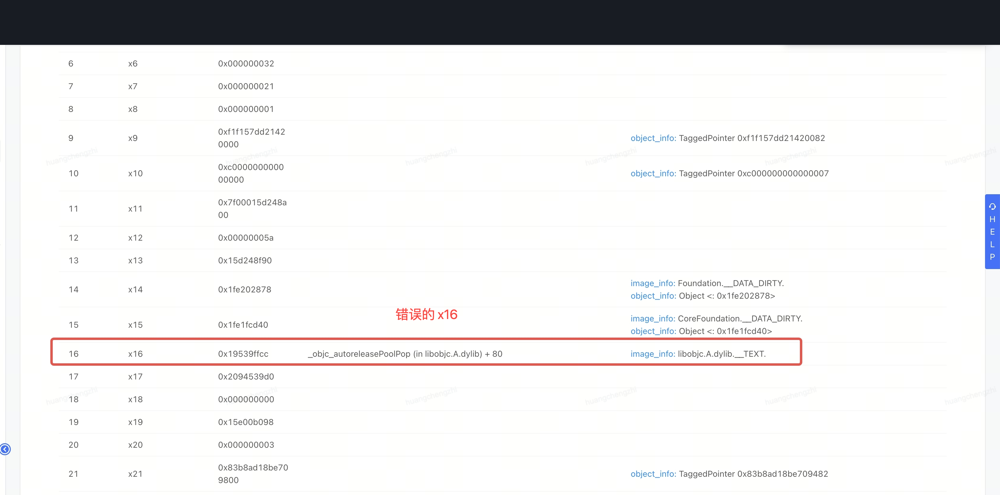

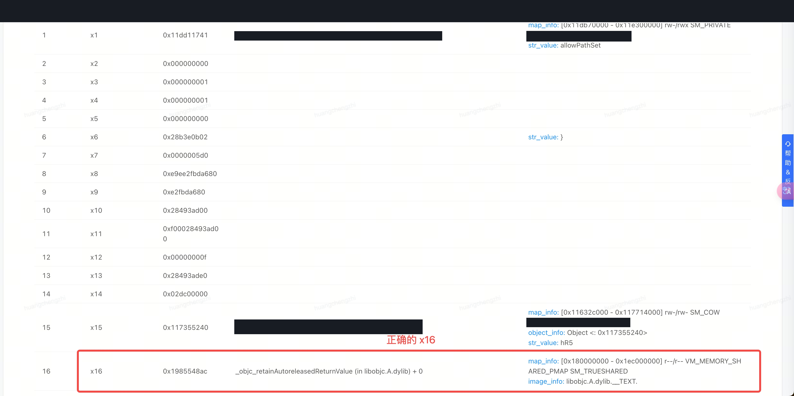

## 正确使用 vm\_read\_overwrite

上一节展示了一些错误使用 vm\_read 的方法，一般情况下我们会更多使用 vm\_read\_overwrite 方法。

我们从线上遇到的崩溃来展示一个合理使用 vm\_read\_overwrite 的场景。


具体来说，就是需要在某一个非主线程中，遍历所有其他线程，并记录其他线程的一些信息，例如线程的 qos / relative\_priority 等（如果有）。在遍历其他线程时，出现了崩溃。


### Metric 崩溃信息

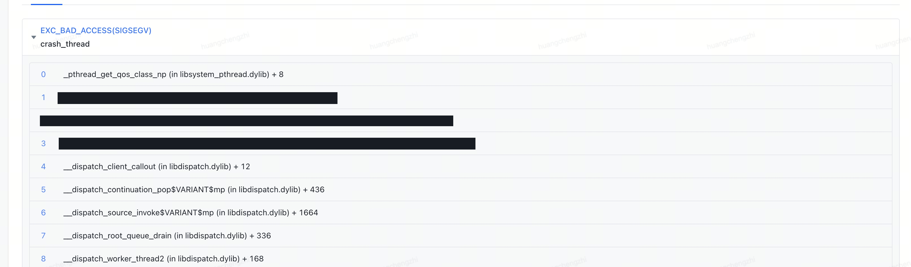

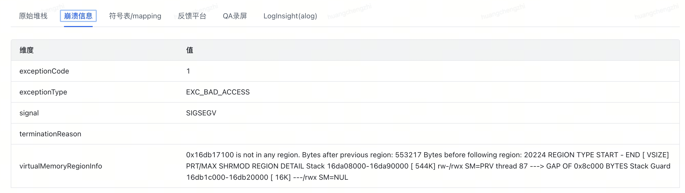

[VM Region 信息 查看方法](https://developer.apple.com/documentation/xcode/investigating-memory-access-crashes) ， 这里就能把前面介绍的 VM 的知识用起来了。Metric 提供崩溃地址相邻的 VM Region 信息，CrashMonitor 自建的 issue 则提供全部 VM Region 的信息。

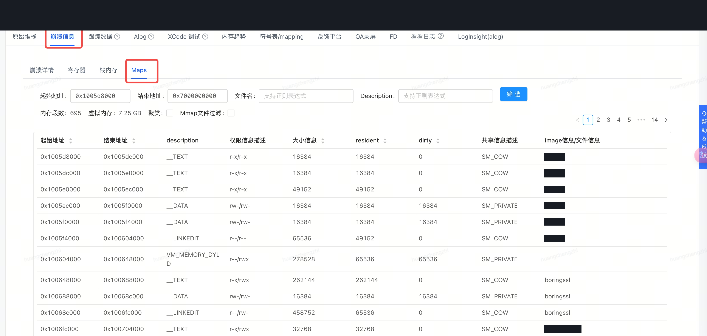


issue 1 ： 

<table class="vm-region-table">
<thead>
<tr><th colspan="6">0x16db17100 is not in any region. Bytes after previous region553217 Bytes before following region: 20224</th></tr>
<tr><th scope="col">REGION TYPE</th><th scope="col">START - END</th><th scope="col">[ VSIZE]</th><th scope="col">PRT/MAX</th><th scope="col">SHRMOD</th><th scope="col">REGION DETAIL</th></tr>
</thead>
<tbody>
<tr><td>Stack</td><td>16da08000-16da90000</td><td>[ 544K]</td><td>rw-/rwx</td><td>SM=PRV</td><td>thread 87</td></tr>
<tr><td colspan="6">---&gt; GAP OF 0x8c000 BYTES</td></tr>
<tr><td>Stack Guard</td><td>16db1c000-16db20000</td><td>[ 16K]</td><td>---/rwx</td><td>SM=NUL</td><td></td></tr>
</tbody>
</table>

而我们要访问的地址，0x16db17100 就在 GAP 这段空间内，而这段空间已经被释放了。Thread 87 也没有任何有效信息。

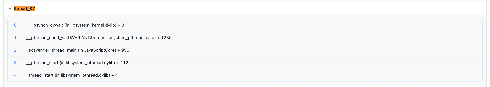

issue 2：

<table class="vm-region-table">
<thead>
<tr><th colspan="6">0x170233100 is not in any region. Bytes after previous region: 553217 Bytes before following region: 478976</th></tr>
<tr><th scope="col">REGION TYPE</th><th scope="col">START - END</th><th scope="col">[ VSIZE]</th><th scope="col">PRT/MAX</th><th scope="col">SHRMOD</th><th scope="col">REGION DETAIL</th></tr>
</thead>
<tbody>
<tr><td>Stack</td><td>1700a4000-1701ac000</td><td>[ 1056K]</td><td>rw-/rwx</td><td>SM=PRV</td><td>thread 48</td></tr>
<tr><td colspan="6">---&gt; GAP OF 0xfc000 BYTES</td></tr>
<tr><td>MALLOC_LARGE</td><td>1702a8000-1702ac000</td><td>[ 16K]</td><td>rw-/rwx</td><td>SM=PRV</td><td></td></tr>
</tbody>
</table>

而我们要访问的地址，0x170233100 就在 GAP 这段空间内，而这段空间已经被释放了。Thread 48 也没有任何有效信息。

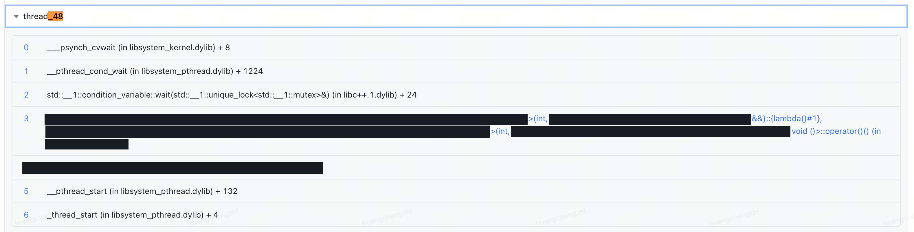


### Crash 调用栈

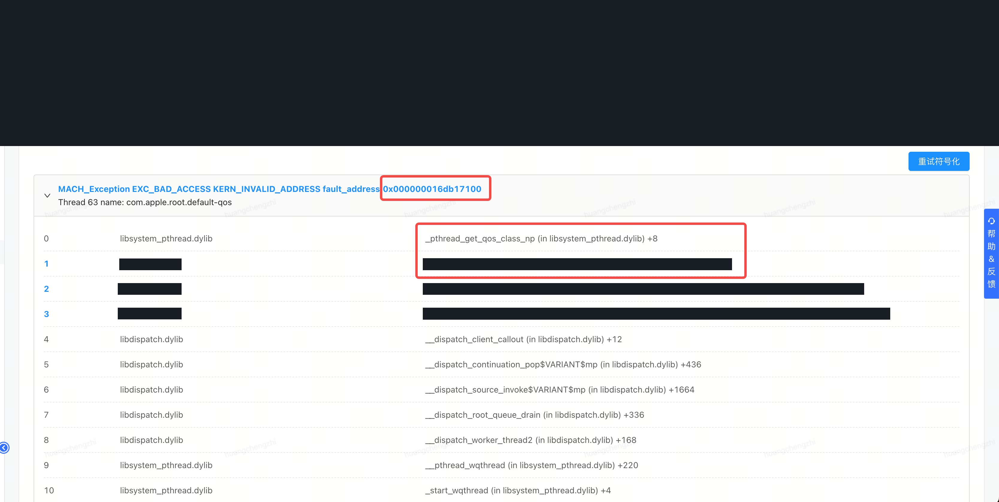


```cpp
_pthread_get_qos_class_np (in libsystem_pthread.dylib) + 8
```

[libsystem\_pthread\.dylib](./attachments/attachment-01.dylib)

可以看到崩溃地址集中在 0x???000 \+ 0x100 的位置，而 \_pthread\_get\_qos\_class\_np 方法查看 dis ，也可以看到正好有基于 thread 访问 \+ 0x100  的偏移量。

Thread 的 vm 地址是对齐的，512KB ，因此体现在这个地址，大概率是 Thread 本身出了问题。

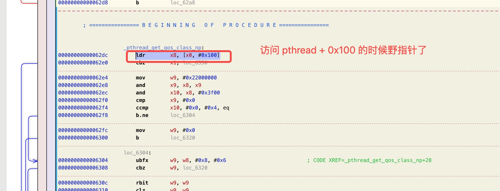

```cpp
int _pthread_get_qos_class_np(int __pthread, void * __qos_class, void * __relative_priority) {
    r2 = __relative_priority;
    r1 = __qos_class;
    r8 = *(__pthread + 0x100);
    if (r1 == 0x0) goto loc_6330;

loc_62e4:
    r9 = r8 & 0x22000000;
    if (r9 == 0x0) {
            asm { ccmp       x10, #0x0, #0x4, eq };
    }
    if (CPU_FLAGS & NE) goto loc_6304;

loc_62fc:
    r9 = 0x0;
    goto loc_6320;

loc_6320:
    r9 = *(int32_t *)(0xbe3c + r9 * 0x4);
    goto loc_632c;

loc_632c:
    *(int32_t *)r1 = r9;
    goto loc_6330;

loc_6330:
    if (r2 != 0x0) {
            if ((r8 & 0x3f00) != 0x0) {
                    asm { ccmp       x9, #0x0, #0x0, ne };
            }
            r8 = sign_extend_64(r8);
            if (CPU_FLAGS & NE) {
                    asm { csinc      w8, wzr, w8, ne };
            }
            *(int32_t *)r2 = r8;
    }
    return 0x0;

loc_6304:
    asm { ubfx       w9, w8, #0x8, #0x6 };
    if (r9 == 0x0) goto loc_6320;

loc_630c:
    asm { rbit       w9, w9 };
    asm { clz        w9, w9 };
    if (r9 > 0x5) goto loc_6358;

loc_631c:
    r9 = r9 + 0x1;
    goto loc_6320;

loc_6358:
    r9 = 0x0;
    goto loc_632c;
}
```

### 如何解决？

因此问题应该很明确了，在我们在进行子线程遍历时，出现了 Thread 被释放，同时 VM Region 也已经被释放。因此访问对应 Thread 信息时，出现问题。

我们从 task\_threads 中获取到 mach\_thread ，再将 mach\_thread 转为 pthread ，再判断 pthread 状态后，通过 `pthread_get_qos_class_np` 调用获取 qos 信息。而在这期间，Thread 的状态可能已经不再置信，例如对应线程已经被释放。

```cpp
// 

    // get threads in the task
    thread_array_t threadList;
    mach_msg_type_number_t threadCount;
    kr = task_threads(mach_task_self(), &threadList, &threadCount);
    if (kr != KERN_SUCCESS) {
        return nil;
    }

    for (int j = 0; j < threadCount; j++) {
        thread_info_data_t thinfo;
        mach_msg_type_number_t threadInfoCount = THREAD_INFO_MAX;
        kr = thread_info(threadList[j], THREAD_EXTENDED_INFO, (thread_info_t)thinfo, &threadInfoCount); // 子线程访问 thread_info 是安全的
        if (kr != KERN_SUCCESS) {
            continue;
        }

        thread_extended_info_t extendInfo = (thread_extended_info_t)thinfo;
        pthread_t pthread = pthread_from_mach_thread_np(threadList[j]);

        // 需要准确得知道 pthread 是否释放了
        
        if (pthread && !(extendInfo->pth_flags & TH_FLAGS_IDLE)) {
            qos_class_t qos_class;
            int relative_priority;
            pthread_get_qos_class_np(pthread, &qos_class, &relative_priority);
        }
    }       
}
```

```cpp
// https://github.com/apple-oss-distributions/libpthread/blob/main/src/qos.c#L172

/*!
 * @function pthread_get_qos_class_np
 *
 * @abstract
 * Gets the requested QOS class and relative priority of a thread.
 *
 * @param __pthread
 * The target thread to inspect.
 *
 * @param __qos_class
 * On output, a QOS class value:
 *  - QOS_CLASS_USER_INTERACTIVE
 *  - QOS_CLASS_USER_INITIATED
 *  - QOS_CLASS_DEFAULT
 *  - QOS_CLASS_UTILITY
 *  - QOS_CLASS_BACKGROUND
 *  - QOS_CLASS_UNSPECIFIED
 * This value may be NULL in which case no value is returned.
 *
 * @param __relative_priority
 * On output, a relative priority offset within the QOS class.
 * This value may be NULL in which case no value is returned.
 *
 * @return
 * Zero if successful, otherwise an errno value.
 */
__API_AVAILABLE(macos(10.10), ios(8.0))
int
pthread_get_qos_class_np(pthread_t __pthread,
        qos_class_t * _Nullable __restrict __qos_class,
        int * _Nullable __restrict __relative_priority);


#define __TSD_THREAD_QOS_CLASS 4

#define _PTHREAD_TSD_SLOT_PTHREAD_QOS_CLASS         __TSD_THREAD_QOS_CLASS


#define _pthread_tsd_slot(th, name) \
        (*(_PTHREAD_TSD_SLOT_##name##_TYPE *)(uintptr_t *)&(th)->tsd[_PTHREAD_TSD_SLOT_##name])

int
pthread_get_qos_class_np(pthread_t thread, qos_class_t *qc, int *relpri)
{
    pthread_priority_t pp = _pthread_tsd_slot(thread, PTHREAD_QOS_CLASS); // 其实我们知道这里的偏移量就是 + 0x100
    _pthread_priority_split(pp, qc, relpri); // 只是一个值的转换
    return 0;
}
```

可以看到实际 pthread\_get\_qos\_class\_np 中访问的是当前 pthread\_t 结构体中的属性 tsd 中的值，不涉及跨 vm 区域的访问。


同时搜索网上别的类似的需求，例如：WebKit 中的使用，只获取当前 Thread 的 Qos ，没有找到跨线程的使用。其余 github 开源代码也大多是传递 `pthread_self()` ，也就是只获取当前线程的 qos 信息。

```cpp
// https://github.com/WebKit/WebKit/blob/cb43f9857cdea23e5451b48098883d5c4e484ade/Source/WTF/wtf/Threading.cpp#L459

auto Thread::currentThreadQOS() -> QOS
{
#if HAVE(QOS_CLASSES)
    qos_class_t qos = QOS_CLASS_DEFAULT;
    int relativePriority;
    pthread_get_qos_class_np(pthread_self(), &qos, &relativePriority);
    return toQOS(qos);
#else
    return QOS::Default;
#endif
}
```

因此只能自己想办法进行处理啦。


由于整块 VM Area 都已经被释放，访问任意偏移量的地址都会导致 BAD\_ACCESS ，因此企图通过 Thread  的状态来进行判断也已不再可信。因此只能通过 VM 是否可读写来判断。


在明确了使用 vm\_read\_overwrite 后，下一个需要考虑的点是： Copy 整块 pthread\_s 区域，还是仅通过 判断 指针是否可读，来进行下一步的访问？


如果选择判断指针是否可读，因为即使 read\_memory 时还是安全的，但是在调用 get\_qos 时还是可能会挂掉，因此这个修复方法只是减少发生的概率，并没有彻底解决问题。

同时如果对应地址的 vm\_region 已经被再次 vm\_allocate 了，会存在读取到 dirty 数据的问题（虽然概率很小）。示例代码如下：

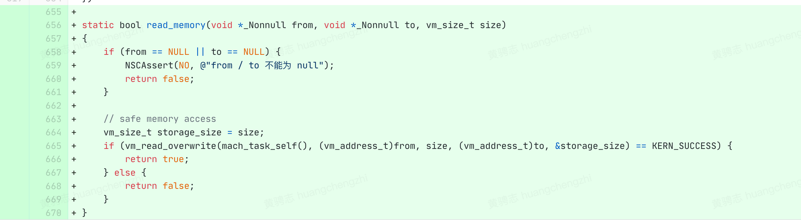


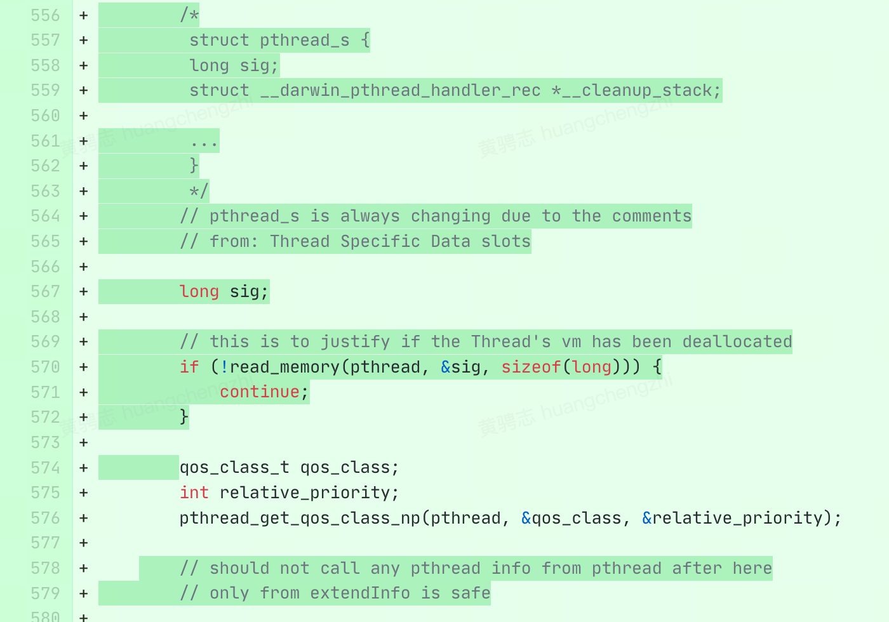


最后我们选择了 copy 整个 pthread\_s 到当前线程的 Stack 中。然后直接在传入 copy 过后的地址，访问对应的偏移量获取到我们需要的信息。

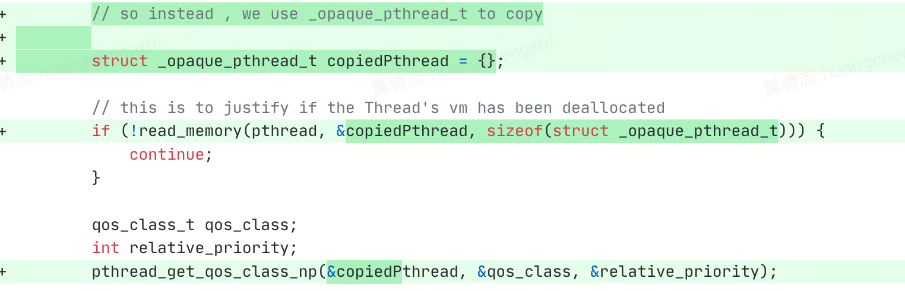


### 其他应用

其实 CrashMonitor 中也存在大量对于 vm\_read\_overwrite 的使用，用来进行安全读取，用来预防访问了异常的地址。

```objective-c
/**
* - Make a new machine context structure (_STRUCT_MCONTEXT)
* - Fill in its stack state using thread_get_state()
* - Get the program counter (first stack trace entry) and frame pointer (all the rest)
* - Step through the stack frame pointed to by the frame pointer and store all instruction addresses in a buffer for
* later use.
* - Note that you should pause the thread before doing this or else you can get unpredictable results.

* The stack frame is filled with structures containing two pointers:

* Pointer to the next level up on the stack
* instruction address

* So you need to take that into account when walking the frame to fill out your stack trace. There's also the possibility
* of a corrupted stack, leading to a bad pointer, which will crash your program. You can get around this by copying
* memory using vm_read_overwrite(), which first asks the kernel if it has access to the memory, so it doesn't crash.
* https://stackoverflow.com/questions/4765158/printing-a-stack-trace-from-another-thread
 */
```


## vm\_read\_overwrite 是否有什么局限？

如果使用 vm\_read\_overwrite 去修改一段别的线程也能访问的内存，那么这个修改无法保证原子性，也就是别的线程可能会读取到中间状态。


具体来说：SymbolRebinder 需要去修改 \_\_la\_symbol\_ptr 中对应原本函数的指向，将其更换为被替换的函数。我们会替换 8 个字节的区域。

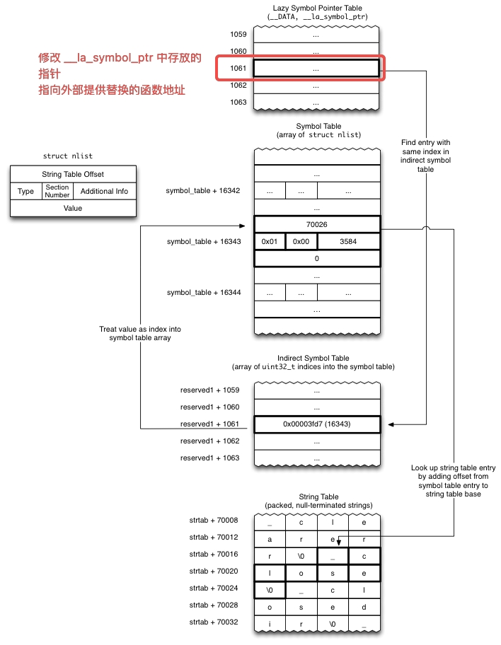

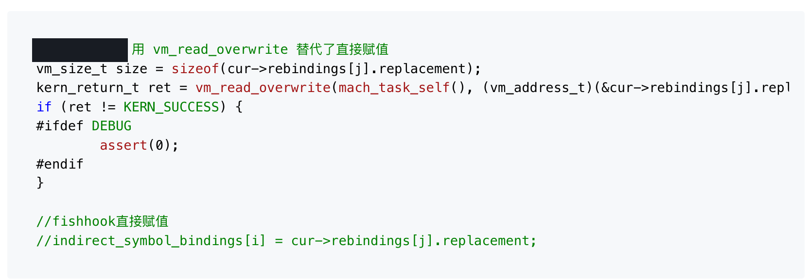

之所以 SymbolRebinder 会使用 vm\_read\_overwrite 去进行替换，是因为这个函数更安全，如果遇到了区域权限错误，则只会 hook 失败而不会出现崩溃。


但这会遇到一个问题，你在进行替换的操作时，有可能会有别的线程正在读取这块地址的值，进行函数的跳转。而 一位同事发现，在通过 SymbolRebinder 替换 dispatch\_queue\_create 的实验组会出现一些零散的 Crash 。

> 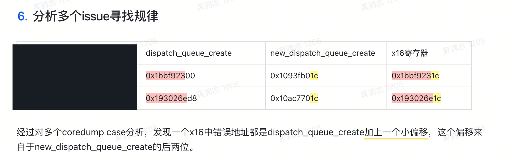


因此我们大胆猜测是 vm\_read\_overwrite 导致了这个问题，因此要找到一个能够一次性写入 8 byte 内存的方案，让别的线程无法看到中间状态。这也合理，因为 vm\_read\_overwrite 是可以一次性 write 一大块区域的，指望这个操作对别的线程是原子性显然不现实。


需要注意的是，这里举的例子虽有有一定偏移量，但还算指向原本期望的函数，但如果部分函数体较短，可能就直接指向到别的函数了，需要结合堆栈进行判断。


同时这个问题会随着你替换的方法的频繁程度会有增加，像 dispatch\_async / autoreleasepoolPop 等高频方法就会大量放大这个问题。

### OC 的 Method Swizzle 是如何进行的？

首先我们调研时就想到了 Method Swizzle 。同样都是替换的方法可能正好被别的线程访问，OC 是如何处理的呢？


答案是遍历所有线程的 pc 指针，看是否有别的线程处于执行 objc\_msgsend 的过程中，有的话就进行特殊处理：避免立刻进行之前的 cache 释放。

```c annotated
/***********************************************************************
 * Method cache locking (GrP 2001-1-14)
 *
 * For speed, objc_msgSend does not acquire any locks when it reads 
 * method caches. Instead, all cache changes are performed so that any 
 * objc_msgSend running concurrently with the cache mutator will not 
 * crash or hang or get an incorrect result from the cache. 
 *
 * When cache memory becomes unused (e.g. the old cache after cache 
 * expansion), it is not immediately freed, because a concurrent 
 * objc_msgSend could still be using it. **Instead, the memory is** 
 * **disconnected from the data structures and placed on a garbage list.** 
 * The memory is now only accessible to instances of objc_msgSend that 
 * were running when the memory was disconnected; any further calls to 
 * objc_msgSend will not see the garbage memory because the other data 
 * structures don't point to it anymore. **The collecting_in_critical**
 * **function checks the PC of all threads and returns FALSE when all threads** 
 * **are found to be outside objc_msgSend.** **This means any call to objc_msgSend** 
 * **that could have had access to the garbage has finished or moved past the** 
 * **cache lookup stage, so it is safe to free the memory.**
 *
 * All functions that modify cache data or structures must acquire the 
 * cacheUpdateLock to prevent interference from concurrent modifications.
 * The function that frees cache garbage must acquire the cacheUpdateLock 
 * and use collecting_in_critical() to flush out cache readers.
 * The cacheUpdateLock is also used to protect the custom allocator used 
 * for large method cache blocks.
 *
 * Cache readers (PC-checked by collecting_in_critical())
 * objc_msgSend*
 * cache_getImp
 *
 * Cache readers/writers (hold cacheUpdateLock during access; not PC-checked)
 * cache_t::copyCacheNolock    (caller must hold the lock)
 * cache_t::eraseNolock        (caller must hold the lock)
 * cache_t::collectNolock      (caller must hold the lock)
 * cache_t::insert             (acquires lock)
 * cache_t::destroy            (acquires lock)
 *
 * UNPROTECTED cache readers (NOT thread-safe; used for debug info only)
 * cache_print
 * _class_printMethodCaches
 * _class_printDuplicateCacheEntries
 * _class_printMethodCacheStatistics
 *
 ***********************************************************************/

```

```c
static int _collecting_in_critical(void)
{

#if HAVE_TASK_RESTARTABLE_RANGES
    // Only use restartable ranges if we registered them earlier.
    if (shouldUseRestartableRanges) {
        kern_return_t kr = task_restartable_ranges_synchronize(mach_task_self());
        if (kr == KERN_SUCCESS) return FALSE;
        _objc_fatal("task_restartable_ranges_synchronize failed (result 0x%x: %s)",
                    kr, mach_error_string(kr));
    }
#endif // !HAVE_TASK_RESTARTABLE_RANGES

    // Fallthrough if we didn't use restartable ranges.

    thread_act_port_array_t threads;
    unsigned number;
    unsigned count;
    kern_return_t ret;
    int result;

    mach_port_t mythread = pthread_mach_thread_np(objc_thread_self());

    // Get a list of all the threads in the current task
#if !DEBUG_TASK_THREADS
    ret = task_threads(mach_task_self(), &threads, &number);
#else
    ret = objc_task_threads(mach_task_self(), &threads, &number);
#endif

    if (ret != KERN_SUCCESS) {
        // See DEBUG_TASK_THREADS below to help debug this.
        _objc_fatal("task_threads failed (result 0x%x)\n", ret);
    }

    // Check whether any thread is in the cache lookup code
    result = FALSE;
    for (count = 0; count < number; count++)
    {
        int region;
        uintptr_t pc;

        // Don't bother checking ourselves
        if (threads[count] == mythread)
            continue;

        // Find out where thread is executing
#if TARGET_OS_OSX
        if (oah_is_current_process_translated()) {
            kern_return_t ret = objc_thread_get_rip(threads[count], (uint64_t*)&pc);
            if (ret != KERN_SUCCESS) {
                pc = PC_SENTINEL;
            }
        } else {
            pc = _get_pc_for_thread (threads[count]);
        }
#else
        pc = _get_pc_for_thread (threads[count]);
#endif

        // Check for bad status, and if so, assume the worse (can't collect)
        if (pc == PC_SENTINEL)
        {
            result = TRUE;
            goto done;
        }
        
        // Check whether it is in the cache lookup code
        for (region = 0; objc_restartableRanges[region].location != 0; region++)
        {
            uint64_t loc = objc_restartableRanges[region].location;
            if ((pc > loc) &&
                (pc - loc < (uint64_t)objc_restartableRanges[region].length))
            {
                result = TRUE;
                goto done;
            }
        }
    }

 done:
    // Deallocate the port rights for the threads
    for (count = 0; count < number; count++) {
        mach_port_deallocate(mach_task_self (), threads[count]);
    }

    // Deallocate the thread list
    vm_deallocate (mach_task_self (), (vm_address_t) threads, sizeof(threads[0]) * number);

    // Return our finding
    return result;

}
```

#### objc\_restartableRanges 的生成

直接用汇编宏写入了范围\.\.\.

```asm
// _objc_restartableRanges is used by method dispatch
// caching code to figure out whether any threads are actively 
// in the cache for dispatching.  The labels surround the asm code
// that do cache lookups.  The tables are zero-terminated.

.macro RestartableEntry
#if __LP64__
        .quad        LLookupStart$0
#else
        .long        LLookupStart$0
        .long        0
#endif
        .short        LLookupEnd$0 - LLookupStart$0
        .short        LLookupRecover$0 - LLookupStart$0
        .long        0
.endmacro

        .align 4
        .private_extern _objc_restartableRanges
_objc_restartableRanges:
        RestartableEntry _cache_getImp
        RestartableEntry _objc_msgSend
        RestartableEntry _objc_msgSendSuper2
        RestartableEntry _objc_msgLookup
        RestartableEntry _objc_msgLookupSuper2
        .fill        16, 1, 0

```

#### 解决问题了\.\.\.吗？

但方案也只是缓解，没法彻底解决。曾经在一个 App 中抓到过 ASan 的 Case。

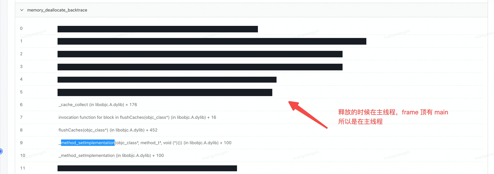

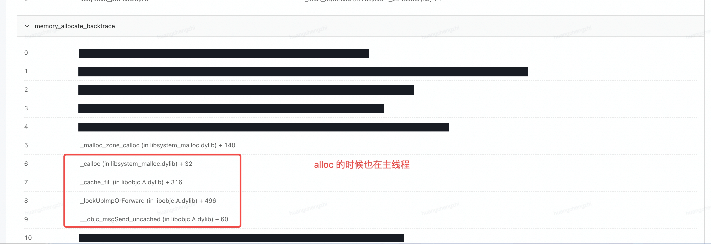

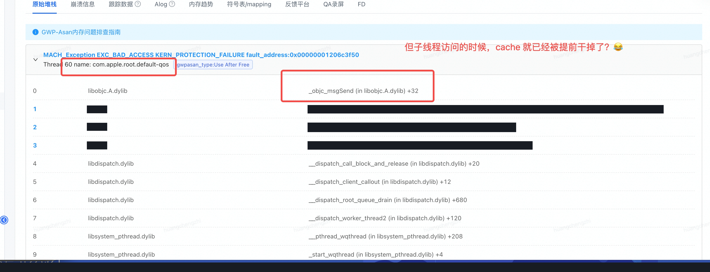

> 一位同事大概率是方法由于多线程执行，提前获取了 cache，但是没有在使用，另一边由于 方法交换 触发了 flushCache（只有 attachCategories、\_method\_setImplementation、method\_exchangeImplementations、addMethods\_finish、setSuperclass 会改变方法列表的情况会触发），而这部分会在没有正在进行的 objc\_MsgSend清空 garbage 里面的 cache，这里情况是虽然有引用 cache 但没在使用，所以就被释放了\.

> 判断是不是要回收看的是 collecting\_in\_critical （The collecting\_in\_critical function checks the PC of all threads and returns FALSE when all threads  are found to be outside objc\_msgSend\.）

> 正常情况下是先不会回收 cache 的，等到了 garbage\_byte\_size 到阈值的时候才会回收，这里也是刚好撞上了


同时与 一位同事交流得知，有专门为这个问题做一个定制 的修复，在遇到崩溃后，CrashMonitor 可以手动移动 PC 。

```c
// 

/*!@function @p RestartableRangesRegister
   @abstract 注册 mach restartable 处理范围，当发生崩溃时
   @code
       PC 位置处于 [location, location + length - 1] 范围时，
       会把 PC 移动到 location + recovery_offs 位置
   @endcode
   @return 返回值为 true 意味着注册功能，返回值为 false 表示失败
 */
EXAMPLE_EXTERN bool RestartableRangeRegister(RestartableRangeRef _Nonnull range);
```

因此我们也就大概率知道，系统的这个处理也不靠谱，算是一个减小发生概率的方案，毕竟总是 runtime 里的代码，有参考实现的价值。


### 尝试用同样方法处理 patch table 的替换（不能彻底解决问题）

以 autoreleasepoop 的跳板（PAC）为例，这是通过 TEXT\.stub 进行的。

```c annotated
CoreFoundation`:
    0x18be52f30 <+0>:  pacibsp 
    0x18be52f34 <+4>:  stp    x20, x19, [sp, #-0x20]!
    0x18be52f38 <+8>:  stp    x29, x30, [sp, #0x10]
    0x18be52f3c <+12>: add    x29, sp, #0x10
    0x18be52f40 <+16>: mov    x19, x0
    0x18be52f44 <+20>: nop    
    0x18be52f48 <+24>: mov    x0, x19
    0x18be52f4c <+28>: bl     0x18bfddb28               ; symbol stub for: objc_autoreleasePoolPop
->  0x18be52f50 <+32>: mov    x0, x19
    0x18be52f54 <+36>: nop    
    0x18be52f58 <+40>: ldp    x29, x30, [sp, #0x10]
    0x18be52f5c <+44>: ldp    x20, x19, [sp], #0x20
    0x18be52f60 <+48>: retab  


(lldb) dis -a 0x18bfddb28
CoreFoundation`objc_autoreleasePoolPop:
    0x18bfddb28 <+0>:  adrp   x17, 443790
    0x18bfddb2c <+4>:  add    x17, x17, #0x478
    0x18bfddb30 <+8>:  ldr    x16, [x17]
    **0x18bfddb34 <+12>: braa   x16, x17** // 通过 x17 校验 x16，并跳转 x16，实际只需要知道 x16 就可以了
```

而我们之前已经拿到了对应的 \_location 的地址，因此只需要遍历所有线程的 x16 寄存器，即可判断是否有正在调用的了。


实例代码如下，在执行替换前，判断其他所有线程是否有 x16 寄存器的值是我们要替换的。。

```c
// first check 
BOOL ifAnyThreadIsCalling = NO;
do {
    ifAnyThreadIsCalling = fishhook_collecting_in_critical(_location);
} while(ifAnyThreadIsCalling == YES);

// and then do the overwrite
if(vm_read_overwrite(mach_task_self(), (vm_address_t)&newValue, sizeof(uintptr_t), (vm_address_t)_location, &storage_size) == KERN_SUCCESS)
    return YES;
else return NO;


// TODO: turn to weak symbol
uintptr_t register_value(const thread_state_record_t* const context, const int regNumber);

int fishhook_collecting_in_critical(void *location) {
    // Fallthrough if we didn't use restartable ranges.

    thread_act_port_array_t threads;
    unsigned number;
    unsigned count;
    kern_return_t ret;
    int result = FALSE;

    mach_port_t mythread = pthread_mach_thread_np(pthread_self());

    // Get a list of all the threads in the current task
    ret = task_threads(mach_task_self(), &threads, &number);

    if (ret != KERN_SUCCESS) {
        // See DEBUG_TASK_THREADS below to help debug this.
        DEBUG_ASSERT(NO);
    }

    result = FALSE;
    for (count = 0; count < number; count++)
    {
        uintptr_t x16;

        // Don't bother checking ourselves
        if (threads[count] == mythread)
            continue;
        
        //获取线程的state
        _STRUCT_MCONTEXT machineContext;
        mach_msg_type_number_t state_count = ARM_THREAD_STATE64_COUNT;
        kern_return_t kr = thread_get_state(threads[count], ARM_THREAD_STATE64, (thread_state_t)&machineContext.__ss, &state_count);
        
        if (kr != KERN_SUCCESS) {
            continue;
        }

        // Find out if thread is about to br x16 to location
        x16 = register_value(&machineContext, 16);
        
        // Check whether x16 is using the address will be overwrite
        if (x16 == location)
        {
            result = TRUE;
            goto done;
        }
    }

 done:
    // Deallocate the port rights for the threads
    for (count = 0; count < number; count++) {
        mach_port_deallocate(mach_task_self (), threads[count]);
    }

    // Deallocate the thread list
    vm_deallocate (mach_task_self (), (vm_address_t) threads, sizeof(threads[0]) * number);

    // Return our finding
    return result;
}
```

但这依旧是有问题的，原因是只能解决一部分 x16 已经写入的情况，但对于其他线程如果刚执行完 **`add    x17, x17, #0x478`** 的线程来说，由于 x16 还没有被赋值，因此无法解决这个问题。

```c annotated
(lldb) dis -a 0x18bfddb28
CoreFoundation`objc_autoreleasePoolPop:
    0x18bfddb28 <+0>:  adrp   x17, 443790
    0x18bfddb2c <+4>:  add    x17, x17, #0x478
->**  0x18bfddb30 <+8>:  ldr    x16, [x17]**
**    0x18bfddb34 <+12>: braa   x16, x17** // 通过 x17 校验 x16，并跳转 x16，实际只需要知道 x16 就可以了
```

如果要解决这个问题，就得 StopTheWorld ，但由于会卡住主线程，会导致卡顿，不能作为常规方案，因此放弃。


### 直接原子写内存

由于其实我们只需要修改 8 byte （寻址空间）的空间，因此可以考虑通过直接使用汇编指令进行修改。

并且我们需要做的只是修改，并且**不在乎别的线程看到的修改先后顺序**，只希望**修改内存的指令本身是原子性的**，这样就可以避免使用 vm\_read\_overwrite 出现的修改 8 byte 的过程中，别的线程看到修改到了一半的中间状态。


因此回顾下我们的需求：

1. 这一步需要解决的是原子写入，并且我们进程里只有一处写入；其他线程读取与开关发布的同步需要另行保证

2. 只需要修改 8 byte 的内存


#### 这次 8 字节写入在什么条件下是原子的？

注意，这里讨论的是 **这次内存写入是否会被其他线程看到中间状态**，而不是多个操作之间已经实现了线程安全或原子同步。

例如 i\+\+; ，这样的一句代码在 RISC 架构下是无法翻译成一句汇编指令的，因此我们也不讨论这个情况。冷知识：ARM 中的 R 就是 [RISC\(Reduced Instruction Set Architecture\)](https://www.geeksforgeeks.org/computer-organization-risc-and-cisc/) 的缩写。

> 一些 RISC 的介绍：

> https://www.geeksforgeeks.org/advanced-risc-machine-arm-processor/

> https://www.spiceworks.com/tech/tech-general/articles/risc-vs-cisc/

> https://cs.stanford.edu/people/eroberts/courses/soco/projects/risc/risccisc/


对于 OC 的对象来说，由于赋值本身还包括 retain/release 操作，因此一定无法翻译成一句汇编，因此如果多线程 set 是会引用计数不打平而 BAD\_ACCESS 的 ；对于基础类型，没有同步的并发读写同样需要遵守语言内存模型，不能认为只是数据错乱而不会出其他问题。


这里需要确认的是这次 8 byte 写入会不会被其他线程看到中间状态，不能只靠“单条指令不会被中断”来判断。对于本例使用的 Arm64、Normal memory、按 8 byte 自然对齐的单通用寄存器读写，架构提供 single-copy atomicity；如果没有满足对齐等前提，就不能照搬这个结论。这也不等于多个操作之间已经建立了同步顺序，C/C++ 代码的并发访问仍需要按语言内存模型处理。

参考 [Arm 官方说明的 Atomics 段落](https://developer.arm.com/community/arm-community-blogs/b/tools-software-ides-blog/posts/armv8-sequential-consistency) 与 [Arm Architecture Reference Manual](https://support.arm.com/documentation/ddi0487/latest)。

下面的示例有两次独立的写入，不能把两条 `str` 合在一起当成一个原子操作。这里使用 `w` 寄存器展示的是 4 byte 写入；本例修改 8 byte 指针时还需要确认对应的访问宽度与 8 byte 对齐。

```asm
test():
        adrp    x8, value
        mov     w9, #1
        mov     w10, #3
        str     w9, [x8, :lo12:value]
        str     w10, [x8, :lo12:value]
        ret
        
value:
        .word   1
```


在满足上述前提后，再来看 SymbolRebinder 在替换 function 时，替换函数所依赖的保证：

1. 原本函数在实际执行 overwrite 之前就已完成赋值，且原本函数只有 fishhook 会对其进行赋值，是安全的

2. 如果实验开关不开启，则只会调用原本函数

3. 实验开关只会在 Fishhook 完成后，再进行打开；这个顺序仍需要由正确的同步机制保证，不能仅凭一条 `str` 排除多线程可见性问题。

```cpp
void example_autoreleasePoolPop(void *token)
{
    if (!example_orig_objc_autoreleasePoolPop) {
        VOID_RETURN_GCC_FORCE_NO_OPTIMIZATION
    }
    
    if (/*某个实验开关不开启*/) {
        example_orig_objc_autoreleasePoolPop();
        VOID_RETURN_GCC_FORCE_NO_OPTIMIZATION
    }
    
    // 满足开关开启，下面再执行对应函数
}
```


PS1 ：由 一位同事提供的另一个角度的验证，通过 gcc 的 built\_in 函数 [`__atomic_store_n`](https://gcc.gnu.org/onlinedocs/gcc/_005f_005fatomic-Builtins.html) 进行赋值，  生成的汇编完全一致。

|[https://godbolt.org/z/aa5n3o1vj](https://godbolt.org/z/aa5n3o1vj)<br>|[https://godbolt.org/z/a1aPnYMKr](https://godbolt.org/z/a1aPnYMKr)|
|---|---|
|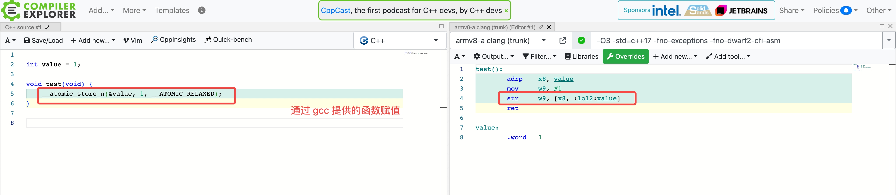<br>|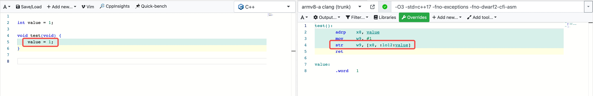<br><br>|

作为对比，如果内存模型变更为 严格一致（SEQ\_CST），则生成的代码就会不同：

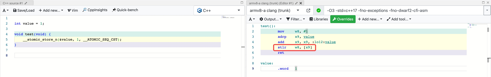

PS2：对齐是本例结论的前提，需要在目标地址与访问宽度层面核对。对于这里的 8 byte 写入，需要确认地址按 8 byte 自然对齐；不能仅看到一条 `str` 就认为条件已经满足。


查看生成的汇编，最后进行赋值的语句确实只有一句 str；在确认访问宽度、对齐和内存属性等前提后，才可以按上面的条件分析。

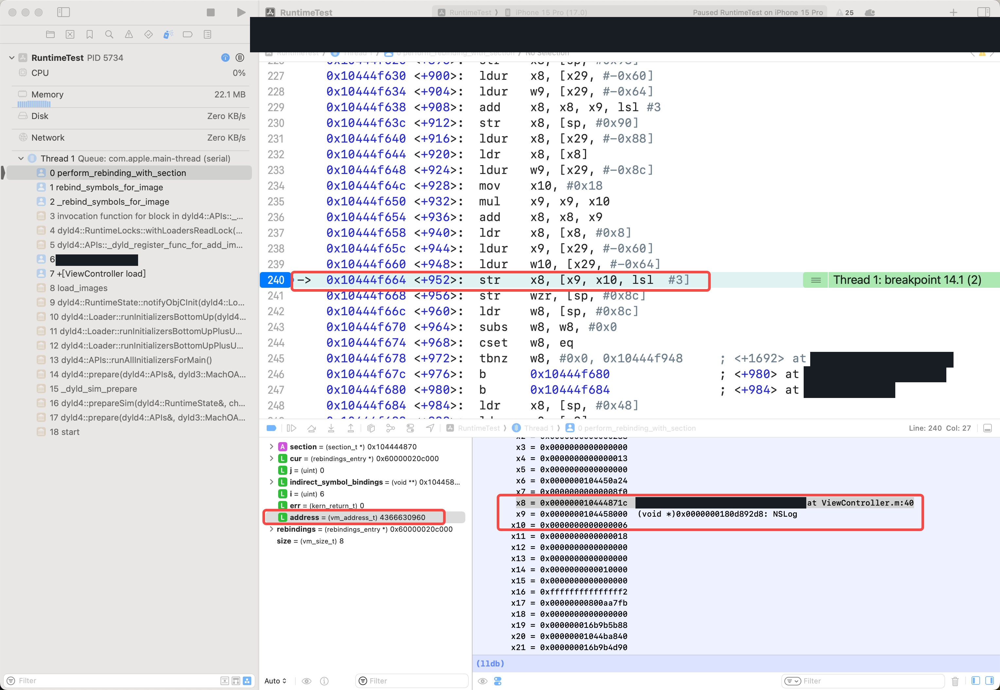

```cpp
if (err == KERN_SUCCESS) {
    vm_size_t size = sizeof(cur->rebindings[j].replacement);
    vm_address_t address = (vm_address_t)(indirect_symbol_bindings + i);
    indirect_symbol_bindings[i] = cur->rebindings[j].replacement;
}
```


结合原子写入，最后一位同事 想到了一个合适的方案：

> 作为替代，可以先用 vm\_read\_overwrite 写入一个这个位置储存的值，这样即使写入非原子性，也不会有问题；在 vm\_read\_overwrite 确认有权限读取后，再使用直接赋值原子性替换。


虽然还是可能出现上一句判断 vm\_read\_overwrite 之后，权限再次被回收的问题，但是概率相较原本已经少了太多，我们认为是完全可以接受的。~~不接受也没办法啊，runtime 也没解决呢。~~


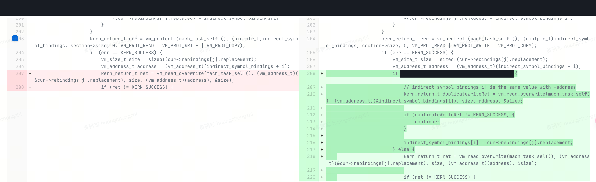


### 上线效果


已回合 SymbolRebinder 主干分支。


需要注意的是目前 示例 App A 在 \(, iOS 18\) 遇到了在对 FileProviderOverride 的 open 进行 fishhook 时的权限丢失，目前还在持续定位问题原因中。因此建议分 OS 进行实验。


## 总结

1. 介绍了操作 VM 的一系列方法，以及给出了合适使用的场景示例。这无疑是一系列非常强力的底层 API ，但一定要注意使用姿势，非必要还希望不要滥用。

2. 定位了由  vm\_read\_overwrite 的非原子性问题引起的线上大盘问题，由于原本 issue 会分散在各个 issue 中，因此一直没有得到足够的关注，本次在部分系统上进行了处理，其余系统仍将继续推进问题解决。对于使用 vm\_read\_overwrite/vm\_write 修改别的线程也有可能进行访问的 VM 区域则需要特别注意非原子性导致的问题。通过 VM 系列方法修改只有当前线程会访问的区域是安全的。

3. 对于本例的 Arm64，按 8 byte 自然对齐、访问 Normal memory 的单通用寄存器读写具有 single-copy atomicity。这个结论依赖具体访问条件，不能推广到所有单条指令，也不能替代语言层面的并发同步。预先检查权限与实际写入之间的竞态仍然存在。

4. 介绍了 OC Runtime 中对于 Method Swizzle 的处理方式，可以看到这并非彻底的修复。
